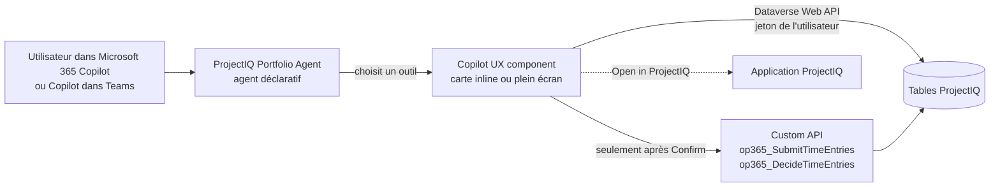
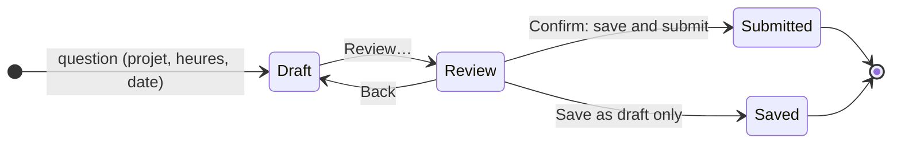
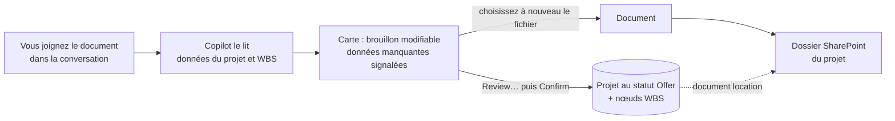
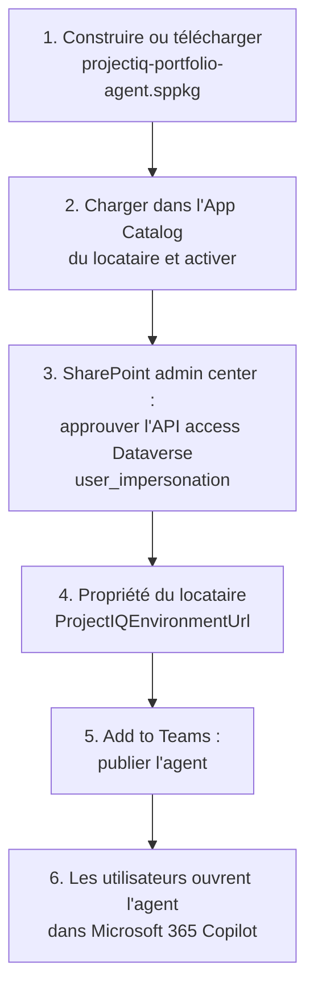

# Portfolio Agent : ProjectIQ dans Microsoft 365 Copilot

> **Langue :** [English](../en/portfolio-agent.md) · [Italiano](../it/portfolio-agent.md) · Français · [Deutsch](../de/portfolio-agent.md)
> **Index des manuels :** [README](../../README.md#user-manuals)

Le **ProjectIQ Portfolio Agent** apporte ProjectIQ dans Microsoft 365 Copilot et Copilot dans Teams. Les utilisateurs posent leurs questions avec leurs propres mots (« quels projets dépassent le budget ? », « saisis 8 heures aujourd'hui sur PRJ-000123 ») et l'agent répond par une carte interactive construite sur les données réelles de ProjectIQ : indicateurs, feux tricolores, graphiques, une chronologie, une carte de chaleur de la charge et des boutons pour aller plus loin ou ouvrir l'enregistrement dans l'application.

Il est réalisé avec les **Copilot UX components de SharePoint Framework (SPFx)** et s'inspire de l'exemple Microsoft *Zava Project Tracker*, mais chaque chiffre provient des tables ProjectIQ dans Dataverse, lues **avec l'identité de l'utilisateur**. Il complète l'intégration [Copilot et Cowork](copilot.md) : Copilot Chat répond en texte à partir du modèle sémantique, le Portfolio Agent répond par des cartes et peut aussi **saisir, soumettre et approuver des heures** après une confirmation explicite.

> Les noms des champs, des boutons et des messages sont en anglais, comme à l'écran. Les Copilot UX components sont disponibles (GA) depuis SPFx 1.24 (octobre 2026). Ils fonctionnent dans Microsoft 365 Copilot et Copilot dans Teams sur le web et le bureau, pas encore sur mobile.

## Fonctionnement

1. L'agent lit la question et choisit **un** composant (un « outil »), en transmettant les valeurs comprises (projet, personne, date, heures).
2. Le composant s'ouvre comme une carte dans la conversation (**inline**) ; **Expand** l'ouvre en **plein écran** avec plus de colonnes et de lignes.
3. La carte lit Dataverse avec les autorisations de l'utilisateur : rôles de sécurité, équipes d'accès de projet et sécurité au niveau des colonnes s'appliquent exactement comme dans l'application.
4. Chaque carte indique à Copilot ce qu'elle affiche, de sorte que les questions suivantes (« pourquoi est-il en retard ? », « et la phase suivante ? ») sont traitées sur les mêmes données.
5. Les boutons de la carte envoient une nouvelle question (par exemple de *My work* vers *Project health*) ou ouvrent l'enregistrement dans l'application ProjectIQ.

## Ce que vous pouvez demander

| Vue | Exemples de questions | Affiche | Écrit |
|---|---|---|---|
| My work | « Qu'est-ce qui demande mon attention sur mes projets cette semaine ? » | Liste classée : heures à approuver, heures rejetées et en brouillon, heures manquantes de la semaine dernière, projets à risque, demandes d'achat en attente de vous, commandes en retard, factures, surcharge | – |
| Log and submit hours | « Saisis 8 heures aujourd'hui sur PRJ-000123 », « Soumets ma feuille de temps » | Votre semaine, lignes en brouillon modifiables, révision | Saisies de temps (après **Confirm**) |
| Approve hours | « Quelles heures dois-je approuver ? » | Heures soumises des projets que vous gérez, par personne et par semaine, avec signalements | Approuver / rejeter (après **Confirm**) |
| Project health | « Où en est le projet PRJ-000123 ? » | Feu et raisons, budget, réel, engagé, reste, estimation à terminaison, marge, phases WBS signalées, achats ouverts | – |
| Project budget | « Montre le budget de la toiture de l'école » | Budget contre coût réel par branche WBS (graphique et tableau), main-d'œuvre, matériaux, engagé | – |
| Project timeline | « PRJ-000123 est-il en retard ? Montre le chemin critique » | Phases WBS sur une chronologie avec avancement, chemin critique, baseline et barres décalées par les dépendances | – |
| Project documents | « Affiche les documents du projet PRJ-000123 » | Fichiers et sous-dossiers du dossier SharePoint du projet, les plus récents d'abord, avec auteur, taille et liens | – |
| New project from a document | Joignez une offre ou un contrat et demandez « Crée un projet brouillon à partir de ce document » | Brouillon modifiable du projet et de son WBS, données manquantes signalées, document à enregistrer | Projet au statut **Offer**, nœuds WBS, document dans SharePoint (après **Confirm**) |
| Portfolio health | « Quels projets dépassent le budget ou sont en retard ? » | Tous les projets avec feu, totaux, marge à terminaison | – |
| Resource load | « Qui est surchargé dans les prochaines semaines ? », « Montre ma charge » | Carte de chaleur des heures allouées par rapport à la capacité, par semaine | – |
| Purchasing status | « Qu'est-ce qui attend aux achats ? », « Quelles commandes sont en retard ? » | Demandes à approuver ou à commander, demandes de prix échues, commandes en retard et ouvertes, factures à vérifier | – |
| Supplier compliance | « Quels fournisseurs ont une attestation expirée ? », « Pouvons-nous commander chez Rossi Srl ? » | Fournisseurs bloqués, documents expirés et bientôt expirés, si un fournisseur peut recevoir des commandes | – |
| What I can do | « Montre-moi ce que tu sais faire » | Les scénarios ci-dessus avec un exemple pour chacun | – |

Amorces de conversation de l'agent : *What needs my attention*, *Portfolio health*, *Hours to approve*, *Log my hours*, *Resource load*, *Explore the agent*.

## Santé du projet et du portefeuille

Le feu utilise les valeurs maintenues par les plugins sur le projet (voir [WBS, budget, Gantt et baselines](wbs-and-planning.md) et [Matériaux, coûts réels et synthèse des coûts](materials-and-costs.md)). Les projets **Offer** ou **Closed** sont affichés comme *Not tracked*.

| Règle | Affichée comme | Feu |
|---|---|---|
| Réel + engagé au-dessus du budget | Actual + committed above budget | Off track |
| Estimation à terminaison au-dessus de la valeur du contrat | Estimate at completion above contract value | Off track |
| Date de fin dépassée et avancement inférieur à 100 % | End date passed, not complete | Off track |
| Réel + engagé à 90 % du budget ou plus | 90% of the budget used | At risk |
| Estimation à terminaison au-dessus du budget | Estimate at completion above budget | At risk |
| Avancement en retard de plus de 20 points sur le temps écoulé | Progress behind elapsed time | At risk |
| Projet **Suspended** | Project suspended | At risk |
| Pas de budget sur la WBS | No budget on the WBS | At risk |

- **Estimation à terminaison** (estimate at completion) = coût réel ÷ avancement lorsque l'avancement est supérieur à 0, sinon le plus grand du budget et du coût réel (la même règle que le contrôle **Cost Summary**).
- **Marge à terminaison** = valeur du contrat − estimation à terminaison.
- **Reste** (remaining) = budget − réel − engagé.

Dans *Project health*, une phase WBS est signalée **Late** lorsque sa date de fin est dépassée et qu'elle n'est pas terminée, et **Hours over** lorsque les heures réelles dépassent les heures budgétées. Avec une baseline de référence, *Slip* est l'écart en jours entre la fin actuelle et la fin de la baseline.

## Saisir et soumettre des heures

L'agent n'enregistre jamais d'heures de lui-même : ce que vous écrivez dans la question **pré-remplit seulement un brouillon** que vous pouvez modifier.

1. Demandez par exemple « saisis 6 heures hier sur PRJ-000123 phase 2.1, visite de chantier ». La carte affiche votre semaine et une ligne en brouillon avec projet, nœud WBS, jour, heures et notes.
2. Modifiez la ligne ou sélectionnez **Add hours** pour d'autres lignes ; **Previous week** / **Next week** changent de semaine.
3. Laissez **Also submit the draft and rejected entries already in this week** coché pour soumettre toute la semaine ensemble.
4. Sélectionnez **Review…**. La carte liste ce qui sera créé et soumis ; plus de 10 heures sur un jour est signalé comme avertissement, plus de 24 heures bloque la confirmation.
5. Sélectionnez **Confirm: save and submit** (ou **Save as draft only**). Les saisies sont créées comme dans la **Timesheet** et soumises avec la même Custom API que le bouton **Submit**, donc les mêmes règles s'appliquent (voir [Suivi du temps](time-tracking.md)) : seulement les projets In Progress, votre propre ressource, coût valorisé au taux du jour, notification aux chefs de projet.

| Champ | Règle |
|---|---|
| Project | Obligatoire ; seuls les projets **In Progress** sont listés |
| WBS node | Facultatif ; nœuds du projet choisi |
| Day | Un jour de la semaine affichée |
| Hours | De 0 à 24, virgule ou point, arrondies au quart d'heure |
| Notes | Facultatives, enregistrées sur la saisie |

## Approuver des heures

1. Demandez « quelles heures dois-je approuver ? » (éventuellement pour un projet ou une personne). La carte regroupe les heures **Submitted** des projets dont vous êtes chef de projet ou membre avec le rôle **Manager**, par personne et par semaine.
2. Signalements : **Since *date*** lorsque soumises depuis plus de 7 jours ; ***n* days > 10 h** lorsqu'une personne a plus de 10 heures sur un jour.
3. Sélectionnez des groupes (ou aucun pour tous), puis **Approve selected…** / **Reject selected…**.
4. La révision indique combien de saisies, d'heures et de personnes. Un rejet exige une **Note for the people**.
5. Sélectionnez **Confirm approval** ou **Confirm rejection**. La décision utilise la même Custom API que le tableau de bord **Time Approval** : les heures approuvées deviennent coût réel, les personnes reçoivent une notification dans l'application.

## Documents du projet

La carte lit le dossier SharePoint que ProjectIQ a créé pour le projet (voir [Documents dans SharePoint](documents.md)) : le dossier est trouvé par l'emplacement de document du projet, puis ses fichiers et sous-dossiers sont listés **avec vos autorisations SharePoint**. Les KPI montrent le nombre de fichiers et de dossiers et la dernière modification ; sélectionnez un nom pour ouvrir le fichier (les fichiers Office s'ouvrent dans le navigateur) ou **Open folder in SharePoint**. L'ajout et la modification restent dans SharePoint ou dans **Related** → **Documents** de l'application.

## Nouveau projet à partir d'un document

Joignez à la conversation une offre, un contrat, un devis ou un document de lancement et demandez, par exemple, « crée un projet brouillon à partir de ce document ». Copilot lit le document et transmet à la carte ce qu'il trouve ; la carte l'affiche comme un brouillon à compléter et à confirmer. Rien n'est créé avant **Confirm**.

1. La carte préremplit **Project name**, **Customer**, **Project manager**, **Start date**, **End date**, **Contract value**, **Description** et les lignes du **WBS** (code, phase ou tâche, heures budgétées, début, fin) avec ce que le document indique. Le client et le chef de projet sont choisis automatiquement seulement lorsqu'un seul compte ou utilisateur correspond au nom du document ; sinon la carte affiche le nom lu et vous choisissez l'enregistrement.
2. Complétez les champs signalés comme manquants. La tuile **To complete** les compte ; **Review…** reste désactivé tant qu'il en reste.
3. Ajustez le WBS : le code donne la structure (1 est une phase, 1.1 et 1.2 sont ses tâches) ; **Add phase or task** ajoute une ligne, la corbeille en supprime une.
4. Sélectionnez **Choose the document** et choisissez à nouveau le même fichier. Copilot lit la pièce jointe mais ne peut pas transmettre le fichier lui-même à la carte, qui le redemande donc une fois.
5. Sélectionnez **Review…**, vérifiez le récapitulatif et les avertissements, puis **Confirm: create draft project**.

Ce qui est créé :

| Élément | Détail |
|---|---|
| Projet | Statut **Offer**, code issu de la numérotation automatique (PRJ-######), client, chef de projet, dates, montant du contrat, description. Vous le passez à **In Progress** dans l'application quand l'offre est acceptée |
| Nœuds WBS | Un par ligne, les parents avant les enfants, avec code, nom, ordre, heures budgétées et dates. Les plugins consolident le budget comme pour les nœuds créés dans l'application (voir [WBS, budget, Gantt et références](wbs-and-planning.md)) |
| Document | Enregistré dans le dossier SharePoint du projet, avec **vos autorisations SharePoint**. La carte crée le dossier dans la bibliothèque `op365_project` et enregistre son document location, le même dossier que celui ouvert par **Related** → **Documents** (voir [Documents dans SharePoint](documents.md)) |

| Contrôle | Effet |
|---|---|
| Nom du projet, client, chef de projet, date de début ou de fin manquants ; fin avant le début ; montant du contrat non numérique | Bloque **Review…** |
| Code WBS différent de 1 ou 1.2, utilisé deux fois ou sans parent ; phase sans nom ; heures non numériques ; fin avant le début | Bloque **Review…** |
| Dates WBS en dehors des dates du projet | Avertissement |
| Aucune ligne WBS | Avertissement : le projet est créé sans phases |
| Aucun document choisi | Avertissement : le projet est créé sans enregistrer le document |

- La création de projets exige un rôle de sécurité qui peut les créer, comme **OP365 Administrator** (voir [Administration](administration.md#rôles-de-sécurité)) ; **OP365 User** ne le peut pas.
- L'équipe, les ressources, les affectations et la référence se définissent ensuite dans l'application.
- Si la gestion des documents SharePoint n'est pas configurée, le projet et son WBS sont créés et la carte indique que le document n'a pas été enregistré : chargez-le plus tard depuis **Documents** sur le projet.

## Achats et fournisseurs

Les vues achats et fournisseurs sont **en lecture seule** : approuver les demandes, créer demandes de prix et commandes, réceptionner et décider des factures restent sur les boutons de l'application (voir [Achats](purchasing.md)). Sélectionnez une ligne pour ouvrir l'enregistrement dans ProjectIQ.

- *Purchasing status* affiche les demandes dont vous êtes le **Current Approver**, les autres demandes soumises, les demandes approuvées à commander, les demandes de prix **Sent** dont l'échéance est passée, les commandes **Sent** ou **Confirmed** dont la livraison prévue est passée (en retard) ou non, et les factures fournisseurs **To Review**. *Committed* est le montant des commandes ouvertes pas encore réceptionnées.
- *Supplier compliance* liste les fournisseurs bloqués et les documents expirés ou expirant dans les 30 prochains jours. Pour un fournisseur, elle indique si l'on peut commander : le fournisseur doit être **Active** et sans document expiré.

## Configuration (administrateurs)

À faire une fois par locataire Microsoft 365, par un administrateur SharePoint avec l'administrateur Power Platform.

| Étape | Qui | Quoi |
|---|---|---|
| 1 | IT | Construire le package depuis `copilot/portfolio-agent` (`npm ci`, `npm run build`, voir [environnement de développement](../dev-environment.md#portfolio-agent-spfx-copilot-components)) ou le prendre dans une release GitHub |
| 2 | Administrateur SharePoint | Charger `projectiq-portfolio-agent.sppkg` dans l'**App Catalog** du locataire, sélectionner **Enable app** |
| 3 | Administrateur SharePoint | SharePoint admin center → **Advanced** → **API access** → approuver la demande en attente **Dataverse** / **user_impersonation** |
| 4 | Administrateur SharePoint | Définir la propriété du locataire `ProjectIQEnvironmentUrl` avec l'URL de l'environnement ProjectIQ (par exemple `https://contoso.crm4.dynamics.com`) ; facultativement `ProjectIQAppId` avec l'id de l'application ProjectIQ, utilisé par les liens **Open in ProjectIQ**. Avec la CLI for Microsoft 365 : `m365 spo storageentity set --appCatalogUrl <URL de l'app catalog> --key ProjectIQEnvironmentUrl --value https://contoso.crm4.dynamics.com` |
| 5 | Administrateur SharePoint | Dans l'App Catalog, sélectionner le package → **Add to Teams** : cela publie l'agent déclaratif dans le catalogue d'agents du locataire. À refaire après une modification du nom, des instructions ou des amorces de l'agent |
| 6 | Chaque utilisateur | Dans Microsoft 365 Copilot, ouvrir **Agents** → **ProjectIQ Portfolio Agent** |

Un package sert un environnement ProjectIQ (la propriété du locataire). Les nouvelles versions des cartes sont prises en compte quelques minutes après la mise à jour du package ; ouvrez une nouvelle conversation pour les tester.

Les étapes 1, 2 et 4 peuvent aussi être exécutées par le workflow GitHub `deploy-agent`, après chaque modification de l'agent et avec l'approbation d'un réviseur ; les étapes 3 et 5 restent manuelles. Configuration : [Portfolio Agent deployment](../dev-environment.md#portfolio-agent-deployment).

### Licences

Chaque personne a besoin d'une licence **Microsoft 365 Copilot** et de la licence **Power Apps Premium** utilisée pour ProjectIQ. Les Copilot UX components n'ont pas de coût à la consommation.

## Sécurité et confidentialité

- Les cartes appellent la Dataverse Web API avec un **jeton délégué de l'utilisateur** (autorisation *Dataverse user_impersonation* approuvée à l'étape 3) : pas de compte de service, pas de copie des données. Une personne ne voit que les projets, lignes et colonnes qu'elle voit dans l'application.
- Les colonnes protégées par le profil **OP365 Cost Visibility** (coûts horaires, Cost des saisies de temps, coûts des matériaux, Spend des fournisseurs) apparaissent à 0 pour les utilisateurs sans ce profil ; les cartes l'indiquent au lieu d'estimer.
- Les seules écritures sont les saisies de temps de l'utilisateur, les décisions sur les heures et les projets brouillons créés à partir d'un document (projet au statut Offer, ses nœuds WBS, son dossier SharePoint et le document), via les mêmes plugins et Custom API que l'application, et seulement après **Confirm**. Achats, projets existants et données de base ne sont jamais modifiés depuis Copilot.
- Ce qu'une carte affiche est transmis à Copilot comme contexte de la conversation (au maximum environ 9 Ko de texte), comme pour toute autre réponse de Copilot.
- Les documents du projet sont lus dans SharePoint avec les **autorisations SharePoint de l'utilisateur** (aucun accès API supplémentaire à approuver) : la carte ne liste que les fichiers que la personne peut ouvrir.

## Messages possibles

| Message | Signification et solution |
|---|---|
| "ProjectIQ environment not configured" | La propriété du locataire `ProjectIQEnvironmentUrl` manque ou n'est pas une URL Dataverse : voir [Configuration](#configuration-administrateurs), étape 4 |
| "No access to ProjectIQ" | L'API access de l'étape 3 n'est pas approuvé, ou l'utilisateur n'a pas de rôle de sécurité dans l'environnement |
| "Several projects match" / "No project matches ..." | Choisissez le projet avec les boutons |
| "No document folder yet" | Personne n'a encore ouvert Documents sur le projet : voir [Documents dans SharePoint](documents.md#ouvrir-les-documents-dun-enregistrement) |
| "You have no access to the SharePoint folder of this project." | Votre compte SharePoint n'a pas accès au site des documents : demandez à l'administrateur SharePoint |
| "Choose the customer." / "Choose the project manager." / "Enter the start date." et les autres messages du brouillon | Complétez ou corrigez le champ du nouveau projet |
| "The project was created, but the document was not saved" | La gestion des documents SharePoint n'est pas configurée pour les projets, ou vous ne pouvez pas écrire dans la bibliothèque : voir [Documents dans SharePoint](documents.md#partie-2--configuration-administrateurs) et chargez le document depuis Documents sur le projet |
| "You are not linked to a resource in ProjectIQ ..." | Aucune ressource active n'a votre utilisateur dans le champ *User* : demandez à un administrateur |
| "Choose the project." / "Hours must be a number from 0 to 24 (quarter hours)." / "Enter the hours or remove the line." | Corrigez la ligne en brouillon |
| "More than 24 hours on ..." / "More than 10 hours on ..." | Trop d'heures sur un jour (bloquant) / vérifiez les heures (avertissement) |
| "Nothing to save or submit in this week." | Aucune nouvelle ligne et aucune saisie en brouillon ou rejetée dans la semaine |
| "Hours and materials can be recorded only on projects In Progress." et les autres messages sur les heures | Émis par les plugins de ProjectIQ, voir [Suivi du temps](time-tracking.md#messages-possibles) |
| "Only a manager of the project can approve or reject its time entries." | Vous n'êtes pas Manager de ce projet |

## Limites

- Non disponible sur les clients mobiles (iOS, Android) avec SPFx 1.24 GA.
- Un environnement ProjectIQ par package du locataire.
- Les cartes, le nom de l'agent, sa description et les suggestions de conversation sont en anglais, italien, français ou allemand, selon la langue de votre compte Microsoft 365 ; les autres langues voient l'anglais. Copilot répond dans la langue de la question. Ce manuel cite les libellés en anglais.
- Les dates sont des jours entiers dans votre fuseau horaire ; les montants sont dans la devise de l'enregistrement, sans conversion.
