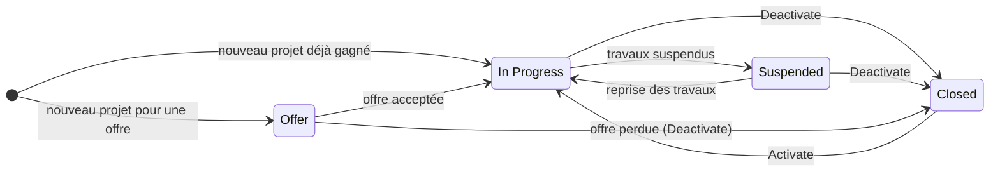
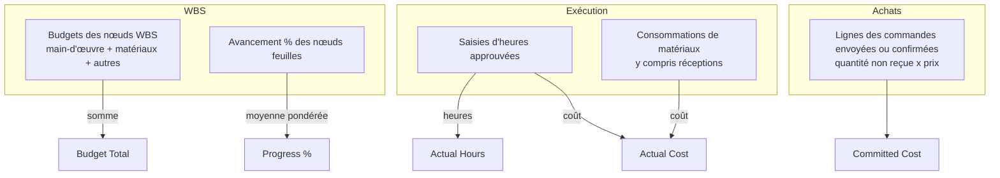
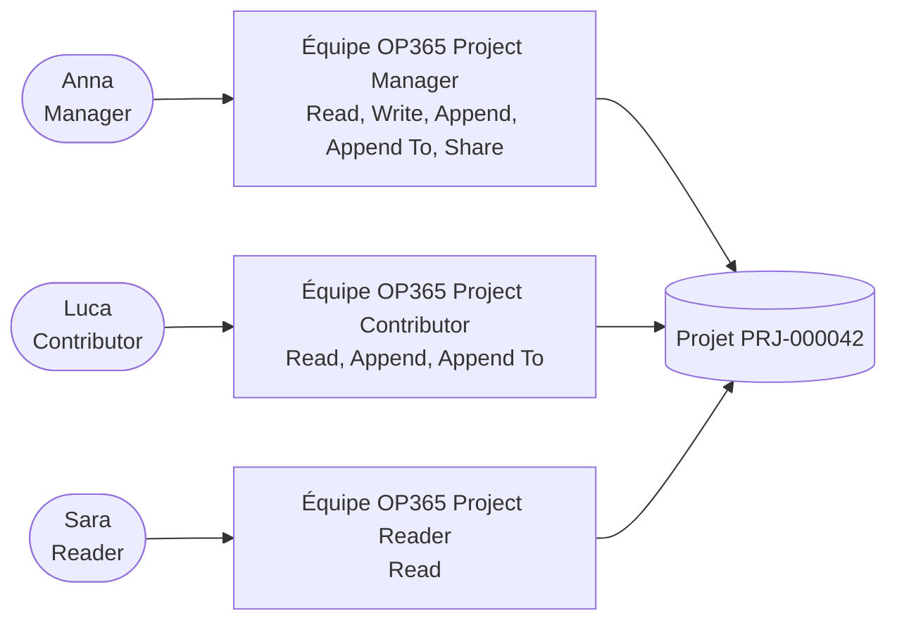

# Projets et équipe projet

> **Langue :** [English](../en/projects-and-team.md) · [Italiano](../it/projects-and-team.md) · Français · [Deutsch](../de/projects-and-team.md)
> **Index des manuels :** [README](../../README.md#user-manuals)

Le **projet** (l'affaire) est le cœur d'Open Project 365. Tout le reste — l'organigramme des tâches, le planning, les heures, les matériaux, les achats — appartient à un projet, et chaque chiffre que vous consultez (budget, coût réel, coût engagé, avancement, marge) est finalement un chiffre de projet. Ce manuel explique comment créer et conduire un projet tout au long de son cycle de vie, ce que signifie chaque champ, quelles valeurs sont calculées pour vous et comment l'**équipe projet** détermine qui peut voir et faire quoi.

Les projets se trouvent dans **Projects → Work → Projects**.

> Les noms des champs et des boutons sont en anglais, comme à l'écran.

## Cycle de vie d'un projet

Un projet passe par quatre raisons de statut (Status Reason) :

| Status reason | État | Signification | Ce que vous pouvez faire |
|---|---|---|---|
| **Offer** (offre) | Actif | Vous préparez ou négociez une offre | Construire la WBS et le budget, planifier, enregistrer des baselines, former l'équipe, préparer des demandes d'achat |
| **In Progress** (en cours) | Actif | L'affaire est en exécution | Tout : heures, matériaux, demandes d'achat, commandes, réceptions |
| **Suspended** (suspendu) | Actif | Les travaux sont temporairement arrêtés | Consulter les données et planifier ; pas de nouvelles heures, matériaux ou commandes |
| **Closed** (clos) | Inactif | L'affaire est terminée (ou l'offre est perdue) | Lecture seule ; réactivez-le avec **Activate** si besoin |

Pour passer entre Offer, In Progress et Suspended, modifiez le champ **Status Reason** de l'onglet Summary et enregistrez. Pour clore le projet, utilisez **Deactivate** dans la barre de commandes ; pour le rouvrir, **Activate**.

> **Important :** les saisies d'heures, les consommations de matériaux et les commandes ne sont acceptées **que sur les projets In Progress**. Si vous obtenez « Hours and materials can be recorded only on projects In Progress. » ou « Purchase orders can be created only on projects In Progress. », vérifiez le statut du projet.

## Vues

| Vue | Affiche |
|---|---|
| **All Projects** | Tous les projets que vous pouvez voir |
| **In Progress Projects** | Affaires en cours |
| **Offers** | Projets au statut Offer |
| **Suspended Projects** | Affaires suspendues |
| **Closed Projects** | Affaires terminées et offres perdues |

Dans toutes les vues des projets, la colonne **Progress %** est dessinée comme une barre verte de 0 à 100, avec le pourcentage arrondi à côté, pour comparer d'un coup d'œil l'avancement de chaque affaire. La même barre apparaît dans les vues des nœuds WBS (WBS Node). Le tri et les filtres sur la colonne fonctionnent comme sur toute colonne numérique ; une valeur vide affiche une cellule vide.

Vous ne voyez que les projets dont vous êtes propriétaire, ceux dont vous êtes membre de l'équipe et — avec le rôle *OP365 Administrator* — tous les projets (voir [Qui voit un projet](#qui-voit-un-projet)).

## Créer un projet

1. Allez dans **Projects → Work → Projects** et cliquez sur **+ New**.
2. Renseignez au moins le **Name** (nom). Le **Code** peut rester vide : il est attribué automatiquement à l'enregistrement (format `PRJ-000001`, `PRJ-000002`, ...). Si votre entreprise utilise ses propres codes, vous pouvez en saisir un ; les codes doivent être uniques.
3. Choisissez le **Customer** (seuls les comptes marqués clients ont du sens ici) et le **Project Manager** (chef de projet).
4. Indiquez **Start Date**, **End Date** et **Contract Value** si vous les connaissez.
5. Choisissez le **Status Reason** : *Offer* si vous êtes encore en phase d'offre, *In Progress* si l'affaire est confirmée.
6. Enregistrez. Le chef de projet est ajouté automatiquement à l'équipe comme **Manager**.

### Champs de l'onglet Summary

| Champ | Signification | Renseigné par |
|---|---|---|
| **Code** | Code unique du projet. Vide = automatique `PRJ-######` | Vous ou le système |
| **Name** | Nom du projet (obligatoire) | Vous |
| **Customer** | Le compte client | Vous |
| **Project Manager** | L'utilisateur responsable du projet. Devient membre Manager de l'équipe | Vous |
| **Status Reason** | Offer, In Progress, Suspended (Closed via Deactivate) | Vous |
| **Owner** | Propriétaire de l'enregistrement (en général le créateur) | Système / vous |
| **Start Date** / **End Date** | Dates prévues du projet | Vous |
| **Contract Value** | Prix convenu avec le client (chiffre d'affaires) | Vous |
| **Budget Total** | Somme des budgets des nœuds WBS | Calculé |
| **Actual Cost** | Coût de la main-d'œuvre approuvée + coût des matériaux saisis sur le projet | Calculé |
| **Actual Hours** | Heures approuvées saisies sur le projet | Calculé |
| **Committed Cost** | Valeur des lignes des commandes envoyées ou confirmées non encore reçues | Calculé |
| **Progress %** | Avancement global, issu de la WBS | Calculé |
| **Description** | Périmètre, notes, tout ce qui est utile | Vous |

La colonne de droite affiche la **Timeline** : notes, mentions (`@nom`) et activités (appels, tâches, rendez-vous, e-mails) sur le projet.

### Comment sont produites les valeurs calculées

Les champs calculés sont mis à jour par l'application **dès l'enregistrement** des enregistrements dont ils dépendent : inutile de rafraîchir un cumul.

- **Budget Total** = somme des budgets totaux des nœuds WBS (chaque nœud : main-d'œuvre + matériaux + autres).
- **Progress %** = avancement des nœuds **feuilles** (sans enfants), pondéré par leur budget total ; si aucun nœud n'a de budget, pondéré par les heures budgétées ; s'il n'y a pas non plus d'heures, moyenne simple.
- **Actual Hours / Actual Cost** ne comptent que les heures **approuvées** (ou toutes les heures soumises si l'approbation des heures est désactivée, voir [Saisie des temps](time-tracking.md)) plus **toutes** les consommations de matériaux.
- **Committed Cost** compte ce qui a été commandé et pas encore reçu ; à la réception, le montant passe de l'engagé au réel.

Chaque client affiche aussi **Projects** (nombre) et **Contract Value Total** (somme des montants de contrat), mis à jour à chaque modification d'un de ses projets.

## Le formulaire projet, onglet par onglet

| Onglet | Contenu | Manuel |
|---|---|---|
| **Summary** | Données du projet, budget et avancement, description, chronologie | ce manuel |
| **WBS** | La grille arborescente de la WBS : phases et tâches avec dates, heures, budget et avancement, modifiables en ligne | [WBS et planification](wbs-and-planning.md) |
| **Gantt** | Le diagramme de Gantt avec dépendances, chemin critique et comparaison à la baseline ; la liste des baselines | [WBS et planification](wbs-and-planning.md) |
| **Costs** | La synthèse des coûts : contrat, budget, réel, estimation à terminaison, marge, budget vs réel par branche WBS | [Matériaux et coûts](materials-and-costs.md) |
| **Time** | Saisies d'heures du projet | [Saisie des temps](time-tracking.md) |
| **Materials** | Consommations de matériaux du projet | [Matériaux et coûts](materials-and-costs.md) |
| **Purchasing** | Demandes d'achat et commandes du projet | [Achats](purchasing.md) |
| **Team** | Membres du projet et leurs rôles | ce manuel |

La barre de commandes du formulaire projet propose aussi **Save Baseline** (voir [WBS et planification](wbs-and-planning.md#baselines)).

## L'équipe du projet

L'onglet **Team** liste les **membres du projet**. Chaque membre est un utilisateur avec un **rôle projet** :

| Rôle projet | Ce qu'il permet sur le projet |
|---|---|
| **Manager** | Lire et modifier le projet et tout son contenu, le partager, approuver les heures, approuver les demandes d'achat (jusqu'au seuil), créer appels d'offres et commandes, changer le statut des commandes, enregistrer des réceptions |
| **Contributor** | Lire le projet, saisir ses propres heures et matériaux, créer des demandes d'achat, enregistrer des réceptions |
| **Reader** | Lire le projet et ses données |

### Ajouter un membre

1. Sur le projet, ouvrez l'onglet **Team** et cliquez sur **+ New Project Member**.
2. Choisissez le **User** et le **Project Role**.
3. Indiquez éventuellement l'**Hourly Rate** : le taux auquel les heures de ce membre sont valorisées en **chiffre d'affaires** (Revenue de la saisie = heures × taux horaire).
4. Enregistrez. Le nom du membre est repris de l'utilisateur.

Un utilisateur ne peut être membre d'un même projet qu'une seule fois : pour changer de rôle, ouvrez le membre existant et modifiez **Project Role**.

Le **chef de projet** est toujours membre avec le rôle Manager : l'application l'ajoute à la création du projet et, si vous changez de chef de projet, ajoute le nouveau comme Manager (ou élève son rôle). L'ancien reste dans l'équipe ; modifiez-le ou retirez-le si nécessaire.

Tous les membres de tous les projets sont aussi visibles par les administrateurs dans **Settings → Company → Project Members**.

### Qui voit un projet

Open Project 365 utilise les **équipes d'accès** (access teams) de Dataverse : chaque projet a jusqu'à trois équipes cachées, une par rôle projet, et ajouter un membre au projet ajoute l'utilisateur à l'équipe correspondante.

En pratique :

- un utilisateur avec le rôle **OP365 User** voit les projets dont il est **propriétaire** et ceux dont il est **membre** ;
- retirer un membre, ou changer son rôle, modifie immédiatement ce qu'il peut voir et faire ;
- un utilisateur avec le rôle **OP365 Administrator** voit et modifie tous les projets, membre ou non.

Les modèles d'équipe sont créés automatiquement la première fois qu'ils sont nécessaires dans chaque environnement ; il n'y a rien à configurer.

## Scénarios types

### De l'offre à l'affaire

1. Créez le projet au statut **Offer**, avec le client marqué *Prospect*.
2. Construisez la WBS et le budget ([WBS et planification](wbs-and-planning.md)), indiquez le montant du contrat.
3. Enregistrez une baseline nommée « Offre » pour garder trace de ce que vous avez chiffré.
4. Quand le client accepte : passez le statut à **In Progress**, le type de client à *Customer*, et enregistrez une nouvelle baseline de référence (« Contrat »).
5. Ajoutez l'équipe, planifiez les affectations, commencez à saisir les heures et les achats.

### Suspendre une affaire

Choisissez **Suspended**. Personne ne peut saisir de nouvelles heures, matériaux ou commandes tant que vous ne repassez pas en **In Progress** ; les données existantes et le planning restent intacts.

### Clore une affaire

1. Vérifiez que toutes les heures sont approuvées, toutes les commandes reçues ou annulées et toutes les factures traitées.
2. Consultez l'onglet **Costs** pour la marge finale.
3. Cliquez sur **Deactivate**. Le projet passe en lecture seule et quitte les vues In Progress.

## Supprimer un projet

Supprimer un projet supprime tout ce qui lui appartient : nœuds WBS, dépendances, affectations, baselines, membres, saisies d'heures, consommations, demandes d'achat, appels d'offres, commandes et réceptions (les factures fournisseurs restent, sans le lien au projet). **Préférez Deactivate** : un projet clos conserve son historique et ses chiffres. Ne supprimez que les projets créés par erreur.

## Messages possibles

| Message | Pourquoi | Que faire |
|---|---|---|
| « Hours and materials can be recorded only on projects In Progress. » | Le projet est une offre, suspendu ou clos | Changez le statut si les travaux ont réellement commencé |
| « Purchase orders can be created only on projects In Progress. » | Idem, pour les achats | Comme ci-dessus |
| « The project is closed. » | Vous avez tenté d'acheter sur un projet inactif | Réactivez le projet si c'est approprié |
| « Only a manager of the project can … » | L'action exige le rôle projet Manager | Demandez au chef de projet de vous ajouter comme Manager, ou d'effectuer l'action |
| Erreur de clé en double sur Code | Un autre projet a déjà ce code | Laissez Code vide pour un code automatique, ou choisissez-en un autre |
| Erreur de doublon sur un membre | L'utilisateur est déjà dans l'équipe | Changez le rôle du membre existant |
