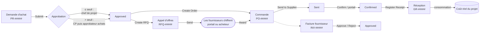
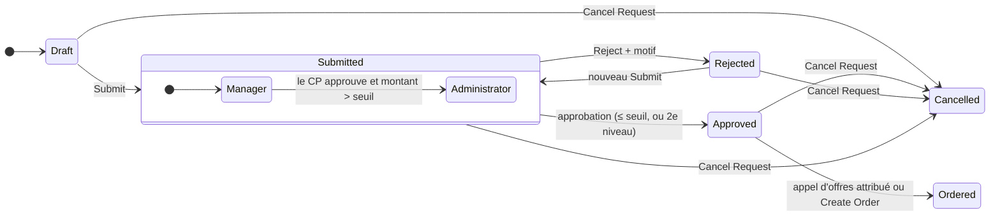
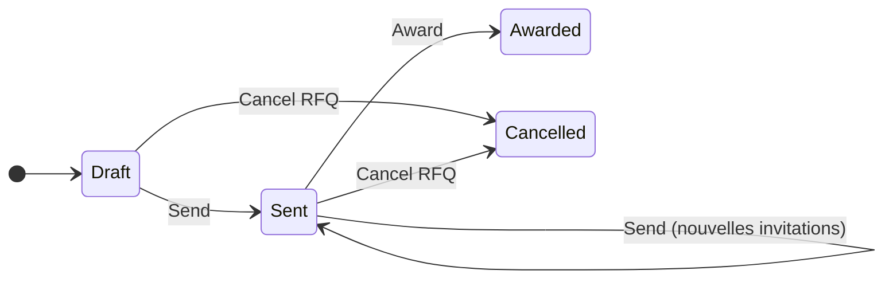
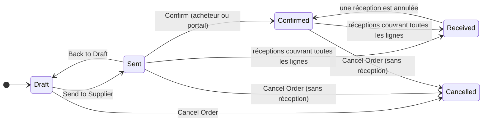
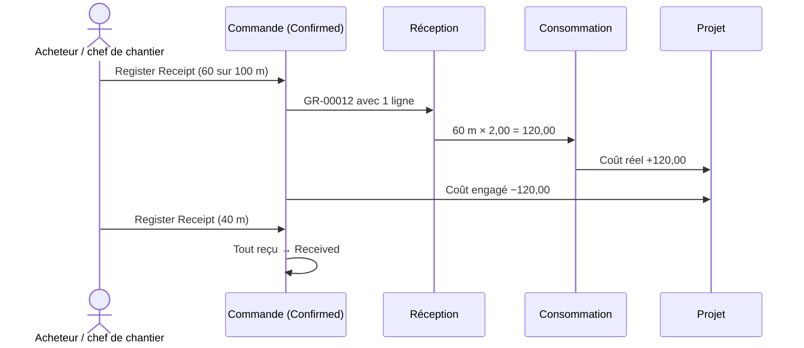

# Achats : demandes, appels d'offres, commandes, réceptions et factures fournisseurs

> **Langue :** [English](../en/purchasing.md) · [Italiano](../it/purchasing.md) · Français · [Deutsch](../de/purchasing.md)
> **Index des manuels :** [README](../../README.md#user-manuals)

Les achats sont l'endroit où l'on gagne ou perd la marge d'une affaire : acheter la bonne chose, au bon prix, auprès d'un fournisseur fiable, sans dépasser le budget. ProjectIQ couvre toute la chaîne achats à l'intérieur du projet : un membre de l'équipe **demande** ce dont il a besoin, le chef de projet (et au-delà d'un seuil l'approbateur achats) **approuve**, l'acheteur demande des **devis** aux fournisseurs et les compare, le meilleur devis devient une **commande**, le fournisseur la confirme (y compris depuis le [portail fournisseurs](supplier-portal.md)), la marchandise est **réceptionnée** et devient du coût réel, et la **facture fournisseur** est contrôlée et approuvée.

Chaque étape met à jour les chiffres du projet : **coût engagé** à l'envoi d'une commande, **coût réel** à la réception, **dépenses** par fournisseur et par article.

Toutes les pages achats sont dans la zone **Purchasing** : groupe **Procurement** (Purchase Requests = demandes d'achat, RFQs = appels d'offres, Purchase Orders = commandes, Goods Receipts = réceptions, Supplier Invoices = factures fournisseurs) et groupe **Analysis** (tableau de bord Spend). L'onglet **Purchasing** du formulaire projet liste les demandes et commandes du projet.

> Les noms des champs et des boutons sont en anglais, comme à l'écran. « RFQ » (*Request for Quotation*) désigne l'appel d'offres (demande de devis).

## La chaîne en un coup d'œil

Les numéros sont attribués automatiquement à l'enregistrement : demandes d'achat `PR-00001`, appels d'offres `RFQ-00001`, commandes `PO-00001`, réceptions `GR-00001`, factures fournisseurs `INV-00001`.

## Qui fait quoi

| Action | Qui peut la faire |
|---|---|
| Créer une demande d'achat | Un Manager ou Contributor du projet, un administrateur (le demandeur, c'est vous) |
| Soumettre une demande | Le demandeur, un Manager du projet, un administrateur |
| Approuver / rejeter jusqu'au seuil | Le chef de projet (approbateur courant), tout Manager du projet, un administrateur |
| Approuver / rejeter au-dessus du seuil (second niveau) | Le **Purchasing Approver** défini dans les [variables d'environnement](administration.md#paramètres-de-lentreprise), ou un administrateur |
| Annuler une demande | Le demandeur, un Manager du projet, un administrateur |
| Créer appels d'offres et commandes, envoyer, attribuer, changer le statut des commandes | Un Manager du projet, un administrateur |
| Enregistrer des réceptions | Un Manager ou Contributor du projet, un administrateur |
| Approuver / rejeter les factures fournisseurs | Le Purchasing Approver, un administrateur |

« Administrateur » désigne un utilisateur avec le rôle **OP365 Administrator** ou **System Administrator**.

Toutes les actions sont des **boutons de la barre de commandes** des formulaires. Chaque bouton n'est actif que dans les statuts où il s'applique, et chaque action demande une confirmation.

## 1. Demandes d'achat

Une demande d'achat (PR) indique *ce qu'il* faut, *pour quel projet et quelle tâche*, *pour quand* et *combien cela coûte* à peu près.

### Créer une demande

1. Allez dans **Purchasing → Procurement → Purchase Requests → + New**, ou dans l'onglet **Purchasing** du projet.
2. Renseignez l'en-tête :

| Champ | Signification |
|---|---|
| **Title** | Courte description du besoin (par exemple « Câbles pour le 2e étage ») |
| **Needed By** | Date à laquelle le matériel est nécessaire sur le chantier |
| **Project** | Le projet (il ne doit pas être clos) |
| **WBS Node** | La tâche concernée par l'achat (même projet uniquement). Sert au contrôle budgétaire et est recopiée sur les lignes de commande |
| **Preferred Supplier** | Le fournisseur que vous suggérez. Nécessaire pour **Create Order** ; toujours invité à la création d'un appel d'offres |
| **Requester** | Vous, par défaut |
| **Justification** | Pourquoi c'est nécessaire, tout ce que l'approbateur doit savoir |

3. Enregistrez, puis ajoutez les **Lines** (section *Lines*, **+ New Purchase Request Line**) :

| Champ | Signification |
|---|---|
| **Item** | Article du catalogue (facultatif) |
| **Description** | Reprise de l'article si vide |
| **Quantity** / **Unit of Measure** | Quantité (l'unité vient de l'article si vide) |
| **Estimated Price** | Prix unitaire attendu. Vide = prix du fournisseur préféré pour l'article, sinon coût unitaire de l'article |
| **Amount** | Quantity × Estimated Price (calculé) |
| **Sort Order** | Ordre des lignes |
| **Notes** | Spécifications pour le fournisseur |

L'**Estimated Amount** (montant estimé) de la demande est la somme des montants des lignes.

### Soumettre et approuver

Cliquez sur **Submit**. La demande passe en **Submitted**, son contenu est verrouillé (seule la Justification peut encore être complétée) et l'application enregistre trois éléments dans la section *Approval* :

- **Above Threshold** : si le montant estimé dépasse le **Purchase Request Threshold** ([variable d'environnement](administration.md#paramètres-de-lentreprise)) ;
- **Over Budget** : si coût réel + coût engagé + cette demande dépassent le budget du nœud WBS (ou du projet, si aucun nœud n'est indiqué) ;
- **Current Approver** : le chef de projet, qui reçoit la notification « Purchase request to approve ».

**Approbation à deux niveaux**

| Niveau | Qui décide | Effet de Approve |
|---|---|---|
| **Manager** (premier) | Chef de projet / Managers du projet | Si la demande **ne** dépasse **pas** le seuil → **Approved**. Si elle le dépasse → elle passe au niveau **Administrator**, *Manager Approved By/On* sont enregistrés et les approbateurs de second niveau sont notifiés |
| **Administrator** (second) | Le Purchasing Approver de la variable d'environnement (s'il est défini), sinon chaque OP365 Administrator | → **Approved** |

Si la personne qui approuve au premier niveau est déjà approbatrice de second niveau, la demande est approuvée directement.

Pour **rejeter**, cliquez sur **Reject** : une boîte de dialogue demande le **Reason** (motif, obligatoire). La demande passe en **Rejected**, le motif est stocké dans *Decision Note* et le demandeur est notifié. Le demandeur peut modifier la demande et la **soumettre** à nouveau.

La vue **Purchase Requests to Decide** liste les demandes en attente de décision ; **My Purchase Requests** les vôtres ; **Open Purchase Requests** celles qui ne sont pas encore commandées, annulées ou rejetées.

> Un seuil à zéro (ou vide) signifie qu'aucune demande ne nécessite le second niveau. *Over Budget* est un avertissement pour l'approbateur : il ne bloque pas l'approbation.

### Après l'approbation : deux façons d'acheter

| Bouton | Quand l'utiliser | Résultat |
|---|---|---|
| **Create RFQ** | Vous voulez des devis concurrents | Un nouvel appel d'offres en Draft, avec déjà invités le fournisseur préféré et les fournisseurs habituels des articles |
| **Create Order** | Vous connaissez déjà fournisseur et prix | Une commande en Draft au **Preferred Supplier** avec les lignes de la demande ; la demande passe en **Ordered** |

**Cancel Request** arrête la demande dans n'importe quel statut sauf Ordered et Cancelled. Seules les demandes Draft, Rejected ou Cancelled peuvent être supprimées.

## 2. Appels d'offres (RFQ)

Un appel d'offres demande à un ou plusieurs fournisseurs de chiffrer les lignes d'une demande approuvée.

### Préparer et envoyer

1. Sur la demande approuvée, cliquez sur **Create RFQ**. L'appel d'offres est créé avec une **Deadline** (échéance) à 7 jours et le titre de la demande dans les **Notes** ; le fournisseur préféré et les fournisseurs habituels des articles figurent dans **Invitations** avec le statut *To Invite*.
2. Ouvrez l'appel d'offres. Ajustez la **Deadline** (aujourd'hui ou plus tard) et les **Notes** destinées aux fournisseurs.
3. Ajoutez d'autres fournisseurs dans **Invitations** (**+ New RFQ Invitation**) : choisissez le **Supplier** ; l'**Email** est repris du fournisseur. Les comptes inactifs, non fournisseurs ou bloqués sont refusés.
4. Cliquez sur **Send**. L'appel d'offres passe en **Sent**, chaque invitation *To Invite* passe en **Invited** (avec numéro, échéance et notes), et pour chaque fournisseur est préparée **une ligne de devis vide par ligne de demande**.

Vous pouvez ajouter des fournisseurs après l'envoi : ajoutez l'invitation et cliquez de nouveau sur **Send** ; seules les nouvelles invitations sont envoyées.

### Recueillir les devis

Chaque invitation a ses propres **lignes de devis** (une par ligne de demande) avec **Unit Price** et **Notes**, plus **Delivery Days** (délai de livraison) et **Supplier Notes** au niveau de l'invitation. Elles se remplissent de deux façons :

- **par le fournisseur**, sur le [portail fournisseurs](supplier-portal.md) : le fournisseur voit l'appel d'offres, saisit prix, délai et notes et clique sur *Send quote* — ou *Decline* ;
- **par l'acheteur**, quand le devis arrive par e-mail ou téléphone : ouvrez l'invitation, onglet **Quotes**, et saisissez les prix.

Le premier prix saisi fait passer l'invitation en **Responded** (avec la date de réponse) ; le compteur **Responses** de l'appel d'offres indique combien de fournisseurs ont répondu. Le **Quoted Amount** de l'invitation est la somme quantité × prix de ses lignes.

| Statut de l'invitation | Signification |
|---|---|
| **To Invite** | Ajoutée, pas encore envoyée |
| **Invited** | Envoyée, en attente de réponse |
| **Responded** | Au moins un prix saisi |
| **Declined** | Le fournisseur a décliné (portail) |

Après l'échéance, les devis ne peuvent plus être modifiés (« The deadline of the request for quotation has passed. ») ; pour la prolonger, modifiez la **Deadline** de l'appel d'offres et cliquez de nouveau sur **Send**.

### Comparer et attribuer

L'onglet **Quote Comparison** de l'appel d'offres affiche une grille **lignes de demande × fournisseurs** :

| Ligne | Quantité | Fournisseur A | Fournisseur B | Fournisseur C | Meilleur prix |
|---|---|---|---|---|---|
| Câble 3x2,5 | 500 m | 0,95 | **0,89** | 0,97 | 0,89 (B) |
| Boîte de dérivation | 40 pce | **3,10** | 3,40 | – | 3,10 (A) |
| **Total** | | **2 989,00** | 3 081,00 | 3/4 lignes | Meilleur total : A |
| **Livraison** | | 10 jours | 7 jours | 5 jours | |

- le **meilleur prix** de chaque ligne est mis en évidence ;
- le **total** de chaque fournisseur est affiché, avec « x of y lines » quand le fournisseur n'a pas chiffré toutes les lignes ; le **meilleur total** n'est choisi que parmi les fournisseurs ayant chiffré toutes les lignes ;
- le **délai de livraison** et le statut de l'invitation sont indiqués pour chaque fournisseur ;
- **Refresh** recharge les devis.

Cliquez sur **Award** sous le fournisseur choisi et confirmez (« Award the request for quotation to <fournisseur> and create the purchase order? »). L'application :

1. crée une **commande en Draft** à ce fournisseur avec les lignes et prix chiffrés (seulement les lignes avec un prix), le nœud WBS de la demande et une **Expected Delivery** = aujourd'hui + le délai du fournisseur ;
2. passe l'appel d'offres en **Awarded**, en enregistrant l'invitation gagnante et la commande ;
3. passe la demande d'achat en **Ordered**.

Seuls les fournisseurs ayant **répondu** peuvent être retenus. **Cancel RFQ** clôt un appel d'offres Draft ou Sent sans commande.

## 3. Commandes

Une commande (PO) est l'engagement d'acheter auprès d'un fournisseur. Elle naît généralement de **Award** ou **Create Order**, mais un Manager peut aussi en créer une de zéro (**Purchasing → Purchase Orders → + New**) sur un projet In Progress.

### Champs

| Champ | Signification |
|---|---|
| **Number** | PO-##### (automatique) |
| **Supplier** | Doit être un fournisseur actif et non bloqué |
| **Project** | Doit être **In Progress** |
| **Purchase Request** | La demande d'origine, s'il y en a une |
| **Order Date** | Aujourd'hui par défaut |
| **Expected Delivery** | Date de livraison attendue |
| **Delivery Place** | Adresse du chantier ou de l'entrepôt |
| **Payment Terms** | Reprises du fournisseur |
| **Total Amount** | Somme des lignes (calculée) |
| *Section Progress* | Sent To, Sent On, Supplier Confirmed, Confirmed On, Received Amount, Received On, Cancelled On |

**Lignes** : Item, Description, **WBS Node** (même projet), Quantity, Unit, **Unit Price** (vide = prix du fournisseur pour l'article, sinon coût de l'article), **Amount**, **Received Quantity** (issue des réceptions, lecture seule), Sort Order, Notes.

### Statuts

| Bouton | Depuis | Effet |
|---|---|---|
| **Send to Supplier** | Draft | → **Sent**. Les lignes sont verrouillées. *Sent To* enregistre l'e-mail du fournisseur, *Sent On* la date. La commande devient visible pour le fournisseur sur le portail. Au moins une ligne est requise |
| **Back to Draft** | Sent | → **Draft**, pour modifier la commande (puis la renvoyer) |
| **Confirm** | Sent | → **Confirmed**, enregistre la confirmation du fournisseur. Le fournisseur peut aussi confirmer sur le portail, avec le même effet |
| **Register Receipt** | Sent, Confirmed | Ouvre la boîte de dialogue de réception (voir plus bas) |
| **Cancel Order** | Draft, Sent, Confirmed | → **Cancelled**, seulement si la commande n'a aucune réception (« Cancel the goods receipts before cancelling the order. ») |

**Received** n'est jamais positionné à la main : la commande passe en Received lorsque les réceptions couvrent toutes ses lignes. Seules les commandes Draft ou Cancelled peuvent être supprimées.

Une fois la commande sortie de Draft, vous pouvez encore mettre à jour ses **Notes**, son **Expected Delivery** et son **Delivery Place** (par exemple quand le fournisseur annonce une nouvelle date de livraison) ; tout le reste nécessite **Back to Draft**.

> *Send to Supplier* enregistre que la commande a été envoyée ; il n'envoie pas d'e-mail au fournisseur. Transmettez le bon de commande par votre canal habituel, ou laissez le fournisseur le trouver sur le portail.

### Effet sur les coûts

- Les commandes Sent et Confirmed comptent dans le **Committed Cost** du projet pour les quantités non encore reçues.
- Chaque commande non annulée compte dans la **Spend** du fournisseur ; chaque ligne dans les **Order Lines** et la **Spend** de l'article.

## 4. Réceptions de marchandises

Une réception (GR) enregistre ce qui est arrivé, avec quel bon de livraison.

### Enregistrer une réception

1. Sur une commande Sent ou Confirmed, cliquez sur **Register Receipt**.
2. Dans la boîte de dialogue, renseignez **Receipt date** (aujourd'hui par défaut), **Delivery note number** et **Delivery note date** (numéro et date du bon de livraison).
3. Pour chaque ligne de commande, saisissez la **quantité reçue** maintenant. **Receive all** remplit tout ce qui reste à recevoir ; **Clear** vide les quantités.
4. Cliquez sur **Register**.

L'application :

- crée la réception (GR-#####) avec une **ligne** par ligne de commande reçue ;
- crée une **consommation de matériaux** par ligne, au **prix de la commande**, sur le projet de la commande et le nœud WBS de la ligne → **coût réel** ;
- augmente la **Received Quantity** des lignes de commande (et le Received Amount de la commande) ; la part reçue sort du **coût engagé** ;
- passe la commande en **Received** quand toutes les lignes sont entièrement reçues.

Vous ne pouvez pas recevoir plus que commandé : « <line>: only N still to receive. »

### Annuler une réception

Si une réception est erronée, ouvrez-la et cliquez sur **Cancel Receipt**. Ses consommations et ses lignes sont supprimées, les quantités à recevoir sont rétablies et une commande Received repasse en **Confirmed**. Enregistrez ensuite la bonne réception.

Sur une réception enregistrée, seules les données du **bon de livraison** et les **notes** peuvent être modifiées ; lignes et quantités ne changent que par Cancel Receipt. Les réceptions ne se créent qu'avec **Register Receipt**.

## 5. Factures fournisseurs

Une facture fournisseur est un **conteneur** pour une facture d'achat : elle contient les données de la facture, ses lignes, le fichier XML ou PDF, le lien vers la commande et la décision d'approbation. (L'import automatique depuis le système d'échange italien SDI est prévu dans une version ultérieure ; aujourd'hui, le fichier est joint à la main.)

### Enregistrer une facture

1. **Purchasing → Supplier Invoices → + New** (ou l'onglet **Invoices** de la commande, pour que la commande soit préremplie).
2. Renseignez **Supplier**, **Document Type** (types FatturaPA : TD01 Invoice = facture, TD02 Advance invoice = acompte, TD04 Credit note = avoir, TD05 Debit note = note de débit, TD06 Fee note = note d'honoraires, TD24 Deferred invoice = facture différée, TD25 Deferred invoice (triangular) = facture différée triangulaire), **Invoice Number**, **Invoice Date**, **Purchase Order**.
3. **Seller Name** et **Seller VAT Number** sont repris du fournisseur ; le **Project** de la commande.
4. Joignez le XML (FatturaPA) ou le PDF dans **Invoice File**.
5. Renseignez éventuellement **Order References** et **Delivery Note References** tels qu'ils figurent sur la facture.
6. Ajoutez les **Lines** : Line Number, Code, Description, Quantity, Unit, Unit Price, Total Price (= quantité × prix unitaire si vide), VAT Rate % (taux de TVA) et éventuellement l'**Order Line** concernée.
7. **Taxable Amount** (HT), **VAT Amount** (TVA) et **Total Amount** sont calculés à partir des lignes.

Les nouvelles factures démarrent en **To Review**.

### Approuver

Le Purchasing Approver (ou un administrateur) contrôle la facture par rapport à la commande et aux réceptions, puis clique sur **Approve** ou **Reject** (motif obligatoire). Les factures décidées — et leurs lignes — sont verrouillées.

| Statut | Signification |
|---|---|
| **To Review** | À contrôler ; données et lignes modifiables |
| **Approved** | Acceptée pour paiement |
| **Rejected** | Contestée ; le motif figure dans *Decision Note* |

Vues : **Invoices to Review**, **Approved Invoices**, **Rejected Invoices**, **Supplier Invoices by Order**.

> Les utilisateurs standard (OP365 User) peuvent lire les factures fournisseurs mais pas les créer ni les modifier : elles sont gérées par le personnel administratif disposant du rôle OP365 Administrator.

## 6. Le tableau de bord Spend

**Purchasing → Analysis → Spend** offre aux acheteurs et à la direction une vue d'ensemble :

| Composant | Contenu |
|---|---|
| **Spend by Supplier** | Histogramme : total des commandes par fournisseur |
| **Spend by Project** | Histogramme : total des commandes par projet |
| **Purchase Orders by Status** | Secteurs : nombre de commandes par statut |
| **Open Purchase Orders** | Liste des commandes non encore reçues ou annulées |
| **Invoices to Review** | Liste des factures en attente d'approbation |

Cliquez sur un segment de graphique pour filtrer, ou ouvrez la liste pour voir les enregistrements.

## Vues

| Table | Vues |
|---|---|
| Demandes d'achat | All, My, To Decide, Open, By Project |
| Appels d'offres | All, Open, Awarded |
| Commandes | All, Open, Confirmed, Received, By Project, By Supplier |
| Réceptions | All, By Order |
| Factures fournisseurs | All, To Review, Approved, Rejected, By Order |

## Messages possibles

| Message | Signification et solution |
|---|---|
| « Use Submit to send a purchase request for approval. » / « Use Submit, Approve, Reject or Cancel to change the status of a purchase request. » | Le statut ne change qu'avec les boutons |
| « A purchase request can be changed only while it is Draft or Rejected. » / « Lines can be changed only while the purchase request is Draft or Rejected. » | Rejetez ou annulez la demande pour la modifier |
| « Add at least one line before submitting. » | La demande n'a pas de lignes |
| « Only the requester or a manager of the project can submit the purchase request. » | Demandez au demandeur ou au chef de projet |
| « This purchase request is above the threshold: only the purchasing approver or an administrator can decide it. » | Elle est au second niveau |
| « Add a note to reject the purchase request. » / « ...the invoice. » / « ...time entries. » | Le motif est obligatoire |
| « Only approved purchase requests can go to a request for quotation. » / « ...can be ordered. » | Approuvez d'abord la demande |
| « Choose the supplier: set Preferred Supplier on the request. » | Create Order nécessite un fournisseur préféré |
| « The deadline must be today or later. » / « The deadline has passed: move it before sending. » | Modifiez l'échéance de l'appel d'offres |
| « Invite at least one supplier. » | Ajoutez une invitation avant Send |
| « Use Send on the request for quotation to invite suppliers. » | Le statut d'invitation ne change qu'avec Send (ou depuis le portail) |
| « This supplier already has a quote for the line: change its price. » | Modifiez la ligne de devis existante |
| « Award a supplier who sent a quote. » / « The supplier quoted no lines. » | Seuls les fournisseurs ayant répondu avec des prix peuvent être retenus |
| « <name> is not an active supplier. » / « <name> is blocked. » | Vérifiez le compte fournisseur |
| « Purchase orders can be created only on projects In Progress. » | Vérifiez le statut du projet |
| « A purchase order can be changed only while it is Draft. » / « Lines can be changed only while the purchase order is Draft. » | Utilisez **Back to Draft** |
| « Add at least one line before sending. » | La commande n'a pas de lignes |
| « Cancel the goods receipts before cancelling the order. » | Annulez d'abord les réceptions |
| « An order becomes Received when all its lines are received. » | Enregistrez les réceptions |
| « Goods can be received only on sent or confirmed purchase orders. » | Envoyez d'abord la commande |
| « <line>: only N still to receive. » / « Nothing to receive. » | Vérifiez les quantités dans la boîte de dialogue |
| « Received quantities come from goods receipts. » | Ne saisissez pas les quantités reçues à la main |
| « Use Register Receipt on the purchase order to receive goods, and Cancel Receipt to undo a receipt. » | Les réceptions ne se gèrent qu'avec les boutons |
| « Approved or rejected invoices cannot be changed. » | Les factures décidées sont définitives |
| « Only the purchasing approver or an administrator can decide supplier invoices. » | Demandez à l'approbateur achats |
