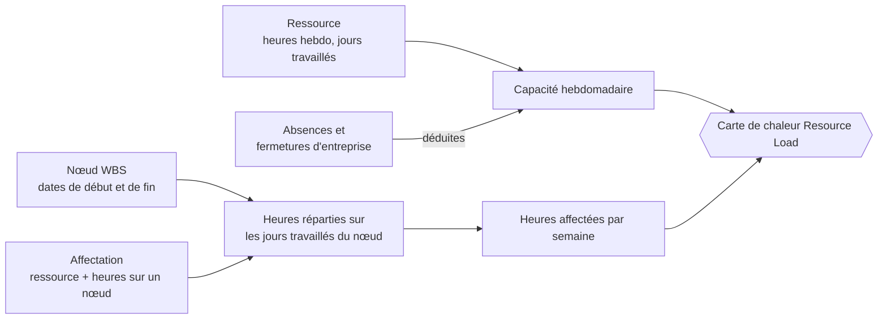
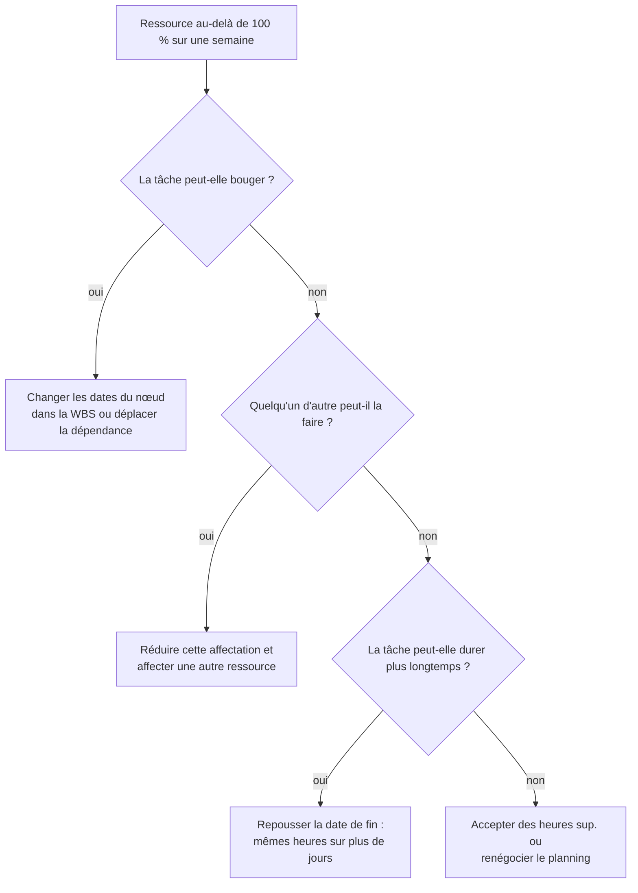

# Affectation et charge des ressources

> **Langue :** [English](../en/resource-load.md) · [Italiano](../it/resource-load.md) · Français · [Deutsch](../de/resource-load.md)
> **Index des manuels :** [README](../../README.md#user-manuals)

Savoir *ce qu'il* faut faire, c'est la moitié de la planification ; l'autre moitié, c'est savoir *qui* le fera et s'il en a le temps. ProjectIQ répond à cette seconde question avec les **affectations** (heures d'une ressource prévues sur un nœud WBS) et le tableau de bord **Resource Load**, une carte de chaleur qui compare, semaine par semaine, les heures affectées à chaque ressource sur tous les projets avec les heures dont cette ressource dispose réellement.

Ce manuel explique comment affecter les ressources, comment la capacité est calculée, comment lire la carte de chaleur et comment résoudre les surcharges.

> Les noms des champs et des boutons sont en anglais, comme à l'écran.

## Les ingrédients

| Ingrédient | Où il est géré | Manuel |
|---|---|---|
| **Ressource** avec Weekly Hours et Working Days | Master Data → Resources | [Données de référence](master-data.md#ressources) |
| **Absences** et **fermetures d'entreprise** | Projects → Planning → Absences, ou onglet Absences de la ressource | [Données de référence](master-data.md#absences-et-fermetures-dentreprise) |
| **Nœud WBS** avec Start Date et End Date | Projet → onglet WBS | [WBS et planification](wbs-and-planning.md) |
| **Affectation** | Nœud WBS → onglet Allocations | ce manuel |

## Affecter une ressource à un nœud WBS

1. Ouvrez le nœud WBS (cliquez sur son nom dans l'onglet WBS du projet).
2. Allez dans l'onglet **Allocations** et cliquez sur **+ New WBS Allocation**.
3. Choisissez la **Resource** et saisissez les **Hours** prévues pour cette ressource sur ce nœud (supérieures à zéro).
4. Enregistrez.

| Champ | Signification |
|---|---|
| **WBS Node** | La tâche (l'affectation est supprimée avec le nœud) |
| **Resource** | Qui fera le travail |
| **Hours** | Heures prévues de cette ressource sur ce nœud (> 0) |
| **Name** | Description de l'affectation |

Une ressource ne peut être affectée qu'une fois au même nœud : pour changer les heures, ouvrez l'affectation existante. Plusieurs ressources peuvent être affectées au même nœud (par exemple un électricien pour 40 heures et un apprenti pour 24 heures).

> Les affectations sont un **plan**, pas un relevé du travail effectué. Les heures réellement travaillées se saisissent dans les saisies d'heures ([Saisie des temps](time-tracking.md)) et apparaissent comme Actual Hours sur le nœud.

Conseil : les **Budget Hours** du nœud sont votre estimation globale ; la somme de ses affectations est la répartition de cette estimation entre les personnes. Garder les deux cohérentes rend fiables à la fois le budget et la charge.

## Calcul de la charge

### Capacité

Pour chaque ressource et chaque semaine :

- **capacité journalière** = Weekly Hours ÷ nombre de Working Days (par exemple 40 ÷ 5 = 8 heures) ;
- chaque jour travaillé apporte sa capacité journalière ; les jours non travaillés n'apportent rien ;
- une **absence** retire la journée entière, ou seulement ses **Hours** pour une absence d'une journée avec heures (par exemple 4 heures de permission) ;
- une **fermeture d'entreprise** (absence sans ressource) retire la journée pour tout le monde.

### Heures affectées

Pour chaque affectation :

- les heures sont **réparties uniformément sur les jours travaillés de la ressource** entre la **Start Date** et la **End Date** du nœud ;
- la part de chaque jour est ajoutée à la semaine correspondante et enregistrée sous le nom du projet (affiché dans l'info-bulle) ;
- les affectations sur des nœuds **sans dates** (ou dont la fin précède le début) ne peuvent pas être placées dans le calendrier : elles sont additionnées dans la colonne **No dates** ;
- seules comptent les affectations actives sur des nœuds actifs de projets actifs (Offer, In Progress, Suspended) ; les projets clos ne chargent personne.

### Exemple chiffré

Marco travaille 40 heures par semaine, du lundi au vendredi. Il est affecté pour 60 heures à « 2.2.1 Électricité », qui va du lundi 2 au vendredi 13 mars (10 jours travaillés), et pour 16 heures à un nœud d'un autre projet qui va du lundi 9 au mardi 10 mars. Il est en congé le vendredi 13 mars.

| Semaine | Capacité | Affecté | Utilisation |
|---|---|---|---|
| 2–6 mars | 5 × 8 = 40 h | 60 ÷ 10 × 5 = 30 h | 75 % |
| 9–13 mars | 4 × 8 = 32 h (vendredi en congé) | 30 h + 16 h = 46 h | 144 % — surcharge |

Notez que l'affectation compte aussi le jour de congé : les affectations suivent les dates du nœud, les absences ne réduisent que la capacité. La carte de chaleur vous dit que le planning, en l'état, ne tient pas.

## Le tableau de bord Resource Load

Ouvrez **Projects → Planning → Resource Load**.

Illustration de la carte de chaleur (heures affectées / capacité) :

| Resource | No dates | Semaine du 2 mars | Semaine du 9 mars | Semaine du 16 mars |
|---|---|---|---|---|
| Giulia | 12 | ⬜ 16 / 40 | 🟨 38 / 40 | 🟨 40 / 40 |
| Marco | – | 🟩 30 / 40 | 🟥 46 / 32 | ⬜ 8 / 40 |

- **Lignes** : les ressources actives, par ordre alphabétique.
- **Colonnes** : les semaines de la fenêtre. La première colonne, **No dates**, montre les heures affectées sur des nœuds sans dates.
- **Cellules** : heures affectées / capacité de la semaine, colorées selon l'utilisation.
- **Info-bulle** sur une cellule : heures affectées, capacité et répartition des heures **par projet**.

### Bandes de couleur

| Bande | Utilisation | Signification |
|---|---|---|
| ⬜ **Under 50%** | affecté < 50 % de la capacité | Beaucoup de marge |
| 🟩 **50–90%** | de 50 % à 90 % | Charge saine |
| 🟨 **90–100%** | de 90 % à 100 % | Complet |
| 🟥 **Over 100%** | au-delà de la capacité (ou heures avec capacité nulle) | Surcharge : il faut déplacer quelque chose |

Le tableau de bord affiche une légende avec ces bandes. (Les couleurs émoji de ce manuel ne sont qu'indicatives.)

### Barre d'outils

| Contrôle | Action |
|---|---|
| **Previous** / **Next** | Décale la fenêtre en arrière ou en avant de sa longueur |
| **This week** | Revient à la semaine en cours |
| **4 / 8 / 12 / 26 weeks** | Longueur de la fenêtre (8 semaines par défaut) |
| **Refresh** | Recharge ressources, affectations et absences |

## Résoudre une surcharge

Quand une cellule est rouge, vous disposez de quatre leviers :

Après chaque changement, cliquez sur **Refresh** dans le tableau de bord pour en voir l'effet.

## Bonnes pratiques

- Donnez à chaque nœud qui sera affecté des **dates de début et de fin** : sinon ses heures tombent dans la colonne « No dates » et n'apparaissent jamais dans une semaine.
- Saisissez à l'avance **absences et fermetures** (congés, fermeture d'août) : la charge de ces semaines devient réaliste.
- Gardez **Weekly Hours** et **Working Days** corrects pour les temps partiels et les équipes.
- Passez en revue le tableau de bord au moins chaque semaine avec les chefs des projets qui partagent des ressources.

## Messages possibles

| Message | Signification |
|---|---|
| « The resource load could not be loaded » | Problème de réseau ou de droits : utilisez Refresh ; si cela persiste, vérifiez vos rôles de sécurité |
| Erreur de clé en double sur une affectation | La ressource est déjà affectée au nœud : modifiez l'affectation existante |
| Erreur de validation sur Hours | Les heures doivent être supérieures à zéro |
