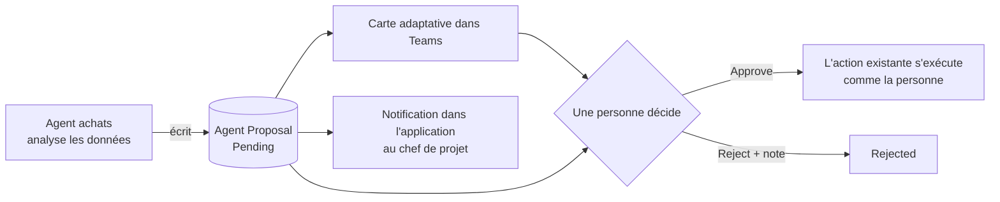
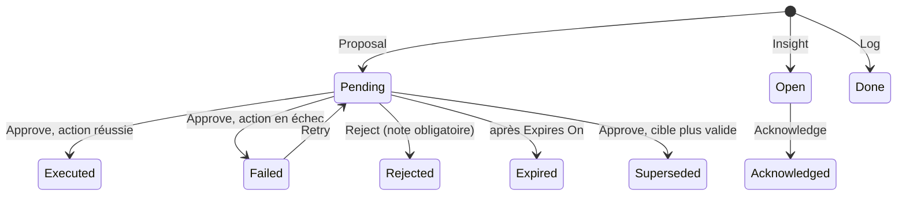
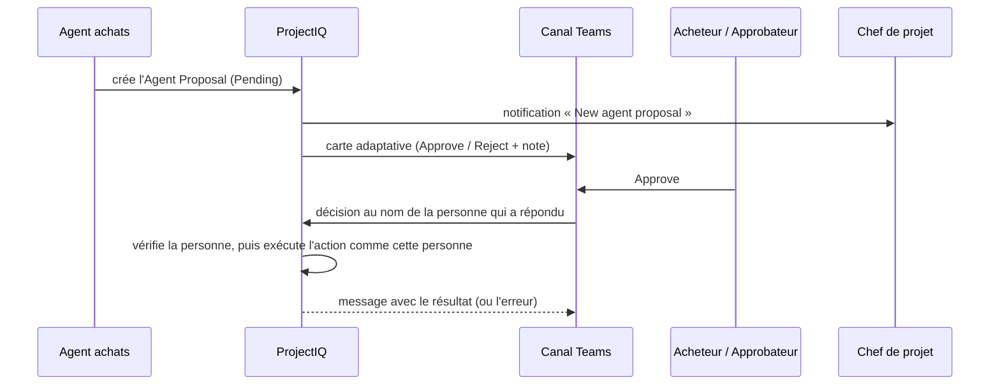

# Agent achats : des propositions qu'une personne décide

> **Langue :** [English](../en/sourcing-agent.md) · [Italiano](../it/sourcing-agent.md) · Français · [Deutsch](../de/sourcing-agent.md)
> **Index des manuels :** [README](../../README.md#user-manuals)

L'**agent achats** (sourcing agent) est conçu pour travailler comme un Sourcing Manager sur les données des [achats](purchasing.md) : il prépare chaque décision d'approvisionnement avec des chiffres et une raison, afin que l'acheteur cesse d'ouvrir demandes, offres et factures « juste pour vérifier ». L'agent ne modifie jamais seul les enregistrements d'achats. Il écrit une **proposition** (« approvisionner cette demande par appel d'offres », « attribuer cet appel d'offres à ce fournisseur »), une personne lit la raison et décide, et seulement alors l'action s'exécute, **avec l'identité et les droits de la personne qui a approuvé**.

> **À venir.** L'agent Copilot Studio qui crée les propositions est livré dans des versions ultérieures, tâche par tâche. Cette version livre les fondations : la table Agent Proposal, les rôles, la carte d'approbation dans Teams, les commandes Approve, Reject, Retry et Acknowledge dans l'application, l'expiration des anciennes propositions et les notifications. Tant que l'agent n'est pas activé, les vues des propositions sont vides ; ce manuel décrit ce que vous verrez et ferez quand les propositions arriveront.

## Ce que fait l'agent

L'agent a dix tâches, livrées dans l'ordre de la chaîne des achats. Chaque tâche aboutit soit à une proposition (une personne décide), soit à une ligne d'insight ou de journal (information seulement).

| # | Tâche | Résultat | Statut |
|---|---|---|---|
| 1 | Aiguiller une demande d'achat approuvée : appel d'offres ou commande directe | Proposition **Source via RFQ** ou **Direct Order** | Planifié |
| 2 | Choisir les fournisseurs à inviter (note, documents valides, délai, historique des prix) | Liste d'invitations dans la proposition de la tâche 1 | Planifié |
| 3 | Analyser les offres (prix, livraison, risque) et recommander l'attribution | Proposition **Award RFQ** | Planifié |
| 4 | Relancer les fournisseurs qui n'ont pas répondu à un appel d'offres | E-mail au fournisseur et ligne de journal | Planifié |
| 5 | Conformité des fournisseurs : documents bientôt expirés ou expirés de fournisseurs ayant des appels d'offres ou commandes ouverts | Insight **Compliance Alert** | Planifié |
| 6 | Rapprochement à trois points facture, commande et réception | Proposition **Approve Invoice** ou **Reject Invoice** | Planifié |
| 7 | Commandes en retard : confirmées, non reçues au-delà du délai | E-mail au fournisseur et insight **Late Delivery** | Planifié |
| 8 | Budget du projet : budget WBS restant | Insight **Budget Alert** | Planifié |
| 9 | Analyse des dépenses : achats fragmentés entre projets | Insight **Consolidation** | Planifié |
| 10 | Prospection et intégration de fournisseurs | Insight **New Supplier Needed** et proposition **Invite Supplier** | Planifié |
| – | La mécanique des propositions décrite dans ce manuel : carte Teams, commandes de l'application, expiration, notifications | – | Disponible |

Pourquoi des propositions et non des actions directes : les achats engagent de l'argent et des obligations envers les fournisseurs. Les règles existantes (qui peut envoyer un appel d'offres, l'attribuer, approuver une facture) restent exactement les mêmes, et la piste d'audit montre la personne qui a approuvé, pas un robot. Les notes écrites lors d'un rejet servent de retour pour améliorer l'agent. Ce choix est consigné dans l'[ADR 0003](../adr/0003-sourcing-agent-proposals.md) ; l'intégration Copilot et Cowork en lecture seule ([ADR 0001](../adr/0001-copilot-work-iq-read-only.md)) n'est pas modifiée.

## Qui fait quoi

| Action | Qui peut la faire |
|---|---|
| Voir une proposition | Les membres du projet (via l'équipe projet), les acheteurs et les administrateurs. Les propositions sans projet ne sont vues que des acheteurs et administrateurs |
| Voir l'**Evidence** d'une proposition | Les utilisateurs avec le profil **OP365 Cost Visibility** |
| Approuver ou rejeter **Source via RFQ**, **Direct Order**, **Award RFQ** | Un administrateur, un utilisateur avec le rôle **OP365 Buyer**, un chef de projet du projet de la proposition |
| Approuver ou rejeter **Invite Supplier** | Un administrateur, un utilisateur avec le rôle **OP365 Buyer** |
| Approuver ou rejeter **Approve Invoice**, **Reject Invoice** | Le **Purchasing Approver**, un administrateur (séparation des tâches : celui qui prépare une commande ne décide pas de sa facture) |
| Faire **Retry** d'une proposition en échec | Quiconque aurait pu décider de cette proposition |
| Faire **Acknowledge** d'un insight | Un administrateur, un utilisateur avec le rôle **OP365 Buyer**, un chef de projet du projet de l'insight |
| Créer des propositions, insights et lignes de journal | L'agent achats seul (son utilisateur d'application) |
| Modifier une proposition | Personne : seule la **Decision Note** est modifiable, tant que la proposition est Pending, Open ou Failed. Les statuts ne changent que par les commandes |

« Administrateur » désigne un utilisateur avec le rôle **OP365 Administrator** ou **System Administrator**. Le rôle **OP365 Buyer** permet aussi de faire les actions d'achat réservées aux chefs de projet et aux administrateurs (créer, envoyer, attribuer et annuler des appels d'offres, créer des commandes, changer le statut des commandes, annuler des demandes d'achat et des réceptions), sur tous les projets ; voir [Achats](purchasing.md#qui-fait-quoi). Le chef de projet du projet de la proposition reçoit une notification dans l'application quand une proposition arrive.

## Propositions de l'agent

Une **Agent Proposal** est une ligne de la table du même nom. Son **Kind** dit ce que c'est :

| Kind | Signification | Démarre comme |
|---|---|---|
| **Proposal** | Attend une décision. Si elle est approuvée, l'action s'exécute | Pending |
| **Insight** | Un constat à lire et à prendre en compte | Open |
| **Log** | Consigne ce que l'agent a déjà fait (par exemple une relance envoyée) | Done |

### Champs

| Champ | Signification |
|---|---|
| **Name** | Généré comme « {Action Type} – {enregistrement} », par exemple « Award RFQ – RFQ-00012 », si l'agent le laisse vide |
| **Kind**, **Action Type** | Ce qu'est la ligne et ce qu'elle propose ou signale. Fixes à la création |
| **Status** | Pending, Open, Failed (actifs) ; Executed, Rejected, Expired, Superseded, Acknowledged, Done (inactifs) |
| **Project**, **Purchase Request**, **RFQ**, **Invitation**, **Purchase Order**, **Supplier Invoice**, **Supplier** | Les enregistrements concernés par la proposition, sous forme de liens ouvrables |
| **Rationale** | L'explication écrite par l'agent : pourquoi il propose cela |
| **Evidence** | Le résultat de l'analyse à l'origine de la proposition (JSON). Visible seulement avec le profil **OP365 Cost Visibility** |
| **Amount**, **Estimated Saving** | Valeur de la commande, de l'attribution ou de la facture, et l'économie attendue par l'agent |
| **Expires On** | Pour les propositions : la date de création plus les jours du paramètre *Sourcing Proposal Expiry Days* (5 par défaut) ; **Retry** la recalcule à partir du jour du nouvel essai |
| **Decided By**, **Decided On**, **Decision Note** | Qui a décidé, quand, et la note (2 000 caractères au plus ; une note plus longue est tronquée). Une note est obligatoire pour rejeter |
| **Result Id** | L'enregistrement créé par l'action approuvée (appel d'offres, commande…) |
| **Error** | Le message de l'action quand elle a échoué |

Absents du formulaire : **Payload** (les entrées de l'action, comme les fournisseurs à inviter) et **Dedup Key**.

### Types d'action

| Action Type | Kind | Exécuté à l'approbation | Décidé par |
|---|---|---|---|
| **Source via RFQ** | Proposal | Crée l'appel d'offres à partir de la demande d'achat, invite les fournisseurs de la proposition et l'envoie | Acheteur, chef de projet, administrateur |
| **Direct Order** | Proposal | Crée la commande en brouillon | Acheteur, chef de projet, administrateur |
| **Award RFQ** | Proposal | Attribue l'appel d'offres à l'invitation de la proposition ; crée la commande en brouillon | Acheteur, chef de projet, administrateur |
| **Approve Invoice**, **Reject Invoice** | Proposal | Approuve ou rejette la facture fournisseur | Purchasing Approver, administrateur |
| **Invite Supplier** | Proposal | Envoie l'invitation au portail fournisseurs au contact de la proposition | Acheteur, administrateur |
| **Supplier Reminder** | Log | Rien : l'e-mail est déjà parti | – |
| **Compliance Alert**, **Budget Alert**, **Late Delivery**, **Consolidation**, **New Supplier Needed** | Insight | Rien | – |

### Cycle de vie

| Statut | Actif | Signification |
|---|---|---|
| **Pending** | Oui | En attente de décision |
| **Open** | Oui | Un insight que personne n'a encore pris en compte |
| **Failed** | Oui | La personne a approuvé, mais l'action a échoué ; voir **Error**. On peut réessayer |
| **Executed** | Non | Approuvée et faite ; **Result Id** pointe vers le nouvel enregistrement |
| **Rejected** | Non | Rejetée avec une note |
| **Expired** | Non | Personne n'a décidé avant **Expires On** |
| **Superseded** | Non | Approuvée trop tard : l'enregistrement n'est plus dans le statut attendu (par exemple l'appel d'offres avait déjà été attribué à la main) et rien n'a été fait |
| **Acknowledged** | Non | Un insight que quelqu'un a lu |
| **Done** | Non | Une ligne de journal |

Une proposition **Source via RFQ** ou **Direct Order** passe aussi à **Superseded** quand sa demande d'achat a déjà un appel d'offres ou une commande non annulés : quelqu'un a approvisionné la demande entre-temps.

### Règles

- **Une seule proposition ouverte par sujet.** L'agent ne peut pas créer une seconde proposition active (Pending, Open ou Failed) pour le même enregistrement et la même action : le système refuse avec « An open proposal for the same action already exists. » Une fois la première décidée, expirée ou superseded, une nouvelle est possible.
- **Personne ne modifie une proposition.** Rationale, Evidence, Payload, Kind, Action Type et liens sont fixés à la création ; seule la **Decision Note** peut changer, et seulement tant que la proposition n'est pas décidée (« The Decision Note cannot be changed after the proposal is decided. »). Un changement direct de statut est refusé avec « Use Approve, Reject, Retry or Acknowledge to change the status of an agent proposal. »
- **Seules les commandes décident.** La décision, la personne et l'heure sont écrites par le système, jamais saisies.
- **Les propositions expirent.** Le flux **Daily agent proposal expiry** s'exécute chaque jour à 06:30 (heure d'Europe occidentale) et passe à **Expired** les propositions Pending dont **Expires On** est antérieure à aujourd'hui.

## Décider d'une proposition

On peut décider d'une proposition depuis Teams ou depuis l'application. Le résultat est le même ; la première décision l'emporte, et un clic ultérieur reçoit « This proposal has already been decided. »

### Depuis Teams

Le flux **Agent proposal approval** publie, pour chaque nouvelle proposition, une **carte adaptative** dans le canal Teams choisi par l'administrateur (paramètre *Sourcing Approval Team*). La carte montre le type d'action, le projet, le fournisseur, le montant, la raison et un lien vers la proposition dans l'application.

1. Lisez la carte. Ouvrez la proposition dans ProjectIQ si vous voulez voir l'Evidence.
2. Pour approuver, sélectionnez **Approve**. La **Note** est facultative.
3. Pour rejeter, saisissez un motif dans **Note (required to reject)** et sélectionnez **Reject**.
4. Le canal reçoit un message avec le résultat réel : « Proposal ...: Executed (decided by ...). » ou **Rejected**, ou **Superseded (nothing was done)** lorsque l'enregistrement n'était plus dans le statut attendu (voir [Cycle de vie](#cycle-de-vie)).

La décision est enregistrée à **votre** nom, identifié par l'adresse e-mail de votre compte Teams, et l'action s'exécute avec **vos** droits. La personne qui répond doit donc être un utilisateur ProjectIQ autorisé à décider de cette proposition ; sinon le canal affiche « You cannot decide this proposal. » ou « The user who decided is not a ProjectIQ user. » et rien ne change : la proposition reste **Pending** et ne passe pas en Failed.

Si l'action échoue (par exemple l'appel d'offres ne peut pas être envoyé), rien n'est créé, la proposition passe à **Failed** avec la raison dans **Error**, et le canal affiche « Proposal ... not decided: ... ». Si vous rejetez sans note, le canal affiche « Add a note to reject the proposal. » et la proposition reste **Pending** : rejetez-la de nouveau depuis l'application, avec une note.

### Depuis l'application

Ouvrez la proposition (depuis la section **Agent Proposals** du projet, ou depuis le lien de la carte). Les commandes se trouvent dans la barre de commandes du formulaire **Agent Proposal** et n'apparaissent que là où elles s'appliquent :

| Commande | Visible quand | Fait |
|---|---|---|
| **Approve** | Pending | Demande confirmation (« Approve this proposal? The agent's action runs with your identity. ») et exécute l'action |
| **Reject** | Pending | Ouvre une boîte de dialogue qui exige une note |
| **Retry** | Failed | Après confirmation, remet la proposition à **Pending**, efface l'erreur et fixe une nouvelle **Expires On** |
| **Acknowledge** | Open | Marque l'insight comme **Acknowledged** |

1. Lisez la **Rationale** et, si vous avez le profil, l'**Evidence**.
2. Sélectionnez **Approve** et confirmez, ou **Reject** et écrivez la note.
3. Le formulaire s'actualise : le statut est **Executed** et **Result Id** montre le nouvel enregistrement, ou **Failed** avec la raison, ou **Superseded**.

Si l'action échoue, l'application affiche le message d'erreur et la proposition passe à **Failed**. Corrigez la cause (par exemple la demande a été modifiée ou l'échéance est dépassée), puis sélectionnez **Retry** et approuvez de nouveau.

### Ce qui se passe à l'approbation

L'action s'exécute en une seule étape, au nom de la personne qui a approuvé ; toutes les règles existantes s'appliquent donc à cette personne : contrôles de statut, « Only a manager of the project or a buyer can ... » et la règle du second niveau pour les factures.

| Action Type | Ce qui s'exécute |
|---|---|
| **Source via RFQ** | Crée l'appel d'offres à partir de la demande d'achat (avec les fournisseurs et l'échéance de la proposition, s'il y en a), puis l'envoie. Si la seconde étape échoue, l'appel d'offres n'est pas créé non plus |
| **Direct Order** | Crée la commande en brouillon (fournisseur de la proposition, sinon fournisseur préféré de la demande) |
| **Award RFQ** | Attribue l'appel d'offres à l'invitation de la proposition |
| **Approve Invoice**, **Reject Invoice** | Décide de la facture fournisseur ; la note est la note de décision, sinon la note enregistrée, sinon la note de la proposition |
| **Invite Supplier** | Invite le contact de la proposition au portail fournisseurs |

Une proposition rejetée ne laisse rien : l'agent ne crée jamais de brouillons.

## Insights et journal

Les insights et les lignes de journal sont de l'information. Un **Insight** reste **Open** jusqu'à ce que quelqu'un le prenne en compte avec **Acknowledge** (un administrateur, un acheteur ou le chef de projet du projet de l'insight) ; il passe alors à **Acknowledged**. Une ligne de **Log** est créée **Done** et n'est jamais décidée. Il n'y a pas de carte Teams pour les insights et le journal.

Utilisez la vue **Agent Log** comme historique de tout ce que l'agent a proposé, constaté ou fait.

## Vues

| Vue | Affiche |
|---|---|
| **Open Agent Proposals** (par défaut) | Les propositions en attente de décision, expiration la plus proche d'abord |
| **Agent Insights** | Les insights ouverts, les plus récents d'abord |
| **Agent Log** | Tout, actif ou non, les plus récents d'abord |
| **My Agent Decisions** | Les propositions que vous avez approuvées ou rejetées, les dernières d'abord |

Dans le formulaire du projet, la section **Agent Proposals** liste les propositions de ce projet.

## Messages que vous pouvez rencontrer

| Message | Quand |
|---|---|
| This proposal has already been decided. | Quelqu'un a décidé avant (par exemple dans Teams), ou la proposition n'est plus Pending |
| Add a note to reject the proposal. | Reject sans note |
| Only failed proposals can be retried. | **Retry** sur une proposition qui n'est pas Failed |
| You cannot decide this proposal. | Vous n'êtes pas autorisé à décider de ce type d'action, voir [Qui fait quoi](#qui-fait-quoi) |
| Only the sourcing agent can decide on behalf of another user. | Une tentative de décider au nom d'une autre personne |
| The user who decided is not a ProjectIQ user. | Le compte Teams de la personne qui a répondu n'est pas un utilisateur ProjectIQ |
| The sourcing agent must give the user who decided. | Un appel de l'agent d'approvisionnement sans la personne qui a décidé (l'agent ne décide jamais pour lui-même) |
| Use Approve, Reject, Retry or Acknowledge to change the status of an agent proposal. | Un changement direct de statut |
| An agent proposal cannot be changed after it is created. | La modification d'un champ autre que Decision Note |
| The Decision Note cannot be changed after the proposal is decided. | La modification de la Decision Note d'une ligne Executed, Rejected, Expired, Superseded, Acknowledged ou Done |
| An open proposal for the same action already exists. | Une proposition en double |
| Set the Kind and the Action Type of the agent proposal. | Une proposition créée sans eux |
| The proposal has no invitation to award. | **Award RFQ** sans invitation |
| The proposal has no contact to invite. | **Invite Supplier** sans contact |
| Only a manager of the project or a buyer can ... | Une action d'achat faite par quelqu'un qui n'est ni chef de projet ni acheteur |

## Mise en place et paramètres

Les administrateurs préparent l'agent une fois par environnement : utilisateur d'application, rôles, les paramètres ci-dessous, la connexion Teams et les deux flux. Les étapes figurent dans la [liste de contrôle de la première mise en place](administration.md#liste-de-contrôle-de-la-première-mise-en-place) du manuel d'administration.

| Paramètre | Effet sur les propositions |
|---|---|
| *Sourcing Agent Enabled* | No (par défaut) : les déclencheurs de l'agent s'arrêtent ; les propositions ouvertes peuvent encore être décidées |
| *Sourcing Agent User* | L'utilisateur d'application de l'agent. Seul cet utilisateur peut indiquer la personne qui a décidé (le flux Teams le fait) |
| *Sourcing Approval Team* | Équipe et canal Teams des cartes d'approbation |
| *Sourcing Proposal Expiry Days* | Jours avant l'expiration d'une proposition en attente (5) |
| *Sourcing Direct Order Limit*, *Sourcing Minimum Quotes*, *Sourcing Reminder Days*, *Sourcing Budget Warning %* | Utilisés par les tâches des versions ultérieures |
