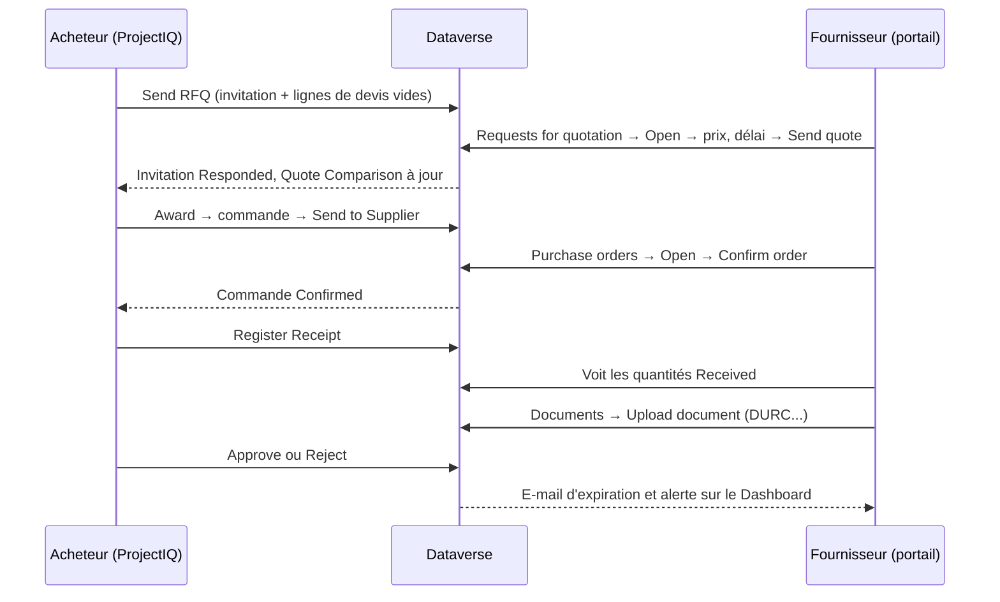

# Portail fournisseurs

> **Langue :** [English](../en/supplier-portal.md) · [Italiano](../it/supplier-portal.md) · Français · [Deutsch](../de/supplier-portal.md)
> **Index des manuels :** [README](../../README.md#user-manuals)

Le **portail fournisseurs** est un site web, réalisé avec Microsoft Power Pages sur la même base Dataverse que ProjectIQ, où vos fournisseurs peuvent travailler avec vous sans allers-retours d'e-mails et de tableurs. Sur le portail, un fournisseur :

- trouve sur un **tableau de bord** ce que vous attendez de lui : appels d'offres à chiffrer, commandes à confirmer, documents à renouveler ;
- voit les **appels d'offres** que vous lui avez envoyés, saisit les **prix unitaires**, le **délai de livraison** et des **notes**, et envoie son devis — ou décline ;
- voit les **commandes** que vous lui avez envoyées, avec lignes et montants, et les **confirme** ;
- voit la part de chaque commande déjà **reçue**, les **projets** de ses commandes et le statut de ses **factures** ;
- dépose ses **documents d'entreprise** (DURC, certifications, assurances), que votre acheteur approuve, et est averti quand ils expirent.

Tout ce que fait le fournisseur est immédiatement visible dans ProjectIQ : les devis apparaissent dans la Quote Comparison de l'appel d'offres, les confirmations changent le statut de la commande, les documents déposés attendent votre vérification.

Ce manuel comporte deux parties : la **Partie 1 pour les fournisseurs** (vous pouvez la leur transmettre) et la **Partie 2 pour votre personnel interne**, qui donne l'accès aux fournisseurs et suit leurs réponses.

> Le portail est aujourd'hui en **anglais** : les noms de pages et de boutons sont reproduits tels qu'à l'écran.

## Partie 1 — Guide pour les fournisseurs

### Connexion

Votre client vous donne accès à son portail fournisseurs. Vous recevez l'adresse du portail (par exemple `https://<client>-suppliers.powerappsportals.com`) et les instructions pour créer ou activer votre compte. Utilisez l'adresse e-mail que votre client a enregistrée pour vous.

1. Ouvrez l'adresse du portail et cliquez sur **Sign in**.
2. Connectez-vous avec votre compte : sous **Sign in with a local account**, saisissez votre **Email** et votre **Password** (**Forgot your password?** vous envoie un lien de réinitialisation), ou utilisez **Microsoft Entra ID** si votre client vous a donné un compte d'entreprise. Pas encore de compte ? Cliquez sur **Register**, ou sur **Redeem invitation** si vous avez reçu un code d'invitation.
3. Après la connexion, le portail ouvre le **Dashboard** (la page d'accueil vous y envoie ; si votre compte n'est pas encore lié à un fournisseur, elle vous invite à contacter votre client). À gauche, la barre latérale affiche les modules : **Dashboard** (tableau de bord), **Projects** (projets), **Requests for quotation** (appels d'offres), **Purchase orders** (commandes), **Invoices** (factures) et **Documents**. Un compteur bleu indique les appels d'offres à chiffrer et les commandes à confirmer ; un compteur orange les documents à renouveler ou à corriger. En bas figurent votre entreprise, votre nom et **Sign out**.

Si une page indique « This area is reserved to suppliers. Sign in with the account your customer invited. », vous n'êtes pas connecté, ou votre compte n'est pas encore activé comme fournisseur : contactez votre client.

Vous ne voyez que les données **de votre entreprise**. Vos collègues disposant de leur propre compte voient les mêmes données.

### Le tableau de bord

Le **Dashboard** est la page d'accueil :

| Partie | Ce qu'elle affiche |
|---|---|
| Compteurs | **Requests to quote** (appels d'offres à chiffrer), **Orders to confirm** (commandes à confirmer), le montant **Ordered** de l'année en cours (commandes confirmées et reçues) et les **Invoices under review** (factures en vérification) |
| **Document compliance** | Un anneau avec la part de vos documents approuvés valides (vert), expirant dans les 30 jours (orange) et expirés (rouge), ainsi que le nombre de documents en attente de vérification ou rejetés |
| **To do** | Une ligne par chose que votre client attend : documents expirés à renouveler, documents rejetés à corriger, appels d'offres à chiffrer (avec l'échéance), commandes à confirmer, documents qui expirent bientôt. Cliquez sur une ligne pour ouvrir la page où le faire |
| **Your projects** | Les premières cartes projet (voir ci-dessous), avec **All projects** pour la liste complète |

### Projets

**Projects** affiche une carte par projet de vos commandes : code et nom, **Project progress** (avancement du projet), **Your deliveries** (la part de votre montant commandé déjà reçue), le nombre d'**Orders**, le montant **Ordered** et la **End date** du projet. Un projet avec une commande à confirmer a une bordure orange. **See orders** ouvre les commandes.

### Répondre à un appel d'offres

1. Cliquez sur **Requests for quotation**. Chaque appel d'offres est une carte avec la date d'invitation, le numéro, l'objet, le montant **Quoted** une fois votre réponse envoyée et une barre indiquant le temps restant avant la **Deadline** (échéance ; elle devient orange puis rouge à l'approche de l'échéance). Les boutons en haut filtrent les cartes : **All**, **To quote**, **Quoted**, **Closed**.

| Badge de la carte | Signification |
|---|---|
| **To quote** | En attente de votre devis (bordure orange) |
| **Quoted** | Vous avez envoyé un devis (modifiable jusqu'à l'échéance) |
| **Declined** / **Closed** | Vous avez décliné, ou l'échéance est passée |

2. Cliquez sur **Quote now** (ou **Change quote**, **Open**) sur la carte. Vous voyez le numéro, l'échéance, les notes de votre client et la liste des articles avec quantité et unité.
3. Pour chaque ligne, saisissez l'**Unit price** (prix unitaire) et, si besoin, des **Notes** (marque, produit alternatif, conditions...).
4. Saisissez les **Delivery days** (délai de livraison en jours après la commande) et d'éventuelles **Notes for the buyer**.
5. Cliquez sur **Send quote**. Un message vert confirme : « Your quote has been sent. You can change it until the deadline. »

Bon à savoir :

- Vous pouvez laisser une ligne sans prix si vous ne fournissez pas cet article : « Lines without a price are not quoted. » Chiffrer toutes les lignes augmente vos chances, car le meilleur total n'est calculé que parmi les fournisseurs ayant chiffré toutes les lignes.
- Vous pouvez revenir et **modifier les prix jusqu'à l'échéance**. Après l'échéance (ou après avoir décliné), les champs sont en lecture seule.
- Si vous ne pouvez pas répondre, cliquez sur **Decline** et confirmez. L'appel d'offres est marqué Declined.
- Le montant **Quoted** de la liste est la somme quantité × prix unitaire de toutes vos lignes.

### Confirmer une commande

1. Cliquez sur **Purchase orders**. Chaque commande est une carte avec projet, date de commande, numéro et total. Les commandes qui attendent votre confirmation sont marquées **To confirm** et affichent livraison prévue, conditions de paiement et lieu de livraison ; les autres affichent une barre **Received** (reçu). Les boutons en haut filtrent les cartes : **All**, **To confirm**, **Confirmed**, **Received**.
2. Cliquez sur **Review and confirm** (ou **Open**). Vous voyez date de commande, livraison prévue, **Delivery place** (lieu de livraison), **Payment terms** (conditions de paiement), statut, et les lignes avec quantité, prix unitaire, montant et quantité déjà **Received** (reçue).
3. Vérifiez la commande, cliquez sur **Confirm order**, puis confirmez. Le statut devient **Confirmed** avec la date de confirmation.

| Statut affiché | Signification |
|---|---|
| **To confirm** | La commande vous a été envoyée et attend votre confirmation |
| **Confirmed** | Vous (ou l'acheteur pour votre compte) l'avez confirmée |
| **Received** | Toute la marchandise a été reçue par votre client |

Si quelque chose ne va pas dans la commande (prix, quantité, date), ne la confirmez pas : contactez l'acheteur, qui corrigera la commande et la renverra.

### Factures

**Invoices** affiche les factures que votre client a reçues de vous : les totaux **Under review** (en vérification), **Approved** de l'année en cours et **Rejected** (rejetées), puis une carte par facture avec commande et projet, numéro, montant, type de document et dates. Les étapes **Received → Reviewed → Approved** (ou **Rejected**, en rouge) montrent où en est la facture ; une facture rejetée affiche la **Reason** (motif). Les boutons en haut filtrent les cartes. Le portail ne reçoit pas de factures : envoyez-les comme d'habitude.

### Documents d'entreprise

**Documents** liste les documents que votre client demande à votre entreprise (DURC, extrait du registre du commerce, certifications, assurances, contrats) avec **Number**, **Issued** (émission), **Expires** (expiration) et deux badges :

| Colonne | Badges |
|---|---|
| **Expiry** | **Valid** (valide), **Expiring** (expire dans les 30 jours), **Expired** (expiré), **Replaced** (un document plus récent du même type a été approuvé), **No expiry** (sans expiration) |
| **Review** | **Pending review** (l'acheteur ne l'a pas encore vérifié), **Approved**, **Rejected** (avec le motif) |

Pour déposer un document :

1. Cliquez sur **New document** (ou faites défiler jusqu'au formulaire en bas de la page).
2. Choisissez le **Type**, saisissez une **Description** et, le cas échéant, **Number**, **Issue date**, **Expiry date** et **Notes**.
3. Choisissez le **File** (PDF ou image, jusqu'à 32 Mo) et cliquez sur **Upload document**.

Le document reste **Pending review** jusqu'à ce que l'acheteur l'approuve. Tant qu'il est en attente ou rejeté, vous pouvez cliquer sur **Edit** (modifier les données ou le fichier, puis **Save changes**) ou **Delete**. Corriger un document rejeté le renvoie en vérification. Une fois **Approved**, le document peut seulement être consulté : pour le renouveler, déposez un nouveau document du même type ; quand l'acheteur l'approuve, l'ancien devient **Replaced**. Quand l'acheteur l'approuve, le fichier passe dans les archives de votre client : la liste affiche **Filed by your customer** à la place du nom du fichier.

Vous recevez un e-mail quand un document approuvé va expirer (30 jours avant) et quand il expire ; le Dashboard affiche les mêmes alertes.

### Erreurs

Si une action échoue, un message rouge en explique la raison. Cas fréquents : « Session expired: sign in again. » (reconnectez-vous et recommencez), « The deadline of the request for quotation has passed. » (contactez l'acheteur pour une prolongation), « The request for quotation is closed. » (il a été attribué ou annulé), « Approved documents cannot be changed. » ou « Approved documents cannot be deleted. » (déposez plutôt un nouveau document), « Choose the file of the document. » (un nouveau document nécessite son fichier).

## Partie 2 — Guide pour le personnel interne

### Ce que le portail expose

Le portail est volontairement restreint. Les fournisseurs ne lisent que leurs propres enregistrements et ne peuvent modifier que quelques champs :

| Données | Le fournisseur peut lire | Le fournisseur peut modifier |
|---|---|---|
| Invitations aux appels d'offres de son entreprise | Numéro, échéance, notes, statut, montant chiffré | **Delivery days**, **supplier notes**, **status** (uniquement vers Responded ou Declined) |
| Lignes de devis de ces invitations | Article, quantité, unité, prix, notes | **Unit price**, **notes** |
| Commandes de son entreprise (Sent, Confirmed, Received) | En-tête et montants | **Supplier confirmed** (qui confirme la commande) |
| Lignes de ces commandes | Article, quantité, prix, montant, quantité reçue | Rien |
| Projets de ces commandes | Code, nom, avancement, date de fin | Rien |
| Factures fournisseur de son entreprise | Numéro, dates, montant, statut, note de décision | Rien |
| Documents fournisseur de son entreprise | Tous les champs, y compris la note de vérification | Type, description, numéro, dates, notes, fichier ; peut les créer et les supprimer, seulement tant que le document n'est pas approuvé |

Les commandes en brouillon ou annulées et les appels d'offres non envoyés ne sont jamais affichés. Les prix des autres fournisseurs ne sont jamais visibles.

### Donner l'accès à un fournisseur

Un utilisateur fournisseur est un **contact** dont l'**entreprise** est le compte fournisseur, avec le rôle web **Supplier**.

1. Dans ProjectIQ, vérifiez que le compte fournisseur est **Is Supplier**, **Active** et non **Blocked**, avec un **Email** valide.
2. Créez (ou ouvrez) le **contact** de la personne, avec **Company Name** = le fournisseur et son e-mail.
3. Dans **Power Pages Management** (ou le studio du portail, *Set up → Web roles*), attribuez au contact le rôle web **Supplier**.
4. Permettez à la personne de se connecter avec la méthode configurée sur votre site (par exemple en envoyant une **invitation** depuis Power Pages Management → *Invitations*, ou en la laissant s'inscrire avec l'e-mail enregistré).
5. Envoyez-lui l'adresse du portail et la [Partie 1](#partie-1--guide-pour-les-fournisseurs) de ce manuel.

Pour retirer l'accès, retirez le rôle web Supplier du contact ou désactivez le contact.

**Méthodes de connexion.** En plus de Microsoft Entra ID, le portail propose des **comptes locaux** (e-mail et mot de passe), pour que les fournisseurs extérieurs à votre tenant puissent se connecter. Les personnes peuvent aussi **s'inscrire** elles-mêmes : une personne inscrite ne voit rien tant que vous n'avez pas renseigné le **Company Name** de son contact avec le fournisseur et attribué le rôle web **Supplier** ; vérifiez donc régulièrement les nouveaux contacts. Votre administrateur peut désactiver les comptes locaux ou l'inscription libre (seules les personnes invitées peuvent alors s'inscrire), voir [Development environment setup](../dev-environment.md#supplier-portal-power-pages) (en anglais).

### Vérifier les documents

Un document déposé sur le portail est **Pending Review** et le propriétaire du compte du fournisseur reçoit la notification « Supplier document to review ». Ouvrez-le depuis la notification, ou depuis la vue **Supplier Documents to Review**, vérifiez le fichier et cliquez sur **Approve** ou **Reject** (avec une note que le fournisseur lira). Voir [Données de référence](master-data.md#vérification). Les e-mails d'expiration aux fournisseurs nécessitent la configuration décrite dans [Administration](administration.md#expiration-quotidienne-des-documents).

### Suivre les réponses

- Dans l'appel d'offres, la liste **Invitations** montre pour chaque fournisseur le statut, **Responded On**, **Quoted Amount** et **Delivery Days** ; le compteur **Responses** indique combien ont répondu.
- L'onglet **Quote Comparison** affiche les devis du portail à côté de ceux que vous avez saisis. Attribuez comme décrit dans [Achats](purchasing.md#comparer-et-attribuer).
- Quand un fournisseur confirme une commande sur le portail, elle passe en **Confirmed** et *Supplier Confirmed* / *Confirmed On* sont renseignés, exactement comme si vous aviez cliqué sur **Confirm**.

### À retenir

- Un appel d'offres n'apparaît sur le portail qu'après **Send** ; une commande qu'après **Send to Supplier**.
- Aucune de ces actions n'envoie d'e-mail à elle seule : prévenez le fournisseur qu'un nouvel appel d'offres ou une nouvelle commande l'attend (par votre e-mail habituel, ou par une automatisation que votre administrateur peut ajouter).
- Si vous repassez une commande en **Back to Draft**, elle disparaît du portail jusqu'à son nouvel envoi.
- Après l'échéance, le fournisseur ne peut plus modifier son devis : prolongez la **Deadline** et cliquez de nouveau sur **Send** si vous souhaitez d'autres réponses.

### Pour les administrateurs

Le portail est livré dans une solution distincte, **OpenProject365SupplierPortal**, qui dépend de la solution principale. L'apparence du portail (barre latérale, cartes, anneau de conformité) est uniquement du Liquid et du CSS dans les modèles web **OP365 Supplier Style**, **OP365 Supplier Nav** et **OP365 Supplier Project Cards**. La mise en place, les autorisations de table, les paramètres de la Web API et les étapes de déploiement sont documentés dans [Development environment setup](../dev-environment.md#supplier-portal-power-pages) (en anglais). Après chaque déploiement du portail, videz le cache du site (`/_services/about` → *Clear cache*, rôle web Administrators) et reconnectez-vous. Dans un nouvel environnement, le site importé doit être réactivé (Power Pages → *Inactive sites*) avant utilisation.
