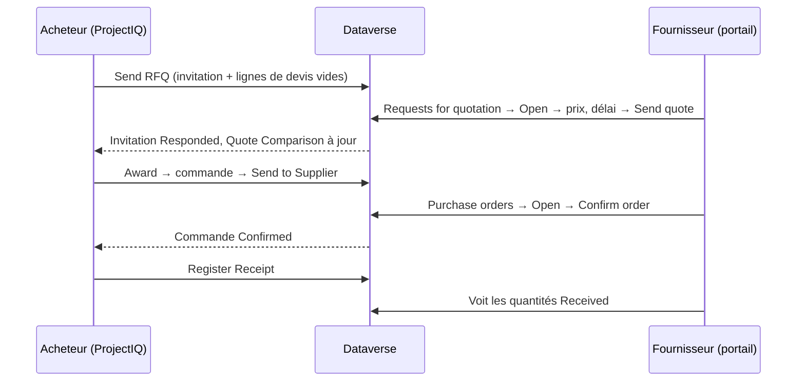

# Portail fournisseurs

> **Langue :** [English](../en/supplier-portal.md) · [Italiano](../it/supplier-portal.md) · Français · [Deutsch](../de/supplier-portal.md)
> **Index des manuels :** [README](../../README.md#user-manuals)

Le **portail fournisseurs** est un site web, réalisé avec Microsoft Power Pages sur la même base Dataverse que ProjectIQ, où vos fournisseurs peuvent travailler avec vous sans allers-retours d'e-mails et de tableurs. Sur le portail, un fournisseur :

- voit les **appels d'offres** que vous lui avez envoyés, saisit les **prix unitaires**, le **délai de livraison** et des **notes**, et envoie son devis — ou décline ;
- voit les **commandes** que vous lui avez envoyées, avec lignes et montants, et les **confirme** ;
- voit la part de chaque commande déjà **reçue**.

Tout ce que fait le fournisseur est immédiatement visible dans ProjectIQ : les devis apparaissent dans la Quote Comparison de l'appel d'offres, les confirmations changent le statut de la commande.

Ce manuel comporte deux parties : la **Partie 1 pour les fournisseurs** (vous pouvez la leur transmettre) et la **Partie 2 pour votre personnel interne**, qui donne l'accès aux fournisseurs et suit leurs réponses.

> Le portail est aujourd'hui en **anglais** : les noms de pages et de boutons sont reproduits tels qu'à l'écran.

## Partie 1 — Guide pour les fournisseurs

### Connexion

Votre client vous donne accès à son portail fournisseurs. Vous recevez l'adresse du portail (par exemple `https://<client>-suppliers.powerappsportals.com`) et les instructions pour créer ou activer votre compte. Utilisez l'adresse e-mail que votre client a enregistrée pour vous.

1. Ouvrez l'adresse du portail et cliquez sur **Sign in**.
2. Connectez-vous avec votre compte.
3. Le menu affiche **Requests for quotation** (appels d'offres) et **Purchase orders** (commandes).

Si une page indique « This area is reserved to suppliers. Sign in with the account your customer invited. », vous n'êtes pas connecté, ou votre compte n'est pas encore activé comme fournisseur : contactez votre client.

Vous ne voyez que les appels d'offres et commandes **de votre entreprise**. Vos collègues disposant de leur propre compte voient les mêmes données.

### Répondre à un appel d'offres

1. Cliquez sur **Requests for quotation**. La liste affiche, pour chaque appel d'offres : numéro, **Deadline** (échéance), **Status** et le montant **Quoted** une fois votre réponse envoyée.

| Statut | Signification |
|---|---|
| **Invited** | En attente de votre devis |
| **Responded** | Vous avez envoyé un devis (modifiable jusqu'à l'échéance) |
| **Declined** | Vous avez décliné |

2. Cliquez sur **Open**. Vous voyez le numéro, l'échéance, les notes de votre client et la liste des articles avec quantité et unité.
3. Pour chaque ligne, saisissez l'**Unit price** (prix unitaire) et, si besoin, des **Notes** (marque, produit alternatif, conditions...).
4. Saisissez les **Delivery days** (délai de livraison en jours après la commande) et d'éventuelles **Notes for the buyer**.
5. Cliquez sur **Send quote**. Un message vert confirme : « Your quote has been sent. You can change it until the deadline. »

Bon à savoir :

- Vous pouvez laisser une ligne sans prix si vous ne fournissez pas cet article : « Lines without a price are not quoted. » Chiffrer toutes les lignes augmente vos chances, car le meilleur total n'est calculé que parmi les fournisseurs ayant chiffré toutes les lignes.
- Vous pouvez revenir et **modifier les prix jusqu'à l'échéance**. Après l'échéance (ou après avoir décliné), les champs sont en lecture seule.
- Si vous ne pouvez pas répondre, cliquez sur **Decline** et confirmez. L'appel d'offres est marqué Declined.
- Le montant **Quoted** de la liste est la somme quantité × prix unitaire de toutes vos lignes.

### Confirmer une commande

1. Cliquez sur **Purchase orders**. La liste affiche numéro, **Date** de commande, **Expected delivery** (livraison prévue), **Status** et **Total**. Les commandes qui attendent votre confirmation sont marquées **To confirm**.
2. Cliquez sur **Open**. Vous voyez date de commande, livraison prévue, **Delivery place** (lieu de livraison), **Payment terms** (conditions de paiement), statut, et les lignes avec quantité, prix unitaire, montant et quantité déjà **Received** (reçue).
3. Vérifiez la commande, cliquez sur **Confirm order**, puis confirmez. Le statut devient **Confirmed** avec la date de confirmation.

| Statut affiché | Signification |
|---|---|
| **To confirm** | La commande vous a été envoyée et attend votre confirmation |
| **Confirmed** | Vous (ou l'acheteur pour votre compte) l'avez confirmée |
| **Received** | Toute la marchandise a été reçue par votre client |

Si quelque chose ne va pas dans la commande (prix, quantité, date), ne la confirmez pas : contactez l'acheteur, qui corrigera la commande et la renverra.

### Erreurs

Si une action échoue, un message rouge en explique la raison. Cas fréquents : « Session expired: sign in again. » (reconnectez-vous et recommencez), « The deadline of the request for quotation has passed. » (contactez l'acheteur pour une prolongation), « The request for quotation is closed. » (il a été attribué ou annulé).

## Partie 2 — Guide pour le personnel interne

### Ce que le portail expose

Le portail est volontairement restreint. Les fournisseurs ne lisent que leurs propres enregistrements et ne peuvent modifier que quelques champs :

| Données | Le fournisseur peut lire | Le fournisseur peut modifier |
|---|---|---|
| Invitations aux appels d'offres de son entreprise | Numéro, échéance, notes, statut, montant chiffré | **Delivery days**, **supplier notes**, **status** (uniquement vers Responded ou Declined) |
| Lignes de devis de ces invitations | Article, quantité, unité, prix, notes | **Unit price**, **notes** |
| Commandes de son entreprise (Sent, Confirmed, Received) | En-tête et montants | **Supplier confirmed** (qui confirme la commande) |
| Lignes de ces commandes | Article, quantité, prix, montant, quantité reçue | Rien |

Les commandes en brouillon ou annulées et les appels d'offres non envoyés ne sont jamais affichés. Les prix des autres fournisseurs ne sont jamais visibles.

### Donner l'accès à un fournisseur

Un utilisateur fournisseur est un **contact** dont l'**entreprise** est le compte fournisseur, avec le rôle web **Supplier**.

1. Dans ProjectIQ, vérifiez que le compte fournisseur est **Is Supplier**, **Active** et non **Blocked**, avec un **Email** valide.
2. Créez (ou ouvrez) le **contact** de la personne, avec **Company Name** = le fournisseur et son e-mail.
3. Dans **Power Pages Management** (ou le studio du portail, *Set up → Web roles*), attribuez au contact le rôle web **Supplier**.
4. Permettez à la personne de se connecter avec la méthode configurée sur votre site (par exemple en envoyant une **invitation** depuis Power Pages Management → *Invitations*, ou en la laissant s'inscrire avec l'e-mail enregistré).
5. Envoyez-lui l'adresse du portail et la [Partie 1](#partie-1--guide-pour-les-fournisseurs) de ce manuel.

Pour retirer l'accès, retirez le rôle web Supplier du contact ou désactivez le contact.

### Suivre les réponses

- Dans l'appel d'offres, la liste **Invitations** montre pour chaque fournisseur le statut, **Responded On**, **Quoted Amount** et **Delivery Days** ; le compteur **Responses** indique combien ont répondu.
- L'onglet **Quote Comparison** affiche les devis du portail à côté de ceux que vous avez saisis. Attribuez comme décrit dans [Achats](purchasing.md#comparer-et-attribuer).
- Quand un fournisseur confirme une commande sur le portail, elle passe en **Confirmed** et *Supplier Confirmed* / *Confirmed On* sont renseignés, exactement comme si vous aviez cliqué sur **Confirm**.

### À retenir

- Un appel d'offres n'apparaît sur le portail qu'après **Send** ; une commande qu'après **Send to Supplier**.
- Aucune de ces actions n'envoie d'e-mail à elle seule : prévenez le fournisseur qu'un nouvel appel d'offres ou une nouvelle commande l'attend (par votre e-mail habituel, ou par une automatisation que votre administrateur peut ajouter).
- Si vous repassez une commande en **Back to Draft**, elle disparaît du portail jusqu'à son nouvel envoi.
- Après l'échéance, le fournisseur ne peut plus modifier son devis : prolongez la **Deadline** et cliquez de nouveau sur **Send** si vous souhaitez d'autres réponses.

### Pour les administrateurs

Le portail est livré dans une solution distincte, **OpenProject365SupplierPortal**, qui dépend de la solution principale. La mise en place, les autorisations de table, les paramètres de la Web API et les étapes de déploiement sont documentés dans [Development environment setup](../dev-environment.md#supplier-portal-power-pages) (en anglais). Après chaque déploiement du portail, videz le cache du site (`/_services/about` → *Clear cache*, rôle web Administrators) et reconnectez-vous. Dans un nouvel environnement, le site importé doit être réactivé (Power Pages → *Inactive sites*) avant utilisation.
