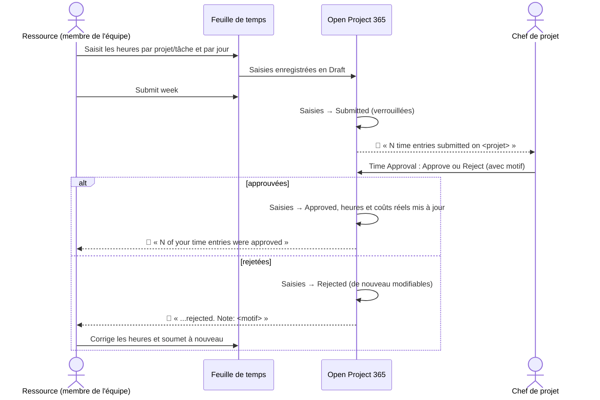
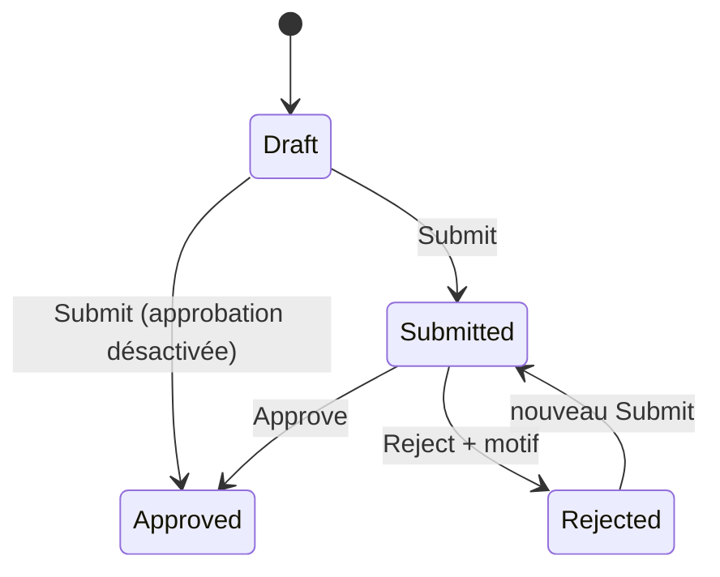
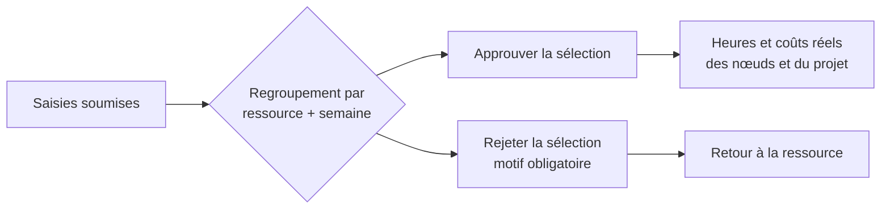

# Saisie des temps : feuille de temps, approbation et rappels

> **Langue :** [English](../en/time-tracking.md) · [Italiano](../it/time-tracking.md) · Français · [Deutsch](../de/time-tracking.md)
> **Index des manuels :** [README](../../README.md#user-manuals)

Les heures sont généralement le premier poste de coût d'une affaire, et le plus difficile à collecter à temps. Open Project 365 fait de leur saisie une routine hebdomadaire : chacun remplit une **feuille de temps hebdomadaire** par projet et par tâche, soumet sa semaine, et les chefs de projet **approuvent** ou **rejettent** les heures depuis un seul écran. Les heures approuvées deviennent les **heures et coûts réels** des nœuds WBS et du projet, valorisées au coût horaire en vigueur ce jour-là. Un **rappel quotidien** prévient ceux qui ont oublié de saisir leurs heures.

Ce manuel s'adresse à tous ceux qui saisissent des heures (partie 1), aux chefs de projet qui les approuvent (partie 2) et aux administrateurs qui configurent le processus (partie 3).

> Les noms des champs et des boutons sont en anglais, comme à l'écran.

## Le processus complet

### Statuts d'une saisie d'heures

| Statut | Qui peut modifier la saisie | Compte dans le réel |
|---|---|---|
| **Draft** (brouillon) | La ressource (modifier, supprimer) | Non |
| **Submitted** (soumise) | Personne : verrouillée en attente d'approbation | Non |
| **Approved** (approuvée) | Personne : définitive | **Oui** |
| **Rejected** (rejetée) | La ressource (modifier, supprimer, soumettre à nouveau) | Non |

## Partie 1 — Saisir ses heures

### Avant de commencer

- Votre utilisateur doit être relié à une **Resource** (Master Data → Resources → champ *User*). Sinon la feuille de temps affiche « Your user is not linked to a resource. Ask an administrator to set User on your Resource. »
- Vous ne pouvez saisir des heures que sur les projets **In Progress** que vous voyez (vous en êtes membre ou propriétaire).

### Le tableau de bord Timesheet

Ouvrez **Projects → Time → Timesheet**. Vous voyez une semaine, du lundi au dimanche, de **vos** heures.

| Zone | Contenu |
|---|---|
| **Barre d'outils** | **Previous week**, **This week**, **Next week**, **Refresh**, **Submit week** |
| **Lignes** | Une ligne par combinaison *projet / tâche* ; la tâche (nœud WBS) est facultative |
| **Colonnes des jours** | Heures par jour ; chaque cellule affiche une pastille colorée avec le statut de sa saisie |
| **Colonne Total** | Heures de la ligne dans la semaine |
| **Pied** | Totaux journaliers et total hebdomadaire, comparé à vos **Weekly hours** |

Illustration :

| Projet / tâche | Lun | Mar | Mer | Jeu | Ven | Sam | Dim | Total |
|---|---|---|---|---|---|---|---|---|
| PRJ-000042 Rénovation de bureaux / 2.2.1 Électricité | 8 ✅ | 6 ✅ | 8 📝 | | | | | 22 |
| PRJ-000051 Entrepôt / 1.2 Plans d'exécution | | 2 ✅ | | 8 📝 | 4 📝 | | | 14 |
| **Total** (heures hebdo 40) | 8 | 8 | 8 | 8 | 4 | | | **36 / 40** |

(✅ approuvée, 📝 brouillon : à l'écran, les pastilles sont *Draft*, *Submitted*, *Approved*, *Rejected*.)

### Ajouter une ligne

1. En bas de la grille, choisissez le **Project** (seuls les projets In Progress sont proposés).
2. Choisissez éventuellement la **Task** (un nœud WBS de ce projet). Laissez vide pour saisir du temps sur le projet dans son ensemble.
3. Cliquez sur **Add line**. Une ligne vide apparaît.

### Saisir les heures

1. Cliquez sur une cellule de jour et saisissez les heures : **de 0 à 24**, décimales avec virgule ou point. Les valeurs sont arrondies au **quart d'heure** (1,3 devient 1,25).
2. Appuyez sur **Entrée** ou passez à une autre cellule : la saisie est enregistrée immédiatement en **Draft**.
3. Pour retirer des heures, saisissez **0** ou videz la cellule : la saisie en brouillon est supprimée.

Si vous saisissez une valeur qui n'est pas un nombre valide, la cellule affiche « Enter hours between 0 and 24. »

Une cellule n'est modifiable que si elle contient **au plus une saisie** et que celle-ci est Draft ou Rejected. Les cellules avec des saisies soumises ou approuvées sont en lecture seule. Si vous avez deux saisies pour le même projet, la même tâche et le même jour (créées par exemple depuis la liste Time Entries), la cellule affiche leur somme et doit être modifiée depuis la liste.

### Soumettre la semaine

Quand la semaine est complète, cliquez sur **Submit week**. Toutes les saisies **Draft** et **Rejected** de la semaine sont soumises en une fois, un message confirme leur nombre (« N entries submitted ») et les chefs de projet sont notifiés. Les saisies soumises sont verrouillées.

> Soumettez chaque semaine, même incomplète : les approbateurs voient vos heures plus tôt et les coûts du projet restent à jour. Vous pourrez ajouter des heures et soumettre à nouveau ; les saisies déjà approuvées ne sont pas touchées.

### Quand des heures sont rejetées

Vous recevez une notification avec le motif. Ouvrez la feuille de temps sur cette semaine : les cellules rejetées sont de nouveau modifiables. Corrigez-les (ou supprimez-les) et cliquez de nouveau sur **Submit week**.

### Notes et autres façons de saisir du temps

La feuille de temps est la voie la plus rapide, mais pas la seule :

- **Projects → Time → Time Entries** liste vos saisies (**My Time Entries**) et permet d'en créer une avec **+ New** : choisissez projet, tâche, date, heures et ajoutez des **Notes** (par exemple ce que vous avez fait).
- Dans le formulaire projet, l'onglet **Time** liste les saisies du projet.
- Le formulaire de création rapide (**+** dans la barre du haut → Time Entry) demande projet, tâche, date, heures et notes.

Dans le formulaire de saisie, seuls les nœuds WBS du projet choisi sont proposés. La **Resource** est renseignée avec votre ressource ; **Name** (ressource + date), **Cost** et **Revenue** sont calculés.

### Le rappel quotidien

Du lundi au vendredi à **17 h 30** (heure de Rome), l'application contrôle les heures de la journée de chacun. Si vous avez saisi moins d'heures que prévu, vous recevez la notification **« Record your hours »** — « You have recorded X of Y hours on <date>. » — avec un bouton **Open timesheet**.

Les heures attendues sont vos Weekly Hours divisées par vos jours travaillés, moins les absences du jour :

| Situation | Heures attendues (40 h/semaine, lun–ven) |
|---|---|
| Journée normale | 8 |
| Demi-journée de permission (absence d'un jour, 4 heures) | 4 |
| Congé ou maladie sur la journée entière | 0 (pas de rappel) |
| Samedi ou dimanche | 0 (pas de rappel) |
| Fermeture d'entreprise | Aucun rappel pour personne |

Les heures comptent quel que soit leur statut (brouillons compris) : il suffit de les saisir pour arrêter le rappel ; inutile de les soumettre chaque jour.

## Partie 2 — Approuver les heures

Les approbateurs sont les **Managers** de chaque projet (membres avec le rôle Manager, ce qui inclut toujours le chef de projet) et les administrateurs.

### Le tableau de bord Time Approval

Ouvrez **Projects → Time → Approvals**. Il liste toutes les saisies **soumises** que vous pouvez voir, regroupées par **ressource** et par **semaine**.

| Colonne | Contenu |
|---|---|
| **Resource** | Qui a travaillé |
| **Week** | Lundi de la semaine |
| **Hours** | Total des heures soumises du groupe, avec la répartition par projet |
| **Expand** | Affiche les saisies du groupe (date, projet, tâche, heures, notes) |

Pour décider :

1. Sélectionnez des groupes entiers avec leur case (ou **Select all**), ou dépliez un groupe et sélectionnez des saisies individuelles.
2. Cliquez sur **Approve** : un message confirme « N entries approved. »
3. Ou cliquez sur **Reject** : une boîte de dialogue « Reject N time entries » demande le **Reason (sent to the resource)**, c'est-à-dire le motif envoyé à la ressource, obligatoire. Confirmez avec **Reject**.

Vous ne pouvez décider que les saisies des projets dont vous êtes Manager. Si vous en sélectionnez d'autres, l'opération s'arrête avec « Only a manager of the project can approve or reject its time entries. »

La vue **Time Entries to Approve** (Projects → Time → Time Entries) montre les mêmes saisies sous forme de liste, et **Time Entries by Project** est utilisée dans l'onglet Time du projet.

### Ce que change l'approbation

Lorsqu'une saisie est approuvée :

- ses **heures** s'ajoutent aux **Actual Hours** de son nœud WBS et du projet ;
- son **coût** s'ajoute à l'**Actual Cost** du nœud et du projet, et apparaît dans la [synthèse des coûts](materials-and-costs.md#synthèse-des-coûts) ;
- la saisie devient définitive : elle ne peut plus être modifiée ni supprimée.

## Valorisation des heures

Chaque saisie porte deux montants, calculés à chaque enregistrement :

| Montant | Formule | Visible par |
|---|---|---|
| **Cost** (coût) | Heures × le **coût horaire de la ressource en vigueur à la date** de la saisie (historique Resource Costs) | Uniquement les utilisateurs avec le profil *OP365 Cost Visibility* |
| **Revenue** (produit) | Heures × l'**Hourly Rate** de l'utilisateur de la ressource en tant que membre du projet (0 s'il n'est pas renseigné) | Les utilisateurs qui peuvent lire la saisie |

Exemple : le coût de Marco est de 35,00 €/h jusqu'au 30 juin et de 38,50 €/h à partir du 1er juillet. 8 heures le 28 juin coûtent 280,00 ; 8 heures le 2 juillet coûtent 308,00, même si les deux saisies sont faites le même jour. Si l'Hourly Rate de Marco sur le projet est de 55,00 €/h, les deux saisies ont un produit de 440,00.

## Partie 3 — Configuration (administrateurs)

| Réglage | Où | Effet |
|---|---|---|
| **Time Approval Enabled** | Settings → Company → Settings | Activé (par défaut) : les heures soumises attendent l'approbation. Désactivé : **Submit** approuve immédiatement les saisies (elles comptent tout de suite dans le réel) |
| **User** sur la Resource | Master Data → Resources | Relie une personne à sa ressource : nécessaire pour la feuille de temps |
| **Weekly Hours**, **Working Days** | Resource | Heures attendues (rappel, total hebdomadaire) |
| **Absences** | Planning → Absences | Réduisent les heures attendues ; les fermetures d'entreprise suspendent les rappels |
| **Hourly Rate** sur le Project Member | Projet → Team | Produit des heures du membre |
| Flux **Daily time reminder** | Power Automate, solution Open Project 365 | Envoie les rappels (lun–ven 17 h 30). Voir [Administration](administration.md#rappel-quotidien-des-heures) |

Les administrateurs peuvent soumettre des saisies pour d'autres et approuver ou rejeter des saisies de n'importe quel projet.

## Messages possibles

| Message | Signification et solution |
|---|---|
| « Your user is not linked to a resource. Ask an administrator to set User on your Resource. » | Aucune ressource active n'a votre utilisateur dans le champ *User* |
| « Hours and materials can be recorded only on projects In Progress. » | Le projet est une offre, suspendu ou clos |
| « The WBS node belongs to another project. » | La tâche choisie ne fait pas partie du projet sélectionné |
| « Submitted or approved time entries cannot be changed. » / « ...cannot be deleted. » | Demandez au chef de projet de rejeter la saisie si elle doit être corrigée |
| « Use Submit, Approve or Reject to change the status of time entries. » | Le statut ne se modifie pas directement |
| « Only draft or rejected time entries can be submitted. » | Certaines saisies sélectionnées sont déjà soumises ou approuvées |
| « You can submit only your own time entries. » | Seuls les administrateurs peuvent soumettre pour d'autres |
| « Select at least one time entry. » | Rien n'a été sélectionné |
| « Add a note to reject time entries. » | Le motif du rejet est obligatoire |
| « Only submitted time entries can be approved or rejected. » | La saisie a déjà été traitée (peut-être par un autre manager) : actualisez |
| « Enter hours between 0 and 24. » | La valeur saisie dans la feuille de temps n'est pas valide |
