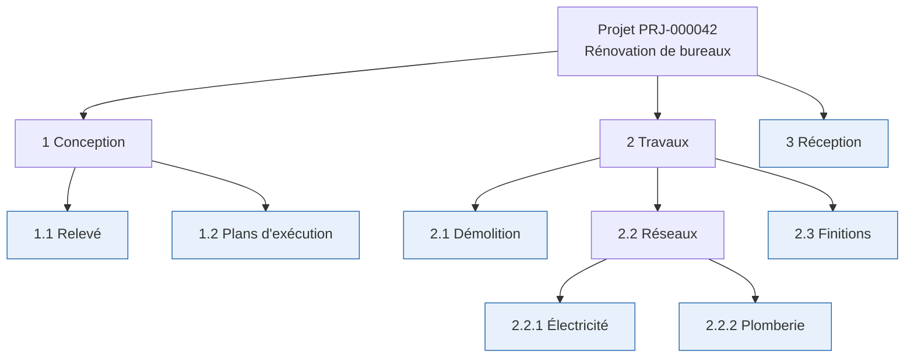
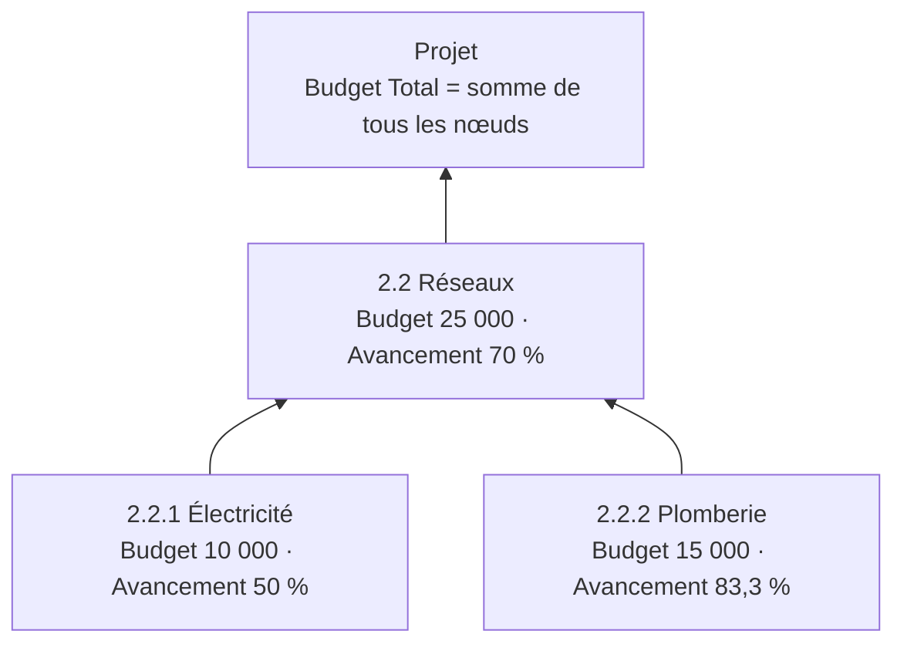
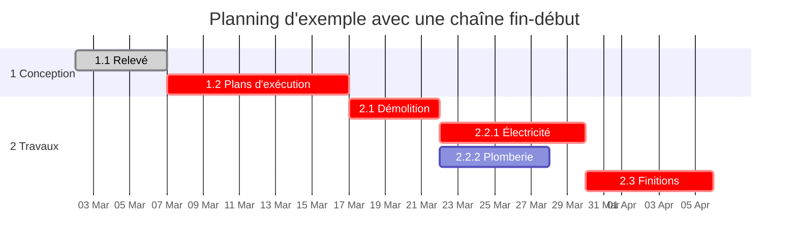
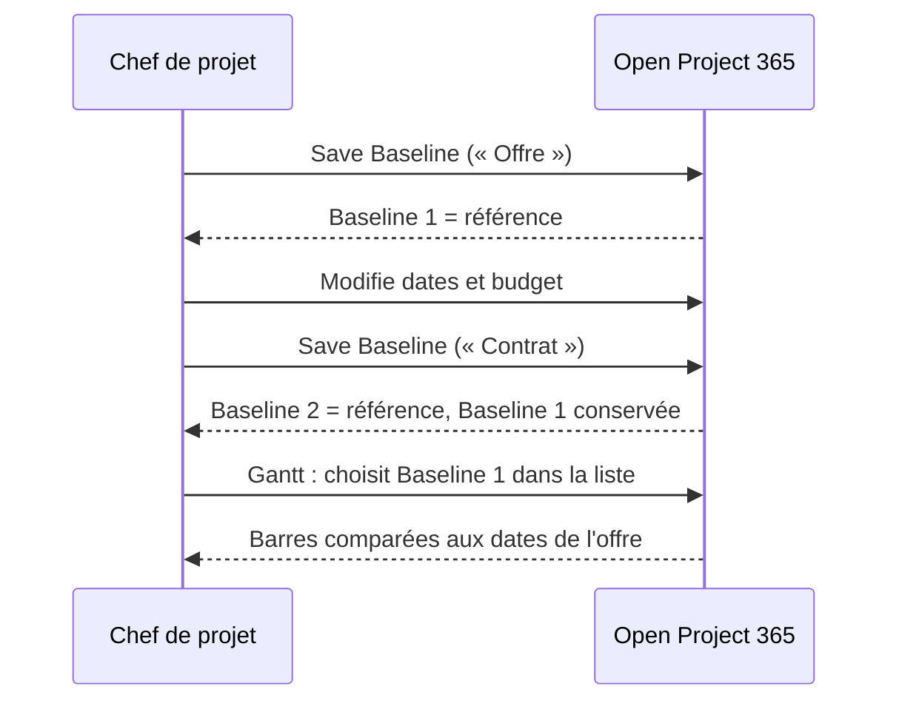

# WBS, budget, Gantt et baselines

> **Langue :** [English](../en/wbs-and-planning.md) · [Italiano](../it/wbs-and-planning.md) · Français · [Deutsch](../de/wbs-and-planning.md)
> **Index des manuels :** [README](../../README.md#user-manuals)

La **Work Breakdown Structure (WBS)**, ou organigramme des tâches, découpe un projet en phases, lots de travaux et tâches. Dans Open Project 365, la WBS est l'endroit où l'on construit le budget, où l'on planifie dates et dépendances, où l'on déclare l'avancement et où l'on collecte heures et coûts. Au-dessus se trouvent le **diagramme de Gantt**, avec le **chemin critique**, et les **baselines**, copies figées du planning qui permettent de comparer ce qui a été convenu avec ce qui se passe.

Ce manuel couvre les onglets **WBS** et **Gantt** du formulaire projet, le formulaire du nœud WBS, les dépendances, les affectations et les baselines. Les heures prévues par ressource sont traitées dans [Charge des ressources](resource-load.md).

> Les noms des champs et des boutons sont en anglais, comme à l'écran.

## Concepts

- Un **nœud WBS** est n'importe quel élément de l'arbre. Un nœud peut avoir un **nœud parent**, l'arbre peut donc être aussi profond que nécessaire.
- Un **nœud feuille** (en surbrillance ci-dessus) n'a pas d'enfants : c'est une vraie tâche. Budget, dates et avancement se saisissent sur les nœuds feuilles.
- Un **nœud parent** (récapitulatif) a des enfants : dans la grille et le Gantt, ses valeurs sont **cumulées** depuis les nœuds inférieurs.
- Une **dépendance** relie deux nœuds : le successeur ne peut commencer qu'après la fin du prédécesseur (fin-début), éventuellement après quelques **jours de décalage** (lag).
- Une **affectation** indique combien d'heures une ressource doit travailler sur un nœud.
- Une **baseline** est une photographie du budget et des dates de tous les nœuds à un moment donné.

## Le nœud WBS

### Champs

**Onglet General**

| Champ | Signification |
|---|---|
| **Project** | Le projet (obligatoire). Le nœud est supprimé avec le projet |
| **Parent Node** | Le nœud supérieur dans l'arbre. Seuls les nœuds **du même projet** peuvent être choisis. Vide = nœud de premier niveau |
| **Code** | Code de structure, par exemple `2.2.1`. Texte libre ; il sert au tri (voir plus bas) |
| **Name** | Nom de la phase ou de la tâche (obligatoire) |
| **Owner Resource** | La ressource responsable du nœud |
| **Sort Order** | Nombre facultatif qui impose la position parmi les nœuds frères |
| **Start Date** / **End Date** | Dates prévues |
| **Progress %** | Pourcentage d'achèvement (0–100), saisi sur les nœuds feuilles |
| **Owner** | Propriétaire de l'enregistrement |

**Onglet Budget**

| Champ | Signification |
|---|---|
| **Budget Hours** | Heures prévues |
| **Actual Hours** | Heures approuvées saisies sur le nœud (calculé) |
| **Budget Labour** | Coût prévu de main-d'œuvre |
| **Budget Materials** | Coût prévu des matériaux |
| **Budget Other** | Autres coûts prévus (sous-traitance, locations, déplacements...) |
| **Budget Total** | Labour + Materials + Other (calculé à l'enregistrement) |
| **Actual Cost** | Coût de la main-d'œuvre approuvée + consommations de matériaux sur le nœud (calculé) |

**Onglet Dependencies** : **Predecessors** (nœuds que ce nœud attend) et **Successors** (nœuds qui attendent celui-ci).

**Onglet Allocations** : ressources et heures prévues sur le nœud.

### Ordre des nœuds

Les nœuds frères s'affichent dans cet ordre :

1. par **Sort Order**, s'il est renseigné (le plus petit d'abord) ;
2. puis par **Code**, dans l'ordre naturel de la structure : `1.2` avant `1.10`, `2` avant `10` ;
3. puis par **Name**.

Dans la plupart des cas, des codes cohérents suffisent ; utilisez Sort Order pour un ordre différent de celui des codes.

## L'onglet WBS (WBS Tree Grid)

L'onglet WBS du projet affiche l'arbre complet sous forme de grille dépliable.

| Colonne | Nœuds feuilles | Nœuds parents |
|---|---|---|
| **Name** (avec code) | Clic pour ouvrir le formulaire du nœud | Clic sur la flèche pour déplier/replier ; clic sur le nom pour ouvrir le formulaire |
| **Start** / **End** | Modifiables en ligne | Début le plus tôt / fin la plus tardive des nœuds inférieurs (en gris, cumulés) |
| **Budget Hours** | Modifiable en ligne | Somme des nœuds inférieurs |
| **Labour**, **Materials**, **Other** | Modifiables en ligne | – |
| **Budget Total** | Calculé | Somme des nœuds inférieurs |
| **Progress %** | Modifiable en ligne | Avancement des feuilles inférieures pondéré par le budget |

La dernière ligne affiche le **Total** des heures et du budget de tout le projet. Les valeurs cumulées sont en gris ; survolez-les pour voir l'info-bulle « Includes child nodes ».

### Barre d'outils

| Bouton | Action |
|---|---|
| **New node** | Ouvre un nouveau formulaire de nœud pour le projet (premier niveau) |
| **New child node** | Ouvre un nouveau nœud sous la ligne sélectionnée (cliquez d'abord sur une ligne pour la sélectionner) |
| **Expand all** / **Collapse all** | Déplie ou replie toutes les branches |
| **Refresh** | Recharge l'arbre (après avoir modifié des nœuds dans une autre fenêtre) |

### Modification en ligne

1. Cliquez sur une cellule d'un nœud feuille (dates, heures, main-d'œuvre, matériaux, autres, avancement).
2. Saisissez la valeur. Les décimales acceptent la virgule ou le point.
3. Appuyez sur **Entrée** ou cliquez ailleurs pour enregistrer ; **Échap** annule.

La modification est enregistrée immédiatement, le budget total du nœud est recalculé et le **Budget Total** et le **Progress %** du projet sont mis à jour. Si une valeur ne peut pas être enregistrée, le message « The change could not be saved » en indique la raison.

> Si le projet n'a pas encore été enregistré, la grille affiche « Save the project to build its WBS. »

### Construire rapidement une WBS

1. Créez les phases de premier niveau avec **New node** (codes `1`, `2`, `3`...).
2. Sélectionnez une phase, cliquez sur **New child node** et créez ses tâches (`1.1`, `1.2`...).
3. Renseignez dates, heures et budget directement dans la grille.
4. Ouvrez les nœuds qui ont besoin de dépendances ou d'affectations et ajoutez-les dans leurs onglets.

## Cumul du budget et de l'avancement

- **Budget Total d'un nœud** = Budget Labour + Budget Materials + Budget Other, recalculé à chaque enregistrement.
- **Budget Total du projet** = somme des budgets totaux des nœuds.
- **Avancement** d'un nœud récapitulatif et du projet = avancement des **nœuds feuilles** pondéré par leur budget total : (10 000 × 50 % + 15 000 × 83,3 %) ÷ 25 000 = 70 %. Si aucune feuille n'a de budget, les poids sont les heures budgétées ; s'il n'y a pas non plus d'heures, on prend une moyenne simple.

> Saisissez les montants de budget **uniquement sur les nœuds feuilles**. Un budget saisi sur un nœud parent est tout de même ajouté au total du projet, qui risque de le compter deux fois si ses enfants ont aussi un budget.

## Dépendances

Une dépendance indique que le **successeur** ne peut commencer qu'après la fin du **prédécesseur**.

| Champ | Signification |
|---|---|
| **Predecessor** | Le nœud qui doit finir en premier |
| **Successor** | Le nœud qui attend |
| **Dependency Type** | *Finish-to-Start* (fin-début) |
| **Lag Days** | Jours calendaires à attendre après la fin du prédécesseur (0 = le successeur peut commencer le lendemain) |
| **Project** / **Name** | Renseignés automatiquement (« Prédécesseur → Successeur ») |

Créez les dépendances depuis l'onglet **Dependencies** d'un nœud : **+ New WBS Dependency** dans *Predecessors* (ce nœud en attend un autre) ou dans *Successors* (un autre nœud attend celui-ci).

L'application contrôle chaque dépendance à l'enregistrement :

| Règle | Message |
|---|---|
| Un nœud ne peut pas dépendre de lui-même | « A WBS node cannot depend on itself. » |
| Les deux nœuds doivent être du même projet | « Predecessor and successor must belong to the same project. » |
| Pas de boucle (A → B → C → A) | « This dependency would create a cycle in the plan. » |
| Le même couple une seule fois | Erreur de clé en double |

Lorsque vous supprimez un nœud, ses dépendances et tous ses nœuds enfants sont supprimés aussi.

## L'onglet Gantt (Gantt Chart)

L'onglet Gantt dessine la WBS sur une ligne de temps.

Ce que vous voyez :

- **Colonne de gauche** : l'arbre WBS (dépliez/repliez avec les flèches ; cliquez sur un nom pour ouvrir le nœud).
- **Barres récapitulatives** (foncées) pour les nœuds parents, du début le plus tôt à la fin la plus tardive de leurs enfants.
- **Barres de tâches** pour les nœuds feuilles, avec l'**avancement** affiché en remplissage plus foncé.
- **Flèches** pour les dépendances fin-début.
- **Chemin critique** en rouge : la chaîne de tâches à marge nulle, c'est-à-dire les tâches dont le retard retarderait la fin du projet. Il est calculé à partir des dates prévues et des dépendances (avec décalage).
- **Barres repoussées** : quand les dépendances obligent une tâche à commencer après son début prévu, la tâche est dessinée en pointillés à la date où elle peut réellement commencer (« Pushed by dependencies to ... »).
- **Barres de baseline** : barres fines sous chaque tâche avec les dates de la baseline sélectionnée.
- **Ligne du jour** : une ligne verticale à la date du jour.
- **Info-bulle** : survolez une barre pour voir dates, avancement, marge (jours), appartenance au chemin critique et dates de la baseline.

### Barre d'outils

| Contrôle | Action |
|---|---|
| **Weeks** / **Months** / **Quarters** | Change l'échelle de temps (semaines, mois, trimestres) |
| **Baseline** | Choisit la baseline de comparaison. La baseline de **référence** est présélectionnée ; *No baseline* masque la comparaison |
| **Critical path** | Affiche ou masque la mise en évidence du chemin critique |
| **Refresh** | Recharge nœuds, dépendances et baselines |

Messages :

- « No WBS node has start and end dates yet. » — renseignez les dates dans l'onglet WBS.
- « Some dependencies form a loop and were ignored. » — le chemin critique ignore les tâches prises dans une boucle ; cela ne peut arriver qu'avec des données importées hors de l'application, car les boucles sont refusées à l'enregistrement.

## Baselines

Une baseline fige les **heures budgétées, le budget total, la date de début et la date de fin** de chaque nœud WBS actif à un moment donné. Baselines typiques : « Offre », « Contrat », « Replanification après avenant 1 ».

### Enregistrer une baseline

1. Dans le formulaire du projet, cliquez sur **Save Baseline** dans la barre de commandes.
2. Confirmez. La WBS actuelle est copiée dans une nouvelle baseline, nommée « Baseline aaaa-mm-jj hh:mm UTC », qui devient la baseline de **référence**.
3. Le Gantt et la liste **Baselines** (onglet Gantt) sont actualisés et la notification « Baseline saved. » apparaît.

Ouvrez la baseline depuis la liste pour la **renommer** ou ajouter une **Description**. Sa section **Nodes** liste les valeurs figées de chaque nœud.

### Baseline de référence

Chaque projet a **au plus une baseline de référence** : celle que le Gantt présélectionne pour la comparaison. Enregistrer une nouvelle baseline en fait la référence. Pour choisir une autre référence, ouvrez cette baseline et cochez **Is Reference** : la précédente est décochée automatiquement.

Les baselines ne sont jamais modifiées par les changements ultérieurs de la WBS. Les nœuds créés après une baseline n'y figurent pas ; les nœuds supprimés y restent.

## Bonnes pratiques

- Gardez des **codes cohérents** (`1`, `1.1`, `1.1.1`) : le tri, la lisibilité et le reporting en profitent.
- Mettez **budget, dates et avancement sur les feuilles** ; laissez les récapitulatifs se cumuler.
- N'ajoutez des **dépendances que là où elles existent vraiment** : le chemin critique ne vaut que par les liens.
- **Enregistrez une baseline** à chaque jalon formel (offre, contrat, avenant approuvé) et donnez-lui un nom parlant.
- Mettez à jour l'**avancement** chaque semaine : il détermine l'avancement du projet et l'estimation à terminaison dans la [synthèse des coûts](materials-and-costs.md#synthèse-des-coûts).

## Messages possibles

| Message | Signification |
|---|---|
| « Save the project to build its WBS. » / « Save the project to see its Gantt. » | Le projet est nouveau et pas encore enregistré |
| « The WBS could not be loaded » / « The plan could not be loaded » | Problème de réseau ou de droits ; utilisez Refresh, puis vérifiez votre accès au projet |
| « The change could not be saved » | La valeur saisie en ligne a été refusée (par exemple avancement hors 0–100, ou pas de droit d'écriture) |
| « Save the project before saving a baseline. » | Save Baseline cliqué sur un projet nouveau |
| « The WBS node belongs to another project. » | Une saisie d'heures, une consommation ou une demande pointait vers un nœud d'un autre projet |
