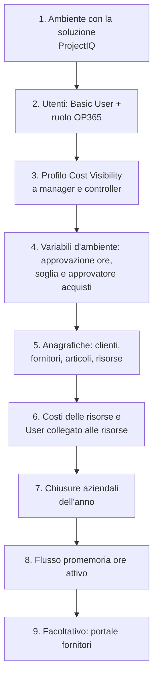
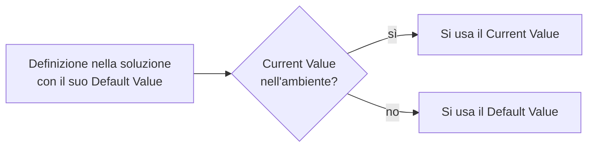
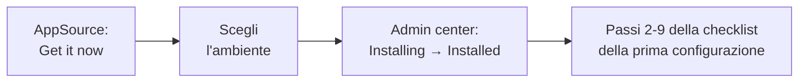

# Amministrazione: utenti, sicurezza, impostazioni e automazioni

> **Lingua:** [English](../en/administration.md) · Italiano · [Français](../fr/administration.md) · [Deutsch](../de/administration.md)
> **Indice dei manuali:** [README](../../README.md#user-manuals)

Questo manuale è per chi configura e gestisce ProjectIQ in un'azienda: amministratori funzionali, personale IT e amministratore della Power Platform. Spiega come dare accesso alle persone, come funziona il modello di sicurezza, cosa fanno le impostazioni aziendali, quali automazioni girano in background e cosa controllare dopo un aggiornamento. Gli argomenti tecnici (build, distribuzione, schema Dataverse) sono trattati in [Development environment setup](../dev-environment.md) e [Data model](../data-model.md) (in inglese).

> I nomi di campi e pulsanti sono in inglese, come appaiono a schermo.

## Checklist della prima configurazione

| Passo | Dove | Dettagli |
|---|---|---|
| 1 | Power Platform admin center | Un ambiente Dataverse per azienda. La soluzione si installa da [Microsoft AppSource](#installazione-da-microsoft-appsource) o la installa l'IT (vedi [dev environment](../dev-environment.md)) |
| 2 | Power Platform admin center → Users | [Ruoli di sicurezza](#ruoli-di-sicurezza) |
| 3 | Power Platform admin center → Column security profiles | [Visibilità dei costi](#visibilità-dei-costi) |
| 4 | Power Apps → Solutions → ProjectIQ → Environment variables | [Impostazioni aziendali](#impostazioni-aziendali) |
| 5 | Master Data | [Anagrafiche](master-data.md) |
| 6 | Master Data → Resources | [Anagrafiche](master-data.md#risorse) |
| 7 | Projects → Planning → Absences (senza risorsa) | [Anagrafiche](master-data.md#assenze-e-chiusure-aziendali) |
| 8 | Power Automate | [Promemoria giornaliero delle ore](#promemoria-giornaliero-delle-ore) |
| 9 | Power Pages | [Portale fornitori](supplier-portal.md) |

## Licenze

Ogni utente interno ha bisogno di una licenza **Power Apps Premium** (o di una licenza equivalente che includa le app model-driven su Dataverse). I fornitori che usano il portale non hanno bisogno di una licenza Power Apps: sono utenti del portale, coperti dalla capacità Power Pages dell'ambiente.

## Ruoli di sicurezza

I ruoli di ProjectIQ sono **additivi**: ogni utente interno ha bisogno del ruolo standard **Basic User** **più** un ruolo di ProjectIQ.

| Ruolo | Per | Accesso |
|---|---|---|
| **OP365 Administrator** | Amministratori funzionali, controller, back office, approvatore acquisti | A livello di organizzazione: creazione, lettura, scrittura, eliminazione, aggiunta, assegnazione e condivisione su tutte le tabelle di ProjectIQ, clienti, fornitori e contatti. Vede tutti i progetti. Può approvare ore e richieste su ogni progetto, decidere le fatture fornitori, inviare ore per altri |
| **OP365 User** | Project manager, membri del team, buyer | Legge le anagrafiche a livello di organizzazione; crea e gestisce i propri record; vede i progetti di cui è **proprietario** o in cui è **membro**, con i diritti del proprio ruolo di progetto (vedi [Progetti e team](projects-and-team.md#il-team-di-progetto)). Fatture fornitori: sola lettura |

Il ruolo standard **System Administrator** è trattato come OP365 Administrator da tutte le regole di ProjectIQ.

### Cosa può fare un OP365 User, per ruolo di progetto

| | Reader | Contributor | Manager |
|---|---|---|---|
| Vedere progetto, WBS, piano, costi | ✓ | ✓ | ✓ |
| Registrare le proprie ore e materiali | | ✓ | ✓ |
| Creare richieste d'acquisto | | ✓ | ✓ |
| Registrare entrate merci | | ✓ | ✓ |
| Modificare progetto, WBS, team, baseline | | | ✓ |
| Approvare ore e richieste d'acquisto (primo livello) | | | ✓ |
| RdO, ordini, stati degli ordini | | | ✓ |

I ruoli di progetto sono concessi tramite **access team** su ogni progetto; i tre modelli di team (**OP365 Project Manager**, **OP365 Project Contributor**, **OP365 Project Reader**) vengono creati automaticamente la prima volta che servono. Non eliminarli né rinominarli.

### Dare accesso a un nuovo dipendente

1. Aggiungi l'utente all'ambiente (Power Platform admin center → Environments → *il tuo ambiente* → Users) e assegna **Basic User** e **OP365 User** (o **OP365 Administrator**).
2. Se la persona deve vedere i costi, aggiungi l'utente al profilo **OP365 Cost Visibility**.
3. Se registrerà ore, crea o apri la sua **Resource** (Master Data → Resources), imposta **User**, Weekly Hours, Working Days e una riga **Resource Cost**.
4. Aggiungi l'utente ai team dei suoi progetti (tab **Team** del progetto), o chiedi ai project manager di farlo.

## Visibilità dei costi

Le colonne di costo sono protette dal profilo di sicurezza di colonna **OP365 Cost Visibility**. Senza di esso un utente vede questi campi vuoti o mascherati, anche sui record che può aprire:

| Tabella | Colonne protette |
|---|---|
| Resource | Hourly Cost |
| Resource Cost | Hourly Cost |
| Time Entry | Cost |
| Material Usage | Unit Cost, Total Cost |
| Account | Spend (fornitori), IBAN |
| Item | Spend |

Assegna il profilo (Power Platform admin center → *Settings* → *Users + permissions* → *Column security profiles* → **OP365 Cost Visibility** → aggiungi utenti o team) ad amministratori, project manager e controller. I totali del progetto (Budget Total, Actual Cost, Committed Cost) non sono protetti: chi può leggere il progetto li vede.

## Impostazioni aziendali

Gli interruttori validi per tutta l'azienda sono **variabili d'ambiente** (environment variables) della soluzione ProjectIQ. Ogni ambiente (Dev, Test, Produzione) ha i propri valori: un ambiente di test può ad esempio saltare l'approvazione delle ore senza toccare la produzione. Non si trovano nell'app: le modifica un amministratore Power Platform o un maker dell'ambiente.

Per cambiare un valore:

1. Apri [Power Apps](https://make.powerapps.com), seleziona l'ambiente, poi **Solutions** → **ProjectIQ** (o **Default Solution**) → **Environment variables**.
2. Apri la variabile e, sotto **Current Value**, fai clic su **+ New value** (o modifica quello esistente). Non cambiare il **Default Value** di una soluzione gestita.
3. **Save**. La modifica vale dall'invio successivo; non serve pubblicare.

| Variabile d'ambiente | Nome visualizzato | Tipo | Predefinito | Effetto |
|---|---|---|---|---|
| `op365_TimeApprovalEnabled` | **Time Approval Enabled** | Yes/No | Yes | Yes: le ore inviate attendono l'approvazione di un project manager. No: **Submit** approva subito le ore |
| `op365_PurchaseRequestThreshold` | **Purchase Request Threshold** | Number | Vuoto | Importo oltre il quale una richiesta d'acquisto richiede anche l'approvazione di secondo livello. Vuoto o 0 = mai |
| `op365_PurchasingApprover` | **Purchasing Approver** | Text | Vuoto | **User Name** (es. `anna.rossi@contoso.com`) o email principale dell'utente che approva le richieste sopra soglia e decide le fatture fornitori. Vuoto, o nessun utente attivo con quel nome = tutti gli OP365 Administrator |
| `op365_SupplierEmailTemplates` | **Supplier Email Templates** | JSON | I modelli ProjectIQ | Modello email (tipo Account) di ogni messaggio ai fornitori, per **Language** del fornitore: `{"DocumentExpiring": {"Italian": "<titolo modello>", "English": "<titolo modello>", "default": "English"}, "DocumentExpired": {...}}`. `default` è la lingua usata quando il fornitore non ne ha una o non esiste il modello |
| `op365_SupplierEmailSender` | **Supplier Email Sender** | Text | Vuoto | Nome o indirizzo email della **coda** (casella con sincronizzazione lato server) che invia le email ai fornitori. Vuoto = nessuna email |

Il Purchasing Approver è un nome utente e non una lookup perché gli id degli utenti cambiano in ogni ambiente. Le richieste già inviate mantengono il livello di approvazione assegnato.

In Test l'IT può impostare i valori anche al momento del rilascio, tramite le deployment settings (vedi [ambiente di sviluppo](../dev-environment.md#github-repository-security)); un valore impostato lì sovrascrive quello dell'ambiente a ogni rilascio.

## Altri dati aziendali nell'area Settings

| Pagina | Uso |
|---|---|
| **Resource Costs** | Tutte le righe di costo orario di tutte le risorse: utile per gli aggiornamenti annuali delle tariffe (aggiungi una riga per risorsa con il nuovo *Valid From*) |
| **Project Members** | Tutti i membri di tutti i progetti: utile per verificare chi lavora dove, o per togliere una persona che ha lasciato l'azienda |

## Automazioni in background

ProjectIQ mantiene aggiornati quasi tutti i valori con **plugin** che girano dentro Dataverse al salvataggio dei record; non richiedono manutenzione. Due automazioni sono pianificate.

### Promemoria giornaliero delle ore

Il **Daily time reminder** è un flusso cloud di Power Automate nella soluzione ProjectIQ. Dal **lunedì al venerdì alle 17:30** (ora dell'Europa occidentale) chiama l'azione *op365_SendTimeReminders*, che invia la notifica in-app "Record your hours" a ogni risorsa attiva con un utente che ha registrato meno ore del previsto nella giornata (vedi [Rilevazione ore](time-tracking.md#il-promemoria-giornaliero)). Nelle chiusure aziendali non viene inviato nessun promemoria.

Il flusso usa il riferimento di connessione **op365_dataverse** (Microsoft Dataverse). Un service principal non può possedere connessioni Power Automate, quindi un **utente** deve:

1. creare una connessione Microsoft Dataverse (va bene l'autenticazione con service principal);
2. collegarla al riferimento di connessione nella soluzione (negli ambienti di Test/Produzione la distribuzione la mappa tramite le deployment settings);
3. condividere la connessione con l'utente applicativo della distribuzione (*Can use*), perché le importazioni possano attivare il flusso;
4. attivare il flusso (**on**) e controllarne la cronologia delle esecuzioni il giorno lavorativo successivo.

### Scadenza giornaliera dei documenti

Il flusso **Daily document expiry** gira **ogni giorno alle 06:00** (ora W. Europe) e chiama l'azione *op365_UpdateDocumentExpiry*: aggiorna lo stato di scadenza dei documenti fornitore e i contatori degli avvisi dei fornitori, e invia ai fornitori le email di scadenza (vedi [Anagrafiche](master-data.md#scadenze-ed-email)). Usa lo stesso riferimento di connessione del Daily time reminder; attivalo **on** allo stesso modo.

Per inviare le email:

1. Crea una **coda** con una casella di posta (per esempio *Fornitori*, `fornitori@contoso.com`), approva l'indirizzo della casella e abilita la **sincronizzazione lato server** per la posta in uscita.
2. Imposta **Supplier Email Sender** con il nome o l'indirizzo email della coda.
3. Controlla i modelli in **Settings** → **Templates** → **E-mail Templates** (*ProjectIQ - Document expiring* e *ProjectIQ - Document expired*, con una versione per lingua come *ProjectIQ - Documento scaduto*). Modificane il testo a piacere; i segnaposto `{Document}`, `{DocumentType}`, `{Number}`, `{IssueDate}` e `{ExpiryDate}` vengono compilati per ogni documento. Per usare altri modelli, scrivi i loro titoli in **Supplier Email Templates**. I modelli sono dati dell'ambiente, non della soluzione: se mancano, l'IT li crea con `tools/dataverse/supplier_email_templates.py`.
4. Compila **Language** ed **Email** di ogni account fornitore.

### Cos'altro succede in automatico

| Automazione | Quando |
|---|---|
| Totali di progetto, totali WBS e avanzamento | A ogni salvataggio di nodi, registrazioni ore, consumi, ordini, entrate merci |
| Numero progetti e valore contrattuale totale del cliente | A ogni modifica di un progetto |
| Spesa e numero contatti del fornitore; righe d'ordine e spesa dell'articolo | A ogni modifica di ordini, righe d'ordine e contatti |
| Costo orario della risorsa | A ogni modifica di un Resource Cost |
| Notifiche in-app | All'invio e alla decisione di ore e richieste d'acquisto, e dal promemoria giornaliero |
| Accesso al team di progetto | A ogni modifica di un membro del progetto |

### Notifiche

Le notifiche in-app sono attive per impostazione predefinita nei nuovi ambienti. Gli utenti le gestiscono dall'icona a campanella. Le notifiche non sono mai bloccanti: se una non può essere inviata, l'operazione va comunque a buon fine.

## Audit e cronologia

L'audit è abilitato sulle tabelle di ProjectIQ: una volta attivato anche a livello di ambiente (Power Platform admin center → *Settings* → *Audit and logs*), ogni modifica viene registrata ed è visibile nell'**Audit history** di ogni record (Related → Audit history). La timeline di ogni record conserva note, menzioni e allegati.

## Installazione da Microsoft AppSource

ProjectIQ è gratuito su Microsoft AppSource: è il modo più rapido per installarlo in un nuovo ambiente. Il pacchetto AppSource installa in ordine le due soluzioni managed, **ProjectIQ** (`OpenProject365`) e il **portale fornitori** (`OpenProject365SupplierPortal`), con gli step dei plugin già attivi.

Prima di iniziare: un ambiente Dataverse per l'azienda, il ruolo **System Administrator** in quell'ambiente e, per vedere l'app in italiano, francese o tedesco, queste lingue attivate nell'ambiente (*Settings* → *Languages*).

1. Apri ProjectIQ su [Microsoft AppSource](https://appsource.microsoft.com) e seleziona **Get it now**; accedi con l'account aziendale.
2. Scegli l'**ambiente** di destinazione, accetta le condizioni d'uso e le condizioni Microsoft e seleziona **Install**.
3. Segui l'avanzamento nel Power Platform admin center → *Environments* → il tuo ambiente → *Resources* → **Dynamics 365 apps**: lo stato passa da *Installing* a **Installed** (servono alcuni minuti). Se compare *Install failed*, apri i dettagli e riprova.
4. Completa i passi da 2 a 9 della [checklist della prima configurazione](#checklist-della-prima-configurazione). Il pacchetto non può farli al posto tuo:
    - assegna agli utenti i [ruoli di sicurezza](#ruoli-di-sicurezza) e il profilo di [visibilità dei costi](#visibilità-dei-costi);
    - imposta le [variabili d'ambiente](#impostazioni-aziendali) (approvazione ore, soglia e approvatore acquisti);
    - crea la connessione Dataverse del flusso [promemoria giornaliero delle ore](#promemoria-giornaliero-delle-ore) e **attiva** il flusso;
    - per il [portale fornitori](supplier-portal.md#per-gli-amministratori): riattiva il sito importato in Power Pages → *Inactive sites*, poi svuotane la cache.

Le nuove versioni vengono pubblicate su AppSource: installale dalla stessa pagina **Dynamics 365 apps** (*Update* su ProjectIQ), poi segui [Dopo un aggiornamento della soluzione](#dopo-un-aggiornamento-della-soluzione).

## Dopo un aggiornamento della soluzione

Quando l'IT distribuisce una nuova versione:

1. Verifica che gli step dei plugin siano **attivi** (un'importazione interrotta può lasciarli disattivati; l'IT può controllare nei *Plug-in steps* della soluzione).
2. Verifica che il flusso **Daily time reminder** sia **attivo**.
3. Se è stato aggiornato il portale fornitori, **svuota la cache del portale** (`/_services/about` → *Clear cache*) e accedi di nuovo.
4. Leggi le note di rilascio e i manuali aggiornati (questa documentazione viene aggiornata insieme a ogni modifica funzionale).

## Togliere una persona che ha lasciato l'azienda

1. Toglila dai team di progetto (Settings → Project Members, filtra per utente).
2. Disattiva la sua **Resource** (ore e costi passati restano).
3. Disabilita l'utente nel Power Platform admin center / Microsoft 365.
4. Riassegna i record di cui è proprietaria (Assign) se serve.
5. Se era il **Purchasing Approver** o un project manager, aggiorna la [variabile d'ambiente](#impostazioni-aziendali) e i progetti.

## Risoluzione dei problemi

| Sintomo | Causa probabile | Soluzione |
|---|---|---|
| Un utente non vede progetti | Non è membro di nessun progetto, o manca il ruolo OP365 | Aggiungi il ruolo e inserisci l'utente nei team di progetto |
| "Your user is not linked to a resource" | Nessuna Resource attiva con quello User | Imposta User sulla Resource |
| Costi vuoti per un manager | Manca il profilo Cost Visibility | Aggiungi l'utente al profilo |
| Nessuno riceve il promemoria giornaliero | Flusso spento o connessione non valida | Controlla il flusso e la sua connessione |
| Totali non aggiornati dopo un'importazione | Step dei plugin disattivati | Attiva gli step dei plugin |
| Le richieste sopra soglia vanno a tutti gli amministratori | Purchasing Approver vuoto, o non è lo User Name di un utente attivo | Imposta la [variabile d'ambiente](#impostazioni-aziendali) |
| I fornitori vedono "This area is reserved to suppliers" | Manca il web role Supplier o non hanno effettuato l'accesso | Assegna il web role al contatto |
