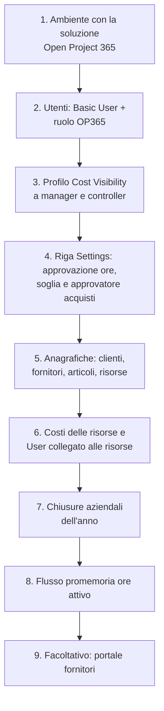

# Amministrazione: utenti, sicurezza, impostazioni e automazioni

> **Lingua:** [English](../en/administration.md) · Italiano · [Français](../fr/administration.md) · [Deutsch](../de/administration.md)
> **Indice dei manuali:** [README](../../README.md#user-manuals)

Questo manuale è per chi configura e gestisce Open Project 365 in un'azienda: amministratori funzionali, personale IT e amministratore della Power Platform. Spiega come dare accesso alle persone, come funziona il modello di sicurezza, cosa fanno le impostazioni aziendali, quali automazioni girano in background e cosa controllare dopo un aggiornamento. Gli argomenti tecnici (build, distribuzione, schema Dataverse) sono trattati in [Development environment setup](../dev-environment.md) e [Data model](../data-model.md) (in inglese).

> I nomi di campi e pulsanti sono in inglese, come appaiono a schermo.

## Checklist della prima configurazione

| Passo | Dove | Dettagli |
|---|---|---|
| 1 | Power Platform admin center | Un ambiente Dataverse per azienda. La soluzione viene installata dall'IT (vedi [dev environment](../dev-environment.md)) |
| 2 | Power Platform admin center → Users | [Ruoli di sicurezza](#ruoli-di-sicurezza) |
| 3 | Power Platform admin center → Column security profiles | [Visibilità dei costi](#visibilità-dei-costi) |
| 4 | Settings → Company → Settings | [Impostazioni aziendali](#impostazioni-aziendali) |
| 5 | Master Data | [Anagrafiche](master-data.md) |
| 6 | Master Data → Resources | [Anagrafiche](master-data.md#risorse) |
| 7 | Projects → Planning → Absences (senza risorsa) | [Anagrafiche](master-data.md#assenze-e-chiusure-aziendali) |
| 8 | Power Automate | [Promemoria giornaliero delle ore](#promemoria-giornaliero-delle-ore) |
| 9 | Power Pages | [Portale fornitori](supplier-portal.md) |

## Licenze

Ogni utente interno ha bisogno di una licenza **Power Apps Premium** (o di una licenza equivalente che includa le app model-driven su Dataverse). I fornitori che usano il portale non hanno bisogno di una licenza Power Apps: sono utenti del portale, coperti dalla capacità Power Pages dell'ambiente.

## Ruoli di sicurezza

I ruoli di Open Project 365 sono **additivi**: ogni utente interno ha bisogno del ruolo standard **Basic User** **più** un ruolo di Open Project 365.

| Ruolo | Per | Accesso |
|---|---|---|
| **OP365 Administrator** | Amministratori funzionali, controller, back office, approvatore acquisti | A livello di organizzazione: creazione, lettura, scrittura, eliminazione, aggiunta, assegnazione e condivisione su tutte le tabelle di Open Project 365, clienti, fornitori e contatti. Vede tutti i progetti. Può approvare ore e richieste su ogni progetto, decidere le fatture fornitori, inviare ore per altri |
| **OP365 User** | Project manager, membri del team, buyer | Legge le anagrafiche a livello di organizzazione; crea e gestisce i propri record; vede i progetti di cui è **proprietario** o in cui è **membro**, con i diritti del proprio ruolo di progetto (vedi [Progetti e team](projects-and-team.md#il-team-di-progetto)). Fatture fornitori: sola lettura |

Il ruolo standard **System Administrator** è trattato come OP365 Administrator da tutte le regole di Open Project 365.

### Cosa può fare un OP365 User, per ruolo di progetto

| | Reader | Contributor | Manager |
|---|---|---|---|
| Vedere progetto, WBS, piano, costi | ✓ | ✓ | ✓ |
| Registrare le proprie ore e materiali | | ✓ | ✓ |
| Creare richieste d'acquisto | | ✓ | ✓ |
| Registrare entrate merci | | ✓ | ✓ |
| Modificare progetto, WBS, team, baseline | | | ✓ |
| Approvare ore e richieste d'acquisto (primo livello) | | | ✓ |
| RdO, ordini, stati degli ordini | | | ✓ |

I ruoli di progetto sono concessi tramite **access team** su ogni progetto; i tre modelli di team (**OP365 Project Manager**, **OP365 Project Contributor**, **OP365 Project Reader**) vengono creati automaticamente la prima volta che servono. Non eliminarli né rinominarli.

### Dare accesso a un nuovo dipendente

1. Aggiungi l'utente all'ambiente (Power Platform admin center → Environments → *il tuo ambiente* → Users) e assegna **Basic User** e **OP365 User** (o **OP365 Administrator**).
2. Se la persona deve vedere i costi, aggiungi l'utente al profilo **OP365 Cost Visibility**.
3. Se registrerà ore, crea o apri la sua **Resource** (Master Data → Resources), imposta **User**, Weekly Hours, Working Days e una riga **Resource Cost**.
4. Aggiungi l'utente ai team dei suoi progetti (tab **Team** del progetto), o chiedi ai project manager di farlo.

## Visibilità dei costi

Le colonne di costo sono protette dal profilo di sicurezza di colonna **OP365 Cost Visibility**. Senza di esso un utente vede questi campi vuoti o mascherati, anche sui record che può aprire:

| Tabella | Colonne protette |
|---|---|
| Resource | Hourly Cost |
| Resource Cost | Hourly Cost |
| Time Entry | Cost |
| Material Usage | Unit Cost, Total Cost |
| Account (fornitore) | Spend |
| Item | Spend |

Assegna il profilo (Power Platform admin center → *Settings* → *Users + permissions* → *Column security profiles* → **OP365 Cost Visibility** → aggiungi utenti o team) ad amministratori, project manager e controller. I totali del progetto (Budget Total, Actual Cost, Committed Cost) non sono protetti: chi può leggere il progetto li vede.

## Impostazioni aziendali

**Settings → Company → Settings** contiene un'**unica riga** con gli interruttori validi per tutta l'azienda. Creala una volta se non esiste; non crearne una seconda.

| Campo | Predefinito | Effetto |
|---|---|---|
| **Name** | – | Nome dell'azienda |
| **Time Approval Enabled** | Attivo (anche quando la riga non esiste) | Attivo: le ore inviate attendono l'approvazione di un project manager. Disattivo: **Submit** approva subito le ore |
| **Purchase Request Threshold** | Vuoto | Importo oltre il quale una richiesta d'acquisto richiede anche l'approvazione di secondo livello. Vuoto o 0 = mai |
| **Purchasing Approver** | Vuoto | L'utente che approva le richieste sopra soglia e decide le fatture fornitori. Vuoto = tutti gli OP365 Administrator |

Le modifiche valgono subito per i nuovi invii; le richieste già inviate mantengono il livello di approvazione assegnato.

## Altri dati aziendali nell'area Settings

| Pagina | Uso |
|---|---|
| **Resource Costs** | Tutte le righe di costo orario di tutte le risorse: utile per gli aggiornamenti annuali delle tariffe (aggiungi una riga per risorsa con il nuovo *Valid From*) |
| **Project Members** | Tutti i membri di tutti i progetti: utile per verificare chi lavora dove, o per togliere una persona che ha lasciato l'azienda |

## Automazioni in background

Open Project 365 mantiene aggiornati quasi tutti i valori con **plugin** che girano dentro Dataverse al salvataggio dei record; non richiedono manutenzione. Una sola automazione è pianificata.

### Promemoria giornaliero delle ore

Il **Daily time reminder** è un flusso cloud di Power Automate nella soluzione Open Project 365. Dal **lunedì al venerdì alle 17:30** (ora dell'Europa occidentale) chiama l'azione *op365_SendTimeReminders*, che invia la notifica in-app "Record your hours" a ogni risorsa attiva con un utente che ha registrato meno ore del previsto nella giornata (vedi [Rilevazione ore](time-tracking.md#il-promemoria-giornaliero)). Nelle chiusure aziendali non viene inviato nessun promemoria.

Il flusso usa il riferimento di connessione **op365_dataverse** (Microsoft Dataverse). Un service principal non può possedere connessioni Power Automate, quindi un **utente** deve:

1. creare una connessione Microsoft Dataverse (va bene l'autenticazione con service principal);
2. collegarla al riferimento di connessione nella soluzione (negli ambienti di Test/Produzione la distribuzione la mappa tramite le deployment settings);
3. condividere la connessione con l'utente applicativo della distribuzione (*Can use*), perché le importazioni possano attivare il flusso;
4. attivare il flusso (**on**) e controllarne la cronologia delle esecuzioni il giorno lavorativo successivo.

### Cos'altro succede in automatico

| Automazione | Quando |
|---|---|
| Totali di progetto, totali WBS e avanzamento | A ogni salvataggio di nodi, registrazioni ore, consumi, ordini, entrate merci |
| Numero progetti e valore contrattuale totale del cliente | A ogni modifica di un progetto |
| Spesa e numero contatti del fornitore; righe d'ordine e spesa dell'articolo | A ogni modifica di ordini, righe d'ordine e contatti |
| Costo orario della risorsa | A ogni modifica di un Resource Cost |
| Notifiche in-app | All'invio e alla decisione di ore e richieste d'acquisto, e dal promemoria giornaliero |
| Accesso al team di progetto | A ogni modifica di un membro del progetto |

### Notifiche

Le notifiche in-app sono attive per impostazione predefinita nei nuovi ambienti. Gli utenti le gestiscono dall'icona a campanella. Le notifiche non sono mai bloccanti: se una non può essere inviata, l'operazione va comunque a buon fine.

## Audit e cronologia

L'audit è abilitato sulle tabelle di Open Project 365: una volta attivato anche a livello di ambiente (Power Platform admin center → *Settings* → *Audit and logs*), ogni modifica viene registrata ed è visibile nell'**Audit history** di ogni record (Related → Audit history). La timeline di ogni record conserva note, menzioni e allegati.

## Dopo un aggiornamento della soluzione

Quando l'IT distribuisce una nuova versione:

1. Verifica che gli step dei plugin siano **attivi** (un'importazione interrotta può lasciarli disattivati; l'IT può controllare nei *Plug-in steps* della soluzione).
2. Verifica che il flusso **Daily time reminder** sia **attivo**.
3. Se è stato aggiornato il portale fornitori, **svuota la cache del portale** (`/_services/about` → *Clear cache*) e accedi di nuovo.
4. Leggi le note di rilascio e i manuali aggiornati (questa documentazione viene aggiornata insieme a ogni modifica funzionale).

## Togliere una persona che ha lasciato l'azienda

1. Toglila dai team di progetto (Settings → Project Members, filtra per utente).
2. Disattiva la sua **Resource** (ore e costi passati restano).
3. Disabilita l'utente nel Power Platform admin center / Microsoft 365.
4. Riassegna i record di cui è proprietaria (Assign) se serve.
5. Se era il **Purchasing Approver** o un project manager, aggiorna le Settings e i progetti.

## Risoluzione dei problemi

| Sintomo | Causa probabile | Soluzione |
|---|---|---|
| Un utente non vede progetti | Non è membro di nessun progetto, o manca il ruolo OP365 | Aggiungi il ruolo e inserisci l'utente nei team di progetto |
| "Your user is not linked to a resource" | Nessuna Resource attiva con quello User | Imposta User sulla Resource |
| Costi vuoti per un manager | Manca il profilo Cost Visibility | Aggiungi l'utente al profilo |
| Nessuno riceve il promemoria giornaliero | Flusso spento o connessione non valida | Controlla il flusso e la sua connessione |
| Totali non aggiornati dopo un'importazione | Step dei plugin disattivati | Attiva gli step dei plugin |
| Le richieste sopra soglia vanno a tutti gli amministratori | Purchasing Approver vuoto | Impostalo nelle Settings |
| I fornitori vedono "This area is reserved to suppliers" | Manca il web role Supplier o non hanno effettuato l'accesso | Assegna il web role al contatto |
