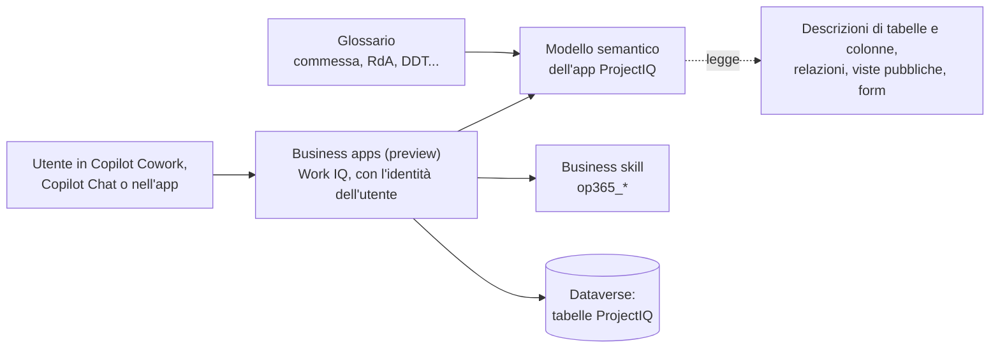
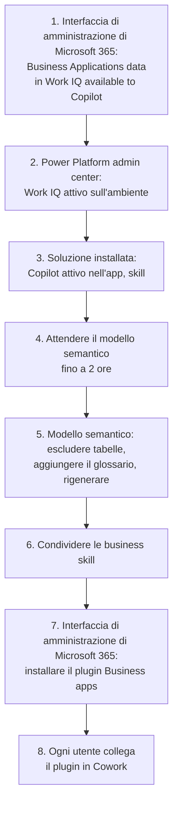

# Copilot e Cowork: fare domande sulle commesse

> **Lingua:** [English](../en/copilot.md) · Italiano · [Français](../fr/copilot.md) · [Deutsch](../de/copilot.md)
> **Indice dei manuali:** [README](../../README.md#user-manuals)

I dati di ProjectIQ si possono leggere da **Microsoft Copilot**: nel riquadro Copilot dell'app, in Microsoft 365 Copilot Chat e in **Copilot Cowork** tramite il plugin **Business apps (preview)**. Le persone chiedono con parole proprie ("come va la commessa PRJ-000123?", "quali ore devo approvare?") e ricevono risposte costruite sugli stessi record che vedono nell'app, con gli stessi permessi.

Questa prima versione è in **sola lettura**: Copilot trova, spiega e riassume i dati, ma non crea, modifica, invia o approva nulla. Ogni azione resta sui pulsanti dell'app.

> I nomi di campi, pulsanti e schermate sono in inglese, come appaiono a schermo. Queste funzionalità Microsoft sono in **preview**: nomi, schermate e comportamento possono cambiare.

## Come funziona

| Parte | Cosa fa | Da dove arriva |
|---|---|---|
| Modello semantico | Spiega a Copilot cosa significano tabelle, colonne e relazioni | Creato da Dataverse per l'app quando Microsoft Copilot è attivo; legge le descrizioni di tabelle e colonne, le relazioni, le viste pubbliche e i nomi dei form della soluzione |
| Glossario | Collega le parole di business (commessa, RdA, DDT, fattura passiva...) alle tabelle | Inserito da un amministratore, vedi [Glossario del modello semantico](#glossario-del-modello-semantico) |
| Business skill | Istruzioni passo passo per le domande più frequenti | Fornite nella soluzione, vedi [Business skill](#business-skill) |
| Permessi | Cosa vede ciascuna persona | I normali ruoli di sicurezza, gli access team di commessa e la sicurezza a livello di colonna di ProjectIQ |

## Cosa si può chiedere

| Argomento | Domande di esempio | Business skill |
|---|---|---|
| Stato commessa | "Come va la commessa PRJ-000123?", "Quali commesse sono fuori budget?" | ProjectIQ - Project status |
| Ore da approvare | "Quali ore devo approvare?" | ProjectIQ - Hours to approve |
| Ore mancanti | "Chi non ha inserito le ore ieri?" | ProjectIQ - Missing hours |
| Acquisti | "A che punto è la RdA per i ponteggi?", "Quali ordini sono in ritardo?", "Quali fatture passive sono da verificare?" | ProjectIQ - Purchasing status |
| Conformità fornitori | "Quali fornitori hanno il DURC scaduto?", "Possiamo ordinare da Rossi Srl?" | ProjectIQ - Supplier compliance |
| Carico risorse | "Chi è sovraccarico il mese prossimo?" | ProjectIQ - Resource load |

Funzionano anche domande su altri argomenti: Copilot usa il modello semantico per trovare le tabelle giuste. Quando la risposta richiede un'azione (approvare, inviare, ricevere), Copilot indica quale schermata dell'app usare.

## Configurazione (amministratori)

I passi si fanno una volta per ambiente, dalle persone con il ruolo di amministrazione adatto.

| Passo | Chi | Dove | Cosa |
|---|---|---|---|
| 1 | Amministratore Microsoft 365 | Microsoft 365 admin center → **Copilot** → **Settings** → **Business Applications data in Work IQ available to Copilot** | **All users**, oppure i gruppi Entra degli utenti di ProjectIQ |
| 2 | Amministratore Power Platform | Power Platform admin center → ambiente → **Work IQ** | Attivo. Verificare anche che **Dataverse search** sia **On** o **Default** |
| 3 | IT | Importazione della soluzione (vedi [dev environment](../dev-environment.md#copilot-and-work-iq), in inglese) | La soluzione attiva **Microsoft Copilot in model-driven apps** per l'app ProjectIQ, aggiunge le business skill e mette le tabelle in perimetro nell'indice di **Dataverse search**: senza indice Copilot conosce le tabelle ma non trova i record |
| 4 | – | – | La prima generazione del modello semantico richiede fino a due ore |
| 5 | System Administrator | Power Apps → **Semantic model** | Vedi [Ottimizzare il modello semantico](#ottimizzare-il-modello-semantico) |
| 6 | System Administrator | Power Apps → **Business skills (preview)** | Vedi [Business skill](#business-skill) |
| 7 | Amministratore Microsoft 365 | Microsoft 365 admin center → **Agents** → **Tools** → **Plugins** → **Business apps (preview)** → **Install** | **All users** oppure **Specific users and groups** |
| 8 | Ogni utente | Copilot → **Cowork** → **Customize** → **Business apps (preview)** → **Show more** → **Connect** accanto a **Business apps (preview)** | Accedere e approvare la richiesta nell'app Authenticator |

Le azioni di scrittura tramite Work IQ sono bloccate per impostazione predefinita dalla policy del tenant. Lasciarle bloccate: in questa versione ProjectIQ è in sola lettura da Copilot.

### Licenze

Ogni persona ha bisogno della licenza **Power Apps Premium** usata per ProjectIQ e di una licenza **Microsoft 365 Copilot**. L'indicizzazione semantica usa capacità Dataverse aggiuntiva.

## Ottimizzare il modello semantico

Il modello semantico dell'app si chiama `M365_Primary_model_op365_OpenProject365` (visto in Dev; Microsoft documenta anche `M365_Secondary_model_<app>`). Dataverse lo rigenera ogni 12 ore; le modifiche a descrizioni, viste e glossario vengono recepite alla rigenerazione successiva, oppure subito con una rigenerazione manuale.

1. Accedere a Power Apps, selezionare l'ambiente, poi **More** → **Discover all** → **Semantic model**.
2. Aprire il modello dell'app **ProjectIQ**.
3. Selezionare **Configuration** e togliere la spunta **Include in semantic model** per queste tabelle, poi selezionare **Save and sync**:

| Tabella | Perché è esclusa |
|---|---|
| Resource Cost | Costi orari: dati sensibili, non servono per rispondere alle domande. Esclusa anche dall'indice di Dataverse search |
| Settings | Configurazione aziendale (riga unica) |
| Baseline Node | Valori salvati in una baseline: duplicano la WBS e confondono le domande sul piano attuale |
| WBS Dependency | Legami del Gantt: rumore per le domande di business |

4. Lasciare **Sample table rows** disattivato (predefinito): le risposte vengono dai dati reali, non da esempi.
5. Aggiungere il glossario, vedi la sezione successiva.
6. Selezionare **Regenerate**.

Il modello semantico **non** viaggia con le soluzioni: ripetere questi passi in ogni ambiente (Dev, Test, produzione) e, dopo una copia o uno spostamento dell'ambiente, disattivare e riattivare Work IQ.

### Glossario del modello semantico

Il glossario aggiunge le parole di business che Dataverse non può dedurre dai metadati. L'elenco completo è nel repository in [copilot/glossary.md](../../copilot/glossary.md) (in inglese, con i sinonimi in italiano, francese e tedesco).

1. Nel modello semantico selezionare **Glossary** → **Add item**.
2. Per ogni riga dell'elenco inserire **Term** e **Definition**, poi aggiungere i **Synonyms** in italiano, francese e tedesco (riaprire la voce e selezionare **Edit** se il campo dei sinonimi non è nella prima schermata).
3. Selezionare **Add term**, poi **Regenerate** quando tutti i termini sono inseriti.

| Term | Italiano | Français | Deutsch |
|---|---|---|---|
| Project | commessa, progetto | projet, affaire | Projekt, Auftrag |
| Time entry | registrazione ore, rapportino, timesheet | saisie de temps, feuille de temps | Zeiteintrag, Stundenzettel |
| Purchase request | richiesta di acquisto, RdA | demande d'achat, DA | Bestellanforderung, BANF |
| RFQ | richiesta di offerta, RdO | demande de prix, appel d'offres | Angebotsanfrage, Ausschreibung |
| Purchase order | ordine di acquisto, OdA | commande d'achat, bon de commande | Bestellung |
| Goods receipt | ricevimento merci, DDT | réception de marchandises, bon de livraison | Wareneingang, Lieferschein |
| Supplier invoice | fattura fornitore, fattura passiva | facture fournisseur | Lieferantenrechnung, Eingangsrechnung |
| Supplier document | documento fornitore, DURC | document fournisseur, attestation | Lieferantendokument, Nachweis |

## Business skill

Le business skill sono istruzioni che spiegano a Copilot come rispondere a un tipo di domanda: quali tabelle leggere, come calcolare i valori, cosa segnalare. Fanno parte della soluzione ProjectIQ (nomi univoci che iniziano con `op365_`), quindi si installano e si aggiornano con essa. Il loro testo è nel repository in `copilot/skills/`.

| Skill | Legge | Rimanda l'utente a |
|---|---|---|
| ProjectIQ - Project status | Commessa, nodi WBS, baseline, acquisti aperti | – |
| ProjectIQ - Hours to approve | Ore inviate delle commesse dell'utente | Projects → Time → **Approvals** |
| ProjectIQ - Missing hours | Risorse, assenze, ore | – (il flusso Daily time reminder avvisa già le persone) |
| ProjectIQ - Purchasing status | RdA, RdO, ordini, entrate merce, fatture passive | I pulsanti dei form degli acquisti |
| ProjectIQ - Supplier compliance | Fornitori e documenti fornitore | Il form del fornitore, oppure il [portale fornitori](supplier-portal.md) |
| ProjectIQ - Resource load | Risorse, allocazioni, assenze | Projects → Planning → **Resource Load** |

Tutte le skill sono in **sola lettura**: non creano né modificano record.

Per renderle disponibili a tutti:

1. In Power Apps selezionare **More** → **Business skills (preview)**.
2. Verificare che le sei skill `ProjectIQ - ...` siano presenti e attive. Sono installate come skill **Organization** (visibili a tutti nell'ambiente).
3. Se un utente non vede una skill, selezionarla → **Share** → **Anyone can view**.

Non modificare le skill in produzione: le modifiche si fanno nel repository e arrivano con la soluzione.

## Sicurezza e privacy

- Copilot lavora **con l'identità dell'utente**: vede solo i record e le colonne che l'utente vede nell'app (ruoli di sicurezza e access team di commessa, vedi [Amministrazione](administration.md#ruoli-di-sicurezza)).
- Le colonne protette dal profilo **OP365 Cost Visibility** (costi orari, Cost delle ore, costi dei materiali, Spend dei fornitori, vedi [Visibilità dei costi](administration.md#visibilità-dei-costi)) restano nascoste agli utenti senza quel profilo. Le skill lo dicono invece di stimare.
- Copilot non modifica i dati. Ogni modifica passa ancora dall'app, dalle sue regole di validazione e dai suoi plugin.

## Limiti

- Funzionalità in preview: le risposte possono essere incomplete; verificare sempre nell'app i valori importanti.
- Nessuna azione da Copilot in questa versione: invio, approvazione, invio ai fornitori, aggiudicazione, ricevimento e annullamento restano nell'app.
- Il modello semantico, le sue impostazioni sulle tabelle e il glossario si configurano per ambiente.
- Le risposte dipendono dalla qualità delle descrizioni nella soluzione: quando una domanda viene fraintesa, segnalarlo così da migliorare la descrizione o il glossario.
