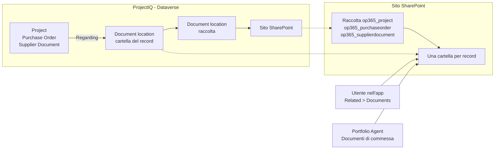
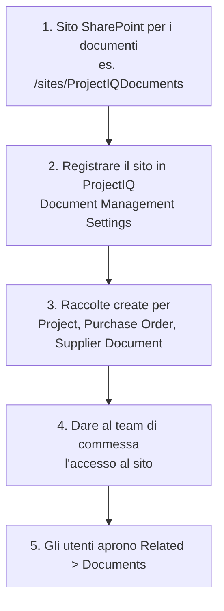

# Documenti in SharePoint

> **Lingua:** [English](../en/documents.md) · Italiano · [Français](../fr/documents.md) · [Deutsch](../de/documents.md)
> **Indice dei manuali:** [README](../../README.md#user-manuals)

Contratti, disegni, SAL, offerte e DDT appartengono a una commessa, ma non al database. ProjectIQ li tiene in **SharePoint**, con la gestione documentale standard di Dataverse: ogni **Project**, **Purchase Order** e **Supplier Document** ha la sua cartella SharePoint, aperta dal record. I file mantengono il versioning di SharePoint, la co-redazione in Office, la ricerca e la condivisione; ProjectIQ memorizza solo dove si trova la cartella.

Questo manuale è per chi lavora con i documenti di commessa (parte 1) e per gli amministratori che collegano ProjectIQ a SharePoint (parte 2).

## Come funziona

| Tabella | Raccolta SharePoint | Cartella |
|---|---|---|
| Project | `op365_project` | Una per commessa, con il nome della commessa e il suo id |
| Purchase Order | `op365_purchaseorder` | Una per ordine |
| Supplier Document | `op365_supplierdocument` | Una per documento (per esempio il DURC scansionato con i suoi allegati) |

La cartella viene creata la **prima volta che qualcuno apre Documents** sul record. Dataverse salva una *document location* che collega il record alla cartella; l'agente e l'app trovano la cartella tramite questa. Un progetto creato in Copilot da un documento ha già la sua cartella, con il documento dentro (vedi [Portfolio Agent](portfolio-agent.md#nuovo-progetto-da-documento)).

## Parte 1: lavorare con i documenti

### Aprire i documenti di un record

1. Apri la commessa (o l'ordine d'acquisto, o il documento fornitore).
2. Seleziona **Related** → **Documents**. La prima volta ProjectIQ crea la cartella SharePoint del record.
3. La griglia elenca i file della cartella: **Upload**, **New** (Word, Excel, PowerPoint, OneNote), **Open in SharePoint**, **Delete**, **Check Out** / **Check In** e **Edit Properties** lavorano direttamente su SharePoint.

| Comando | Cosa fa |
|---|---|
| **Upload** | Carica uno o più file nella cartella (o in una sottocartella) |
| **New** | Crea un documento Office nella cartella e lo apre nel browser |
| **Open Location** / **Open in SharePoint** | Apre la cartella in SharePoint, per sottocartelle, condivisione, versioni e spostamenti massivi |
| **Document Location** → **Add Location** | Collega al record un'altra cartella SharePoint esistente (per esempio una cartella di un team Teams) |

### Chi vede quali file

- Per vedere la scheda **Documents** serve il ruolo ProjectIQ (vedi [Amministrazione](administration.md#ruoli-di-sicurezza)): **OP365 User** può creare la cartella dei record che può aprire e leggere tutte le document location.
- **Sono i permessi SharePoint a decidere quali file vedi.** ProjectIQ non copia la condivisione delle commesse in SharePoint: dai al team di commessa l'accesso al sito (o a una raccolta o cartella) in SharePoint.

### Colonne ProjectIQ

Ogni file aggiunto alla cartella di un record riceve, entro pochi minuti e senza che nessuno le digiti, le informazioni di quel record in colonne SharePoint. Puoi ordinare, filtrare e raggruppare la raccolta in base a queste colonne. Microsoft Search e Copilot le usano per trovare "i documenti della commessa PRJ-000123" o "i file del fornitore Rossi" anche quando il testo del file non li cita.

| Colonna | Project | Purchase Order | Supplier Document |
|---|---|---|---|
| **ProjectIQ Record Type** | Project | Purchase Order | Supplier Document |
| **Project Code** | Codice della commessa | Codice della commessa dell'ordine | – |
| **Project Name** | Nome della commessa | Nome della commessa dell'ordine | – |
| **Customer** | Cliente della commessa | Cliente della commessa dell'ordine | – |
| **Project Manager** | Project manager | Project manager della commessa dell'ordine | – |
| **PO Number** | – | Numero dell'ordine (PO-#####) | – |
| **Supplier** | – | Fornitore dell'ordine | Fornitore del documento |

- I valori sono quelli del record **nel momento in cui il file viene aggiunto**. Se rinomini una commessa o ne cambi il cliente, i file già presenti non vengono aggiornati.
- I file fuori dalla cartella di un record non vengono classificati: per esempio quelli nella radice della raccolta o in una cartella aggiunta con **Add Location**.
- Le colonne si modificano come qualsiasi altra colonna SharePoint e ProjectIQ non le sovrascrive. **ProjectIQ Record Id** è nascosta nei moduli e conserva il record a cui appartiene il file.

### Documenti in Copilot

Nel [Portfolio Agent](portfolio-agent.md#documenti-di-commessa) chiedi "mostra i documenti della commessa PRJ-000123": la card elenca file e sottocartelle della cartella della commessa, dai più recenti, con il link a ogni file e alla cartella. Se è impostata una fonte di conoscenza SharePoint, puoi chiedere anche cosa dice un documento (vedi [Portfolio Agent](portfolio-agent.md#domande-sul-contenuto-dei-documenti)).

### Documenti fornitore

Un **Supplier Document** (DURC, certificazione, assicurazione) mantiene la colonna **File**, usata dal [portale fornitori](supplier-portal.md). La cartella SharePoint del record serve per gli altri file che lo accompagnano (rinnovi, corrispondenza). Scadenze e conformità fornitori continuano a basarsi sui campi del Supplier Document come prima.

## Parte 2: configurazione (amministratori)

Si fa una volta per ambiente, dall'amministratore Power Platform insieme a un amministratore SharePoint.

| Passo | Chi | Cosa |
|---|---|---|
| 1 | Amministratore SharePoint | Crea un sito SharePoint di team o di comunicazione per i documenti, nello stesso tenant Microsoft 365 dell'ambiente |
| 2 | Amministratore Power Platform | Nell'app apri **Settings** (ingranaggio) → **Advanced Settings** → **Document Management** → **Document Management Settings**, seleziona **Project**, **Purchase Order** e **Supplier Document**, inserisci l'URL del sito, seleziona **Next** e **Finish**. Le raccolte vengono create sul sito |
| 3 | Amministratore Power Platform | Alternativa al passo 2 per ambienti gestiti da script: `SHAREPOINT_SITE_URL=<URL del sito> python3 tools/dataverse/documents.py` registra il sito come sito predefinito; le raccolte vengono create quando il primo record di ogni tabella apre Documents |
| 4 | Amministratore SharePoint | Dai alle persone che usano ProjectIQ almeno **Edit** (o **Read**) sul sito |
| 5 | Ogni utente | Apri **Related** → **Documents** su un record |

L'integrazione SharePoint server-based è attiva per impostazione predefinita in Dataverse online; se **Document Management Settings** segnala che è disattivata, attivala da **Advanced Settings** → **Document Management** → **Enable Server-Based SharePoint Integration**.

La gestione documentale sulle tre tabelle e i privilegi su document location e sito SharePoint dei ruoli **OP365 User** e **OP365 Administrator** fanno parte della soluzione ProjectIQ: un aggiornamento della soluzione li porta. Il sito SharePoint è un'impostazione di ogni ambiente e non è nella soluzione.

### Colonne ProjectIQ sui file

Le [colonne ProjectIQ](#colonne-projectiq) sono compilate da tre flussi cloud della soluzione, uno per raccolta:
- **Tag project documents**
- **Tag purchase order documents**
- **Tag supplier documents**

I flussi controllano la raccolta ogni 3 minuti e usano due riferimenti di connessione:
- **op365_sharepoint** (SharePoint), che deve appartenere a un **utente dedicato** con permesso **Edit** sul sito;
- **op365_dataverse**.

| Passo | Chi | Cosa |
|---|---|---|
| 1 | Admin SharePoint | Con la CLI for Microsoft 365 autenticata come proprietario del sito, esegui `SHAREPOINT_SITE_URL=<URL del sito> python3 tools/sharepoint/document_metadata.py`. Lo script aggiunge le colonne alle tre raccolte (nomi interni `ProjectIQ*`, quelli usati dai flussi) e ne stampa gli id. Le tre raccolte devono già esistere (vedi sotto). Usa lo script, non colonne aggiunte a mano: SharePoint ricaverebbe altri nomi interni dai nomi visualizzati |
| 2 | Admin Power Platform | Imposta le variabili d'ambiente **SharePoint Site URL** (`op365_SharePointSiteUrl`), **Project Library Id**, **Purchase Order Library Id** e **Supplier Document Library Id** con l'URL del sito e gli id stampati. In Test si impostano tramite il deploy, vedi [dev-environment](../dev-environment.md#4-deploy-to-test) |
| 3 | Admin Power Platform | Nell'ambiente di destinazione (non in Dev: la connessione non è un componente di soluzione) apri **Power Apps** → **Connections** → **New connection** → **SharePoint** e accedi come utente dedicato. Condividila (**Share**) con l'application user del deploy (**Can use**). In Test copia l'id della connessione dall'URL della sua pagina nel secret `OP365_SHAREPOINT_CONNECTION_ID`: il deploy collega **op365_sharepoint** alla connessione |
| 4 | Admin Power Platform | Attiva i tre flussi (**Solutions** → **ProjectIQ** → **Cloud flows**) |
| 5 | Admin SharePoint | Facoltativo, per i file già presenti: ripeti il passo 1 con `--backfill` e le variabili `PAC_*` dell'ambiente |

I flussi vengono importati **disattivati**: dopo ogni aggiornamento della soluzione controlla che siano ancora attivi.

In un ambiente gestito (Test) non collegare a mano il riferimento di connessione e non modificare i flussi: si crea un livello non gestito che gli import successivi non sovrascrivono. Lascia che il collegamento lo faccia il deploy.

La raccolta di una tabella esiste solo dopo aver eseguito **Document Management Settings** con quella tabella selezionata. Se una tabella è stata abilitata dopo (per esempio **Supplier Document**), riesegui **Document Management Settings**, selezionala e completa: aprire Documents su un record non crea la raccolta.

## Messaggi che potresti vedere

| Messaggio | Significato e soluzione |
|---|---|
| Nessun **Documents** sotto **Related**, o un messaggio che la gestione documentale non è configurata | Il sito non è registrato (vedi [Parte 2](#parte-2-configurazione-amministratori), passo 2), oppure l'app ProjectIQ non contiene le tabelle **SharePoint Document** e **Document Location**: esegui `tools/dataverse/app.py` o aggiungi le tabelle nel designer dell'app e pubblica |
| La griglia Documents dice che non hai permessi sulla posizione | Il tuo account SharePoint non ha accesso al sito o alla cartella: chiedi all'amministratore SharePoint (passo 4) |
| Accesso negato alla creazione della cartella | Non puoi scrivere nella raccolta: chiedi **Edit** sul sito |
| Card: "No document folder yet" | Nessuno ha aperto Documents sulla commessa: apri la commessa in ProjectIQ e seleziona **Related** → **Documents** |
| Card: "You have no access to the SharePoint folder of this project." | Come sopra: manca l'accesso SharePoint al sito |
| Le colonne ProjectIQ di un file nuovo restano vuote | Il flusso della raccolta è disattivato oppure la sua esecuzione è fallita. Controlla la cronologia delle esecuzioni del flusso: la connessione di **op365_sharepoint** deve essere valida e il suo utente deve avere **Edit** sul sito |
| `document_metadata.py` si ferma con *File Not Found* | Una raccolta non esiste ancora sul sito: riesegui **Document Management Settings** con la sua tabella selezionata, poi riesegui lo script |
| `document_metadata.py` si ferma con *A duplicate field name … was found* | La raccolta ha colonne con gli stessi nomi visualizzati ma altri nomi interni (aggiunte a mano o da una versione precedente dello script): se sono vuote eliminale, poi riesegui lo script |
