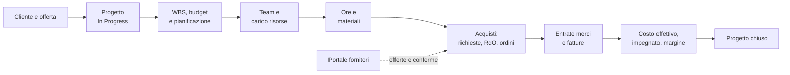
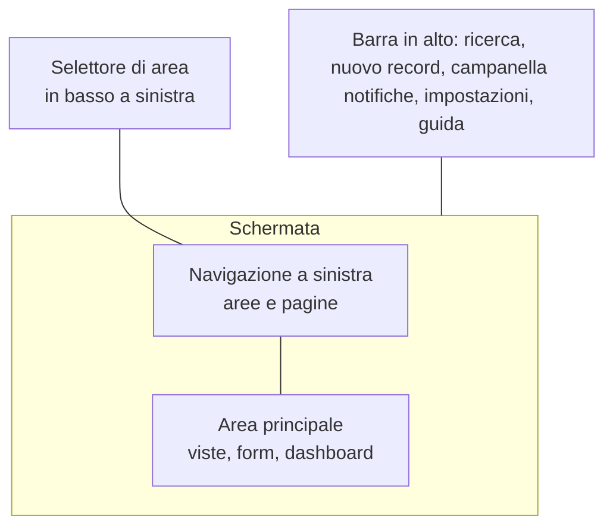
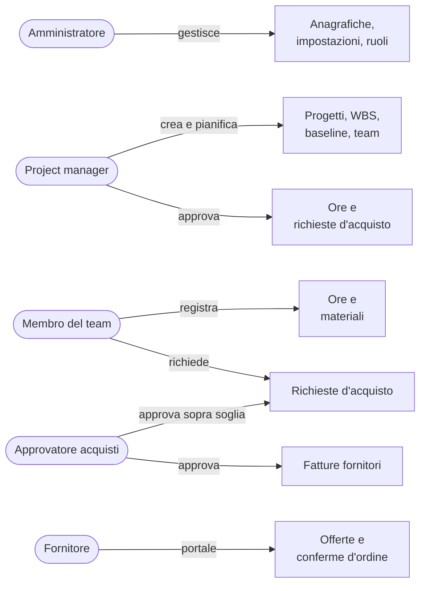

# Primi passi con Open Project 365

> **Lingua:** [English](../en/getting-started.md) · Italiano · [Français](../fr/getting-started.md) · [Deutsch](../de/getting-started.md)
> **Indice dei manuali:** [README](../../README.md#user-manuals)

Questa guida è la prima cosa da leggere se sei nuovo in Open Project 365. Spiega a cosa serve l'applicazione, come si incastrano le sue parti, come orientarsi tra le schermate e quale manuale aprire per ogni attività. Gli altri manuali approfondiscono ogni area funzionale; questo ti dà la mappa.

> **Nota sui nomi a video.** L'interfaccia dell'applicazione è oggi in **inglese** (le traduzioni italiana, francese e tedesca sono pianificate). In questo manuale i nomi di pulsanti, campi e pagine sono scritti in inglese, esattamente come li vedi a schermo, con la traduzione quando aiuta.

## Cosa fa Open Project 365

Open Project 365 è un'applicazione per la gestione di progetti e commesse, pensata per le aziende che lavorano su ordine: imprese edili e impiantistiche, studi di ingegneria, officine, società di servizi e qualunque realtà che deve sapere, per ogni commessa, **cosa era stato previsto, quanto è stato speso e quanto è ancora impegnato**.

Funziona dentro Microsoft Power Apps come app model-driven su Microsoft Dataverse. In pratica:

- la apri dal browser (o da Teams, se l'azienda la aggiunge lì) con il tuo account aziendale Microsoft 365;
- tutti i dati stanno nell'ambiente Dataverse della tua azienda: ogni azienda ha il proprio database, nulla è condiviso con altri clienti;
- sicurezza, audit, note, notifiche e ricerca sono quelli standard della Power Platform e si comportano come nel resto di Dynamics 365.

L'applicazione copre l'intero ciclo di vita di una commessa:

## I concetti principali in una pagina

| Concetto | Che cos'è | Dove approfondire |
|---|---|---|
| **Customer** (cliente) / **Supplier** (fornitore) | Le aziende per cui lavori o da cui compri. Sono entrambe *account* Dataverse: la stessa azienda può essere tutte e due | [Anagrafiche](master-data.md) |
| **Item** (articolo) | Ciò che compri o usi in commessa (materiale, componente, servizio), con un costo unitario e i fornitori che lo vendono | [Anagrafiche](master-data.md) |
| **Resource** (risorsa) | Una persona (o una squadra) di cui si pianificano e registrano le ore, con capacità settimanale e costo orario | [Anagrafiche](master-data.md) |
| **Project** (progetto/commessa) | Il lavoro: cliente, project manager, date, valore contrattuale, budget, costo effettivo e impegnato, avanzamento | [Progetti e team](projects-and-team.md) |
| **Project member** (membro del progetto) | Un utente che lavora al progetto come Manager, Contributor o Reader. L'appartenenza decide chi vede il progetto | [Progetti e team](projects-and-team.md) |
| **WBS node** (nodo WBS) | Un elemento della struttura di scomposizione del lavoro: fase, pacchetto di lavoro o attività, con budget, date e avanzamento | [WBS e pianificazione](wbs-and-planning.md) |
| **Dependency** (dipendenza) | "L'attività B può iniziare solo dopo la fine di A" (fine-inizio, con giorni di ritardo) | [WBS e pianificazione](wbs-and-planning.md) |
| **Baseline** | Copia congelata di budget e date, per confrontare il piano attuale con quello concordato | [WBS e pianificazione](wbs-and-planning.md) |
| **Allocation** (allocazione) | Ore di una risorsa pianificate su un nodo WBS; alimentano il carico risorse | [Carico risorse](resource-load.md) |
| **Time entry** (registrazione ore) | Ore lavorate da una risorsa su un progetto (e facoltativamente su un'attività) in un giorno, con flusso di approvazione | [Rilevazione ore](time-tracking.md) |
| **Material usage** (consumo materiale) | Materiale consumato su un progetto, valorizzato al prezzo del fornitore o al costo dell'articolo | [Materiali e costi](materials-and-costs.md) |
| **Purchase request → RFQ → Purchase order → Goods receipt → Supplier invoice** | La catena degli acquisti: richiesta d'acquisto, richiesta d'offerta, ordine, entrata merci, fattura passiva | [Acquisti](purchasing.md) |
| **Supplier portal** (portale fornitori) | Sito web dove i fornitori rispondono alle richieste d'offerta e confermano gli ordini | [Portale fornitori](supplier-portal.md) |
| **Settings** (impostazioni) | Interruttori validi per tutta l'azienda: approvazione ore, soglia e approvatore acquisti | [Amministrazione](administration.md) |

## Accesso

1. Apri il link che ti ha dato l'amministratore (del tipo `https://<azienda>.crm4.dynamics.com/main.aspx?appid=...`), oppure vai su [make.powerapps.com](https://make.powerapps.com) → **Apps** e scegli **Open Project 365**.
2. Accedi con il tuo account aziendale.
3. Se compare "You don't have permissions", chiedi all'amministratore i ruoli di sicurezza **Basic User** e **OP365 User** (vedi [Amministrazione](administration.md#ruoli-di-sicurezza)).

Se registrerai ore, l'amministratore deve anche collegare il tuo utente a un record **Resource**; altrimenti il foglio ore ti avvisa con "Your user is not linked to a resource".

## Orientarsi nell'applicazione

L'applicazione usa il layout standard delle app model-driven:

- **Selettore di area** (in fondo alla navigazione a sinistra): cambia il gruppo di pagine mostrato. Open Project 365 ha quattro aree: **Projects** (progetti), **Purchasing** (acquisti), **Master Data** (anagrafiche) e **Settings** (impostazioni).
- **Navigazione a sinistra**: le pagine dell'area corrente.
- **Viste**: elenchi di record con colonne, filtri e ordinamento; cambi vista con il menu a tendina accanto al titolo.
- **Form (schede)**: un singolo record, organizzato in tab. Le modifiche si salvano con **Save** (o Ctrl+S); il form salva anche automaticamente dopo poco.
- **Barra dei comandi**: i pulsanti sopra una vista o un form (New, Save, Delete e i comandi di Open Project 365 come **Submit**, **Approve**, **Save Baseline**).
- **Dashboard**: pagine intere con grafici e componenti interattivi (Timesheet, Time Approval, Resource Load, Spend).

### La mappa della navigazione

| Area | Gruppo | Pagina | Utente tipico |
|---|---|---|---|
| Projects | Work | **Projects** (progetti), **Material Usage** (consumi materiale) | Project manager, membri del team |
| Projects | Time | **Timesheet** (foglio ore), **Approvals** (approvazioni), **Time Entries** (registrazioni ore) | Chi registra ore; i manager che approvano |
| Projects | Planning | **Resource Load** (carico risorse), **Absences** (assenze) | Project manager, pianificatori |
| Purchasing | Procurement | **Purchase Requests**, **RFQs**, **Purchase Orders**, **Goods Receipts**, **Supplier Invoices** | Project manager, buyer, amministrazione |
| Purchasing | Analysis | **Spend** (spesa) | Buyer, direzione |
| Master Data | Records | **Customers**, **Suppliers**, **Contacts**, **Items**, **Resources** | Personale amministrativo, buyer |
| Settings | Company | **Settings**, **Resource Costs**, **Project Members** | Amministratori |

In base al tuo ruolo di sicurezza, alcune pagine possono non mostrare record o non permetterne la creazione.

## Chi fa cosa

| Ruolo | Cosa farai più spesso | Manuali da leggere |
|---|---|---|
| **Membro del team** (Contributor) | Compilare il foglio ore settimanale, registrare materiali, aprire richieste d'acquisto | [Rilevazione ore](time-tracking.md), [Materiali e costi](materials-and-costs.md), [Acquisti](purchasing.md) |
| **Project manager** (Manager) | Creare il progetto, costruire WBS e piano, salvare baseline, gestire il team, approvare ore e richieste, seguire i costi | [Progetti e team](projects-and-team.md), [WBS e pianificazione](wbs-and-planning.md), [Carico risorse](resource-load.md), [Rilevazione ore](time-tracking.md), [Materiali e costi](materials-and-costs.md), [Acquisti](purchasing.md) |
| **Buyer / approvatore acquisti** | Approvare le richieste sopra soglia, gestire RdO, ordini, entrate merci e fatture | [Acquisti](purchasing.md), [Portale fornitori](supplier-portal.md) |
| **Amministratore** | Utenti, ruoli, anagrafiche, impostazioni, visibilità costi, portale fornitori | [Amministrazione](administration.md), [Anagrafiche](master-data.md), [Portale fornitori](supplier-portal.md) |
| **Fornitore** (esterno) | Rispondere alle RdO e confermare gli ordini sul portale | [Portale fornitori](supplier-portal.md) |

## Notifiche

Open Project 365 usa le **notifiche in-app** delle app model-driven: l'icona a campanella nella barra in alto. Ricevi una notifica quando:

| Evento | Chi viene avvisato |
|---|---|
| Delle ore vengono inviate in approvazione | I manager del progetto |
| Le tue ore vengono approvate o respinte (con il motivo) | Tu (la risorsa) |
| Hai registrato meno ore del previsto nella giornata (lunedì–venerdì, ore 17:30) | Tu, con un link al foglio ore |
| Una richiesta d'acquisto attende la tua approvazione | Il project manager, poi l'approvatore acquisti se la richiesta supera la soglia |
| La tua richiesta d'acquisto viene approvata o respinta | Il richiedente |

Le notifiche compaiono nel pannello della campanella e, per qualche secondo, come avviso in alto a destra. Clicca una notifica per aprire il record. Le preferenze di notifica sono quelle standard della piattaforma.

## Note, menzioni e timeline

La maggior parte dei record di Open Project 365 ha una **Timeline**, di solito nella colonna di destra della prima scheda del form. Puoi:

- aggiungere **note**, con allegati;
- **menzionare un collega** scrivendo `@` seguito dal nome: il collega riceve una notifica e la nota diventa un piccolo thread di commenti;
- sui progetti, registrare anche **attività** (telefonate, task, appuntamenti, email).

La timeline è il posto giusto per decisioni, comunicazioni con il cliente e tutto ciò che vuoi conservare insieme al record.

## Stati e record bloccati

Molti record seguono un flusso (registrazioni ore, richieste d'acquisto, ordini, fatture...). Alcune regole valgono ovunque:

- **I cambi di stato passano dai pulsanti di comando** (Submit, Approve, Send, Confirm...), mai modificando il campo Status Reason. Se ci provi, ricevi un messaggio come "Use Submit, Approve or Reject to change the status".
- **I record oltre un certo stato sono bloccati**: una registrazione ore inviata, un ordine spedito, una fattura approvata non si possono modificare. Per correggerli usa il pulsante che li riporta indietro (Reject, Back to Draft, Cancel Receipt).
- **Quasi tutto il lavoro avviene solo su progetti In Progress**: ore, materiali e ordini d'acquisto vengono rifiutati su offerte, progetti sospesi o chiusi.

## Ricerca e viste personali

- La **casella di ricerca** nella barra in alto cerca in tutte le tabelle (progetti per nome o codice, clienti, articoli, ordini d'acquisto...).
- In ogni vista puoi filtrare le colonne, cambiare l'ordinamento e **salvare il risultato come vista personale** (Create view). Le viste personali si possono condividere con i colleghi.
- Usa **Export to Excel** dalla barra dei comandi di una vista per analizzare i dati fuori dall'app.

## Lingua

L'interfaccia è disponibile in **inglese, italiano, francese e tedesco**. Ogni utente sceglie la lingua in **Impostazioni (icona a ingranaggio) > Impostazioni di personalizzazione > Lingue > Lingua interfaccia utente**; tabelle, campi, viste, pulsanti, i controlli di commessa (WBS, Gantt, foglio ore...), le finestre di dialogo, i messaggi di errore e le notifiche seguono questa scelta. Questi manuali sono disponibili in tutte e quattro le lingue; alcuni nomi di pulsanti e campi possono comparire ancora in inglese, con la traduzione dove aiuta.

## Prossimi passi

- Nuovo su un progetto? Leggi [Progetti e team](projects-and-team.md).
- Devi registrare ore oggi? Vai direttamente a [Rilevazione ore](time-tracking.md).
- Stai configurando l'azienda per la prima volta? Parti da [Amministrazione](administration.md) e [Anagrafiche](master-data.md).
