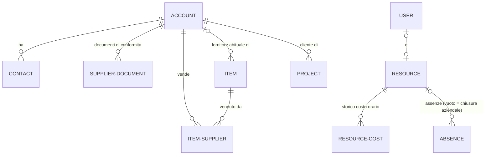
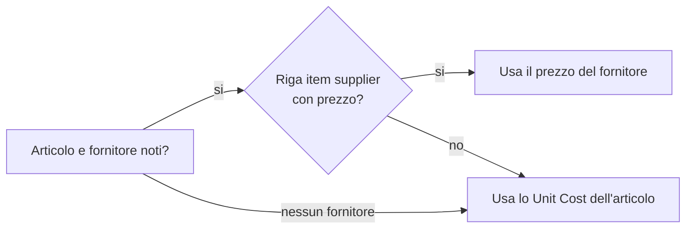
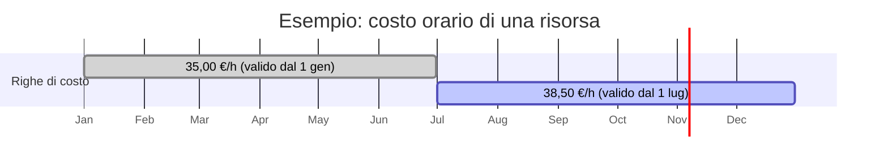
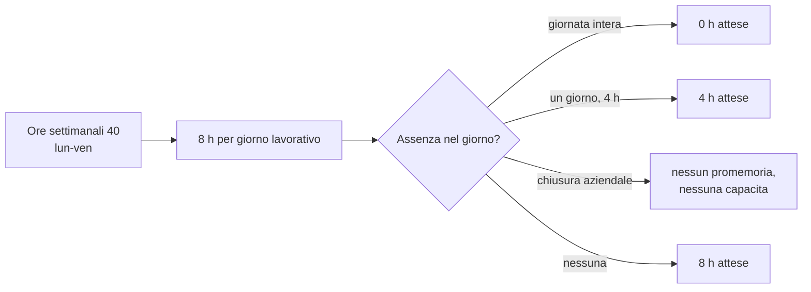

# Anagrafiche: clienti, fornitori, contatti, articoli e risorse

> **Lingua:** [English](../en/master-data.md) · Italiano · [Français](../fr/master-data.md) · [Deutsch](../de/master-data.md)
> **Indice dei manuali:** [README](../../README.md#user-manuals)

Le anagrafiche sono le informazioni su cui si basa tutto il resto di Open Project 365: le aziende per cui lavori e da cui compri, le persone con cui parli, gli articoli che acquisti e consumi, le risorse di cui pianifichi e registri le ore. Tenerle pulite e complete è ciò che rende affidabili costi, acquisti e pianificazione. Questo manuale spiega ogni tipo di record, a cosa serve ciascun campo e le regole che l'applicazione applica in automatico.

Tutte le anagrafiche stanno nell'area **Master Data**, gruppo **Records**: **Customers** (clienti), **Suppliers** (fornitori), **Contacts** (contatti), **Items** (articoli), **Resources** (risorse). I costi orari delle risorse sono nell'area **Settings**; le impostazioni aziendali sono variabili d'ambiente (vedi [Amministrazione](administration.md#impostazioni-aziendali)).

> I nomi di campi e pulsanti sono in inglese, come appaiono a schermo.

## Come si collegano le anagrafiche

## Clienti e fornitori (account)

Clienti e fornitori sono entrambi memorizzati come **account**, la tabella standard di Dataverse per le aziende. Una stessa azienda può essere cliente, fornitore o entrambe le cose: lo decidono due caselle, **Is Customer** (è cliente) e **Is Supplier** (è fornitore).

### Due form, un solo record

Un account ha due form:

- il form **Customer**, con i dati che servono per vendere e fatturare;
- il form **Supplier**, con i dati che servono per acquistare, più documenti di conformità e prezzi degli articoli.

L'applicazione sceglie il form giusto per te:

- quando apri un'azienda che è **solo fornitore**, viene mostrata sul form Supplier; tutti gli altri account si aprono sul form Customer;
- quando crei un nuovo account da **Suppliers** (o scegli il form Supplier), **Is Supplier** viene spuntato automaticamente; da **Customers** (form Customer) viene spuntato **Is Customer**.

Puoi sempre cambiare form con il selettore accanto al nome del record.

### Viste

| Vista | Mostra |
|---|---|
| **All Customers** (predefinita in Customers) | Tutti gli account marcati come clienti |
| **Prospects** | Clienti con Customer Type *Prospect* (potenziali) |
| **Customers with Projects** / **Customers without Projects** | Clienti con (o senza) almeno un progetto |
| **All Suppliers** (predefinita in Suppliers) | Tutti gli account marcati come fornitori |
| **Active Suppliers** / **Blocked Suppliers** | Fornitori per Supplier Status |
| **Suppliers with Document Alerts** | Fornitori con documenti di conformità scaduti o in scadenza |

### Campi del cliente (form Customer, tab Summary)

| Campo | Significato |
|---|---|
| **Account Name** | Ragione sociale, come la vuoi sui documenti |
| **Is Customer** | L'azienda compare tra i clienti e può essere scelta come cliente di un progetto |
| **Customer Type** | *Prospect* (potenziale cliente, per esempio mentre un'offerta è aperta) o *Customer* |
| **VAT Number** / **Tax Code** | Partita IVA e codice fiscale (o equivalenti esteri) |
| **Primary Contact**, **Main Phone**, **Email**, **Website** | Dati di contatto standard |
| **Owner** | L'utente responsabile dell'account |
| **Address** | Via, città, CAP, provincia, nazione |
| **Payment Terms**, **IBAN**, **PEC**, **Language** | Dati di fatturazione; Language è la lingua per documenti ed email inviati all'azienda (italiano, inglese, tedesco, francese) |

Valori in sola lettura mantenuti dall'applicazione: **Projects** (numero di progetti del cliente) e **Contract Value Total** (somma dei valori contrattuali dei suoi progetti). Si aggiornano ogni volta che un progetto viene creato, modificato o eliminato.

La tab **Contacts** elenca le persone dell'azienda.

### Campi del fornitore (form Supplier)

La tab **Summary** ha gli stessi dati di azienda, indirizzo e pagamento del form cliente, più:

| Campo | Significato |
|---|---|
| **Is Supplier** | L'azienda può ricevere richieste d'offerta e ordini d'acquisto |
| **Supplier Status** | *Active* (attivo) o *Blocked* (bloccato). Un fornitore bloccato non può essere invitato a una RdO né ricevere ordini: l'applicazione ti ferma con "<nome> is blocked." |
| **Supplier Category** | Testo libero per raggruppare i fornitori (per esempio "Elettrico", "Calcestruzzo", "Noleggi") |
| **Email** | Usata come indirizzo predefinito degli inviti nelle RdO e registrata come **Sent To** quando un ordine viene inviato |

Valori in sola lettura: **Spend** (totale degli ordini al fornitore, visibile solo a chi ha la visibilità costi) e **Contacts** (numero di contatti). Li mantengono i plugin degli acquisti.

La tab **Documents** elenca i **documenti di conformità** del fornitore e mostra i contatori **Document Alerts** (Expired Documents = scaduti, Expiring Documents = in scadenza). La tab **Item Prices** elenca gli articoli che il fornitore vende, con il suo prezzo per ciascuno.

> I contatori degli avvisi documenti sono predisposti per un aggiornamento giornaliero; finché quel processo non viene attivato nel tuo ambiente possono restare vuoti. I documenti, con le loro date di scadenza, sono sempre disponibili nella tab Documents e nelle viste.

### Documenti del fornitore

Un documento del fornitore registra un documento di conformità che devi conservare: DURC, visura camerale, certificazioni, polizze assicurative, contratti e così via.

| Campo | Significato |
|---|---|
| **Supplier** | Il fornitore (il documento viene eliminato se si elimina il fornitore) |
| **Document Type** | DURC, Company Report (visura), Certification, Insurance, Contract, Other (obbligatorio) |
| **Description** | Breve descrizione (obbligatoria) |
| **Number** | Numero o riferimento del documento |
| **Issue Date** / **Expiry Date** | Periodo di validità (emissione e scadenza) |
| **External URL** | Link al documento in un altro sistema (per esempio SharePoint) |
| **File** | Il documento stesso, caricato in Dataverse |
| **Notes** | Altro |

Crea i documenti dalla tab Documents del fornitore (**+ New Supplier Document**), così il fornitore viene compilato in automatico.

## Contatti

I contatti sono i contatti standard di Dataverse: le persone che lavorano per i tuoi clienti e fornitori. Open Project 365 aggiunge un campo:

- **Is Decision Maker**: spuntalo per chi decide (per esempio chi firma l'offerta o l'ordine).

Un contatto appartiene a un'azienda tramite **Company Name** (account padre). Per i fornitori questo conta anche per il [portale fornitori](supplier-portal.md): un utente fornitore è un contatto la cui azienda è il fornitore.

## Articoli

Un articolo è qualunque cosa compri o consumi in commessa: un materiale, un componente, un consumabile, un servizio o un noleggio.

| Campo | Significato |
|---|---|
| **Code** | Codice articolo univoco (obbligatorio; l'applicazione rifiuta due articoli con lo stesso codice) |
| **Name** | Descrizione (obbligatoria) |
| **Category** | Testo libero per raggruppare gli articoli |
| **Unit of Measure** | pz, m, kg, h, m², ... Viene copiata su righe di richiesta, righe d'ordine e consumi |
| **Unit Cost** | Costo standard di un'unità. Usato quando non c'è un prezzo del fornitore |
| **Default Supplier** | Il fornitore da cui compri di solito l'articolo. Viene invitato automaticamente quando si crea una RdO per una richiesta che contiene l'articolo |
| **Notes** | Altro |

Valori in sola lettura, mantenuti dagli acquisti: **Order Lines** (quante righe d'ordine usano l'articolo) e **Spend** (importo totale ordinato, visibile solo con la visibilità costi).

### Fornitori e prezzi dell'articolo

La sezione **Suppliers** dell'articolo (e la tab **Item Prices** del fornitore) elenca gli **item supplier**: una riga per ogni fornitore che vende l'articolo.

| Campo | Significato |
|---|---|
| **Item** / **Supplier** | La coppia; può esistere una sola riga per lo stesso articolo e fornitore |
| **Supplier Code** | Il codice del fornitore per l'articolo |
| **Price** | Il prezzo unitario del fornitore |
| **Lead Time (Days)** | Tempo di consegna abituale in giorni |
| **Minimum Lot** | Quantità minima per ordine |
| **Notes** | Condizioni, sconti, ... |

### Quale prezzo viene usato

Ogni volta che l'applicazione deve valorizzare un articolo (consumi, righe di richiesta e d'ordine), cerca un prezzo in questo ordine:

Puoi sempre sovrascrivere il prezzo proposto sulla riga; la regola lo compila solo quando è vuoto.

## Risorse

Una **risorsa** è una persona (o una squadra, o qualsiasi capacità) le cui ore vengono pianificate sulla WBS e registrate nelle registrazioni ore. Una risorsa non deve essere per forza un utente: puoi pianificare subappaltatori o operai senza licenza. Per registrare ore in autonomia, però, la persona deve avere un utente collegato alla propria risorsa.

### Campi della risorsa

| Campo | Significato |
|---|---|
| **Name** | Nome della persona o della squadra (obbligatorio) |
| **Role** | Mansione o competenza (per esempio "Elettricista", "Capocantiere") |
| **User** | L'utente Dataverse della persona. Necessario per usare il foglio ore: il foglio ore trova "la mia risorsa" tramite questo campo |
| **Owner** | Proprietario del record |
| **Weekly Hours** | Ore contrattuali a settimana, da 0 a 80. Predefinito **40** |
| **Working Days** | I giorni lavorativi della risorsa. Predefinito **da lunedì a venerdì** |
| **Hourly Cost** | Costo orario corrente. **Leggilo, non scriverlo**: viene sincronizzato dai Resource Costs (vedi sotto). Visibile solo agli utenti con il profilo *OP365 Cost Visibility* |

Quando crei una risorsa lasciando vuoti Weekly Hours e Working Days, l'applicazione imposta 40 ore e lunedì–venerdì.

Ore settimanali e giorni lavorativi si usano in tre punti:

- il **promemoria giornaliero**: ore attese al giorno = ore settimanali ÷ numero di giorni lavorativi;
- il **foglio ore**: il totale settimanale è confrontato con le ore settimanali;
- il **carico risorse**: capacità settimanale = ore settimanali, meno assenze e chiusure aziendali.

### Storico del costo orario (Resource Costs)

I costi cambiano nel tempo, e il costo di un'ora lavorata a marzo non deve cambiare quando la tariffa aumenta a settembre. Per questo il costo orario è memorizzato come **storico** nella tab **Costs** della risorsa (o in **Settings → Resource Costs**):

| Campo | Significato |
|---|---|
| **Resource** | La risorsa |
| **Valid From** | Primo giorno di validità del costo (obbligatorio; una riga per risorsa e data) |
| **Hourly Cost** | Costo orario da quella data (obbligatorio, visibile solo con la visibilità costi) |

Come funziona:

- il **costo di una registrazione ore** è ore × il costo valido **alla data della registrazione** (l'ultima riga con Valid From non successiva alla data). Una registrazione del 15 marzo usa 35,00; una del 15 luglio usa 38,50, anche se entrambe vengono inserite oggi;
- l'**Hourly Cost** mostrato sulla risorsa è la riga con il Valid From più recente non nel futuro. Viene ricalcolato ogni volta che una riga di costo viene creata, modificata o eliminata;
- se inserisci un costo che parte nel futuro, il campo della risorsa lo mostrerà quando una riga di costo verrà modificata di nuovo dopo quella data; le registrazioni ore da quella data in poi lo usano subito.

Se una risorsa non ha alcuna riga di costo, si usa il suo Hourly Cost.

### Assenze e chiusure aziendali

La tab **Absences** della risorsa (e **Projects → Planning → Absences**) registra i periodi in cui una risorsa non è disponibile.

| Campo | Significato |
|---|---|
| **Resource** | Chi è assente. **Lascialo vuoto per registrare una chiusura aziendale** (per esempio la chiusura di agosto o un ponte): vale per tutti |
| **Absence Type** | Vacation (ferie), Leave (permesso), Sickness (malattia), Closure (chiusura) — obbligatorio |
| **From** / **To** | Primo e ultimo giorno (obbligatori) |
| **Hours** | Solo per assenze di un giorno: le ore di assenza (per esempio 4 per mezza giornata). Vuoto per giornate intere |
| **Notes** | Altro |

Le assenze sono usate da:

- il **promemoria giornaliero**, che si aspetta meno ore (o nessuna) nei giorni di assenza e non invia nulla nelle chiusure aziendali;
- il **carico risorse**, che riduce la capacità settimanale.

## Buone pratiche

- **Controlla i duplicati** prima di creare un'azienda: cerca per nome e partita IVA.
- **Spunta sia Is Customer sia Is Supplier** quando un'azienda ha entrambi i ruoli, invece di creare due account.
- **Blocca** un fornitore invece di eliminarlo: la sua storia (ordini, fatture, documenti) resta intatta.
- **Non scrivere mai il costo orario sulla risorsa**: aggiungi una riga Resource Cost con la data di decorrenza.
- **Collega lo User** a ogni risorsa che registra ore, e verifica che l'utente abbia i ruoli di sicurezza giusti (vedi [Amministrazione](administration.md)).
- **Assegna a ogni articolo un fornitore abituale** e i prezzi dei fornitori che usi: RdO, ordini e consumi saranno precompilati.

## Messaggi che potresti vedere

| Messaggio | Perché | Cosa fare |
|---|---|---|
| "<name> is not an active supplier." | L'account è inattivo o non marcato come fornitore | Spunta Is Supplier o riattiva l'account |
| "<name> is blocked." | Supplier Status è Blocked | Rimettilo Active se il fornitore può essere di nuovo usato |
| Errore di chiave duplicata salvando un articolo | Un altro articolo ha lo stesso Code | Usa un codice diverso o apri l'articolo esistente |
| Errore di chiave duplicata su un item supplier | Quel fornitore ha già una riga prezzo per l'articolo | Apri e modifica la riga esistente |
| Errore di chiave duplicata su un resource cost | La risorsa ha già un costo con quel Valid From | Modifica la riga esistente |
| Hourly Cost vuoto o mascherato | Non hai il profilo Cost Visibility | Chiedi a un amministratore se devi vedere i costi |
