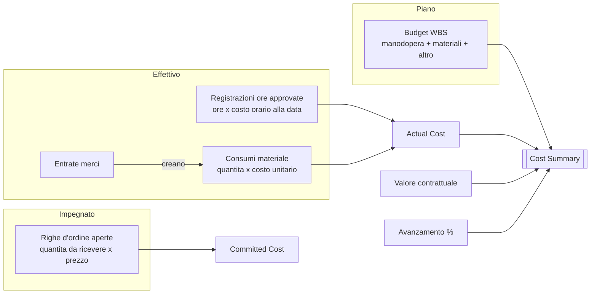
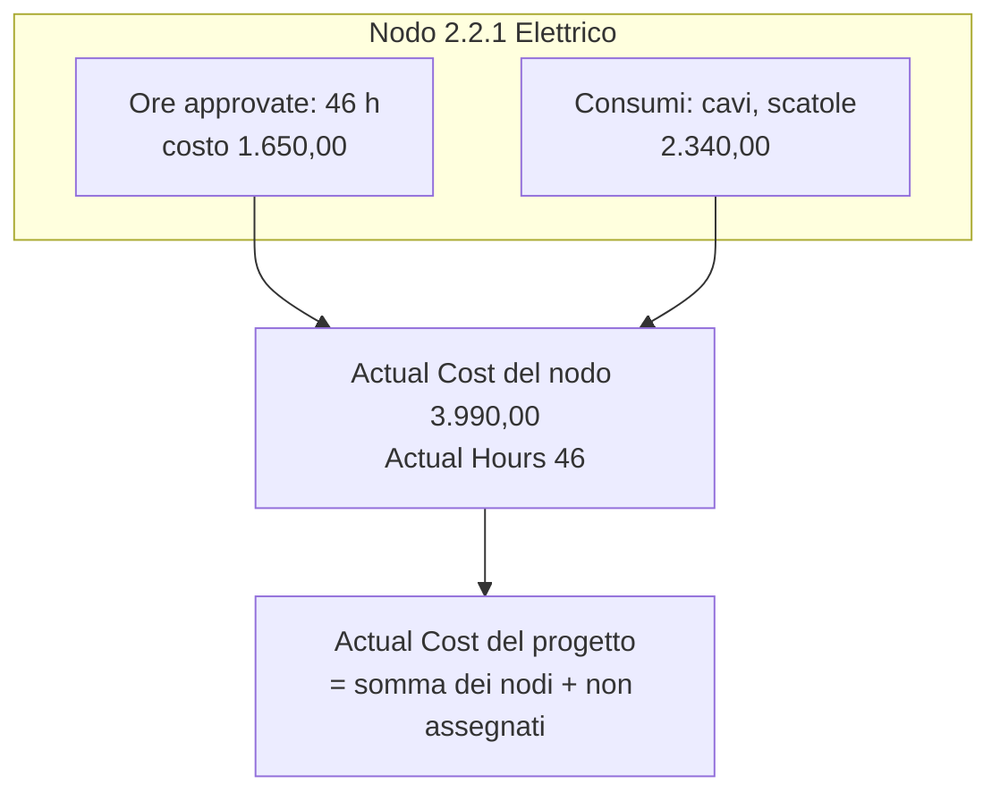
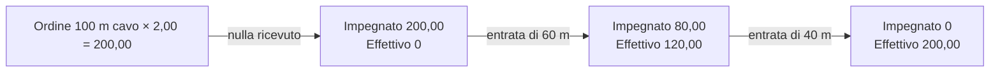

# Materiali, costi effettivi e riepilogo costi

> **Lingua:** [English](../en/materials-and-costs.md) · Italiano · [Français](../fr/materials-and-costs.md) · [Deutsch](../de/materials-and-costs.md)
> **Indice dei manuali:** [README](../../README.md#user-manuals)

Una commessa è redditizia solo se sai, in ogni momento, quanto è costata davvero e quanto costerà. ProjectIQ raccoglie i **costi effettivi** da due fonti — ore approvate e consumi di materiale — e li combina con il **costo impegnato** degli ordini aperti e con il **budget** della WBS. Il **Cost Summary** (riepilogo costi) nel form del progetto trasforma questi numeri in una previsione: la stima a finire e il margine atteso.

Questo manuale spiega come registrare i materiali, come si formano costi effettivi e impegnati e come leggere il riepilogo costi.

> I nomi di campi e pulsanti sono in inglese, come appaiono a schermo.

## Da dove vengono i numeri

| Valore | Fonte | Aggiornato |
|---|---|---|
| **Budget Total** | Budget dei nodi WBS | Al salvataggio di un nodo |
| **Actual Hours** | Registrazioni ore approvate | All'approvazione di una registrazione (o all'invio, con approvazione disattivata) |
| **Actual Cost** | Costo delle ore approvate + costo totale di tutti i consumi | Al salvataggio o eliminazione di una registrazione o di un consumo |
| **Committed Cost** | Righe d'ordine ancora da ricevere × prezzo, su ordini inviati o confermati | Quando cambiano ordini, righe o entrate merci |
| **Progress %** | Avanzamento dei nodi foglia, pesato sul budget | Al salvataggio di un nodo |

Ogni valore esiste sia su ogni **nodo WBS** (ore e costo effettivi di quel nodo) sia sul **progetto** (totali). I costi registrati sul progetto senza nodo WBS contano nei totali del progetto e compaiono come *Not assigned to a WBS node* nel riepilogo costi.

## Consumi di materiale

Un **material usage** (consumo di materiale) registra il materiale consumato su un progetto: cosa, quanto, quando, su quale attività, da quale fornitore e a che costo. Può essere creato a mano o automaticamente da un'entrata merci (vedi [Acquisti](purchasing.md#4-entrate-merci)).

### Registrare materiale a mano

1. Apri **Projects → Work → Material Usage** e clicca **+ New**, oppure usa la tab **Materials** del progetto (il progetto viene precompilato), oppure il form di creazione rapida.
2. Scegli il **Project** (deve essere **In Progress**) e facoltativamente il **WBS Node** (sono proposti solo nodi di quel progetto).
3. Imposta la **Usage Date**.
4. Scegli l'**Item**. **Description** e **Unit of Measure** vengono copiate dall'articolo se vuote.
5. Facoltativamente scegli il **Supplier** da cui proviene il materiale.
6. Scrivi la **Quantity**.
7. Lascia vuoto **Unit Cost** perché lo compili l'applicazione, oppure scrivilo.
8. Salva: **Total Cost** = Quantity × Unit Cost.

### Campi

| Campo | Significato |
|---|---|
| **Project** | Il progetto (obbligatorio). Il consumo viene eliminato con il progetto |
| **WBS Node** | L'attività su cui si usa il materiale (facoltativo, solo dello stesso progetto) |
| **Usage Date** | Quando è stato usato |
| **Item** | L'articolo a catalogo (facoltativo: puoi registrare materiale a testo libero) |
| **Description** | Cosa è stato usato; dall'articolo se vuota |
| **Supplier** | Da dove proviene (facoltativo) |
| **Quantity** / **Unit of Measure** | Quanto; l'unità viene dall'articolo se vuota |
| **Unit Cost** | Costo per unità (visibile solo con la visibilità costi) |
| **Total Cost** | Quantity × Unit Cost, calcolato (visibile solo con la visibilità costi) |

### Come viene proposto il costo unitario

Quando scegli un articolo e lasci vuoto Unit Cost:

1. se è indicato un **Supplier** ed esiste una riga **item supplier** attiva per quell'articolo e fornitore, si usa il suo **Price**;
2. altrimenti si usa lo **Unit Cost** dell'articolo.

La proposta avviene solo quando l'articolo viene scelto o cambiato; le modifiche successive dei prezzi a catalogo non cambiano i record esistenti.

### Materiale dalle entrate merci

Quando un buyer registra un'entrata merci su un ordine d'acquisto, ProjectIQ crea un consumo per ogni riga ricevuta, al **prezzo d'ordine**, sul progetto dell'ordine e sul nodo WBS della riga d'ordine. Questi record sono marcati come provenienti dall'entrata merci e **non possono essere modificati né eliminati direttamente**: "This material usage comes from a goods receipt: cancel the receipt to change it." Per correggerli, annulla l'entrata merci e registrala di nuovo.

Quindi **non** devi registrare due volte il materiale acquistato: ricevilo, e diventa costo effettivo automaticamente. Registra a mano solo il materiale preso dal magazzino o acquistato fuori dagli ordini.

### Viste

| Vista | Mostra |
|---|---|
| **All Material Usage** | Tutti i consumi che puoi vedere |
| **Material Usage by Project** | Usata nella tab Materials del progetto |

La ricerca rapida (casella di ricerca della vista) è disponibile sui consumi.

## Il costo effettivo nel dettaglio

- **Manodopera**: contano solo le registrazioni **approvate** (con approvazione disattivata, quelle inviate vengono approvate subito). Ore in bozza, inviate o respinte non sono ancora costo effettivo.
- **Materiali**: **tutti** i consumi contano appena salvati, sia inseriti a mano sia creati da un'entrata merci.
- Il ricalcolo è immediato e copre anche gli spostamenti: se una registrazione passa a un altro nodo o progetto, vengono ricalcolati sia i vecchi sia i nuovi totali.

## Costo impegnato

Il **costo impegnato** sono i soldi già promessi ai fornitori ma non ancora ricevuti come merce: per ogni riga degli ordini **Sent** (inviati) o **Confirmed** (confermati), (quantità ordinata − quantità ricevuta) × prezzo. Gli ordini in bozza (non ancora inviati) e quelli annullati non contano. Quando arriva la merce, la parte ricevuta passa da impegnato a effettivo (tramite il consumo di materiale). Vedi [Acquisti](purchasing.md) per i dettagli.

Il costo impegnato si usa anche quando si invia una richiesta d'acquisto: se effettivo + impegnato + la nuova richiesta superano il budget del nodo (o del progetto), la richiesta viene marcata **Over Budget** per l'approvatore.

## Riepilogo costi

La tab **Costs** del progetto mostra il componente **Cost Summary**.

### Valori di testata

| Valore | Significato |
|---|---|
| **Contract value** | Il prezzo concordato (Contract Value del progetto) |
| **Budget** | Budget totale della WBS |
| **Actual cost** | Costo effettivo a oggi, con la ripartizione **Labour** (manodopera) / **Materials** (materiali) |
| **Estimate at completion** | Stima a finire, cioè previsione del costo finale: **costo effettivo ÷ avanzamento** quando l'avanzamento è maggiore di zero; altrimenti il maggiore tra budget ed effettivo |
| **Expected margin** | Valore contrattuale − stima a finire |

### Budget vs effettivo per ramo WBS

Sotto la testata, una tabella mostra una riga per ogni **nodo WBS di primo livello** (ogni ramo include tutti i suoi sotto-nodi):

| Colonna | Significato |
|---|---|
| **WBS branch** | Codice e nome del nodo di primo livello |
| **Budget** | Budget totale del ramo |
| **Actual** | Costo effettivo del ramo |
| **Variance** | Effettivo − budget: **positivo significa fuori budget** |
| **Spent** | Quota del budget già spesa, come barra |
| **Hours (actual / budget)** | Ore approvate rispetto alle ore a budget |

I costi senza nodo WBS compaiono in un'ultima riga, **Not assigned to a WBS node**.

### Esempio

| | Valore |
|---|---|
| Valore contrattuale | 120.000 |
| Budget | 100.000 |
| Costo effettivo | 45.000 (manodopera 30.000, materiali 15.000) |
| Avanzamento | 40% |
| **Stima a finire** | 45.000 ÷ 0,40 = **112.500** |
| **Margine atteso** | 120.000 − 112.500 = **7.500** (il margine a budget era 20.000) |

La previsione dice che la commessa spende più in fretta di quanto avanzi: a questo ritmo finirà 12.500 sopra il budget. Guarda la tabella per ramo per capire da dove viene lo scostamento.

> La stima a finire vale quanto i valori di **avanzamento**: aggiorna regolarmente l'avanzamento dei nodi foglia. Con avanzamento a 0 la previsione ricade sul budget (o sul costo effettivo, se è già più alto).

Messaggi: "Save the project to see its costs." su un progetto nuovo; "The cost summary could not be loaded" in caso di problemi di rete o permessi (ricarica il form).

## Visibilità dei costi

I costi sono dati sensibili. Le colonne con costi orari e costi dei materiali sono protette dal profilo di sicurezza di colonna **OP365 Cost Visibility**:

- gli utenti **con** il profilo vedono Unit Cost, Total Cost, il Cost delle registrazioni ore, i costi orari delle risorse, la spesa per fornitore e articolo;
- gli utenti **senza** il profilo vedono questi campi vuoti o mascherati, anche sui record che possono aprire.

I totali del progetto (Actual Cost, Committed Cost, Budget Total) sono visibili a chiunque possa leggere il progetto. Assegna il profilo ad amministratori, project manager e controller (vedi [Amministrazione](administration.md#visibilità-dei-costi)).

## Messaggi che potresti vedere

| Messaggio | Significato e soluzione |
|---|---|
| "Hours and materials can be recorded only on projects In Progress." | Metti il progetto In Progress, o registra su un altro progetto |
| "The WBS node belongs to another project." | Scegli un nodo del progetto selezionato |
| "This material usage comes from a goods receipt: cancel the receipt to change it." | Usa **Cancel Receipt** sull'entrata merci, poi registrala di nuovo |
| Unit Cost o Total Cost vuoti | Non hai il profilo Cost Visibility, oppure l'articolo non ha costo né prezzo del fornitore |
