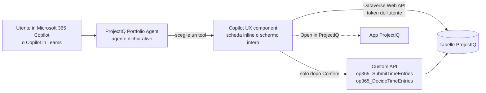
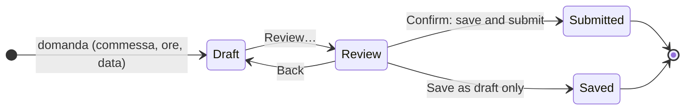
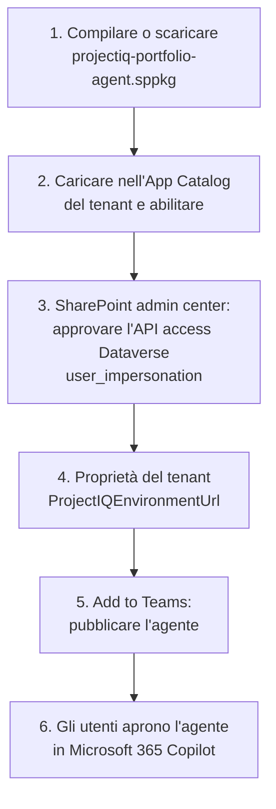

# Portfolio Agent: ProjectIQ in Microsoft 365 Copilot

> **Lingua:** [English](../en/portfolio-agent.md) · Italiano · [Français](../fr/portfolio-agent.md) · [Deutsch](../de/portfolio-agent.md)
> **Indice dei manuali:** [README](../../README.md#user-manuals)

Il **ProjectIQ Portfolio Agent** porta ProjectIQ in Microsoft 365 Copilot e in Copilot in Teams. Le persone chiedono con parole proprie ("quali commesse sono fuori budget?", "registra 8 ore oggi su PRJ-000123") e l'agente risponde con una scheda interattiva costruita sui dati reali di ProjectIQ: indicatori, semafori, grafici, una timeline, una mappa di calore del carico e pulsanti per approfondire o aprire il record nell'app.

È realizzato con i **Copilot UX component di SharePoint Framework (SPFx)** e si ispira all'esempio Microsoft *Zava Project Tracker*, ma ogni numero arriva dalle tabelle ProjectIQ in Dataverse, lette **con l'identità dell'utente**. Completa l'integrazione [Copilot e Cowork](copilot.md): Copilot Chat risponde a testo dal modello semantico, il Portfolio Agent risponde con schede e può anche **registrare, inviare e approvare ore** dopo una conferma esplicita.

> I nomi di campi, pulsanti e messaggi sono in inglese, come appaiono a schermo. I Copilot UX component sono disponibili (GA) da SPFx 1.24 (ottobre 2026). Funzionano in Microsoft 365 Copilot e in Copilot in Teams su web e desktop, non ancora su mobile.

## Come funziona

1. L'agente legge la domanda e sceglie **un** componente (un "tool"), passando i valori che ha capito (commessa, persona, data, ore).
2. Il componente si apre come scheda nella chat (**inline**); **Expand** lo apre a **schermo intero** con più colonne e righe.
3. La scheda legge Dataverse con i permessi dell'utente: ruoli di sicurezza, access team di commessa e sicurezza a livello di colonna valgono esattamente come nell'app.
4. Ogni scheda dice a Copilot cosa mostra, così le domande successive ("perché è in ritardo?", "e la fase dopo?") hanno risposta sugli stessi dati.
5. I pulsanti della scheda inviano una nuova domanda (per esempio da *My work* a *Project health*) o aprono il record nell'app ProjectIQ.

## Cosa si può chiedere

| Vista | Domande di esempio | Mostra | Scrive |
|---|---|---|---|
| My work | "Cosa richiede la mia attenzione sulle mie commesse questa settimana?" | Elenco ordinato: ore da approvare, ore rifiutate e in bozza, ore mancanti della settimana scorsa, commesse a rischio, RdA in attesa di te, ordini in ritardo, fatture, sovraccarico | – |
| Log and submit hours | "Registra 8 ore oggi su PRJ-000123", "Invia il mio rapportino" | La tua settimana, righe in bozza modificabili, revisione | Registrazioni ore (dopo **Confirm**) |
| Approve hours | "Quali ore devo approvare?" | Ore inviate delle commesse che gestisci, per persona e settimana, con segnalazioni | Approva / rifiuta (dopo **Confirm**) |
| Project health | "Come va la commessa PRJ-000123?" | Semaforo e motivi, budget, consuntivo, impegnato, residuo, stima a finire, margine, fasi WBS segnalate, acquisti aperti | – |
| Project budget | "Mostra il budget del tetto della scuola" | Budget contro costo effettivo per ramo WBS (grafico e tabella), manodopera, materiali, impegnato | – |
| Project timeline | "PRJ-000123 è in ritardo? Mostra il percorso critico" | Fasi WBS su una timeline con avanzamento, percorso critico, baseline e barre spinte dalle dipendenze | – |
| Project documents | "Mostra i documenti della commessa PRJ-000123" | File e sottocartelle della cartella SharePoint della commessa, dai più recenti, con autore, dimensione e link | – |
| Portfolio health | "Quali commesse sono fuori budget o in ritardo?" | Tutte le commesse con semaforo, totali, margine a finire | – |
| Resource load | "Chi è sovraccarico nelle prossime settimane?", "Mostra il mio carico" | Mappa di calore delle ore allocate rispetto alla capacità, per settimana | – |
| Purchasing status | "Cosa è in attesa negli acquisti?", "Quali ordini sono in ritardo?" | RdA da approvare o da ordinare, RdO scadute, ordini in ritardo e aperti, fatture da verificare | – |
| Supplier compliance | "Quali fornitori hanno il DURC scaduto?", "Possiamo ordinare da Rossi Srl?" | Fornitori bloccati, documenti scaduti e in scadenza, se un fornitore può ricevere ordini | – |
| What I can do | "Mostrami cosa sai fare" | Gli scenari qui sopra con un esempio per ciascuno | – |

Conversation starter dell'agente: *What needs my attention*, *Portfolio health*, *Hours to approve*, *Log my hours*, *Resource load*, *Explore the agent*.

## Salute della commessa e del portfolio

Il semaforo usa i valori tenuti aggiornati dai plugin sulla commessa (vedi [WBS, budget, Gantt e baseline](wbs-and-planning.md) e [Materiali, costi effettivi e riepilogo costi](materials-and-costs.md)). Le commesse in **Offer** o **Closed** sono mostrate come *Not tracked*.

| Regola | Mostrata come | Semaforo |
|---|---|---|
| Consuntivo + impegnato oltre il budget | Actual + committed above budget | Off track |
| Stima a finire oltre il valore del contratto | Estimate at completion above contract value | Off track |
| Data di fine passata e avanzamento sotto il 100% | End date passed, not complete | Off track |
| Consuntivo + impegnato al 90% del budget o più | 90% of the budget used | At risk |
| Stima a finire oltre il budget | Estimate at completion above budget | At risk |
| Avanzamento indietro di oltre 20 punti rispetto al tempo trascorso | Progress behind elapsed time | At risk |
| Commessa **Suspended** | Project suspended | At risk |
| Nessun budget sulla WBS | No budget on the WBS | At risk |

- **Stima a finire** (estimate at completion) = costo effettivo ÷ avanzamento quando l'avanzamento è sopra 0, altrimenti il maggiore tra budget e costo effettivo (la stessa regola del controllo **Cost Summary**).
- **Margine a finire** = valore del contratto − stima a finire.
- **Residuo** (remaining) = budget − consuntivo − impegnato.

In *Project health* una fase WBS è segnalata **Late** quando la data di fine è passata e non è completata, e **Hours over** quando le ore effettive superano le ore a budget. Con una baseline di riferimento, *Slip* è la differenza in giorni tra la fine attuale e la fine in baseline.

## Registrare e inviare le ore

L'agente non salva mai ore da solo: quello che scrivi nella domanda **precompila soltanto una bozza** che puoi modificare.

1. Chiedi, per esempio, "registra 6 ore ieri su PRJ-000123 fase 2.1, sopralluogo". La scheda mostra la tua settimana e una riga in bozza con commessa, nodo WBS, giorno, ore e note.
2. Modifica la riga o seleziona **Add hours** per altre righe; **Previous week** / **Next week** cambiano settimana.
3. Lascia selezionato **Also submit the draft and rejected entries already in this week** per inviare tutta la settimana insieme.
4. Seleziona **Review…**. La scheda elenca cosa sarà creato e inviato; più di 10 ore in un giorno è segnalato come avviso, più di 24 ore blocca la conferma.
5. Seleziona **Confirm: save and submit** (oppure **Save as draft only**). Le registrazioni sono create come nel **Timesheet** e inviate con la stessa Custom API del pulsante **Submit**, quindi valgono le stesse regole (vedi [Rilevazione ore](time-tracking.md)): solo commesse In Progress, la tua risorsa, costo valorizzato alla tariffa del giorno, notifica ai project manager.

| Campo | Regola |
|---|---|
| Project | Obbligatorio; sono elencate solo le commesse **In Progress** |
| WBS node | Facoltativo; nodi della commessa scelta |
| Day | Un giorno della settimana mostrata |
| Hours | Da 0 a 24, con virgola o punto, arrotondate al quarto d'ora |
| Notes | Facoltative, salvate sulla registrazione |

## Approvare le ore

1. Chiedi "quali ore devo approvare?" (eventualmente per una commessa o una persona). La scheda raggruppa le ore **Submitted** delle commesse di cui sei project manager o membro con ruolo **Manager**, per persona e settimana.
2. Segnalazioni: **Since *data*** quando inviate da più di 7 giorni; ***n* days > 10 h** quando una persona ha più di 10 ore in un giorno.
3. Seleziona i gruppi (o nessuno per tutti), poi **Approve selected…** / **Reject selected…**.
4. La revisione mostra quante registrazioni, ore e persone. Il rifiuto richiede una **Note for the people**.
5. Seleziona **Confirm approval** o **Confirm rejection**. La decisione usa la stessa Custom API della dashboard **Time Approval**: le ore approvate diventano costo effettivo, le persone ricevono una notifica in-app.

## Documenti di commessa

La card legge la cartella SharePoint che ProjectIQ ha creato per la commessa (vedi [Documenti in SharePoint](documents.md)): la cartella si trova tramite la document location della commessa, poi file e sottocartelle vengono elencati **con i tuoi permessi SharePoint**. I KPI mostrano numero di file e cartelle e l'ultima modifica; seleziona un nome per aprire il file (i file Office si aprono nel browser) oppure **Open folder in SharePoint**. Caricamento e modifica restano in SharePoint o in **Related** → **Documents** dell'app.

## Acquisti e fornitori

Le viste acquisti e fornitori sono **in sola lettura**: approvare RdA, creare RdO e ordini, ricevere merci e decidere le fatture restano sui pulsanti dell'app (vedi [Acquisti](purchasing.md)). Seleziona una riga per aprire il record in ProjectIQ.

- *Purchasing status* mostra le RdA il cui **Current Approver** sei tu, le altre RdA inviate, le RdA approvate da ordinare, le RdO **Sent** con scadenza passata, gli ordini **Sent** o **Confirmed** con consegna prevista passata (in ritardo) o no, e le fatture fornitore **To Review**. *Committed* è l'importo degli ordini aperti non ancora ricevuti.
- *Supplier compliance* elenca i fornitori bloccati e i documenti scaduti o in scadenza nei prossimi 30 giorni. Per un fornitore risponde se si può ordinare: il fornitore deve essere **Active** e senza documenti scaduti.

## Configurazione (amministratori)

Si fa una volta per tenant Microsoft 365, a cura di un amministratore SharePoint insieme all'amministratore Power Platform.

| Passo | Chi | Cosa |
|---|---|---|
| 1 | IT | Compilare il pacchetto da `copilot/portfolio-agent` (`npm ci`, `npm run build`, vedi [ambiente di sviluppo](../dev-environment.md#portfolio-agent-spfx-copilot-components)) oppure prenderlo da una release GitHub |
| 2 | Amministratore SharePoint | Caricare `projectiq-portfolio-agent.sppkg` nell'**App Catalog** del tenant, selezionare **Enable app** |
| 3 | Amministratore SharePoint | SharePoint admin center → **Advanced** → **API access** → approvare la richiesta in attesa **Dataverse** / **user_impersonation** |
| 4 | Amministratore SharePoint | Impostare la proprietà del tenant `ProjectIQEnvironmentUrl` con l'URL dell'ambiente ProjectIQ (per esempio `https://contoso.crm4.dynamics.com`); facoltativamente `ProjectIQAppId` con l'id dell'app ProjectIQ, usato dai link **Open in ProjectIQ**. Con la CLI for Microsoft 365: `m365 spo storageentity set --appCatalogUrl <URL app catalog> --key ProjectIQEnvironmentUrl --value https://contoso.crm4.dynamics.com` |
| 5 | Amministratore SharePoint | Nell'App Catalog selezionare il pacchetto → **Add to Teams**: pubblica l'agente dichiarativo nel catalogo agenti del tenant. Ripetere dopo modifiche a nome, istruzioni o starter dell'agente |
| 6 | Ogni utente | In Microsoft 365 Copilot aprire **Agents** → **ProjectIQ Portfolio Agent** |

Un pacchetto serve un ambiente ProjectIQ (la proprietà del tenant). Le nuove versioni delle schede sono attive pochi minuti dopo l'aggiornamento del pacchetto; avvia una nuova conversazione per provarle.

I passi 1, 2 e 4 possono essere eseguiti anche dal workflow GitHub `deploy-agent`, dopo ogni modifica dell'agente e con l'approvazione di un revisore; i passi 3 e 5 restano manuali. Configurazione: [Portfolio Agent deployment](../dev-environment.md#portfolio-agent-deployment).

### Licenze

Ogni persona ha bisogno di una licenza **Microsoft 365 Copilot** e della licenza **Power Apps Premium** usata per ProjectIQ. I Copilot UX component non hanno costi a consumo.

## Sicurezza e privacy

- Le schede chiamano la Dataverse Web API con un **token delegato dell'utente** (permesso *Dataverse user_impersonation* approvato al passo 3): nessun account di servizio, nessuna copia dei dati. Una persona vede solo le commesse, le righe e le colonne che vede nell'app.
- Le colonne protette dal profilo **OP365 Cost Visibility** (costi orari, Cost delle registrazioni ore, costi dei materiali, Spend dei fornitori) appaiono a 0 per chi non ha il profilo; le schede lo dicono invece di stimare.
- Le sole scritture sono le registrazioni ore dell'utente e le decisioni sulle ore, tramite gli stessi plugin e Custom API dell'app, e solo dopo **Confirm**. Acquisti, commesse e anagrafiche non vengono mai modificati da Copilot.
- Ciò che una scheda mostra è passato a Copilot come contesto della conversazione (al massimo circa 9 KB di testo), come per ogni altra risposta di Copilot.
- I documenti di commessa sono letti da SharePoint con i **permessi SharePoint dell'utente** (nessun accesso API in più da approvare): la card elenca solo i file che la persona può aprire.

## Messaggi che potresti vedere

| Messaggio | Significato e soluzione |
|---|---|
| "ProjectIQ environment not configured" | La proprietà del tenant `ProjectIQEnvironmentUrl` manca o non è un URL Dataverse: vedi [Configurazione](#configurazione-amministratori), passo 4 |
| "No access to ProjectIQ" | L'API access del passo 3 non è approvato, oppure l'utente non ha un ruolo di sicurezza nell'ambiente |
| "Several projects match" / "No project matches ..." | Scegli la commessa dai pulsanti |
| "No document folder yet" | Nessuno ha ancora aperto Documents sulla commessa: vedi [Documenti in SharePoint](documents.md#aprire-i-documenti-di-un-record) |
| "You have no access to the SharePoint folder of this project." | Il tuo account SharePoint non ha accesso al sito dei documenti: chiedi all'amministratore SharePoint |
| "You are not linked to a resource in ProjectIQ ..." | Nessuna risorsa attiva ha il tuo utente nel campo *User*: chiedi a un amministratore |
| "Choose the project." / "Hours must be a number from 0 to 24 (quarter hours)." / "Enter the hours or remove the line." | Correggi la riga in bozza |
| "More than 24 hours on ..." / "More than 10 hours on ..." | Troppe ore in un giorno (bloccante) / controlla le ore (avviso) |
| "Nothing to save or submit in this week." | Nessuna riga nuova e nessuna registrazione in bozza o rifiutata nella settimana |
| "Hours and materials can be recorded only on projects In Progress." e gli altri messaggi sulle ore | Generati dai plugin di ProjectIQ, vedi [Rilevazione ore](time-tracking.md#messaggi-che-potresti-vedere) |
| "Only a manager of the project can approve or reject its time entries." | Non sei Manager di quella commessa |

## Limiti

- Non disponibile sui client mobile (iOS, Android) con SPFx 1.24 GA.
- Un ambiente ProjectIQ per pacchetto del tenant.
- Le schede, il nome dell'agente, la sua descrizione e i suggerimenti di conversazione sono in inglese, italiano, francese o tedesco, secondo la lingua del tuo account Microsoft 365; nelle altre lingue compaiono in inglese. Copilot risponde nella lingua della domanda. Questo manuale riporta le etichette in inglese.
- Le date sono giorni interi nel tuo fuso orario; gli importi sono nella valuta del record, senza conversione.
