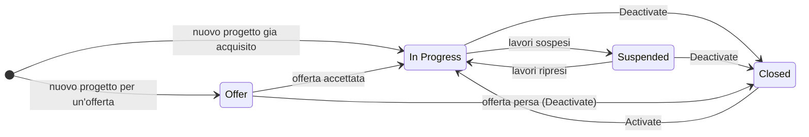
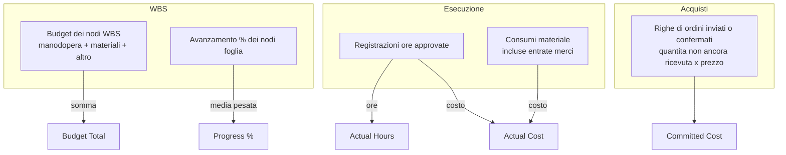
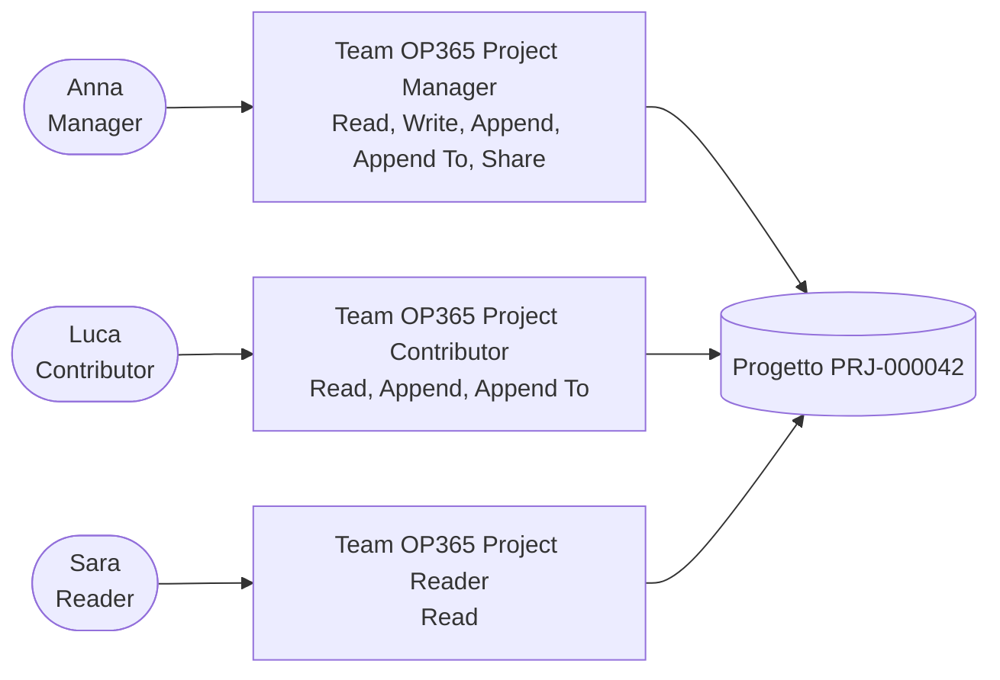

# Progetti e team di progetto

> **Lingua:** [English](../en/projects-and-team.md) · Italiano · [Français](../fr/projects-and-team.md) · [Deutsch](../de/projects-and-team.md)
> **Indice dei manuali:** [README](../../README.md#user-manuals)

Il **progetto** (la commessa) è il cuore di Open Project 365. Tutto il resto — la struttura di scomposizione del lavoro, il piano, le ore, i materiali, gli acquisti — appartiene a un progetto, e ogni numero che guardi (budget, costo effettivo, costo impegnato, avanzamento, margine) è in definitiva un numero di un progetto. Questo manuale spiega come creare e condurre un progetto lungo il suo ciclo di vita, cosa significa ogni campo, quali valori vengono calcolati per te e come il **team di progetto** decide chi può vedere e fare cosa.

Trovi i progetti in **Projects → Work → Projects**.

> I nomi di campi e pulsanti sono in inglese, come appaiono a schermo.

## Ciclo di vita di un progetto

Un progetto attraversa quattro motivi di stato (Status Reason):

| Status reason | Stato | Significato | Cosa puoi fare |
|---|---|---|---|
| **Offer** (offerta) | Attivo | Stai preparando o negoziando un'offerta | Costruire WBS e budget, pianificare, salvare baseline, formare il team, preparare richieste d'acquisto |
| **In Progress** (in corso) | Attivo | La commessa è in esecuzione | Tutto: ore, materiali, richieste d'acquisto, ordini, entrate merci |
| **Suspended** (sospeso) | Attivo | I lavori sono temporaneamente fermi | Consultare i dati e pianificare; niente nuove ore, materiali o ordini |
| **Closed** (chiuso) | Inattivo | La commessa è finita (o l'offerta è persa) | Sola lettura; riattivalo con **Activate** se serve |

Per passare tra Offer, In Progress e Suspended, cambia il campo **Status Reason** nella tab Summary e salva. Per chiudere il progetto usa **Deactivate** nella barra dei comandi; per riaprirlo usa **Activate**.

> **Importante:** registrazioni ore, consumi materiale e ordini d'acquisto sono accettati **solo su progetti In Progress**. Se ricevi "Hours and materials can be recorded only on projects In Progress." o "Purchase orders can be created only on projects In Progress.", controlla lo stato del progetto.

## Viste

| Vista | Mostra |
|---|---|
| **All Projects** | Tutti i progetti che puoi vedere |
| **In Progress Projects** | Commesse in corso |
| **Offers** | Progetti in stato Offer |
| **Suspended Projects** | Commesse sospese |
| **Closed Projects** | Commesse finite e offerte perse |

In tutte le viste dei progetti la colonna **Progress %** è disegnata come una barra verde da 0 a 100, con accanto la percentuale arrotondata, così si confronta a colpo d'occhio a che punto è ogni commessa. La stessa barra compare nelle viste dei nodi WBS (WBS Node). Ordinamento e filtri sulla colonna funzionano come su qualsiasi colonna numerica; un valore vuoto mostra una cella vuota.

Vedi solo i progetti di cui sei proprietario, quelli in cui sei membro del team e — con il ruolo *OP365 Administrator* — tutti i progetti (vedi [Chi vede un progetto](#chi-vede-un-progetto)).

## Creare un progetto

1. Vai in **Projects → Work → Projects** e clicca **+ New**.
2. Compila almeno il **Name** (nome). Il **Code** può restare vuoto: viene assegnato automaticamente al salvataggio (formato `PRJ-000001`, `PRJ-000002`, ...). Se la tua azienda usa codici propri puoi digitarne uno; i codici devono essere univoci.
3. Scegli il **Customer** (cliente; hanno senso solo gli account marcati come clienti) e il **Project Manager**.
4. Imposta **Start Date**, **End Date** e **Contract Value** se li conosci.
5. Scegli lo **Status Reason**: *Offer* se sei ancora in fase d'offerta, *In Progress* se la commessa è confermata.
6. Salva. Il project manager viene aggiunto automaticamente al team come **Manager**.

### Campi della tab Summary

| Campo | Significato | Chi lo compila |
|---|---|---|
| **Code** | Codice univoco del progetto. Vuoto = automatico `PRJ-######` | Tu o il sistema |
| **Name** | Nome del progetto (obbligatorio) | Tu |
| **Customer** | L'account cliente | Tu |
| **Project Manager** | L'utente responsabile del progetto. Diventa membro Manager del team | Tu |
| **Status Reason** | Offer, In Progress, Suspended (Closed tramite Deactivate) | Tu |
| **Owner** | Proprietario del record (di solito chi l'ha creato) | Sistema / tu |
| **Start Date** / **End Date** | Date pianificate del progetto | Tu |
| **Contract Value** | Prezzo concordato con il cliente (ricavo) | Tu |
| **Budget Total** | Somma dei budget dei nodi WBS | Calcolato |
| **Actual Cost** | Costo della manodopera approvata + costo dei materiali registrati sul progetto | Calcolato |
| **Actual Hours** | Ore approvate registrate sul progetto | Calcolato |
| **Committed Cost** | Valore delle righe degli ordini inviati o confermati non ancora ricevute | Calcolato |
| **Progress %** | Avanzamento complessivo, dalla WBS | Calcolato |
| **Description** | Ambito, note, tutto ciò che serve | Tu |

La colonna di destra mostra la **Timeline**: note, menzioni (`@nome`) e attività (telefonate, task, appuntamenti, email) sul progetto.

### Come si ottengono i valori calcolati

I campi calcolati vengono aggiornati dall'applicazione **subito, al salvataggio** dei record da cui dipendono: non serve mai aggiornare un rollup.

- **Budget Total** = somma dei budget totali dei nodi WBS (ogni nodo: manodopera + materiali + altro).
- **Progress %** = avanzamento dei nodi **foglia** (nodi senza figli), pesato sul loro budget totale; se nessun nodo ha budget, pesato sulle ore a budget; se non ci sono nemmeno ore, media semplice.
- **Actual Hours / Actual Cost** contano solo le ore **approvate** (o tutte le ore inviate quando l'approvazione ore è disattivata, vedi [Rilevazione ore](time-tracking.md)) più **tutti** i consumi di materiale.
- **Committed Cost** conta ciò che è stato ordinato e non ancora ricevuto; quando arriva la merce, l'importo passa da impegnato a effettivo.

Ogni cliente mostra inoltre **Projects** (numero) e **Contract Value Total** (somma dei valori contrattuali), aggiornati a ogni modifica di un suo progetto.

## Il form del progetto, tab per tab

| Tab | Cosa contiene | Manuale |
|---|---|---|
| **Summary** | Dati del progetto, budget e avanzamento, descrizione, timeline | questo manuale |
| **WBS** | La griglia ad albero della WBS: fasi e attività con date, ore, budget e avanzamento, modificabili in linea | [WBS e pianificazione](wbs-and-planning.md) |
| **Gantt** | Il diagramma di Gantt con dipendenze, percorso critico e confronto con la baseline; l'elenco delle baseline | [WBS e pianificazione](wbs-and-planning.md) |
| **Costs** | Il riepilogo costi: contratto, budget, effettivo, stima a finire, margine, budget vs effettivo per ramo WBS | [Materiali e costi](materials-and-costs.md) |
| **Time** | Registrazioni ore del progetto | [Rilevazione ore](time-tracking.md) |
| **Materials** | Consumi di materiale del progetto | [Materiali e costi](materials-and-costs.md) |
| **Purchasing** | Richieste d'acquisto e ordini del progetto | [Acquisti](purchasing.md) |
| **Team** | Membri del progetto e loro ruoli | questo manuale |

La barra dei comandi del form progetto ha anche **Save Baseline** (vedi [WBS e pianificazione](wbs-and-planning.md#baseline)).

## Il team di progetto

La tab **Team** elenca i **membri del progetto**. Ogni membro è un utente con un **ruolo di progetto**:

| Ruolo di progetto | Cosa può fare sul progetto |
|---|---|
| **Manager** | Leggere e modificare il progetto e tutto ciò che contiene, condividerlo, approvare le ore, approvare le richieste d'acquisto (fino alla soglia), creare RdO e ordini, cambiare lo stato degli ordini, registrare entrate merci |
| **Contributor** | Leggere il progetto, registrare le proprie ore e materiali, creare richieste d'acquisto, registrare entrate merci |
| **Reader** | Leggere il progetto e i suoi dati |

### Aggiungere un membro

1. Sul progetto apri la tab **Team** e clicca **+ New Project Member**.
2. Scegli lo **User** e il **Project Role**.
3. Facoltativamente imposta l'**Hourly Rate**: la tariffa con cui le ore di questo membro vengono valorizzate come **ricavo** (Revenue della registrazione = ore × tariffa oraria).
4. Salva. Il nome del membro viene compilato dall'utente.

Un utente può essere membro dello stesso progetto una sola volta: per cambiare ruolo, apri il membro esistente e modifica **Project Role**.

Il **project manager** è sempre membro con ruolo Manager: l'applicazione lo aggiunge alla creazione del progetto e, se cambi project manager, aggiunge il nuovo come Manager (o ne alza il ruolo). Il precedente resta nel team; modificalo o rimuovilo se serve.

Tutti i membri di tutti i progetti sono visibili agli amministratori anche in **Settings → Company → Project Members**.

### Chi vede un progetto

Open Project 365 usa gli **access team** di Dataverse: ogni progetto ha fino a tre team nascosti, uno per ruolo di progetto, e aggiungere un membro al progetto aggiunge l'utente al team corrispondente.

In pratica:

- un utente con il ruolo **OP365 User** vede i progetti di cui è **proprietario** e quelli in cui è **membro**;
- rimuovere un membro, o cambiarne il ruolo, cambia immediatamente cosa può vedere e fare;
- un utente con il ruolo **OP365 Administrator** vede e modifica tutti i progetti, membro o no.

I modelli dei team vengono creati automaticamente la prima volta che servono in ogni ambiente; non c'è nulla da configurare.

## Scenari tipici

### Dall'offerta alla commessa

1. Crea il progetto con stato **Offer** e il cliente marcato come *Prospect*.
2. Costruisci WBS e budget ([WBS e pianificazione](wbs-and-planning.md)), imposta il valore contrattuale.
3. Salva una baseline chiamata "Offerta" per ricordare cosa hai quotato.
4. Quando il cliente accetta: cambia lo stato in **In Progress**, cambia il tipo cliente in *Customer*, salva una nuova baseline di riferimento ("Contratto").
5. Aggiungi il team, pianifica le allocazioni, inizia a registrare ore e acquisti.

### Sospendere una commessa

Imposta **Suspended**. Nessuno può registrare nuove ore, materiali o ordini finché non rimetti **In Progress**; dati esistenti e piano restano intatti.

### Chiudere una commessa

1. Verifica che tutte le ore siano approvate, tutti gli ordini ricevuti o annullati e tutte le fatture decise.
2. Controlla la tab **Costs** per il margine finale.
3. Clicca **Deactivate**. Il progetto diventa di sola lettura ed esce dalle viste In Progress.

## Eliminare un progetto

Eliminare un progetto elimina tutto ciò che gli appartiene: nodi WBS, dipendenze, allocazioni, baseline, membri, registrazioni ore, consumi, richieste d'acquisto, RdO, ordini ed entrate merci (le fatture fornitori restano, senza il collegamento al progetto). **Preferisci Deactivate**: un progetto chiuso conserva la sua storia e i suoi numeri. Elimina solo i progetti creati per errore.

## Messaggi che potresti vedere

| Messaggio | Perché | Cosa fare |
|---|---|---|
| "Hours and materials can be recorded only on projects In Progress." | Il progetto è un'offerta, sospeso o chiuso | Cambia lo stato se i lavori sono davvero iniziati |
| "Purchase orders can be created only on projects In Progress." | Idem, per gli acquisti | Come sopra |
| "The project is closed." | Hai provato ad acquistare su un progetto inattivo | Riattiva il progetto se opportuno |
| "Only a manager of the project can …" | L'azione richiede il ruolo di progetto Manager | Chiedi al project manager di aggiungerti come Manager, o di eseguire l'azione |
| Errore di chiave duplicata su Code | Un altro progetto ha già quel codice | Lascia Code vuoto per averne uno automatico, o scegline un altro |
| Errore di duplicato su un membro | L'utente è già nel team | Cambia il ruolo del membro esistente |
