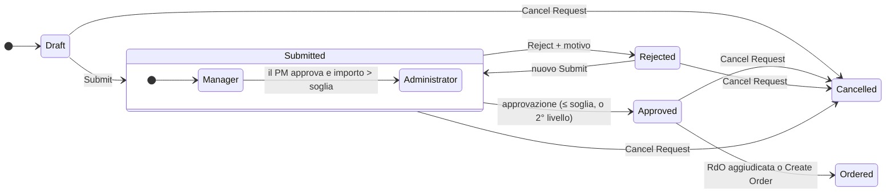
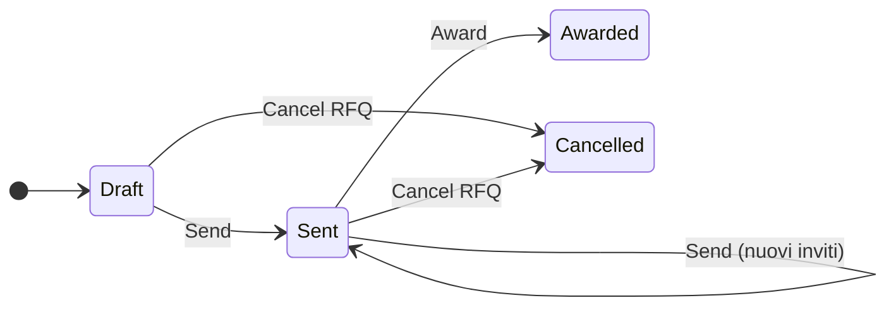
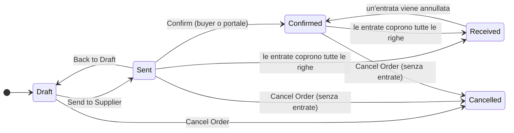
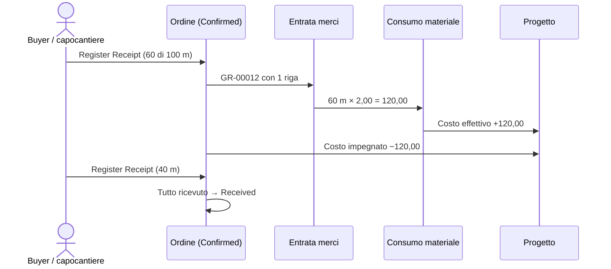

# Acquisti: richieste, RdO, ordini, entrate merci e fatture fornitori

> **Lingua:** [English](../en/purchasing.md) · Italiano · [Français](../fr/purchasing.md) · [Deutsch](../de/purchasing.md)
> **Indice dei manuali:** [README](../../README.md#user-manuals)

Gli acquisti sono il punto in cui i costi di commessa si vincono o si perdono: comprare la cosa giusta, al prezzo giusto, da un fornitore affidabile, senza sforare il budget. ProjectIQ copre l'intera catena degli acquisti dentro il progetto: un membro del team **richiede** ciò che serve, il project manager (e sopra una soglia l'approvatore acquisti) **approva**, il buyer chiede **offerte** ai fornitori e le confronta, l'offerta vincente diventa un **ordine d'acquisto**, il fornitore lo conferma (anche dal [portale fornitori](supplier-portal.md)), la merce viene **ricevuta** e diventa costo effettivo, e la **fattura del fornitore** viene controllata e approvata.

Ogni passo aggiorna i numeri del progetto: **costo impegnato** quando un ordine viene inviato, **costo effettivo** quando la merce viene ricevuta, **spesa** per fornitore e articolo.

Tutte le pagine degli acquisti sono nell'area **Purchasing**: gruppo **Procurement** (Purchase Requests = richieste d'acquisto, RFQs = richieste d'offerta, Purchase Orders = ordini, Goods Receipts = entrate merci, Supplier Invoices = fatture fornitori) e gruppo **Analysis** (dashboard Spend). La tab **Purchasing** del form progetto elenca richieste e ordini del progetto.

> I nomi di campi e pulsanti sono in inglese, come appaiono a schermo. In italiano usiamo "RdO" per *Request for Quotation* (RFQ).

## La catena in sintesi

```mermaid
flowchart LR
    PR[Richiesta d'acquisto<br/>PR-#####] -->|Submit| AP{Approvazione}
    AP -->|≤ soglia:<br/>project manager| OK[Approved]
    AP -->|> soglia:<br/>PM poi approvatore acquisti| OK
    OK -->|Create RFQ| RFQ[Richiesta d'offerta<br/>RFQ-#####]
    OK -->|Create Order| PO
    RFQ -->|Send| SUP([I fornitori quotano<br/>portale o buyer])
    SUP -->|Award| PO[Ordine d'acquisto<br/>PO-#####]
    PO -->|Send to Supplier| SENT[Sent]
    SENT -->|Confirm / portale| CONF[Confirmed]
    CONF -->|Register Receipt| GR[Entrata merci<br/>GR-#####]
    GR -->|consumo materiale| ACT[(Costo effettivo del progetto)]
    PO -.-> INV[Fattura fornitore<br/>INV-#####]
    INV -->|Approve / Reject| DONE[Approved]
```

I numeri vengono assegnati automaticamente al salvataggio: richieste d'acquisto `PR-00001`, richieste d'offerta `RFQ-00001`, ordini `PO-00001`, entrate merci `GR-00001`, fatture fornitori `INV-00001`.

## Chi fa cosa

| Azione | Chi può farla |
|---|---|
| Creare una richiesta d'acquisto | Un Manager o Contributor del progetto, un amministratore (il richiedente sei tu) |
| Inviare una richiesta | Il richiedente, un Manager del progetto, un amministratore |
| Approvare / respingere fino alla soglia | Il project manager (approvatore corrente), qualunque Manager del progetto, un amministratore |
| Approvare / respingere sopra la soglia (secondo livello) | Il **Purchasing Approver** indicato nelle [variabili d'ambiente](administration.md#impostazioni-aziendali), o un amministratore |
| Annullare una richiesta | Il richiedente, un Manager del progetto, un amministratore |
| Creare RdO e ordini, inviare, aggiudicare, cambiare stato agli ordini | Un Manager del progetto, un amministratore |
| Registrare entrate merci | Un Manager o Contributor del progetto, un amministratore |
| Approvare / respingere fatture fornitori | Il Purchasing Approver, un amministratore |

"Amministratore" indica un utente con il ruolo **OP365 Administrator** o **System Administrator**.

Tutte le azioni sono **pulsanti nella barra dei comandi** dei form. Ogni pulsante è attivo solo negli stati in cui ha senso, e ogni azione chiede conferma.

## 1. Richieste d'acquisto

Una richiesta d'acquisto (PR) dice *cosa* serve, *per quale progetto e attività*, *entro quando* e *quanto costa* all'incirca.

### Creare una richiesta

1. Vai in **Purchasing → Procurement → Purchase Requests → + New**, oppure nella tab **Purchasing** del progetto.
2. Compila la testata:

| Campo | Significato |
|---|---|
| **Title** | Breve descrizione del fabbisogno (per esempio "Cavi per il 2° piano") |
| **Needed By** | Data in cui il materiale serve in cantiere |
| **Project** | Il progetto (non deve essere chiuso) |
| **WBS Node** | L'attività a cui è destinato l'acquisto (solo dello stesso progetto). Usato per il controllo budget e copiato sulle righe d'ordine |
| **Preferred Supplier** | Il fornitore che suggerisci. Necessario per usare **Create Order**; sempre invitato quando si crea una RdO |
| **Requester** | Tu, per impostazione predefinita |
| **Justification** | Perché serve, tutto ciò che l'approvatore deve sapere |

3. Salva, poi aggiungi le **Lines** (sezione *Lines*, **+ New Purchase Request Line**):

| Campo | Significato |
|---|---|
| **Item** | Articolo a catalogo (facoltativo) |
| **Description** | Dall'articolo se vuota |
| **Quantity** / **Unit of Measure** | Quanto (l'unità viene dall'articolo se vuota) |
| **Estimated Price** | Prezzo unitario previsto. Vuoto = prezzo del fornitore preferito per l'articolo, altrimenti costo unitario dell'articolo |
| **Amount** | Quantity × Estimated Price (calcolato) |
| **Sort Order** | Ordine delle righe |
| **Notes** | Specifiche per il fornitore |

L'**Estimated Amount** (importo stimato) della richiesta è la somma degli importi delle righe.

### Inviare e approvare

Clicca **Submit**. La richiesta diventa **Submitted**, il suo contenuto viene bloccato (si può ancora completare solo la Justification) e l'applicazione registra tre cose nella sezione *Approval*:

- **Above Threshold**: se l'importo stimato supera la **Purchase Request Threshold** ([variabile d'ambiente](administration.md#impostazioni-aziendali));
- **Over Budget**: se costo effettivo + costo impegnato + questa richiesta superano il budget del nodo WBS (o del progetto, se il nodo non è indicato);
- **Current Approver**: il project manager, che riceve la notifica "Purchase request to approve".

**Approvazione a due livelli**

| Livello | Chi decide | Cosa succede con Approve |
|---|---|---|
| **Manager** (primo) | Project manager / Manager del progetto | Se la richiesta **non** supera la soglia → **Approved**. Se la supera → passa al livello **Administrator**, vengono registrati *Manager Approved By/On* e gli approvatori di secondo livello vengono avvisati |
| **Administrator** (secondo) | Il Purchasing Approver della variabile d'ambiente (se impostato), altrimenti ogni OP365 Administrator | → **Approved** |

Se chi approva al primo livello è già un approvatore di secondo livello, la richiesta viene approvata direttamente.

Per **respingere** clicca **Reject**: una finestra chiede il **Reason** (motivo, obbligatorio). La richiesta diventa **Rejected**, il motivo viene salvato in *Decision Note* e il richiedente viene avvisato. Il richiedente può modificare la richiesta e **inviarla** di nuovo.

La vista **Purchase Requests to Decide** elenca le richieste in attesa di decisione; **My Purchase Requests** le tue; **Open Purchase Requests** quelle non ancora ordinate, annullate o respinte.

> Una soglia pari a zero (o vuota) significa che nessuna richiesta richiede il secondo livello. *Over Budget* è un avviso per l'approvatore: non blocca l'approvazione.

### Dopo l'approvazione: due modi di acquistare

| Pulsante | Quando usarlo | Risultato |
|---|---|---|
| **Create RFQ** | Vuoi offerte in concorrenza | Una nuova RdO in Draft, con già invitati il fornitore preferito e i fornitori abituali degli articoli |
| **Create Order** | Conosci già fornitore e prezzo | Un ordine in Draft al **Preferred Supplier** con le righe della richiesta; la richiesta diventa **Ordered** |

**Cancel Request** ferma la richiesta in qualunque stato tranne Ordered e Cancelled. Si possono eliminare solo richieste Draft, Rejected o Cancelled.

## 2. Richieste d'offerta (RdO)

Una RdO chiede a uno o più fornitori di quotare le righe di una richiesta approvata.

### Preparare e inviare

1. Sulla richiesta approvata clicca **Create RFQ**. La RdO viene creata con una **Deadline** (scadenza) a 7 giorni e il titolo della richiesta nelle **Notes**; il fornitore preferito e i fornitori abituali degli articoli sono elencati in **Invitations** con stato *To Invite*.
2. Apri la RdO. Sistema la **Deadline** (oggi o successiva) e le **Notes** per i fornitori.
3. Aggiungi altri fornitori in **Invitations** (**+ New RFQ Invitation**): scegli il **Supplier**; l'**Email** viene copiata dal fornitore. Account inattivi, non fornitori o bloccati vengono rifiutati.
4. Clicca **Send**. La RdO diventa **Sent**, ogni invito *To Invite* diventa **Invited** (con numero RdO, scadenza e note), e per ogni fornitore viene preparata **una riga d'offerta vuota per ogni riga della richiesta**.

Puoi aggiungere fornitori dopo l'invio: aggiungi l'invito e clicca di nuovo **Send**; vengono invitati solo i nuovi.

### Raccogliere le offerte

Ogni invito ha le proprie **righe d'offerta** (una per riga di richiesta) con **Unit Price** e **Notes**, più **Delivery Days** (giorni di consegna) e **Supplier Notes** a livello di invito. Si compilano in due modi:

- **dal fornitore**, sul [portale fornitori](supplier-portal.md): il fornitore vede la RdO, inserisce prezzi, giorni di consegna e note e clicca *Send quote* — oppure *Decline*;
- **dal buyer**, quando l'offerta arriva per email o telefono: apri l'invito, tab **Quotes**, e scrivi i prezzi.

Il primo prezzo inserito marca l'invito come **Responded** (con la data di risposta); il contatore **Responses** della RdO mostra quanti fornitori hanno risposto. Il **Quoted Amount** dell'invito è la somma di quantità × prezzo sulle sue righe.

| Stato dell'invito | Significato |
|---|---|
| **To Invite** | Aggiunto, non ancora inviato |
| **Invited** | Inviato, in attesa di risposta |
| **Responded** | Almeno un prezzo inserito |
| **Declined** | Il fornitore ha rinunciato (portale) |

Dopo la scadenza le offerte non possono più essere modificate ("The deadline of the request for quotation has passed."); per prorogarla, cambia la **Deadline** della RdO e clicca di nuovo **Send**.

### Confronto e aggiudicazione

La tab **Quote Comparison** della RdO mostra una griglia **righe della richiesta × fornitori**:

| Riga | Quantità | Fornitore A | Fornitore B | Fornitore C | Miglior prezzo |
|---|---|---|---|---|---|
| Cavo 3x2,5 | 500 m | 0,95 | **0,89** | 0,97 | 0,89 (B) |
| Scatola di derivazione | 40 pz | **3,10** | 3,40 | – | 3,10 (A) |
| **Totale** | | **2.989,00** | 3.081,00 | 3/4 righe | Miglior totale: A |
| **Consegna** | | 10 giorni | 7 giorni | 5 giorni | |

- il **miglior prezzo** di ogni riga è evidenziato;
- è mostrato il **totale** di ogni fornitore, con "x of y lines" quando il fornitore non ha quotato tutte le righe; il **miglior totale** è scelto solo tra i fornitori che hanno quotato tutte le righe;
- per ogni fornitore sono indicati i **giorni di consegna** e lo stato dell'invito;
- **Refresh** ricarica le offerte.

Clicca **Award** sotto il fornitore scelto e conferma ("Award the request for quotation to <fornitore> and create the purchase order?"). L'applicazione:

1. crea un **ordine in Draft** a quel fornitore con le righe e i prezzi quotati (solo le righe con prezzo), il nodo WBS della richiesta e un'**Expected Delivery** = oggi + i giorni di consegna del fornitore;
2. porta la RdO in **Awarded**, registrando l'invito vincente e l'ordine;
3. porta la richiesta d'acquisto in **Ordered**.

Possono vincere solo fornitori che hanno **risposto**. **Cancel RFQ** chiude una RdO Draft o Sent senza ordine.

## 3. Ordini d'acquisto

Un ordine d'acquisto (PO) è l'impegno ad acquistare da un fornitore. Di solito nasce da **Award** o **Create Order**, ma un Manager può anche crearne uno da zero (**Purchasing → Purchase Orders → + New**) su un progetto In Progress.

### Campi

| Campo | Significato |
|---|---|
| **Number** | PO-##### (automatico) |
| **Supplier** | Deve essere un fornitore attivo e non bloccato |
| **Project** | Deve essere **In Progress** |
| **Purchase Request** | La richiesta d'origine, se presente |
| **Order Date** | Oggi, per impostazione predefinita |
| **Expected Delivery** | Quando è attesa la merce |
| **Delivery Place** | Indirizzo del cantiere o magazzino |
| **Payment Terms** | Dal fornitore |
| **Total Amount** | Somma delle righe (calcolato) |
| *Sezione Progress* | Sent To, Sent On, Supplier Confirmed, Confirmed On, Received Amount, Received On, Cancelled On |

**Righe**: Item, Description, **WBS Node** (stesso progetto), Quantity, Unit, **Unit Price** (vuoto = prezzo del fornitore per l'articolo, altrimenti costo dell'articolo), **Amount**, **Received Quantity** (dalle entrate merci, sola lettura), Sort Order, Notes.

### Stati

| Pulsante | Da | Effetto |
|---|---|---|
| **Send to Supplier** | Draft | → **Sent**. Le righe vengono bloccate. *Sent To* registra l'email del fornitore, *Sent On* la data. L'ordine diventa visibile al fornitore sul portale. Serve almeno una riga |
| **Back to Draft** | Sent | → **Draft**, per modificare l'ordine (poi va reinviato) |
| **Confirm** | Sent | → **Confirmed**, registra la conferma del fornitore. Il fornitore può anche confermare dal portale, con lo stesso effetto |
| **Register Receipt** | Sent, Confirmed | Apre la finestra dell'entrata merci (vedi sotto) |
| **Cancel Order** | Draft, Sent, Confirmed | → **Cancelled**, solo se l'ordine non ha entrate merci ("Cancel the goods receipts before cancelling the order.") |

**Received** non si imposta mai a mano: l'ordine diventa Received quando le entrate merci coprono tutte le righe. Si possono eliminare solo ordini Draft o Cancelled.

Una volta uscito da Draft, puoi ancora aggiornare **Notes**, **Expected Delivery** e **Delivery Place** dell'ordine (per esempio quando il fornitore comunica una nuova data di consegna); tutto il resto richiede **Back to Draft**.

> *Send to Supplier* registra che l'ordine è stato inviato; non spedisce da solo un'email al fornitore. Invia il documento d'ordine con il tuo canale abituale, oppure lascia che il fornitore lo trovi sul portale.

### Effetto sui costi

- Gli ordini Sent e Confirmed contano nel **Committed Cost** del progetto per le quantità non ancora ricevute.
- Ogni ordine non annullato conta nella **Spend** del fornitore; ogni riga in **Order Lines** e **Spend** dell'articolo.

## 4. Entrate merci

Un'entrata merci (GR) registra cosa è arrivato, a fronte di quale documento di trasporto (DDT).

### Registrare un'entrata

1. Su un ordine Sent o Confirmed clicca **Register Receipt**.
2. Nella finestra compila **Receipt date** (oggi per impostazione predefinita), **Delivery note number** e **Delivery note date** (numero e data del DDT).
3. Per ogni riga d'ordine scrivi la **quantità ricevuta** ora. **Receive all** compila tutto ciò che resta da ricevere; **Clear** svuota le quantità.
4. Clicca **Register**.

L'applicazione:

- crea l'entrata merci (GR-#####) con una **riga** per ogni riga d'ordine ricevuta;
- crea un **consumo di materiale** per riga, al **prezzo d'ordine**, sul progetto dell'ordine e sul nodo WBS della riga → **costo effettivo**;
- aumenta la **Received Quantity** delle righe d'ordine (e il Received Amount dell'ordine); la parte ricevuta esce dal **costo impegnato**;
- porta l'ordine in **Received** quando ogni riga è completamente ricevuta.

Non puoi ricevere più di quanto ordinato: "<riga>: only N still to receive."

### Annullare un'entrata

Se un'entrata è sbagliata, aprila e clicca **Cancel Receipt**. I suoi consumi e le sue righe vengono eliminati, le quantità da ricevere vengono ripristinate e un ordine Received torna **Confirmed**. Poi registra l'entrata corretta.

Su un'entrata registrata si possono modificare solo i dati del **DDT** e le **note**; righe e quantità cambiano solo tramite Cancel Receipt. Le entrate si creano solo con **Register Receipt**.

## 5. Fatture fornitori

Una fattura fornitore è un **contenitore** per la fattura passiva: contiene i dati della fattura, le sue righe, il file XML o PDF, il collegamento all'ordine e la decisione di approvazione. (L'importazione automatica dallo SDI è prevista in un rilascio successivo; oggi il file si allega a mano.)

### Registrare una fattura

1. **Purchasing → Supplier Invoices → + New** (oppure la tab **Invoices** dell'ordine, così l'ordine viene precompilato).
2. Compila **Supplier**, **Document Type** (TD01 Invoice = fattura, TD02 Advance invoice = acconto, TD04 Credit note = nota di credito, TD05 Debit note = nota di debito, TD06 Fee note = parcella, TD24 Deferred invoice = fattura differita, TD25 Deferred invoice (triangular) = fattura differita triangolare), **Invoice Number**, **Invoice Date**, **Purchase Order**.
3. **Seller Name** e **Seller VAT Number** vengono copiati dal fornitore; il **Project** dall'ordine.
4. Allega l'XML (FatturaPA) o il PDF in **Invoice File**.
5. Facoltativamente compila **Order References** e **Delivery Note References** come riportati in fattura.
6. Aggiungi le **Lines**: Line Number, Code, Description, Quantity, Unit, Unit Price, Total Price (= quantità × prezzo unitario se vuoto), VAT Rate % (aliquota IVA) e facoltativamente la **Order Line** a cui si riferisce.
7. **Taxable Amount** (imponibile), **VAT Amount** (IVA) e **Total Amount** sono calcolati dalle righe.

Le nuove fatture partono in **To Review**.

### Approvare

Il Purchasing Approver (o un amministratore) controlla la fattura rispetto a ordine ed entrate merci, poi clicca **Approve** o **Reject** (motivo obbligatorio). Le fatture decise — e le loro righe — sono bloccate.

| Stato | Significato |
|---|---|
| **To Review** | Da controllare; dati e righe modificabili |
| **Approved** | Accettata per il pagamento |
| **Rejected** | Contestata; il motivo è in *Decision Note* |

Viste: **Invoices to Review**, **Approved Invoices**, **Rejected Invoices**, **Supplier Invoices by Order**.

> Gli utenti normali (OP365 User) possono leggere le fatture fornitori ma non crearle né modificarle: le fatture sono gestite dal personale amministrativo con il ruolo OP365 Administrator.

## 6. La dashboard Spend

**Purchasing → Analysis → Spend** dà a buyer e direzione una visione d'insieme:

| Componente | Contenuto |
|---|---|
| **Spend by Supplier** | Grafico a barre: totale degli ordini per fornitore |
| **Spend by Project** | Grafico a barre: totale degli ordini per progetto |
| **Purchase Orders by Status** | Grafico a torta: numero di ordini per stato |
| **Open Purchase Orders** | Elenco degli ordini non ancora ricevuti o annullati |
| **Invoices to Review** | Elenco delle fatture in attesa di approvazione |

Clicca un segmento del grafico per filtrare, o apri l'elenco per vedere i record.

## Viste

| Tabella | Viste |
|---|---|
| Richieste d'acquisto | All, My, To Decide, Open, By Project |
| RdO | All, Open, Awarded |
| Ordini d'acquisto | All, Open, Confirmed, Received, By Project, By Supplier |
| Entrate merci | All, By Order |
| Fatture fornitori | All, To Review, Approved, Rejected, By Order |

## Messaggi che potresti vedere

| Messaggio | Significato e soluzione |
|---|---|
| "Use Submit to send a purchase request for approval." / "Use Submit, Approve, Reject or Cancel to change the status of a purchase request." | Lo stato cambia solo con i pulsanti |
| "A purchase request can be changed only while it is Draft or Rejected." / "Lines can be changed only while the purchase request is Draft or Rejected." | Respingi o annulla la richiesta per modificarla |
| "Add at least one line before submitting." | La richiesta non ha righe |
| "Only the requester or a manager of the project can submit the purchase request." | Chiedi al richiedente o al project manager |
| "This purchase request is above the threshold: only the purchasing approver or an administrator can decide it." | È al secondo livello |
| "Add a note to reject the purchase request." / "...the invoice." / "...time entries." | Il motivo è obbligatorio |
| "Only approved purchase requests can go to a request for quotation." / "...can be ordered." | Approva prima la richiesta |
| "Choose the supplier: set Preferred Supplier on the request." | Create Order richiede un fornitore preferito |
| "The deadline must be today or later." / "The deadline has passed: move it before sending." | Cambia la scadenza della RdO |
| "Invite at least one supplier." | Aggiungi un invito prima di Send |
| "Use Send on the request for quotation to invite suppliers." | Lo stato dell'invito cambia solo con Send (o dal portale) |
| "This supplier already has a quote for the line: change its price." | Modifica la riga d'offerta esistente |
| "Award a supplier who sent a quote." / "The supplier quoted no lines." | Possono vincere solo fornitori che hanno risposto con prezzi |
| "<name> is not an active supplier." / "<name> is blocked." | Verifica l'account del fornitore |
| "Purchase orders can be created only on projects In Progress." | Verifica lo stato del progetto |
| "A purchase order can be changed only while it is Draft." / "Lines can be changed only while the purchase order is Draft." | Usa **Back to Draft** |
| "Add at least one line before sending." | L'ordine non ha righe |
| "Cancel the goods receipts before cancelling the order." | Annulla prima le entrate merci |
| "An order becomes Received when all its lines are received." | Registra le entrate merci |
| "Goods can be received only on sent or confirmed purchase orders." | Invia prima l'ordine |
| "<line>: only N still to receive." / "Nothing to receive." | Controlla le quantità nella finestra |
| "Received quantities come from goods receipts." | Non scrivere a mano le quantità ricevute |
| "Use Register Receipt on the purchase order to receive goods, and Cancel Receipt to undo a receipt." | Le entrate si gestiscono solo con i pulsanti |
| "Approved or rejected invoices cannot be changed." | Le fatture decise sono definitive |
| "Only the purchasing approver or an administrator can decide supplier invoices." | Chiedi all'approvatore acquisti |
