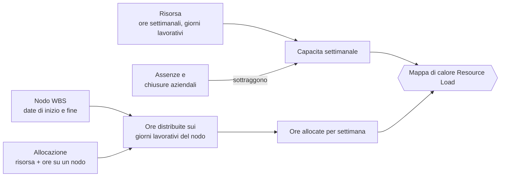
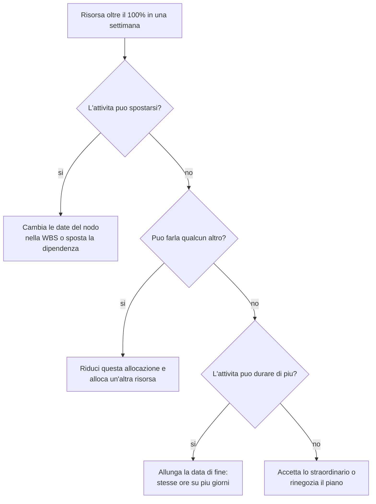

# Allocazione e carico delle risorse

> **Lingua:** [English](../en/resource-load.md) · Italiano · [Français](../fr/resource-load.md) · [Deutsch](../de/resource-load.md)
> **Indice dei manuali:** [README](../../README.md#user-manuals)

Sapere *cosa* va fatto è metà della pianificazione; l'altra metà è sapere *chi* lo farà e se ha tempo. ProjectIQ risponde alla seconda domanda con le **allocazioni** (ore di una risorsa pianificate su un nodo WBS) e con la dashboard **Resource Load**, una mappa di calore che confronta, settimana per settimana, le ore allocate a ogni risorsa su tutti i progetti con le ore che quella risorsa ha effettivamente a disposizione.

Questo manuale spiega come allocare le risorse, come si calcola la capacità, come leggere la mappa di calore e come risolvere i sovraccarichi.

> I nomi di campi e pulsanti sono in inglese, come appaiono a schermo.

## Gli ingredienti

| Ingrediente | Dove si gestisce | Manuale |
|---|---|---|
| **Risorsa** con Weekly Hours e Working Days | Master Data → Resources | [Anagrafiche](master-data.md#risorse) |
| **Assenze** e **chiusure aziendali** | Projects → Planning → Absences, o tab Absences della risorsa | [Anagrafiche](master-data.md#assenze-e-chiusure-aziendali) |
| **Nodo WBS** con Start Date e End Date | Progetto → tab WBS | [WBS e pianificazione](wbs-and-planning.md) |
| **Allocazione** | Nodo WBS → tab Allocations | questo manuale |

## Allocare una risorsa a un nodo WBS

1. Apri il nodo WBS (clicca il suo nome nella tab WBS del progetto).
2. Vai nella tab **Allocations** e clicca **+ New WBS Allocation**.
3. Scegli la **Resource** e scrivi le **Hours** che prevedi per quella risorsa su quel nodo (devono essere maggiori di zero).
4. Salva.

| Campo | Significato |
|---|---|
| **WBS Node** | L'attività (l'allocazione viene eliminata con il nodo) |
| **Resource** | Chi farà il lavoro |
| **Hours** | Ore pianificate di questa risorsa su questo nodo (> 0) |
| **Name** | Descrizione dell'allocazione |

Una risorsa può essere allocata allo stesso nodo una sola volta: per cambiare le ore apri l'allocazione esistente. Più risorse possono essere allocate allo stesso nodo (per esempio un elettricista per 40 ore e un apprendista per 24).

> Le allocazioni sono un **piano**, non una registrazione del lavoro svolto. Le ore effettivamente lavorate si registrano con le registrazioni ore ([Rilevazione ore](time-tracking.md)) e compaiono come Actual Hours sul nodo.

Suggerimento: le **Budget Hours** del nodo sono la tua stima complessiva; la somma delle allocazioni è come quella stima si divide tra le persone. Tenerle coerenti rende affidabili sia il budget sia il carico.

## Come si calcola il carico

### Capacità

Per ogni risorsa e ogni settimana:

- **capacità giornaliera** = Weekly Hours ÷ numero di Working Days (per esempio 40 ÷ 5 = 8 ore);
- ogni giorno lavorativo contribuisce con la sua capacità giornaliera; i giorni non lavorativi non contribuiscono;
- un'**assenza** toglie l'intera giornata, oppure solo le sue **Hours** per un'assenza di un giorno con ore (per esempio 4 ore di permesso);
- una **chiusura aziendale** (assenza senza risorsa) toglie la giornata a tutti.

### Ore allocate

Per ogni allocazione:

- le ore sono **distribuite in modo uniforme sui giorni lavorativi della risorsa** compresi tra **Start Date** e **End Date** del nodo;
- la quota di ogni giorno è sommata alla settimana in cui cade, e registrata sotto il nome del progetto (mostrato nel suggerimento);
- le allocazioni su nodi **senza date** (o con la fine prima dell'inizio) non possono essere collocate in calendario: sono sommate nella colonna **No dates**;
- contano solo allocazioni attive su nodi attivi di progetti attivi (Offer, In Progress, Suspended); i progetti chiusi non caricano nessuno.

### Esempio

Marco lavora 40 ore a settimana, da lunedì a venerdì. È allocato per 60 ore su "2.2.1 Elettrico", che va da lunedì 2 a venerdì 13 marzo (10 giorni lavorativi), e per 16 ore su un nodo di un altro progetto che va da lunedì 9 a martedì 10 marzo. Venerdì 13 marzo è in ferie.

| Settimana | Capacità | Allocato | Utilizzo |
|---|---|---|---|
| 2–6 marzo | 5 × 8 = 40 h | 60 ÷ 10 × 5 = 30 h | 75% |
| 9–13 marzo | 4 × 8 = 32 h (venerdì in ferie) | 30 h + 16 h = 46 h | 144% — sovraccarico |

Nota che l'allocazione conta anche nel giorno di ferie: le allocazioni seguono le date del nodo, le assenze riducono solo la capacità. La mappa di calore ti dice che il piano, così com'è, non sta in piedi.

## La dashboard Resource Load

Apri **Projects → Planning → Resource Load**.

Illustrazione della mappa di calore (ore allocate / capacità):

| Resource | No dates | Settimana del 2 marzo | Settimana del 9 marzo | Settimana del 16 marzo |
|---|---|---|---|---|
| Giulia | 12 | ⬜ 16 / 40 | 🟨 38 / 40 | 🟨 40 / 40 |
| Marco | – | 🟩 30 / 40 | 🟥 46 / 32 | ⬜ 8 / 40 |

- **Righe**: le risorse attive, in ordine alfabetico.
- **Colonne**: le settimane della finestra. La prima colonna, **No dates**, mostra le ore allocate su nodi senza date.
- **Celle**: ore allocate / capacità della settimana, colorate in base all'utilizzo.
- **Suggerimento** su una cella: ore allocate, capacità e ripartizione delle ore **per progetto**.

### Fasce di colore

| Fascia | Utilizzo | Significato |
|---|---|---|
| ⬜ **Under 50%** | allocato < 50% della capacità | Molto spazio libero |
| 🟩 **50–90%** | dal 50% al 90% | Carico sano |
| 🟨 **90–100%** | dal 90% al 100% | Pieno |
| 🟥 **Over 100%** | oltre la capacità (o ore con capacità zero) | Sovraccarico: qualcosa deve cambiare |

La dashboard mostra una legenda con queste fasce. (I colori emoji in questo manuale sono solo indicativi di quelli a schermo.)

### Barra degli strumenti

| Controllo | Cosa fa |
|---|---|
| **Previous** / **Next** | Sposta la finestra indietro o avanti della sua lunghezza |
| **This week** | Torna alla settimana corrente |
| **4 / 8 / 12 / 26 weeks** | Lunghezza della finestra (predefinita 8 settimane) |
| **Refresh** | Ricarica risorse, allocazioni e assenze |

## Risolvere un sovraccarico

Quando una cella è rossa hai quattro leve:

Dopo ogni modifica clicca **Refresh** sulla dashboard per vederne l'effetto.

## Buone pratiche

- Dai a ogni nodo che verrà allocato **date di inizio e fine**: altrimenti le sue ore finiscono nella colonna "No dates" e non compaiono mai in una settimana.
- Registra in anticipo **assenze e chiusure** (ferie, chiusura di agosto): il carico di quelle settimane diventa realistico.
- Mantieni corretti **Weekly Hours** e **Working Days** per part-time e squadre.
- Rivedi la dashboard almeno ogni settimana con i project manager dei progetti che condividono risorse.

## Messaggi che potresti vedere

| Messaggio | Significato |
|---|---|
| "The resource load could not be loaded" | Problema di rete o di permessi: usa Refresh; se persiste, verifica i tuoi ruoli di sicurezza |
| Errore di chiave duplicata su un'allocazione | La risorsa è già allocata al nodo: modifica l'allocazione esistente |
| Errore di validazione su Hours | Le ore devono essere maggiori di zero |
