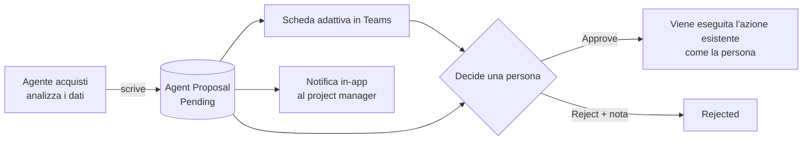
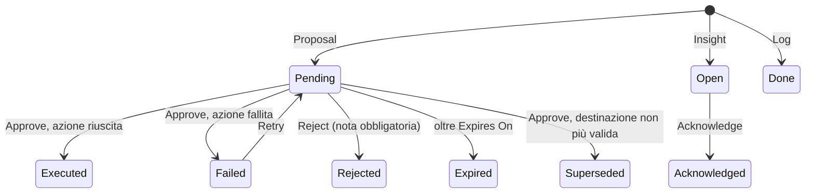
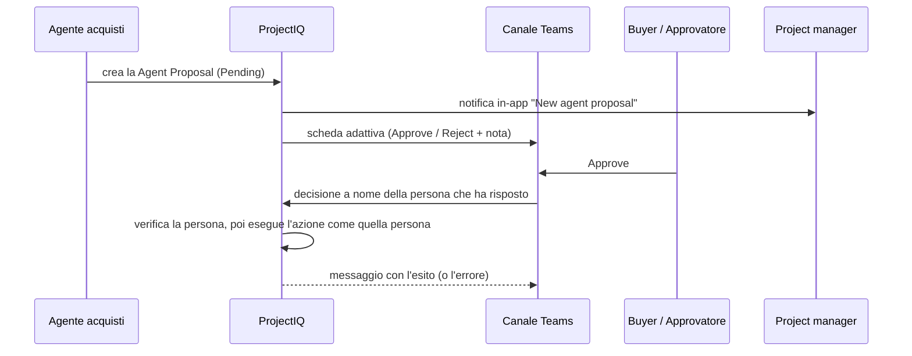
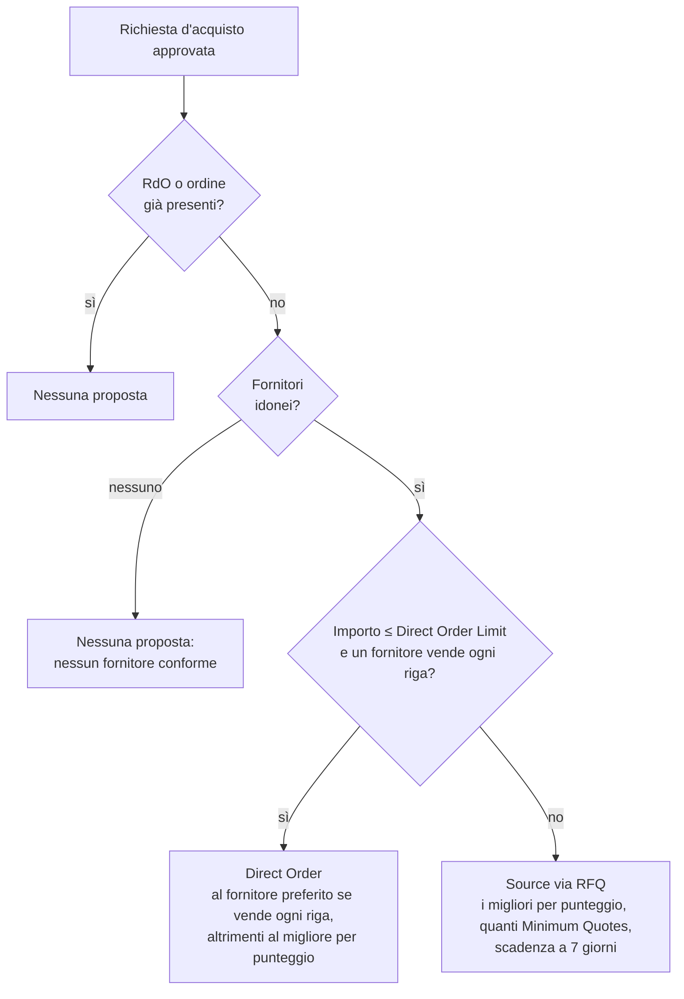

# Agente acquisti: proposte che decide una persona

> **Lingua:** [English](../en/sourcing-agent.md) · Italiano · [Français](../fr/sourcing-agent.md) · [Deutsch](../de/sourcing-agent.md)
> **Indice dei manuali:** [README](../../README.md#user-manuals)

L'**agente acquisti** (sourcing agent) è pensato per lavorare come un Sourcing Manager sui dati degli [acquisti](purchasing.md): prepara ogni decisione di approvvigionamento con numeri e motivazione, così chi acquista smette di aprire richieste, offerte e fatture "solo per controllare". L'agente non modifica mai da solo i record degli acquisti. Scrive una **proposta** ("approvvigiona questa richiesta con una RdO", "aggiudica questa RdO a quel fornitore"), una persona legge la motivazione e decide, e solo allora l'azione viene eseguita, **con l'identità e i diritti della persona che ha approvato**.

> **In arrivo.** L'agente Copilot Studio che crea le proposte arriva nelle versioni successive, un task alla volta. Questa versione consegna le fondamenta: la tabella Agent Proposal, i ruoli, la scheda di approvazione in Teams, i comandi Approve, Reject, Retry e Acknowledge nell'app, la scadenza delle vecchie proposte e le notifiche. Finché l'agente non è acceso, le viste delle proposte sono vuote; questo manuale descrive cosa vedrai e farai quando arriveranno le proposte.

## Cosa fa l'agente

L'agente ha dieci task, consegnati nell'ordine della catena degli acquisti. Ogni task termina in una proposta (decide una persona) oppure in una riga di insight o di log (solo informazione).

| # | Task | Risultato | Stato |
|---|---|---|---|
| 1 | Instradare una richiesta d'acquisto approvata: RdO o ordine diretto | Proposta **Source via RFQ** o **Direct Order** | Analisi disponibile ([come](#come-viene-instradata-una-richiesta)); agente in arrivo |
| 2 | Scegliere i fornitori da invitare (articoli venduti, documenti validi, prezzo, tempi di consegna, risposte alle RdO passate) | Elenco degli inviti dentro la proposta del task 1 | Analisi disponibile ([come](#come-viene-instradata-una-richiesta)); agente in arrivo |
| 3 | Analizzare le offerte (prezzo, consegna, rischio) e raccomandare l'aggiudicazione | Proposta **Award RFQ** | Pianificato |
| 4 | Sollecitare i fornitori che non hanno risposto a una RdO | E-mail al fornitore e riga di log | Pianificato |
| 5 | Conformità dei fornitori: documenti in scadenza o scaduti di fornitori con RdO o ordini aperti | Insight **Compliance Alert** | Pianificato |
| 6 | Controllo a tre vie di fattura, ordine ed entrata merci | Proposta **Approve Invoice** o **Reject Invoice** | Pianificato |
| 7 | Ordini in ritardo: confermati, non ricevuti oltre il tempo di consegna | E-mail al fornitore e insight **Late Delivery** | Pianificato |
| 8 | Budget di progetto: budget WBS residuo | Insight **Budget Alert** | Pianificato |
| 9 | Analisi della spesa: acquisti frammentati tra progetti | Insight **Consolidation** | Pianificato |
| 10 | Ricerca e onboarding di fornitori | Insight **New Supplier Needed** e proposta **Invite Supplier** | Pianificato |
| – | La meccanica delle proposte descritta in questo manuale: scheda Teams, comandi dell'app, scadenza, notifiche | – | Disponibile |

Perché proposte e non azioni dirette: gli acquisti impegnano denaro e obblighi verso i fornitori. Le regole esistenti (chi può inviare una RdO, aggiudicarla, approvare una fattura) restano esattamente com'erano, e la traccia di audit mostra la persona che ha approvato, non un robot. Le note scritte quando si respinge sono il feedback usato per migliorare l'agente. La scelta è registrata nell'[ADR 0003](../adr/0003-sourcing-agent-proposals.md); l'integrazione Copilot e Cowork in sola lettura ([ADR 0001](../adr/0001-copilot-work-iq-read-only.md)) non cambia.

## Chi fa cosa

| Azione | Chi può farla |
|---|---|
| Vedere una proposta | I membri del progetto (tramite il team di progetto), i buyer e gli amministratori. Le proposte senza progetto le vedono solo buyer e amministratori |
| Vedere l'**Evidence** di una proposta | Gli utenti con il profilo **OP365 Cost Visibility** |
| Approvare o respingere **Source via RFQ**, **Direct Order**, **Award RFQ** | Un amministratore, un utente con il ruolo **OP365 Buyer**, un project manager del progetto della proposta |
| Approvare o respingere **Invite Supplier** | Un amministratore, un utente con il ruolo **OP365 Buyer** |
| Approvare o respingere **Approve Invoice**, **Reject Invoice** | Il **Purchasing Approver**, un amministratore (separazione dei compiti: chi prepara un ordine non decide sulla sua fattura) |
| Fare **Retry** di una proposta fallita | Chi avrebbe potuto decidere quella proposta |
| Fare **Acknowledge** di un insight | Un amministratore, un utente con il ruolo **OP365 Buyer**, un project manager del progetto dell'insight |
| Creare proposte, insight e righe di log | Solo l'agente acquisti (il suo application user) |
| Modificare una proposta | Nessuno: si può modificare solo la **Decision Note**, finché la proposta è Pending, Open o Failed. Gli stati cambiano solo con i comandi |

"Amministratore" indica un utente con il ruolo **OP365 Administrator** o **System Administrator**. Il ruolo **OP365 Buyer** permette anche di fare le azioni di acquisto riservate ai project manager e agli amministratori (creare, inviare, aggiudicare e annullare RdO, creare ordini, cambiare lo stato degli ordini, annullare richieste d'acquisto ed entrate merci), su ogni progetto; vedi [Acquisti](purchasing.md#chi-fa-cosa). Il project manager del progetto della proposta riceve una notifica in-app quando arriva una proposta.

## Proposte dell'agente

Una **Agent Proposal** è una riga dell'omonima tabella. Il suo **Kind** dice cos'è:

| Kind | Significato | Parte come |
|---|---|---|
| **Proposal** | Attende una decisione. Se approvata, l'azione viene eseguita | Pending |
| **Insight** | Una segnalazione da leggere e prendere in carico | Open |
| **Log** | Registra qualcosa che l'agente ha già fatto (per esempio un sollecito inviato) | Done |

### Campi

| Campo | Significato |
|---|---|
| **Name** | Generato come "{Action Type} – {record}", per esempio "Award RFQ – RFQ-00012", se l'agente lo lascia vuoto |
| **Kind**, **Action Type** | Cos'è la riga e cosa propone o segnala. Fissi alla creazione |
| **Status** | Pending, Open, Failed (attivi); Executed, Rejected, Expired, Superseded, Acknowledged, Done (inattivi) |
| **Project**, **Purchase Request**, **RFQ**, **Invitation**, **Purchase Order**, **Supplier Invoice**, **Supplier** | I record a cui si riferisce la proposta, come collegamenti apribili |
| **Rationale** | La spiegazione scritta dall'agente: perché propone questo |
| **Evidence** | L'output dell'analisi alla base della proposta (JSON). Visibile solo con il profilo **OP365 Cost Visibility** |
| **Amount**, **Estimated Saving** | Valore dell'ordine, dell'aggiudicazione o della fattura, e il risparmio atteso dall'agente |
| **Expires On** | Per le proposte: la data di creazione più i giorni dell'impostazione *Sourcing Proposal Expiry Days* (5 di default); **Retry** la ricalcola dal giorno del nuovo tentativo |
| **Decided By**, **Decided On**, **Decision Note** | Chi ha deciso, quando, e la nota (fino a 2.000 caratteri; una nota più lunga viene troncata). Per respingere la nota è obbligatoria |
| **Result Id** | Il record creato dall'azione approvata (RdO, ordine d'acquisto…) |
| **Error** | Il messaggio dell'azione quando è fallita |

Non sono nel modulo: **Payload** (gli input dell'azione, come i fornitori da invitare) e **Dedup Key**.

### Tipi di azione

| Action Type | Kind | Cosa viene eseguito all'approvazione | Decide |
|---|---|---|---|
| **Source via RFQ** | Proposal | Crea la RdO dalla richiesta d'acquisto, invita i fornitori della proposta e la invia | Buyer, project manager, amministratore |
| **Direct Order** | Proposal | Crea l'ordine d'acquisto in bozza | Buyer, project manager, amministratore |
| **Award RFQ** | Proposal | Aggiudica la RdO all'invito della proposta; crea l'ordine d'acquisto in bozza | Buyer, project manager, amministratore |
| **Approve Invoice**, **Reject Invoice** | Proposal | Approva o respinge la fattura fornitore | Purchasing Approver, amministratore |
| **Invite Supplier** | Proposal | Invia l'invito al portale fornitori al contatto della proposta | Buyer, amministratore |
| **Supplier Reminder** | Log | Niente: l'e-mail è già stata inviata | – |
| **Compliance Alert**, **Budget Alert**, **Late Delivery**, **Consolidation**, **New Supplier Needed** | Insight | Niente | – |

### Ciclo di vita

| Stato | Attivo | Significato |
|---|---|---|
| **Pending** | Sì | In attesa di decisione |
| **Open** | Sì | Un insight che nessuno ha ancora preso in carico |
| **Failed** | Sì | La persona ha approvato, ma l'azione è fallita; vedi **Error**. Si può ritentare |
| **Executed** | No | Approvata ed eseguita; **Result Id** punta al nuovo record |
| **Rejected** | No | Respinta con una nota |
| **Expired** | No | Nessuno ha deciso prima di **Expires On** |
| **Superseded** | No | Approvata troppo tardi: il record non è più nello stato previsto (per esempio la RdO era già stata aggiudicata a mano) e non è stato fatto nulla |
| **Acknowledged** | No | Un insight che qualcuno ha letto |
| **Done** | No | Una riga di log |

Una proposta **Source via RFQ** o **Direct Order** diventa **Superseded** anche quando la sua richiesta d'acquisto ha già una RdO o un ordine non annullati: nel frattempo qualcuno ha approvvigionato la richiesta.

### Regole

- **Una sola proposta aperta per oggetto.** L'agente non può creare una seconda proposta attiva (Pending, Open o Failed) per lo stesso record e la stessa azione: il sistema rifiuta con "An open proposal for the same action already exists." Quando la prima è decisa, scaduta o superseded, ne è possibile una nuova.
- **Nessuno modifica una proposta.** Rationale, Evidence, Payload, Kind, Action Type e collegamenti sono fissi alla creazione; si può cambiare solo la **Decision Note**, e solo finché la proposta non è decisa ("The Decision Note cannot be changed after the proposal is decided."). Un cambio diretto di stato viene rifiutato con "Use Approve, Reject, Retry or Acknowledge to change the status of an agent proposal."
- **Decidono solo i comandi.** La decisione, la persona e l'ora sono scritte dal sistema, mai digitate.
- **Le proposte scadono.** Il flusso **Daily agent proposal expiry** gira ogni giorno alle 06:30 (ora dell'Europa occidentale) e porta a **Expired** le proposte Pending con **Expires On** precedente a oggi.

## Decidere una proposta

Una proposta si può decidere da Teams o dall'app. Il risultato è lo stesso; vince la prima decisione, e un clic successivo riceve "This proposal has already been decided."

### Da Teams

Il flusso **Agent proposal approval** pubblica una **scheda adattiva** nel canale Teams scelto dall'amministratore (impostazione *Sourcing Approval Team*) per ogni nuova proposta. La scheda mostra tipo di azione, progetto, fornitore, importo, la motivazione e un collegamento alla proposta nell'app.

1. Leggi la scheda. Apri la proposta in ProjectIQ se vuoi vedere l'Evidence.
2. Per approvare, seleziona **Approve**. La **Note** è facoltativa.
3. Per respingere, scrivi un motivo in **Note (required to reject)** e seleziona **Reject**.
4. Il canale riceve un messaggio con l'esito reale: "Proposal ...: Executed (decided by ...)." oppure **Rejected**, oppure **Superseded (nothing was done)** quando il record non era più nello stato atteso (vedi [Ciclo di vita](#ciclo-di-vita)).

La decisione viene registrata a **tuo** nome, identificato dall'indirizzo e-mail del tuo account Teams, e l'azione viene eseguita con i **tuoi** diritti. Chi risponde deve quindi essere un utente ProjectIQ autorizzato a decidere quella proposta; altrimenti il canale mostra "You cannot decide this proposal." oppure "The user who decided is not a ProjectIQ user." e non cambia nulla: la proposta resta **Pending** e non diventa Failed.

Se l'azione fallisce (per esempio la RdO non si può inviare), non viene creato nulla, la proposta diventa **Failed** con il motivo in **Error** e il canale mostra "Proposal ... not decided: ...". Se respingi senza nota, nel canale compare "Add a note to reject the proposal." e la proposta resta **Pending**: respingila di nuovo dall'app, con una nota.

### Dall'app

Apri la proposta (dalla sezione **Agent Proposals** del progetto, o dal collegamento della scheda). I comandi sono nella barra dei comandi del modulo **Agent Proposal** e compaiono solo dove servono:

| Comando | Visibile quando | Cosa fa |
|---|---|---|
| **Approve** | Pending | Chiede conferma ("Approve this proposal? The agent's action runs with your identity.") ed esegue l'azione |
| **Reject** | Pending | Apre una finestra che richiede una nota |
| **Retry** | Failed | Dopo la conferma, riporta la proposta a **Pending**, cancella l'errore e imposta una nuova **Expires On** |
| **Acknowledge** | Open | Segna l'insight come **Acknowledged** |

1. Leggi la **Rationale** e, se hai il profilo, l'**Evidence**.
2. Seleziona **Approve** e conferma, oppure **Reject** e scrivi la nota.
3. Il modulo si aggiorna: lo stato è **Executed** e **Result Id** mostra il nuovo record, oppure **Failed** con il motivo, oppure **Superseded**.

Se l'azione fallisce, l'app mostra il messaggio di errore e la proposta diventa **Failed**. Rimuovi la causa (per esempio la richiesta è stata modificata o la scadenza è passata), poi seleziona **Retry** e approva di nuovo.

### Cosa succede all'approvazione

L'azione viene eseguita in un solo passo, a nome della persona che ha approvato, quindi tutte le regole esistenti valgono per quella persona: controlli di stato, "Only a manager of the project or a buyer can ..." e la regola del secondo livello per le fatture.

| Action Type | Cosa viene eseguito |
|---|---|
| **Source via RFQ** | Crea la RdO dalla richiesta d'acquisto (con i fornitori e la scadenza della proposta, se presenti), poi la invia. Se il secondo passo fallisce, nemmeno la RdO viene creata |
| **Direct Order** | Crea l'ordine d'acquisto in bozza (fornitore della proposta, altrimenti il fornitore preferito della richiesta) |
| **Award RFQ** | Aggiudica la RdO all'invito della proposta |
| **Approve Invoice**, **Reject Invoice** | Decide la fattura fornitore; la nota è la nota della decisione, altrimenti quella memorizzata, altrimenti la nota della proposta |
| **Invite Supplier** | Invita il contatto della proposta al portale fornitori |

Una proposta respinta non lascia nulla: l'agente non crea mai bozze.

## Come viene instradata una richiesta

I task 1 e 2 lavorano su una richiesta d'acquisto **approvata**. Due analisi in sola lettura fanno i conti; l'agente si limita a spiegarli nel campo **Rationale** della proposta e copia l'analisi in **Evidence**:

- **Sourcing Suggest Suppliers** ordina i fornitori che potrebbero servire la richiesta;
- **Sourcing Route Request** sceglie tra RdO e ordine diretto e compila fornitori e scadenza della proposta.

Entrambe leggono i dati con i diritti di chi le chiama: un utente vede solo i fornitori e i prezzi che i suoi ruoli gli permettono di leggere.

**Candidati.** Il fornitore preferito della richiesta, i fornitori degli articoli richiesti (righe fornitore dell'articolo e fornitore predefinito dell'articolo) e i fornitori la cui *Supplier Category* è la *Category* di un articolo richiesto.

**Non idonei** (elencati in fondo, mai invitati): inattivi o non fornitori, **Blocked**, o con **documenti scaduti**. I documenti in scadenza sono solo un avviso.

**Punteggio** dei fornitori idonei, su 100 più un bonus:

| Parte | Punti | Come |
|---|---|---|
| Righe coperte | 40 | Quota delle righe della richiesta il cui articolo è venduto dal fornitore |
| Prezzo | 25 | Prezzo fornitore più basso ÷ prezzo di questo fornitore, sulle righe con un prezzo fornitore. Nessun prezzo registrato: 12,5 |
| Tempi di consegna | 15 | Tempo di consegna più breve ÷ quello di questo fornitore (il più lungo dei suoi articoli). Sconosciuto: 7,5 |
| Risposte | 15 | RdO a cui ha risposto ÷ RdO chiuse negli ultimi 12 mesi (rifiutate, con risposta o oltre la scadenza). Nessuno storico: 7,5 |
| Fornitore preferito | +5 | Il fornitore preferito della richiesta |

I motivi (importo rispetto al limite, fornitori scelti, meno fornitori di *Sourcing Minimum Quotes*) fanno parte dell'analisi, quindi la proposta dice sempre perché. Quando approvi, la RdO o l'ordine vengono creati esattamente come se avessi usato tu **Create RFQ** o **Create Purchase Order**, con i tuoi diritti.

## Insight e log

Insight e righe di log sono informazioni. Un **Insight** resta **Open** finché qualcuno non lo prende in carico con **Acknowledge** (un amministratore, un buyer o il project manager del progetto dell'insight); poi diventa **Acknowledged**. Una riga di **Log** nasce **Done** e non viene mai decisa. Per insight e log non c'è la scheda Teams.

Usa la vista **Agent Log** come storico di tutto ciò che l'agente ha proposto, trovato o fatto.

## Viste

| Vista | Mostra |
|---|---|
| **Open Agent Proposals** (predefinita) | Le proposte in attesa di decisione, prima quelle che scadono prima |
| **Agent Insights** | Gli insight aperti, i più recenti prima |
| **Agent Log** | Tutto, attivo o no, i più recenti prima |
| **My Agent Decisions** | Le proposte che hai approvato o respinto, le ultime prima |

Nel modulo del progetto, la sezione **Agent Proposals** elenca le proposte di quel progetto.

## Messaggi che puoi incontrare

| Messaggio | Quando |
|---|---|
| This proposal has already been decided. | Qualcuno ha deciso prima (per esempio in Teams), o la proposta non è più Pending |
| Add a note to reject the proposal. | Reject senza nota |
| Only failed proposals can be retried. | **Retry** su una proposta che non è Failed |
| You cannot decide this proposal. | Non sei autorizzato a decidere quel tipo di azione, vedi [Chi fa cosa](#chi-fa-cosa) |
| Only the sourcing agent can decide on behalf of another user. | Un tentativo di decidere a nome di un'altra persona |
| The user who decided is not a ProjectIQ user. | L'account Teams di chi ha risposto non è un utente ProjectIQ |
| The sourcing agent must give the user who decided. | Una chiamata dell'agente di sourcing senza la persona che ha deciso (l'agente non decide mai per sé) |
| Use Approve, Reject, Retry or Acknowledge to change the status of an agent proposal. | Un cambio diretto di stato |
| An agent proposal cannot be changed after it is created. | La modifica di un campo diverso da Decision Note |
| The Decision Note cannot be changed after the proposal is decided. | La modifica della Decision Note di una riga Executed, Rejected, Expired, Superseded, Acknowledged o Done |
| An open proposal for the same action already exists. | Una proposta duplicata |
| Set the Kind and the Action Type of the agent proposal. | Una proposta creata senza di essi |
| The proposal has no invitation to award. | **Award RFQ** senza un invito |
| The proposal has no contact to invite. | **Invite Supplier** senza un contatto |
| Only a manager of the project or a buyer can ... | Un'azione di acquisto fatta da chi non è né project manager né buyer |

## Configurazione e impostazioni

Gli amministratori preparano l'agente una volta per ambiente: application user, ruoli, le impostazioni qui sotto, la connessione Teams e i due flussi. I passi sono nella [checklist della prima configurazione](administration.md#checklist-della-prima-configurazione) del manuale di amministrazione.

| Impostazione | Effetto sulle proposte |
|---|---|
| *Sourcing Agent Enabled* | No (predefinito): i trigger dell'agente si fermano; le proposte aperte si possono ancora decidere |
| *Sourcing Agent User* | L'application user dell'agente. Solo questo utente può indicare la persona che ha deciso (lo fa il flusso Teams) |
| *Sourcing Approval Team* | Team e canale Teams delle schede di approvazione |
| *Sourcing Proposal Expiry Days* | Giorni prima che una proposta in attesa scada (5) |
| *Sourcing Direct Order Limit* | Importo stimato fino al quale una richiesta può andare in ordine diretto ([instradamento](#come-viene-instradata-una-richiesta)). Vuota: sempre una RdO |
| *Sourcing Minimum Quotes* | Fornitori invitati a una RdO (3) |
| *Sourcing Reminder Days*, *Sourcing Budget Warning %* | Usate dai task delle versioni successive |
