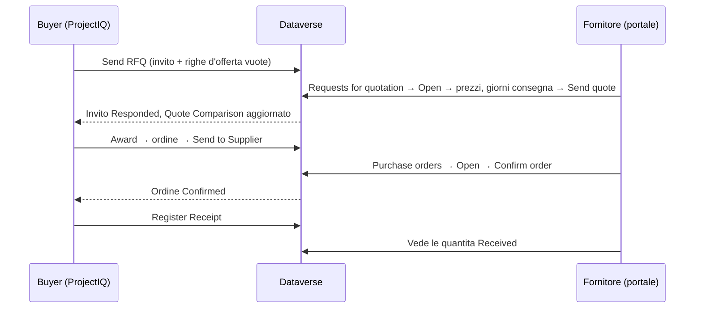

# Portale fornitori

> **Lingua:** [English](../en/supplier-portal.md) · Italiano · [Français](../fr/supplier-portal.md) · [Deutsch](../de/supplier-portal.md)
> **Indice dei manuali:** [README](../../README.md#user-manuals)

Il **portale fornitori** è un sito web, realizzato con Microsoft Power Pages sullo stesso database Dataverse di ProjectIQ, dove i tuoi fornitori possono lavorare con te senza email e fogli di calcolo che vanno avanti e indietro. Sul portale un fornitore:

- vede le **richieste d'offerta** (RdO) che gli hai inviato, inserisce **prezzi unitari**, **giorni di consegna** e **note**, e invia l'offerta — oppure rinuncia;
- vede gli **ordini d'acquisto** che gli hai inviato, con righe e importi, e li **conferma**;
- vede quanto di ogni ordine è già stato **ricevuto**.

Tutto ciò che il fornitore fa è subito visibile in ProjectIQ: le offerte compaiono nel Quote Comparison della RdO, le conferme cambiano lo stato dell'ordine.

Questo manuale ha due parti: la **Parte 1 per i fornitori** (puoi inviarla a loro) e la **Parte 2 per il personale interno**, che dà accesso ai fornitori e segue le loro risposte.

> Il portale è oggi in **inglese**: i nomi di pagine e pulsanti sono riportati come appaiono a schermo.

## Parte 1 — Guida per i fornitori

### Accesso

Il tuo cliente ti dà accesso al suo portale fornitori. Ricevi l'indirizzo del portale (per esempio `https://<cliente>-suppliers.powerappsportals.com`) e le istruzioni per creare o attivare il tuo account. Usa l'indirizzo email che il cliente ha registrato per te.

1. Apri l'indirizzo del portale e clicca **Sign in**.
2. Accedi con il tuo account.
3. Il menu mostra **Requests for quotation** (richieste d'offerta) e **Purchase orders** (ordini d'acquisto).

Se una pagina dice "This area is reserved to suppliers. Sign in with the account your customer invited.", non hai effettuato l'accesso, oppure il tuo account non è ancora abilitato come fornitore: contatta il tuo cliente.

Vedi solo le RdO e gli ordini **della tua azienda**. I colleghi della tua azienda con un proprio account vedono gli stessi dati.

### Rispondere a una richiesta d'offerta

1. Clicca **Requests for quotation**. L'elenco mostra, per ogni RdO: numero, **Deadline** (scadenza), **Status** e l'importo **Quoted** dopo che hai risposto.

| Stato | Significato |
|---|---|
| **Invited** | In attesa della tua offerta |
| **Responded** | Hai inviato un'offerta (puoi ancora modificarla fino alla scadenza) |
| **Declined** | Hai rinunciato |

2. Clicca **Open** sulla RdO. Vedi numero, scadenza, le note del cliente e l'elenco degli articoli con quantità e unità.
3. Per ogni riga scrivi lo **Unit price** (prezzo unitario) e, se serve, le **Notes** (marca, prodotto alternativo, condizioni...).
4. Scrivi i **Delivery days** (in quanti giorni dall'ordine puoi consegnare) ed eventuali **Notes for the buyer**.
5. Clicca **Send quote**. Un messaggio verde conferma: "Your quote has been sent. You can change it until the deadline."

Da sapere:

- Puoi lasciare una riga senza prezzo se non fornisci quell'articolo: "Lines without a price are not quoted." Quotare tutte le righe aumenta le tue possibilità, perché il miglior totale si calcola solo tra i fornitori che hanno quotato tutte le righe.
- Puoi tornare e **modificare i prezzi fino alla scadenza**. Dopo la scadenza (o dopo la rinuncia) i campi sono in sola lettura.
- Se non puoi quotare, clicca **Decline** e conferma. La RdO viene marcata Declined.
- L'importo **Quoted** nell'elenco è quantità × prezzo unitario su tutte le tue righe.

### Confermare un ordine d'acquisto

1. Clicca **Purchase orders**. L'elenco mostra numero, **Date** dell'ordine, **Expected delivery** (consegna prevista), **Status** e **Total**. Gli ordini in attesa della tua conferma sono marcati **To confirm**.
2. Clicca **Open**. Vedi data ordine, consegna prevista, **Delivery place** (luogo di consegna), **Payment terms** (condizioni di pagamento), stato, e le righe con quantità, prezzo unitario, importo e quantità già **Received** (ricevuta).
3. Controlla l'ordine e clicca **Confirm order**, poi conferma. Lo stato diventa **Confirmed** con la data di conferma.

| Stato mostrato | Significato |
|---|---|
| **To confirm** | L'ordine ti è stato inviato e attende la tua conferma |
| **Confirmed** | Tu (o il buyer per tuo conto) lo avete confermato |
| **Received** | Tutta la merce è stata ricevuta dal tuo cliente |

Se qualcosa nell'ordine non va (prezzo, quantità, data), non confermarlo: contatta il buyer, che correggerà l'ordine e lo invierà di nuovo.

### Errori

Se un'azione non riesce, un messaggio rosso spiega il motivo. Casi comuni: "Session expired: sign in again." (accedi di nuovo e ripeti), "The deadline of the request for quotation has passed." (contatta il buyer per una proroga), "The request for quotation is closed." (è stata aggiudicata o annullata).

## Parte 2 — Guida per il personale interno

### Cosa espone il portale

Il portale è volutamente ristretto. I fornitori possono leggere solo i propri record e scrivere solo pochi campi:

| Dati | Il fornitore può leggere | Il fornitore può modificare |
|---|---|---|
| Inviti RdO della sua azienda | Numero, scadenza, note, stato, importo quotato | **Delivery days**, **supplier notes**, **status** (solo verso Responded o Declined) |
| Righe d'offerta di quegli inviti | Articolo, quantità, unità, prezzo, note | **Unit price**, **notes** |
| Ordini d'acquisto della sua azienda (Sent, Confirmed, Received) | Testata e importi | **Supplier confirmed** (che conferma l'ordine) |
| Righe di quegli ordini | Articolo, quantità, prezzo, importo, quantità ricevuta | Nulla |

Ordini in bozza o annullati e RdO non ancora inviate non vengono mai mostrati. I prezzi degli altri fornitori non sono mai visibili.

### Dare accesso a un fornitore

Un utente fornitore è un **contatto** la cui **azienda** è l'account del fornitore, con il web role **Supplier**.

1. In ProjectIQ verifica che l'account del fornitore sia **Is Supplier**, **Active** e non **Blocked**, e abbia un'**Email** valida.
2. Crea (o apri) il **contatto** della persona, con **Company Name** = il fornitore e la sua email.
3. In **Power Pages Management** (o nello studio del portale, *Set up → Web roles*) assegna al contatto il web role **Supplier**.
4. Fai accedere la persona con il metodo configurato sul tuo sito (per esempio invia un **invito** da Power Pages Management → *Invitations*, oppure lasciala registrarsi con l'email che hai registrato).
5. Invia alla persona l'indirizzo del portale e la [Parte 1](#parte-1--guida-per-i-fornitori) di questo manuale.

Per togliere l'accesso, rimuovi il web role Supplier dal contatto o disattiva il contatto.

### Seguire le risposte

- Nella RdO, l'elenco **Invitations** mostra per ogni fornitore stato, **Responded On**, **Quoted Amount** e **Delivery Days**; il contatore **Responses** mostra quanti hanno risposto.
- La tab **Quote Comparison** mostra le offerte del portale accanto a quelle inserite da te. Aggiudica come descritto in [Acquisti](purchasing.md#confronto-e-aggiudicazione).
- Quando un fornitore conferma un ordine dal portale, l'ordine diventa **Confirmed** e vengono compilati *Supplier Confirmed* / *Confirmed On*, esattamente come se avessi cliccato **Confirm**.

### Da ricordare

- Una RdO compare sul portale solo dopo **Send**; un ordine solo dopo **Send to Supplier**.
- Nessuna delle due azioni invia da sola un'email: avvisa il fornitore che c'è una nuova RdO o un nuovo ordine (con la tua email abituale, o con un'automazione che l'amministratore può aggiungere).
- Se riporti un ordine **Back to Draft**, sparisce dal portale finché non lo invii di nuovo.
- Dopo la scadenza il fornitore non può più modificare l'offerta: proroga la **Deadline** e clicca di nuovo **Send** se vuoi altre risposte.

### Per gli amministratori

Il portale è distribuito come soluzione separata, **OpenProject365SupplierPortal**, che dipende dalla soluzione principale. Configurazione, permessi sulle tabelle, impostazioni della Web API e passi di distribuzione sono documentati in [Development environment setup](../dev-environment.md#supplier-portal-power-pages) (in inglese). Dopo ogni distribuzione del portale, svuota la cache del sito (`/_services/about` → *Clear cache*, web role Administrators) e accedi di nuovo. In un nuovo ambiente, il sito importato va riattivato (Power Pages → *Inactive sites*) prima dell'uso.
