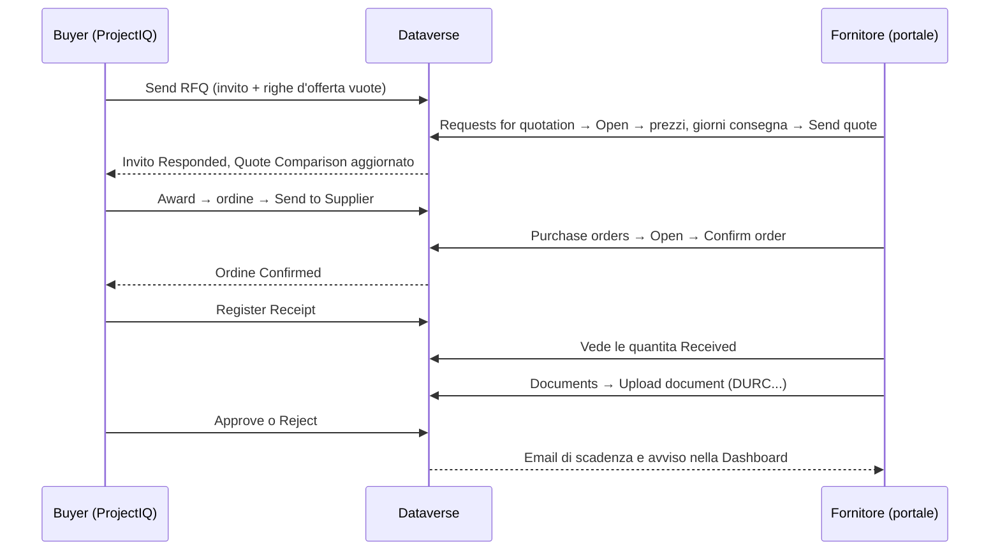

# Portale fornitori

> **Lingua:** [English](../en/supplier-portal.md) · Italiano · [Français](../fr/supplier-portal.md) · [Deutsch](../de/supplier-portal.md)
> **Indice dei manuali:** [README](../../README.md#user-manuals)

Il **portale fornitori** è un sito web, realizzato con Microsoft Power Pages sullo stesso database Dataverse di ProjectIQ, dove i tuoi fornitori possono lavorare con te senza email e fogli di calcolo che vanno avanti e indietro. Sul portale un fornitore:

- trova in una **dashboard** ciò che stai aspettando: RdO da quotare, ordini da confermare, documenti da rinnovare;
- vede le **richieste d'offerta** (RdO) che gli hai inviato, inserisce **prezzi unitari**, **giorni di consegna** e **note**, e invia l'offerta — oppure rinuncia;
- vede gli **ordini d'acquisto** che gli hai inviato, con righe e importi, e li **conferma**;
- vede quanto di ogni ordine è già stato **ricevuto**, le **commesse** dei suoi ordini e lo stato delle sue **fatture**;
- carica i suoi **documenti aziendali** (DURC, certificazioni, assicurazioni), che il tuo buyer approva, e viene avvisato quando scadono.

Tutto ciò che il fornitore fa è subito visibile in ProjectIQ: le offerte compaiono nel Quote Comparison della RdO, le conferme cambiano lo stato dell'ordine, i documenti caricati attendono la tua revisione.

Questo manuale ha due parti: la **Parte 1 per i fornitori** (puoi inviarla a loro) e la **Parte 2 per il personale interno**, che dà accesso ai fornitori e segue le loro risposte.

> Il portale è oggi in **inglese**: i nomi di pagine e pulsanti sono riportati come appaiono a schermo.

## Parte 1 — Guida per i fornitori

### Accesso

Il tuo cliente ti dà accesso al suo portale fornitori. Ricevi l'indirizzo del portale (per esempio `https://<cliente>-suppliers.powerappsportals.com`) e le istruzioni per creare o attivare il tuo account. Usa l'indirizzo email che il cliente ha registrato per te.

1. Apri l'indirizzo del portale e clicca **Sign in**.
2. Accedi con il tuo account: in **Sign in with a local account** inserisci **Email** e **Password** (**Forgot your password?** ti invia un link per reimpostarla), oppure usa **Microsoft Entra ID** se il cliente ti ha dato un account aziendale. Non hai ancora un account? Clicca **Register**, oppure **Redeem invitation** se hai ricevuto un codice d'invito.
3. Dopo l'accesso il portale apre la **Dashboard** (la home page ti porta lì; se il tuo account non è ancora collegato a un fornitore, ti chiede di rivolgerti al cliente). A sinistra, la barra laterale mostra i moduli: **Dashboard**, **Projects** (commesse), **Requests for quotation** (richieste d'offerta), **Purchase orders** (ordini d'acquisto), **Invoices** (fatture) e **Documents** (documenti). Un contatore blu indica le RdO da quotare e gli ordini da confermare; un contatore arancione i documenti da rinnovare o correggere. In fondo trovi la tua azienda, il tuo nome e **Sign out**.

Se una pagina dice "This area is reserved to suppliers. Sign in with the account your customer invited.", non hai effettuato l'accesso, oppure il tuo account non è ancora abilitato come fornitore: contatta il tuo cliente.

Vedi solo i dati **della tua azienda**. I colleghi della tua azienda con un proprio account vedono gli stessi dati.

### La dashboard

La **Dashboard** è la pagina iniziale:

| Parte | Cosa mostra |
|---|---|
| Contatori | **Requests to quote** (RdO da quotare), **Orders to confirm** (ordini da confermare), l'importo **Ordered** nell'anno in corso (ordini confermati e ricevuti) e le **Invoices under review** (fatture in verifica) |
| **Document compliance** | Un anello con la quota dei tuoi documenti approvati validi (verde), in scadenza entro 30 giorni (arancione) e scaduti (rosso), più quanti attendono la revisione o sono stati rifiutati |
| **To do** | Una riga per ogni cosa che il cliente aspetta: documenti scaduti da rinnovare, documenti rifiutati da correggere, RdO da quotare (con la scadenza), ordini da confermare, documenti in scadenza. Clicca una riga per aprire la pagina in cui farlo |
| **Your projects** | Le prime schede commessa (vedi sotto), con **All projects** per l'elenco completo |

### Commesse

**Projects** mostra una scheda per ogni commessa dei tuoi ordini d'acquisto: codice e nome, **Project progress** (avanzamento della commessa), **Your deliveries** (la quota del tuo importo ordinato già ricevuta), il numero di **Orders**, l'importo **Ordered** e la **End date** della commessa. Una commessa con un ordine da confermare ha il bordo arancione. **See orders** apre gli ordini d'acquisto.

### Rispondere a una richiesta d'offerta

1. Clicca **Requests for quotation**. Ogni RdO è una scheda con data d'invito, numero, oggetto, l'importo **Quoted** dopo che hai risposto e una barra che mostra quanto tempo resta prima della **Deadline** (scadenza; diventa arancione e poi rossa man mano che la scadenza si avvicina). I pulsanti in alto filtrano le schede: **All**, **To quote**, **Quoted**, **Closed**.

| Etichetta della scheda | Significato |
|---|---|
| **To quote** | In attesa della tua offerta (bordo arancione) |
| **Quoted** | Hai inviato un'offerta (puoi ancora modificarla fino alla scadenza) |
| **Declined** / **Closed** | Hai rinunciato, oppure la scadenza è passata |

2. Clicca **Quote now** (oppure **Change quote**, **Open**) sulla scheda. Vedi numero, scadenza, le note del cliente e l'elenco degli articoli con quantità e unità.
3. Per ogni riga scrivi lo **Unit price** (prezzo unitario) e, se serve, le **Notes** (marca, prodotto alternativo, condizioni...).
4. Scrivi i **Delivery days** (in quanti giorni dall'ordine puoi consegnare) ed eventuali **Notes for the buyer**.
5. Clicca **Send quote**. Un messaggio verde conferma: "Your quote has been sent. You can change it until the deadline."

Da sapere:

- Puoi lasciare una riga senza prezzo se non fornisci quell'articolo: "Lines without a price are not quoted." Quotare tutte le righe aumenta le tue possibilità, perché il miglior totale si calcola solo tra i fornitori che hanno quotato tutte le righe.
- Puoi tornare e **modificare i prezzi fino alla scadenza**. Dopo la scadenza (o dopo la rinuncia) i campi sono in sola lettura.
- Se non puoi quotare, clicca **Decline** e conferma. La RdO viene marcata Declined.
- L'importo **Quoted** nell'elenco è quantità × prezzo unitario su tutte le tue righe.

### Confermare un ordine d'acquisto

1. Clicca **Purchase orders**. Ogni ordine è una scheda con commessa, data ordine, numero e totale. Gli ordini in attesa della tua conferma sono marcati **To confirm** e mostrano consegna prevista, condizioni di pagamento e luogo di consegna; gli altri mostrano una barra **Received** (ricevuto). I pulsanti in alto filtrano le schede: **All**, **To confirm**, **Confirmed**, **Received**.
2. Clicca **Review and confirm** (oppure **Open**). Vedi data ordine, consegna prevista, **Delivery place** (luogo di consegna), **Payment terms** (condizioni di pagamento), stato, e le righe con quantità, prezzo unitario, importo e quantità già **Received** (ricevuta).
3. Controlla l'ordine e clicca **Confirm order**, poi conferma. Lo stato diventa **Confirmed** con la data di conferma.

| Stato mostrato | Significato |
|---|---|
| **To confirm** | L'ordine ti è stato inviato e attende la tua conferma |
| **Confirmed** | Tu (o il buyer per tuo conto) lo avete confermato |
| **Received** | Tutta la merce è stata ricevuta dal tuo cliente |

Se qualcosa nell'ordine non va (prezzo, quantità, data), non confermarlo: contatta il buyer, che correggerà l'ordine e lo invierà di nuovo.

### Fatture

**Invoices** mostra le fatture che il cliente ha ricevuto da te: i totali **Under review** (in verifica), **Approved** nell'anno in corso e **Rejected** (rifiutate), poi una scheda per fattura con ordine e commessa, numero, importo, tipo documento e date. I passi **Received → Reviewed → Approved** (oppure **Rejected**, in rosso) mostrano a che punto è la fattura; una fattura rifiutata mostra la **Reason** (motivo). I pulsanti in alto filtrano le schede. Il portale non riceve fatture: inviale come di consueto.

### Documenti aziendali

**Documents** elenca i documenti che il cliente richiede alla tua azienda (DURC, visura camerale, certificazioni, assicurazioni, contratti) con **Number**, **Issued** (emissione), **Expires** (scadenza) e due etichette:

| Colonna | Etichette |
|---|---|
| **Expiry** | **Valid** (valido), **Expiring** (in scadenza entro 30 giorni), **Expired** (scaduto), **Replaced** (è stato approvato un documento più recente dello stesso tipo), **No expiry** (senza scadenza) |
| **Review** | **Pending review** (il buyer non l'ha ancora controllato), **Approved**, **Rejected** (con il motivo) |

Per caricare un documento:

1. Clicca **Upload document** (oppure scorri fino al modulo in fondo alla pagina).
2. Scegli il **Type** (tipo), scrivi una **Description** e, se presenti, **Number**, **Issue date**, **Expiry date** e **Notes**.
3. Scegli il **File** (PDF o immagine, fino a 32 MB) e clicca **Upload document**.

Il documento resta **Pending review** finché il buyer non lo approva. Finché è in revisione o rifiutato puoi cliccare **Edit** (modifica dati o file, poi **Save changes**) o **Delete**. Correggere un documento rifiutato lo rimanda in revisione. Una volta **Approved** il documento si può solo consultare: per rinnovarlo carica un nuovo documento dello stesso tipo; quando il buyer lo approva, il vecchio diventa **Replaced**.

Ricevi un'email quando un documento approvato sta per scadere (30 giorni prima) e quando scade; la Dashboard mostra gli stessi avvisi.

### Errori

Se un'azione non riesce, un messaggio rosso spiega il motivo. Casi comuni: "Session expired: sign in again." (accedi di nuovo e ripeti), "The deadline of the request for quotation has passed." (contatta il buyer per una proroga), "The request for quotation is closed." (è stata aggiudicata o annullata), "Approved documents cannot be changed." o "Approved documents cannot be deleted." (carica invece un nuovo documento), "Choose the file of the document." (un nuovo documento richiede il suo file).

## Parte 2 — Guida per il personale interno

### Cosa espone il portale

Il portale è volutamente ristretto. I fornitori possono leggere solo i propri record e scrivere solo pochi campi:

| Dati | Il fornitore può leggere | Il fornitore può modificare |
|---|---|---|
| Inviti RdO della sua azienda | Numero, scadenza, note, stato, importo quotato | **Delivery days**, **supplier notes**, **status** (solo verso Responded o Declined) |
| Righe d'offerta di quegli inviti | Articolo, quantità, unità, prezzo, note | **Unit price**, **notes** |
| Ordini d'acquisto della sua azienda (Sent, Confirmed, Received) | Testata e importi | **Supplier confirmed** (che conferma l'ordine) |
| Righe di quegli ordini | Articolo, quantità, prezzo, importo, quantità ricevuta | Nulla |
| Commesse di quegli ordini | Codice, nome, avanzamento, data fine | Nulla |
| Fatture fornitore della sua azienda | Numero, date, importo, stato, nota della decisione | Nulla |
| Documenti fornitore della sua azienda | Tutti i campi, compresa la nota di revisione | Tipo, descrizione, numero, date, note, file; può crearli ed eliminarli, solo finché il documento non è approvato |

Ordini in bozza o annullati e RdO non ancora inviate non vengono mai mostrati. I prezzi degli altri fornitori non sono mai visibili.

### Dare accesso a un fornitore

Un utente fornitore è un **contatto** la cui **azienda** è l'account del fornitore, con il web role **Supplier**.

1. In ProjectIQ verifica che l'account del fornitore sia **Is Supplier**, **Active** e non **Blocked**, e abbia un'**Email** valida.
2. Crea (o apri) il **contatto** della persona, con **Company Name** = il fornitore e la sua email.
3. In **Power Pages Management** (o nello studio del portale, *Set up → Web roles*) assegna al contatto il web role **Supplier**.
4. Fai accedere la persona con il metodo configurato sul tuo sito (per esempio invia un **invito** da Power Pages Management → *Invitations*, oppure lasciala registrarsi con l'email che hai registrato).
5. Invia alla persona l'indirizzo del portale e la [Parte 1](#parte-1--guida-per-i-fornitori) di questo manuale.

Per togliere l'accesso, rimuovi il web role Supplier dal contatto o disattiva il contatto.

**Metodi di accesso.** Oltre a Microsoft Entra ID, il portale offre gli **account locali** (email e password), così possono accedere anche i fornitori esterni al tuo tenant. Le persone possono anche **registrarsi** da sole: chi si registra non vede nulla finché non imposti il **Company Name** del suo contatto sul fornitore e gli assegni il web role **Supplier**, quindi controlla periodicamente i nuovi contatti. L'amministratore può disattivare gli account locali o l'auto-registrazione (in quel caso possono registrarsi solo gli invitati), vedi [Development environment setup](../dev-environment.md#supplier-portal-power-pages) (in inglese).

### Revisione dei documenti

Un documento caricato sul portale è **Pending Review** e il proprietario dell'account del fornitore riceve la notifica "Supplier document to review". Aprilo dalla notifica, o dalla vista **Supplier Documents to Review**, controlla il file e clicca **Approve** o **Reject** (con una nota che il fornitore leggerà). Vedi [Anagrafiche](master-data.md#revisione). Le email di scadenza ai fornitori richiedono la configurazione descritta in [Amministrazione](administration.md#scadenza-giornaliera-dei-documenti).

### Seguire le risposte

- Nella RdO, l'elenco **Invitations** mostra per ogni fornitore stato, **Responded On**, **Quoted Amount** e **Delivery Days**; il contatore **Responses** mostra quanti hanno risposto.
- La tab **Quote Comparison** mostra le offerte del portale accanto a quelle inserite da te. Aggiudica come descritto in [Acquisti](purchasing.md#confronto-e-aggiudicazione).
- Quando un fornitore conferma un ordine dal portale, l'ordine diventa **Confirmed** e vengono compilati *Supplier Confirmed* / *Confirmed On*, esattamente come se avessi cliccato **Confirm**.

### Da ricordare

- Una RdO compare sul portale solo dopo **Send**; un ordine solo dopo **Send to Supplier**.
- Nessuna delle due azioni invia da sola un'email: avvisa il fornitore che c'è una nuova RdO o un nuovo ordine (con la tua email abituale, o con un'automazione che l'amministratore può aggiungere).
- Se riporti un ordine **Back to Draft**, sparisce dal portale finché non lo invii di nuovo.
- Dopo la scadenza il fornitore non può più modificare l'offerta: proroga la **Deadline** e clicca di nuovo **Send** se vuoi altre risposte.

### Per gli amministratori

Il portale è distribuito come soluzione separata, **OpenProject365SupplierPortal**, che dipende dalla soluzione principale. L'aspetto del portale (barra laterale, schede, anello di conformità) è solo Liquid e CSS nei web template **OP365 Supplier Style**, **OP365 Supplier Nav** e **OP365 Supplier Project Cards**. Configurazione, permessi sulle tabelle, impostazioni della Web API e passi di distribuzione sono documentati in [Development environment setup](../dev-environment.md#supplier-portal-power-pages) (in inglese). Dopo ogni distribuzione del portale, svuota la cache del sito (`/_services/about` → *Clear cache*, web role Administrators) e accedi di nuovo. In un nuovo ambiente, il sito importato va riattivato (Power Pages → *Inactive sites*) prima dell'uso.
