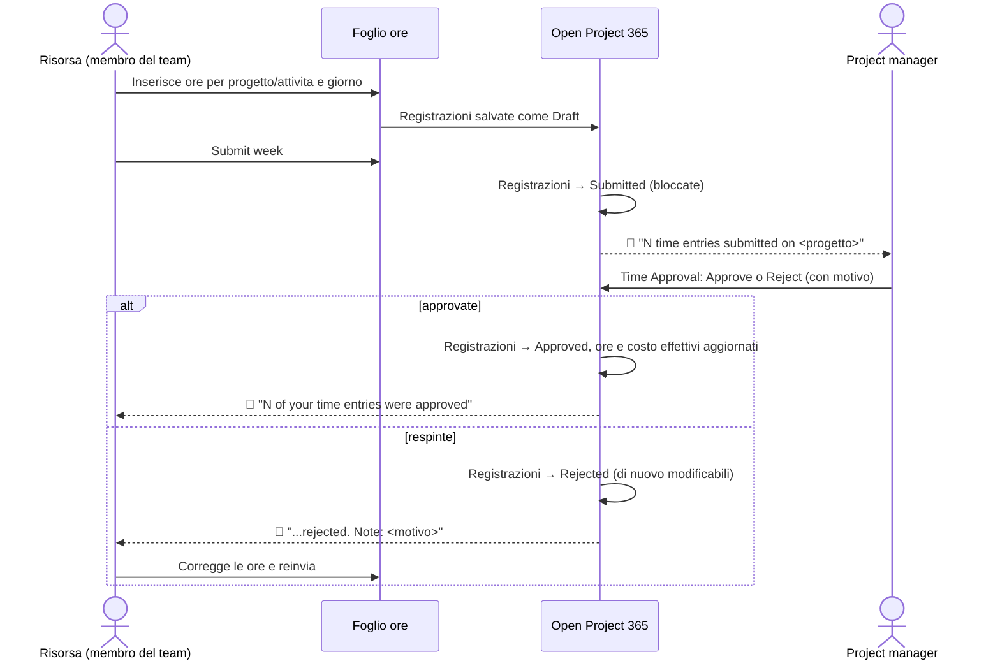
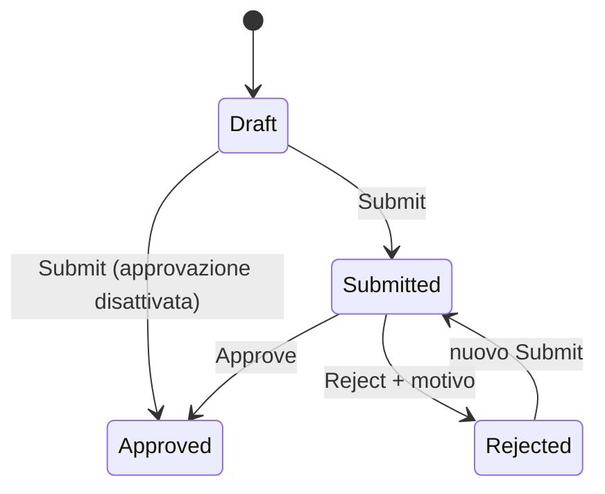
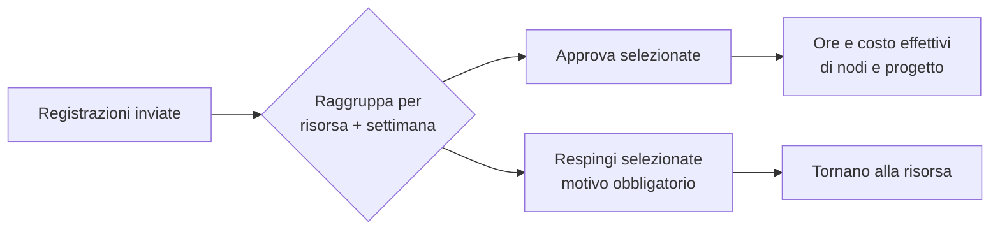

# Rilevazione ore: foglio ore, approvazione e promemoria

> **Lingua:** [English](../en/time-tracking.md) · Italiano · [Français](../fr/time-tracking.md) · [Deutsch](../de/time-tracking.md)
> **Indice dei manuali:** [README](../../README.md#user-manuals)

Le ore sono di solito il costo più grande di una commessa, e il più difficile da raccogliere in tempo. Open Project 365 trasforma la loro registrazione in una routine settimanale: ogni persona compila un **foglio ore settimanale** per progetto e attività, invia la settimana, e i project manager **approvano** o **respingono** le ore da un'unica schermata. Le ore approvate diventano **ore e costo effettivi** dei nodi WBS e del progetto, valorizzate al costo orario valido in quel giorno. Un **promemoria giornaliero** avvisa chi si è dimenticato di registrare.

Questo manuale è per chi registra ore (parte 1), per i project manager che le approvano (parte 2) e per gli amministratori che configurano il processo (parte 3).

> I nomi di campi e pulsanti sono in inglese, come appaiono a schermo.

## Il processo completo

### Stati di una registrazione ore

| Stato | Chi può modificare la registrazione | Conta nei consuntivi |
|---|---|---|
| **Draft** (bozza) | La risorsa (modifica, elimina) | No |
| **Submitted** (inviata) | Nessuno: bloccata in attesa di approvazione | No |
| **Approved** (approvata) | Nessuno: definitiva | **Sì** |
| **Rejected** (respinta) | La risorsa (modifica, elimina, reinvia) | No |

## Parte 1 — Registrare le proprie ore

### Prima di iniziare

- Il tuo utente deve essere collegato a una **Resource** (Master Data → Resources → campo *User*). Altrimenti il foglio ore mostra "Your user is not linked to a resource. Ask an administrator to set User on your Resource."
- Puoi registrare ore solo su progetti **In Progress** che puoi vedere (sei membro o proprietario).

### La dashboard Timesheet

Apri **Projects → Time → Timesheet**. Vedi una settimana, da lunedì a domenica, delle **tue** ore.

| Zona | Cosa mostra |
|---|---|
| **Barra degli strumenti** | **Previous week**, **This week**, **Next week**, **Refresh**, **Submit week** |
| **Righe** | Una riga per combinazione *progetto / attività*; l'attività (nodo WBS) è facoltativa |
| **Colonne dei giorni** | Ore per giorno; ogni cella mostra un'etichetta colorata con lo stato della sua registrazione |
| **Colonna Total** | Ore della riga nella settimana |
| **Piede** | Totali giornalieri e totale settimanale, confrontato con le tue **Weekly hours** |

Illustrazione:

| Progetto / attività | Lun | Mar | Mer | Gio | Ven | Sab | Dom | Totale |
|---|---|---|---|---|---|---|---|---|
| PRJ-000042 Ristrutturazione uffici / 2.2.1 Elettrico | 8 ✅ | 6 ✅ | 8 📝 | | | | | 22 |
| PRJ-000051 Magazzino / 1.2 Progetto esecutivo | | 2 ✅ | | 8 📝 | 4 📝 | | | 14 |
| **Totale** (ore settimanali 40) | 8 | 8 | 8 | 8 | 4 | | | **36 / 40** |

(✅ approvata, 📝 bozza: a schermo le etichette sono *Draft*, *Submitted*, *Approved*, *Rejected*.)

### Aggiungere una riga

1. In fondo alla griglia scegli il **Project** (sono elencati solo i progetti In Progress).
2. Facoltativamente scegli il **Task** (un nodo WBS di quel progetto). Lascialo vuoto per registrare tempo sul progetto nel suo insieme.
3. Clicca **Add line**. Compare una riga vuota.

### Inserire le ore

1. Clicca una cella giorno della riga e scrivi le ore: **da 0 a 24**, con decimali a virgola o punto. I valori vengono arrotondati al **quarto d'ora** (1,3 diventa 1,25).
2. Premi **Invio** o passa a un'altra cella: la registrazione viene salvata subito come **Draft**.
3. Per togliere ore scrivi **0** o svuota la cella: la registrazione in bozza viene eliminata.

Se scrivi qualcosa che non è un numero valido, la cella mostra "Enter hours between 0 and 24."

Una cella è modificabile solo quando contiene **al massimo una registrazione** e quella registrazione è Draft o Rejected. Le celle con registrazioni inviate o approvate sono in sola lettura. Se hai due registrazioni per lo stesso progetto, attività e giorno (per esempio create dall'elenco Time Entries), la cella mostra la somma e va modificata dall'elenco.

### Inviare la settimana

Quando la settimana è completa clicca **Submit week**. Tutte le registrazioni **Draft** e **Rejected** della settimana vengono inviate insieme, un messaggio conferma quante ("N entries submitted") e i project manager vengono avvisati. Le registrazioni inviate sono bloccate.

> Invia ogni settimana, anche se incompleta: gli approvatori vedono prima le tue ore e i costi di progetto restano aggiornati. Puoi aggiungere altre ore dopo e inviare di nuovo; le registrazioni già approvate non vengono toccate.

### Quando le ore vengono respinte

Ricevi una notifica con il motivo. Apri il foglio ore su quella settimana: le celle respinte sono di nuovo modificabili. Correggile (o eliminale) e clicca di nuovo **Submit week**.

### Note su una registrazione e altri modi di registrare

Il foglio ore è il modo più veloce, ma non l'unico:

- **Projects → Time → Time Entries** elenca le tue registrazioni (**My Time Entries**) e permette di crearne una con **+ New**: scegli progetto, attività, data, ore e aggiungi **Notes** (per esempio cosa hai fatto).
- Nel form del progetto, la tab **Time** elenca le registrazioni del progetto.
- Il form di creazione rapida (**+** nella barra in alto → Time Entry) chiede progetto, attività, data, ore e note.

Nel form della registrazione si possono scegliere solo i nodi WBS del progetto selezionato. La **Resource** viene compilata con la tua risorsa; **Name** (risorsa + data), **Cost** e **Revenue** sono calcolati.

### Il promemoria giornaliero

Dal lunedì al venerdì alle **17:30** (ora di Roma) l'applicazione controlla le ore della giornata di tutti. Se hai registrato meno ore del previsto, ricevi la notifica **"Record your hours"** — "You have recorded X of Y hours on <data>." — con il pulsante **Open timesheet**.

Le ore attese sono le tue Weekly Hours divise per i giorni lavorativi, meno eventuali assenze della giornata:

| Situazione | Ore attese (40 h/settimana, lun–ven) |
|---|---|
| Giornata lavorativa normale | 8 |
| Mezza giornata di permesso (assenza di un giorno, 4 ore) | 4 |
| Ferie o malattia per l'intera giornata | 0 (nessun promemoria) |
| Sabato o domenica | 0 (nessun promemoria) |
| Chiusura aziendale | Nessun promemoria per nessuno |

Le ore contano qualunque sia il loro stato (bozze comprese): basta registrarle per fermare il promemoria; non serve inviarle ogni giorno.

## Parte 2 — Approvare le ore

Gli approvatori sono i **Manager** di ciascun progetto (membri con ruolo Manager, che include sempre il project manager) e gli amministratori.

### La dashboard Time Approval

Apri **Projects → Time → Approvals**. Elenca tutte le registrazioni **inviate** che puoi vedere, raggruppate per **risorsa** e **settimana**.

| Colonna | Contenuto |
|---|---|
| **Resource** | Chi ha lavorato |
| **Week** | Lunedì della settimana |
| **Hours** | Totale ore inviate del gruppo, con la ripartizione per progetto |
| **Expand** | Mostra le singole registrazioni del gruppo (data, progetto, attività, ore, note) |

Per decidere:

1. Seleziona interi gruppi con la loro casella (o **Select all**), oppure espandi un gruppo e seleziona singole registrazioni.
2. Clicca **Approve**: un messaggio conferma "N entries approved."
3. Oppure clicca **Reject**: una finestra "Reject N time entries" chiede il **Reason (sent to the resource)**, cioè il motivo inviato alla risorsa, obbligatorio. Conferma con **Reject**.

Puoi decidere solo le registrazioni dei progetti in cui sei Manager. Se ne selezioni altre, l'operazione si ferma con "Only a manager of the project can approve or reject its time entries."

La vista **Time Entries to Approve** (Projects → Time → Time Entries) mostra le stesse registrazioni come elenco, e **Time Entries by Project** è usata nella tab Time del progetto.

### Cosa cambia con l'approvazione

Quando una registrazione viene approvata:

- le sue **ore** si sommano alle **Actual Hours** del suo nodo WBS e del progetto;
- il suo **costo** si somma all'**Actual Cost** del nodo e del progetto, e compare nel [riepilogo costi](materials-and-costs.md#riepilogo-costi);
- la registrazione diventa definitiva: non può essere modificata né eliminata.

## Come vengono valorizzate le ore

Ogni registrazione porta due importi, calcolati a ogni salvataggio:

| Importo | Formula | Visibile a |
|---|---|---|
| **Cost** (costo) | Ore × il **costo orario della risorsa valido alla data** della registrazione (dallo storico Resource Costs) | Solo agli utenti con il profilo *OP365 Cost Visibility* |
| **Revenue** (ricavo) | Ore × l'**Hourly Rate** dell'utente della risorsa come membro del progetto (0 se non impostato) | Agli utenti che possono leggere la registrazione |

Esempio: il costo di Marco è 35,00 €/h fino al 30 giugno e 38,50 €/h dal 1 luglio. 8 ore del 28 giugno costano 280,00; 8 ore del 2 luglio costano 308,00, anche se entrambe le registrazioni vengono inserite lo stesso giorno. Se l'Hourly Rate di Marco sul progetto è 55,00 €/h, entrambe hanno un ricavo di 440,00.

## Parte 3 — Configurazione (amministratori)

| Impostazione | Dove | Effetto |
|---|---|---|
| **Time Approval Enabled** | Settings → Company → Settings | Attivo (predefinito): le ore inviate attendono l'approvazione. Disattivo: **Submit** approva subito le registrazioni (contano subito nei consuntivi) |
| **User** sulla Resource | Master Data → Resources | Collega una persona alla sua risorsa: necessario per usare il foglio ore |
| **Weekly Hours**, **Working Days** | Resource | Ore attese (promemoria, totale settimanale) |
| **Absences** | Planning → Absences | Riducono le ore attese; le chiusure aziendali sospendono i promemoria |
| **Hourly Rate** sul Project Member | Progetto → Team | Ricavo delle ore del membro |
| Flusso **Daily time reminder** | Power Automate, soluzione Open Project 365 | Invia i promemoria (lun–ven 17:30). Vedi [Amministrazione](administration.md#promemoria-giornaliero-delle-ore) |

Gli amministratori possono inviare registrazioni per conto di altri e approvare o respingere registrazioni di qualunque progetto.

## Messaggi che potresti vedere

| Messaggio | Significato e soluzione |
|---|---|
| "Your user is not linked to a resource. Ask an administrator to set User on your Resource." | Nessuna risorsa attiva ha il tuo utente nel campo *User* |
| "Hours and materials can be recorded only on projects In Progress." | Il progetto è un'offerta, sospeso o chiuso |
| "The WBS node belongs to another project." | L'attività scelta non fa parte del progetto selezionato |
| "Submitted or approved time entries cannot be changed." / "...cannot be deleted." | Chiedi al project manager di respingere la registrazione se va corretta |
| "Use Submit, Approve or Reject to change the status of time entries." | Lo stato non si modifica direttamente |
| "Only draft or rejected time entries can be submitted." | Alcune registrazioni selezionate sono già inviate o approvate |
| "You can submit only your own time entries." | Solo gli amministratori possono inviare per altri |
| "Select at least one time entry." | Non è stato selezionato nulla |
| "Add a note to reject time entries." | Il motivo del rifiuto è obbligatorio |
| "Only submitted time entries can be approved or rejected." | La registrazione era già stata decisa (magari da un altro manager): aggiorna |
| "Enter hours between 0 and 24." | Il valore scritto nel foglio ore non è valido |
