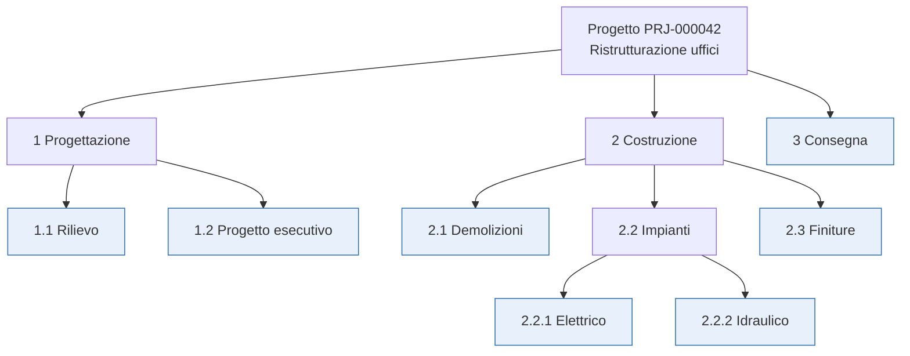
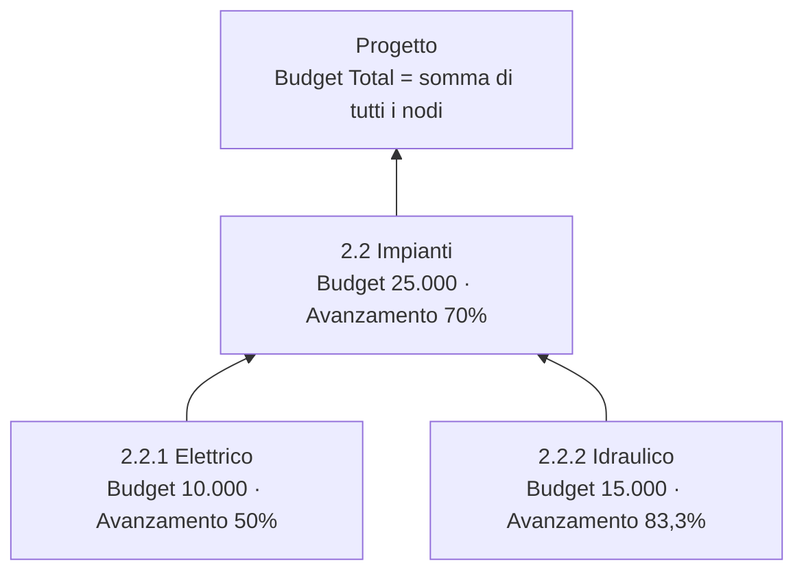
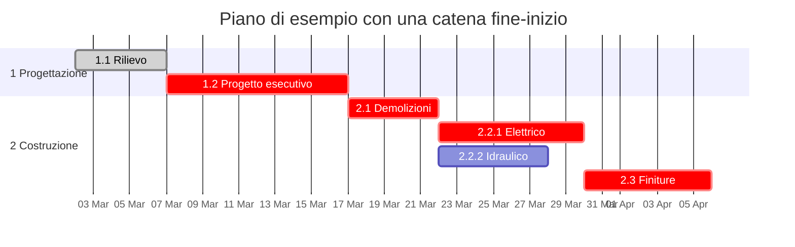
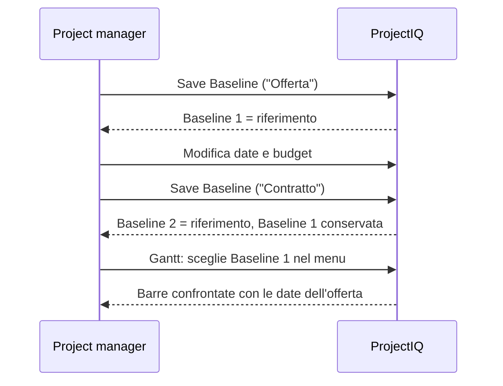

# WBS, budget, Gantt e baseline

> **Lingua:** [English](../en/wbs-and-planning.md) · Italiano · [Français](../fr/wbs-and-planning.md) · [Deutsch](../de/wbs-and-planning.md)
> **Indice dei manuali:** [README](../../README.md#user-manuals)

La **Work Breakdown Structure (WBS)**, o struttura di scomposizione del lavoro, divide un progetto in fasi, pacchetti di lavoro e attività. In ProjectIQ la WBS è il luogo in cui si costruisce il budget, si pianificano date e dipendenze, si dichiara l'avanzamento e si raccolgono ore e costi. Sopra di essa ci sono il **diagramma di Gantt**, con il **percorso critico**, e le **baseline**, copie congelate del piano che permettono di confrontare ciò che era stato concordato con ciò che sta accadendo.

Questo manuale tratta le tab **WBS** e **Gantt** del form progetto, il form del nodo WBS, le dipendenze, le allocazioni e le baseline. Le ore pianificate per risorsa sono trattate in [Carico risorse](resource-load.md).

> I nomi di campi e pulsanti sono in inglese, come appaiono a schermo.

## Concetti

- Un **nodo WBS** è un qualunque elemento dell'albero. Un nodo può avere un **nodo padre**, quindi l'albero può essere profondo quanto serve.
- Un **nodo foglia** (evidenziato sopra) non ha figli: è un'attività reale. Budget, date e avanzamento si inseriscono sui nodi foglia.
- Un **nodo padre** (riepilogo) ha figli: nella griglia e nel Gantt i suoi valori sono **aggregati** dai nodi sottostanti.
- Una **dipendenza** collega due nodi: il successore può iniziare solo dopo la fine del predecessore (fine-inizio), eventualmente dopo alcuni **giorni di ritardo** (lag).
- Un'**allocazione** indica quante ore una risorsa dovrebbe lavorare su un nodo.
- Una **baseline** è una fotografia di budget e date di tutti i nodi in un dato momento.

## Il nodo WBS

### Campi

**Tab General**

| Campo | Significato |
|---|---|
| **Project** | Il progetto (obbligatorio). Il nodo viene eliminato con il progetto |
| **Parent Node** | Il nodo superiore nell'albero. Si possono scegliere solo nodi **dello stesso progetto**. Vuoto = nodo di primo livello |
| **Code** | Codice di struttura, per esempio `2.2.1`. Testo libero; serve per l'ordinamento (vedi sotto) |
| **Name** | Nome della fase o attività (obbligatorio) |
| **Owner Resource** | La risorsa responsabile del nodo |
| **Sort Order** | Numero facoltativo che forza la posizione tra nodi fratelli |
| **Start Date** / **End Date** | Date pianificate |
| **Progress %** | Percentuale di completamento (0–100), inserita sui nodi foglia |
| **Owner** | Proprietario del record |

**Tab Budget**

| Campo | Significato |
|---|---|
| **Budget Hours** | Ore previste |
| **Actual Hours** | Ore approvate registrate sul nodo (calcolato) |
| **Budget Labour** | Costo previsto della manodopera |
| **Budget Materials** | Costo previsto dei materiali |
| **Budget Other** | Altri costi previsti (subappalti, noli, trasferte...) |
| **Budget Total** | Labour + Materials + Other (calcolato al salvataggio) |
| **Actual Cost** | Costo della manodopera approvata + consumi di materiale sul nodo (calcolato) |

**Tab Dependencies**: **Predecessors** (nodi che questo nodo aspetta) e **Successors** (nodi che aspettano questo).

**Tab Allocations**: risorse e ore pianificate sul nodo.

### Ordinamento dei nodi

I nodi fratelli sono mostrati in questo ordine:

1. per **Sort Order**, se valorizzato (prima i più bassi);
2. poi per **Code**, in ordine naturale di struttura: `1.2` viene prima di `1.10`, `2` prima di `10`;
3. poi per **Name**.

Quindi nella maggior parte dei casi bastano codici coerenti; usa Sort Order quando vuoi un ordine diverso da quello dei codici.

## La tab WBS (WBS Tree Grid)

La tab WBS del progetto mostra l'intero albero come griglia espandibile.

| Colonna | Nodi foglia | Nodi padre |
|---|---|---|
| **Name** (con codice) | Clic per aprire il form del nodo | Clic sulla freccia per espandere/comprimere; clic sul nome per aprire il form |
| **Start** / **End** | Modificabili in linea | Inizio più vicino / fine più lontana dei nodi sottostanti (in grigio, aggregati) |
| **Budget Hours** | Modificabile in linea | Somma dei nodi sottostanti |
| **Labour**, **Materials**, **Other** | Modificabili in linea | – |
| **Budget Total** | Calcolato | Somma dei nodi sottostanti |
| **Progress %** | Barra verde da 0 a 100; clicca la percentuale per modificarla in linea | Avanzamento delle foglie sottostanti pesato sul budget, come barra |

Gli importi sono mostrati nella valuta del progetto.

L'ultima riga mostra il **Total** di ore e budget dell'intero progetto. I valori aggregati sono in grigio; passa il mouse sopra per vedere il suggerimento "Includes child nodes".

### Barra degli strumenti

| Pulsante | Cosa fa |
|---|---|
| **New node** | Apre un nuovo form di nodo WBS per il progetto (primo livello) |
| **New child node** | Apre un nuovo nodo sotto la riga selezionata (clicca prima una riga per selezionarla) |
| **Expand all** / **Collapse all** | Apre o chiude tutti i rami |
| **Refresh** | Ricarica l'albero (usalo dopo aver modificato nodi in un'altra finestra) |

### Modifica in linea

1. Clicca una cella di un nodo foglia (date, ore, manodopera, materiali, altro, avanzamento).
2. Scrivi il valore. I decimali possono usare la virgola o il punto.
3. Premi **Invio** o clicca altrove per salvare; **Esc** annulla.

La modifica viene salvata subito, il budget totale del nodo viene ricalcolato e vengono aggiornati **Budget Total** e **Progress %** del progetto. Se un valore non può essere salvato, il messaggio "The change could not be saved" ne mostra il motivo.

> Se il progetto non è ancora stato salvato, la griglia mostra "Save the project to build its WBS."

### Costruire velocemente una WBS

1. Crea le fasi di primo livello con **New node** (codice `1`, `2`, `3`...).
2. Seleziona una fase, clicca **New child node** e crea le sue attività (`1.1`, `1.2`...).
3. Compila date, ore e budget direttamente nella griglia.
4. Apri i nodi che hanno bisogno di dipendenze o allocazioni e aggiungile nelle rispettive tab.

## Come si aggregano budget e avanzamento

- **Budget Total di un nodo** = Budget Labour + Budget Materials + Budget Other, ricalcolato a ogni salvataggio.
- **Budget Total del progetto** = somma dei budget totali dei nodi.
- **Avanzamento** di un nodo di riepilogo e del progetto = avanzamento dei **nodi foglia** pesato sul loro budget totale: (10.000 × 50% + 15.000 × 83,3%) ÷ 25.000 = 70%. Se nessuna foglia ha budget, i pesi sono le ore a budget; se non ci sono nemmeno ore, si usa una media semplice.

> Inserisci gli importi di budget **solo sui nodi foglia**. Un budget inserito su un nodo padre viene comunque sommato al totale del progetto, che rischia di contarlo due volte se anche i figli hanno un budget.

## Dipendenze

Una dipendenza dice che il **successore** può iniziare solo dopo la fine del **predecessore**.

| Campo | Significato |
|---|---|
| **Predecessor** | Il nodo che deve finire prima |
| **Successor** | Il nodo che aspetta |
| **Dependency Type** | *Finish-to-Start* (fine-inizio) |
| **Lag Days** | Giorni di calendario da attendere dopo la fine del predecessore (0 = il successore può iniziare il giorno dopo) |
| **Project** / **Name** | Compilati automaticamente ("Predecessore → Successore") |

Crea le dipendenze dalla tab **Dependencies** di un nodo: **+ New WBS Dependency** in *Predecessors* (questo nodo aspetta un altro) o in *Successors* (un altro nodo aspetta questo).

L'applicazione controlla ogni dipendenza al salvataggio:

| Regola | Messaggio |
|---|---|
| Un nodo non può dipendere da sé stesso | "A WBS node cannot depend on itself." |
| I due nodi devono essere dello stesso progetto | "Predecessor and successor must belong to the same project." |
| Niente cicli (A → B → C → A) | "This dependency would create a cycle in the plan." |
| La stessa coppia una sola volta | Errore di chiave duplicata |

Quando elimini un nodo, vengono eliminate anche le sue dipendenze e tutti i nodi figli.

## La tab Gantt (Gantt Chart)

La tab Gantt disegna la WBS su una linea del tempo.

Cosa vedi:

- **Colonna sinistra**: l'albero WBS (espandi/comprimi con le frecce; clicca un nome per aprire il nodo).
- **Barre di riepilogo** (scure) per i nodi padre, dall'inizio più vicino alla fine più lontana dei figli.
- **Barre delle attività** per i nodi foglia, con l'**avanzamento** mostrato come riempimento più scuro.
- **Frecce** per le dipendenze fine-inizio.
- **Percorso critico** in rosso: la catena di attività con margine (float) zero, cioè le attività il cui ritardo ritarderebbe la fine del progetto. È calcolato dalle date pianificate e dalle dipendenze (con lag).
- **Barre spinte**: quando le dipendenze obbligano un'attività a iniziare più tardi del suo inizio pianificato, l'attività è disegnata tratteggiata alla data in cui può davvero iniziare ("Pushed by dependencies to ...").
- **Barre della baseline**: barre sottili sotto ogni attività con le date della baseline selezionata.
- **Linea di oggi**: una linea verticale sulla data odierna.
- **Suggerimento**: passa il mouse su una barra per vedere date, avanzamento, margine (giorni), se è sul percorso critico e le date della baseline.

### Barra degli strumenti

| Controllo | Cosa fa |
|---|---|
| **Weeks** / **Months** / **Quarters** | Cambia la scala temporale (settimane, mesi, trimestri) |
| **Baseline** | Sceglie la baseline di confronto. La baseline di **riferimento** è preselezionata; *No baseline* nasconde il confronto |
| **Critical path** | Mostra o nasconde l'evidenziazione del percorso critico |
| **Refresh** | Ricarica nodi, dipendenze e baseline |

Messaggi:

- "No WBS node has start and end dates yet." — compila le date nella tab WBS.
- "Some dependencies form a loop and were ignored." — il percorso critico ignora le attività in un ciclo; può accadere solo con dati importati fuori dall'applicazione, perché i cicli vengono rifiutati al salvataggio.

## Baseline

Una baseline congela **ore a budget, budget totale, data di inizio e data di fine** di ogni nodo WBS attivo in un certo momento. Baseline tipiche sono "Offerta", "Contratto", "Ripianificazione dopo variante 1".

### Salvare una baseline

1. Nel form del progetto clicca **Save Baseline** nella barra dei comandi.
2. Conferma. La WBS corrente viene copiata in una nuova baseline, chiamata "Baseline aaaa-mm-gg hh:mm UTC", che diventa la baseline di **riferimento**.
3. Il Gantt e l'elenco **Baselines** (tab Gantt) vengono aggiornati e compare la notifica "Baseline saved.".

Apri la baseline dall'elenco per **rinominarla** o aggiungere una **Description**. La sua sezione **Nodes** elenca i valori congelati di ogni nodo.

### Baseline di riferimento

Ogni progetto ha **al massimo una baseline di riferimento**: quella che il Gantt preseleziona per il confronto. Salvare una nuova baseline la rende di riferimento. Per scegliere un'altra baseline di riferimento, aprila e spunta **Is Reference**: la precedente viene deselezionata automaticamente.

Le baseline non vengono mai modificate dalle successive modifiche della WBS. I nodi creati dopo una baseline non vi compaiono; i nodi eliminati vi restano.

## Buone pratiche

- Mantieni **codici coerenti** (`1`, `1.1`, `1.1.1`): ne beneficiano ordinamento, leggibilità e reportistica.
- Metti **budget, date e avanzamento sulle foglie**; lascia che i riepiloghi si aggreghino.
- Aggiungi **dipendenze solo dove esistono davvero**: il percorso critico vale quanto i collegamenti.
- **Salva una baseline** a ogni traguardo formale (offerta, contratto, variante approvata) e dalle un nome significativo.
- Aggiorna l'**avanzamento** ogni settimana: determina l'avanzamento del progetto e la stima a finire nel [riepilogo costi](materials-and-costs.md#riepilogo-costi).

## Messaggi che potresti vedere

| Messaggio | Significato |
|---|---|
| "Save the project to build its WBS." / "Save the project to see its Gantt." | Il progetto è nuovo e non ancora salvato |
| "The WBS could not be loaded" / "The plan could not be loaded" | Problema di rete o di permessi; usa Refresh, poi verifica il tuo accesso al progetto |
| "The change could not be saved" | Il valore in linea è stato rifiutato (per esempio avanzamento fuori da 0–100, o nessun permesso di scrittura) |
| "Save the project before saving a baseline." | Save Baseline cliccato su un progetto nuovo |
| "The WBS node belongs to another project." | Una registrazione ore, un consumo o una richiesta puntava a un nodo di un altro progetto |
