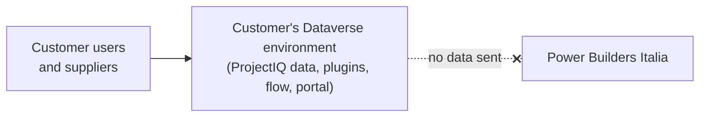

# ProjectIQ privacy statement

*Last updated: 28 October 2026.*

This statement explains how **ProjectIQ**, published by **Power Builders Italia** (the "publisher"), handles personal data. It applies to the ProjectIQ solutions installed from Microsoft AppSource or from this repository.

## ProjectIQ runs in your environment

ProjectIQ is a set of Microsoft Power Platform solutions (a model-driven app, Dataverse tables, plugins, PCF controls, a Power Automate flow and an optional Power Pages supplier portal). Once installed, it runs **entirely inside the customer's Microsoft Dataverse environment**, in the customer's Microsoft tenant.

- The plugins and the PCF controls only call the Dataverse API of the same environment; ProjectIQ contains **no call to services of the publisher or of third parties**.
- The publisher has **no access** to the customer's environment and **does not receive, store or process** any customer data or personal data entered in ProjectIQ (projects, resources, timesheets, suppliers, portal users).
- ProjectIQ does not include telemetry, analytics or tracking.

## Who is the controller

The customer is the controller of the data stored in its environment. Data is processed by Microsoft as the customer's processor under the customer's agreements with Microsoft (see the [Microsoft Privacy Statement](https://privacy.microsoft.com/privacystatement) and the [Microsoft Products and Services Data Protection Addendum](https://www.microsoft.com/licensing/docs/view/Microsoft-Products-and-Services-Data-Protection-Addendum-DPA)). Retention, auditing, access rights and deletion are managed by the customer with the standard Dataverse and Power Platform tools.

## Microsoft AppSource

When a customer gets ProjectIQ on Microsoft AppSource, Microsoft may share the customer's contact details with the publisher as a lead, as described in the Microsoft AppSource terms. The publisher uses these details only to answer the customer about ProjectIQ and does not sell or share them.

## Support requests

If you contact the publisher for support (e-mail or GitHub issues), the publisher uses the information you send only to answer the request. Do not include personal data or business data in public GitHub issues.

## Website

The documentation website is hosted on GitHub Pages; GitHub may log technical data of the visits as described in the [GitHub Privacy Statement](https://docs.github.com/site-policy/privacy-policies/github-general-privacy-statement). The publisher does not add cookies or analytics to the website.

## Contact

Power Builders Italia — privacy questions: open an issue at <https://github.com/Power-Builders-Italia/ProjectIQ/issues> or write to the contact address published on the AppSource listing.
