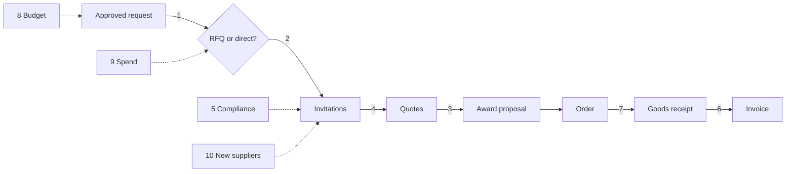
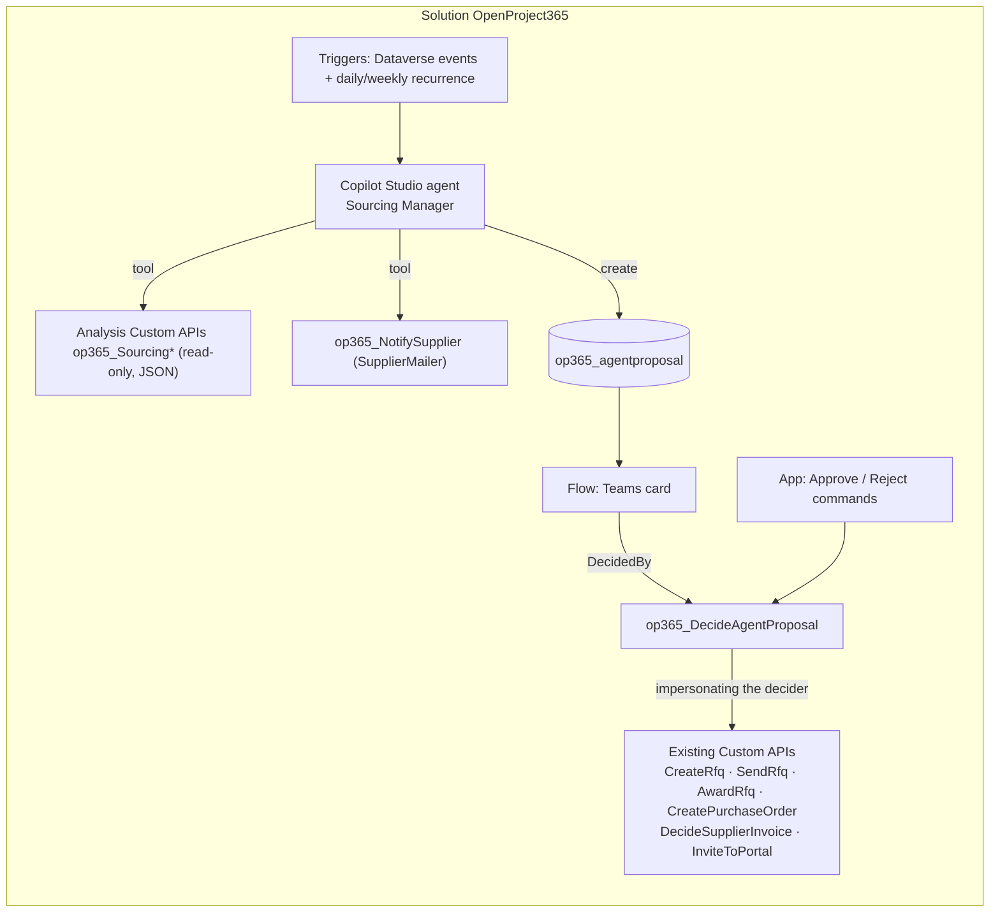
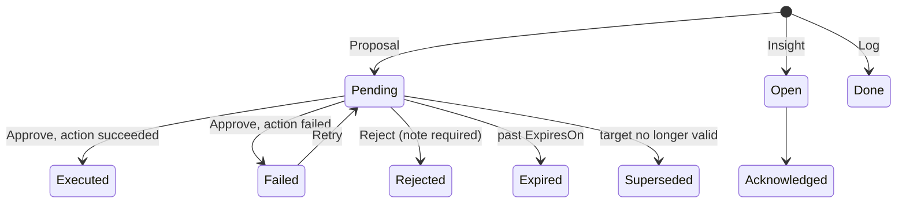
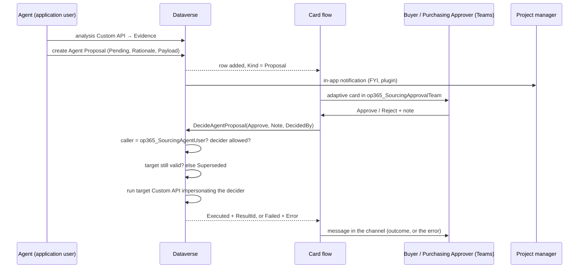
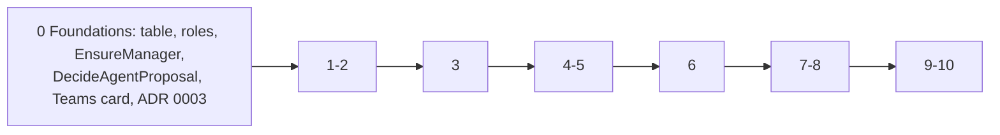

# Sourcing agent — design

- Status: foundations built (2026-11-03); this document matches what was built in the foundations pull request
- Scope: an autonomous **Copilot Studio** agent that works as a Sourcing Manager on ProjectIQ purchasing data, from the approved purchase request to the supplier invoice.

## 1. Goal and decisions

The buyer stops opening RFQs and invoices "just to check": the agent prepares every sourcing decision with numbers and a reason, does the routine supplier follow-ups on its own, and keeps a log of what it did.

| # | Decision |
|---|---|
| D1 | Ten tasks, same priority, delivered in pipeline order (section 2) |
| D2 | Platform: Copilot Studio, autonomous agent with Dataverse event triggers and recurrences |
| D3 | Writes only through **proposals**: the agent prepares, a person approves, then the existing Custom API runs |
| D4 | Proposals are rows of a new table `op365_agentproposal`, decided from a Teams adaptive card or from the app |
| D5 | Supplier messages go through the existing `SupplierMailer` (queue `op365_SupplierEmailSender`, templates by supplier language) |
| D6 | Purchasing proposals are decided by the new role **OP365 Buyer**; invoice proposals by the **Purchasing Approver** (segregation of duties); the project manager is informed |
| D7 | Approach "hybrid": every number comes from deterministic, unit-tested Custom APIs in C#; the LLM chooses what to do and explains why |
| D8 | Everything (table, Custom APIs, roles, environment variables, the agent and its flows) lives in the single solution `OpenProject365`; the agent is off by default |

A new ADR `docs/adr/0003-sourcing-agent-proposals.md` records D3, D4 and the trust rule of section 5. ADR 0001 (Copilot and Cowork read-only) stays valid for Copilot and Cowork.

## 2. Tasks

🟢 = the agent acts on its own (reads, analyses, notifications) · 🟡 = the agent creates a proposal, a person decides.

| # | Task | Mode | Analysis Custom API | Outcome |
|---|---|---|---|---|
| 1 | Route an approved purchase request: RFQ or direct order | 🟡 | `op365_SourcingRouteRequest` | Proposal *Source via RFQ* or *Direct Order* |
| 2 | Choose the suppliers to invite (rating, valid documents, lead time, price history) | 🟢 inside 1 | `op365_SourcingSuggestSuppliers` | Invitation list in the payload of task 1 |
| 3 | Analyse the quotes (price, delivery, risk) and recommend the award | 🟡 | `op365_SourcingCompareQuotes` | Proposal *Award RFQ* |
| 4 | Remind suppliers who have not answered an RFQ | 🟢 | `op365_SourcingLateItems` | E-mail *RFQ Reminder* + Log |
| 5 | Supplier compliance: expiring or expired documents of suppliers with open RFQs or orders | 🟢 | `op365_SourcingLateItems` | Insight to the buyer; non-compliant suppliers excluded by task 2 |
| 6 | Three-way match invoice / order / goods receipt | 🟡 | `op365_SourcingMatchInvoice` | Proposal *Approve Invoice* or *Reject Invoice* |
| 7 | Late orders: confirmed, not received beyond the lead time, impact on the critical path | 🟢 | `op365_SourcingLateItems` | E-mail *Order Delay* + Insight to the PM when the WBS node is critical |
| 8 | Project budget: remaining WBS budget (budget − actual − committed) | 🟢 | `op365_SourcingBudgetCheck` | Insight *Budget Alert* to the PM |
| 9 | Spend analysis: fragmented purchases of the same item or supplier across projects | 🟢 | `op365_SourcingSpendInsights` | Insight *Consolidation* |
| 10 | Supplier scouting and onboarding: categories with one supplier, new suppliers not on the portal | 🟡 | `op365_SourcingCategoryCoverage` | Insight *New Supplier Needed*, proposal *Invite Supplier* |

## 3. Architecture

| Topic | Decision |
|---|---|
| Agent identity | Application user **ProjectIQ Sourcing Agent** with role *OP365 Sourcing Agent*: reads, creates proposals, notifies suppliers; never writes business tables, never decides |
| No drafts | The agent does not create draft RFQs or orders. On approval `DecideAgentProposal` runs the whole chain (e.g. `CreateRfq` → apply the invitation list of the payload → `SendRfq`), so a rejected proposal leaves nothing behind |
| Execution | `DecideAgentProposal` checks the decider, then calls the target Custom API with `IOrganizationServiceFactory.CreateOrganizationService(deciderId)`: status rules, `EnsureManager`, `IsSecondLevelApprover` and auditing apply to the person who approved |
| Failure | A failing inner action throws and rolls back the **whole** `DecideAgentProposal` call, so the proposal cannot be marked Failed by the call itself and stays Pending. The caller (card flow, app command) records the failure with `op365_RecordProposalError`: Pending → Failed with the message; Retry returns it to Pending |
| Idempotency | One open proposal per `DedupKey` (`table:id:action`), enforced by plugin |
| Calculation errors | An analysis Custom API that fails produces a Log row with the error and no proposal; the agent never falls back to computing numbers itself |

## 4. Data model

### Table `op365_agentproposal` (Agent Proposal)

User-owned, notes and auditing on. Parental relationship from Project (cascade share), so project access-team members see the proposals of their projects.

| Column | Type | Notes |
|---|---|---|
| Name | Text | Generated, e.g. "Award RFQ-000123 → Rossi Srl" |
| Kind | Choice | Proposal, Insight, Log |
| ActionType | Choice | See below |
| ProjectId, PurchaseRequestId, RfqId, InvitationId, PurchaseOrderId, SupplierInvoiceId, SupplierId | Lookups | Typed lookups instead of a polymorphic regarding: filtered views and subgrids on the existing forms |
| Rationale | Multiline text | Explanation written by the agent |
| Evidence | Multiline text (JSON) | Output of the analysis Custom API; column-secured (*OP365 Cost Visibility*) |
| Payload | Multiline text (JSON) | Inputs of the action (e.g. suppliers to invite, winning invitation, rejection note) |
| Amount, EstimatedSaving | Currency | Sorting and dashboard |
| DedupKey | Text | `table:id:action` |
| ExpiresOn | Date | CreatedOn + `op365_SourcingProposalExpiryDays` |
| DecidedById, DecidedOn, DecisionNote | Lookup, date, text | Set by `DecideAgentProposal` |
| ResultId, Error | Text | Record created by the action, or the error message |

Rationale, Evidence, Payload, Kind, ActionType and the lookups cannot change after create; the status changes only through the Custom APIs.

### Action types (choice values from 365000000)

| ActionType | Kind | Tasks | Runs on approval | Decided by |
|---|---|---|---|---|
| Source via RFQ | Proposal | 1-2 | `CreateRfq`, invitation list of the payload, `SendRfq` | Buyer, PM, admin |
| Direct Order | Proposal | 1 | `CreatePurchaseOrder` | Buyer, PM, admin |
| Award RFQ | Proposal | 3 | `AwardRfq(InvitationId)` | Buyer, PM, admin |
| Approve Invoice / Reject Invoice | Proposal | 6 | `DecideSupplierInvoice` | Purchasing Approver, admin |
| Invite Supplier | Proposal | 10 | `InviteToPortal` | Buyer, admin |
| Supplier Reminder | Log | 4, 7 | – (e-mail already sent) | – |
| Compliance Alert, Budget Alert, Late Delivery, Consolidation, New Supplier Needed | Insight | 5, 7, 8, 9, 10 | – | – |

### Life cycle

Active: Pending, Open, Failed. Inactive: Executed, Rejected, Expired, Superseded, Acknowledged, Done. Rejection notes are the feedback used to tune the agent instructions.

### Environment variables (all in `OpenProject365`)

| Schema name | Type | Default | Read by |
|---|---|---|---|
| `op365_SourcingAgentEnabled` | Yes/No | no | Agent triggers (stop at once when no); open proposals stay decidable |
| `op365_SourcingAgentUser` | Text (application user name) | – | `DecideAgentProposal`: the only caller trusted to pass `DecidedBy` |
| `op365_SourcingApprovalTeam` | Text (Teams team and channel) | – | Teams card flow |
| `op365_SourcingDirectOrderLimit` | Number | – | `SourcingRouteRequest`: below it, propose a direct order |
| `op365_SourcingMinQuotes` | Number | 3 | `SourcingSuggestSuppliers` |
| `op365_SourcingReminderDays` | Number | 2 | `SourcingLateItems`: days before the RFQ deadline |
| `op365_SourcingBudgetWarningPct` | Number | 90 | `SourcingBudgetCheck` |
| `op365_SourcingProposalExpiryDays` | Number | 5 | Proposal create, `ExpireAgentProposals` |

### New Custom APIs

| Custom API | Binding | Does |
|---|---|---|
| `op365_SourcingRouteRequest` | Purchase request | Recommended route, suppliers to invite, budget check (JSON) |
| `op365_SourcingSuggestSuppliers` | Purchase request | Ranked suppliers with reasons; excludes blocked and non-compliant suppliers |
| `op365_SourcingCompareQuotes` | RFQ | Same rule as the `QuoteComparison` control: best price per line, best total, delivery, coverage |
| `op365_SourcingMatchInvoice` | Supplier invoice | Price and quantity differences against order lines and goods receipts, reusing `InvoiceLogic` |
| `op365_SourcingLateItems` | Unbound | RFQ invitations to remind, late orders (with critical-path flag), compliance issues of active suppliers |
| `op365_SourcingBudgetCheck` | Project or WBS node | Budget, actual, committed, remaining, % used per WBS node |
| `op365_SourcingSpendInsights` | Unbound | Fragmented purchases by item, supplier and category over a period |
| `op365_SourcingCategoryCoverage` | Unbound | Categories with fewer active, compliant suppliers than `op365_SourcingMinQuotes` |
| `op365_NotifySupplier` | Account | Sends a supplier template (RFQ Reminder, Order Delay, Portal Invitation) regarding a record; output Sent |
| `op365_DecideAgentProposal` | Agent proposal | Inputs Approve, Note, DecidedBy (optional); outputs Status, ResultId |
| `op365_RetryAgentProposal` | Agent proposal | Failed → Pending |
| `op365_RecordProposalError` | Unbound (ProposalId, Error) | Marks a proposal **Failed** with the error after an approved action failed. Allowed to the agent user and to whoever can decide the proposal (admins included) |
| `op365_ExpireAgentProposals` | Unbound | Pending past ExpiresOn → Expired; output Count |

Analysis Custom APIs return spend and quote prices only when the caller has the *OP365 Cost Visibility* profile; they never return IBAN or hourly costs.

## 5. Triggers and flows

| Trigger | Tasks |
|---|---|
| Event: purchase request → Approved | 1, 2, 8 |
| Event: RFQ invitation → Responded or Declined, when every invitation has answered | 3 |
| Event: supplier invoice → To Review (reading completed) | 6 |
| Event: new supplier account not on the portal | 10 |
| Daily 07:00 (after *Daily document expiry* at 06:00) | 3 (sent RFQs past the deadline), 4, 5, 7, 8 |
| Weekly, Monday | 9, 10 |
| Daily 06:30 flow (deterministic, no agent) | `op365_ExpireAgentProposals` |

If `DecideAgentProposal` fails after an Approve, the flow calls `op365_RecordProposalError` (the proposal becomes Failed) and posts the error in the channel. A Reject without a note is refused by the API and is not recorded: the proposal stays Pending.

The in-app notification (FYI) to the project managers is sent by the plugin `AgentProposalNotify` when the proposal is created, not by the flow.

Deciding from the app calls `DecideAgentProposal` directly with the person as caller; a later click on the Teams card gets "This proposal has already been decided."

## 6. Security

| Role | Privileges |
|---|---|
| **OP365 Buyer** (new) | Organization Read on Project and its child tables; Organization full access on purchase requests, RFQs, invitations, quotes, orders, goods receipts, supplier accounts and contacts; supplier invoices Read and Append To; Agent Proposal Organization Read and Write. Additive to Basic User; assign *OP365 Cost Visibility* |
| **OP365 Sourcing Agent** (new, application user only) | Organization Read on master data, project and purchasing tables; Create on Agent Proposal; Read and Append To on the lookup targets of the proposal (project, purchase request, RFQ, invitation, order, supplier invoice, account), needed to set the lookups; *OP365 Cost Visibility* (needed for spend analysis) |
| OP365 User | Agent Proposal at User level: sees the proposals of their projects through the access team (parental relationship) |
| OP365 Administrator | Full access |

Code changes:

| Where | Change |
|---|---|
| `Purchasing.EnsureManager` | Admin, project manager **or OP365 Buyer** (`Rules.IsBuyer`) |
| `DecideSupplierInvoice` | None: invoices stay with the Purchasing Approver or an administrator |
| `DecideAgentProposal` | `DecidedBy` accepted only when the caller is `op365_SourcingAgentUser` (checked before the user name is looked up); the decider must be allowed for the action type; then impersonation. Acknowledging an insight requires admin, buyer or project manager of the project. Source via RFQ / Direct Order proposals become Superseded also when the purchase request already has a non-cancelled RFQ or purchase order |
| Agent Proposal | Not exposed on the supplier portal (no table permission) |

## 7. ALM and tests

| Component | Source of truth | How it reaches Dev |
|---|---|---|
| Pure rules (routing, supplier score, quote comparison, three-way match, late items, budget, consolidation) | `src/plugins/OpenProject365.Plugins/SourcingLogic.cs` | Plugin build |
| Analysis Custom APIs | `SourcingAnalysis.cs` | `plugins.py` / `deploy-dev` |
| Proposal APIs and plugins, `NotifySupplier` | `Sourcing.cs` | `plugins.py` / `deploy-dev` |
| Table, choices, environment variables, roles, Custom API definitions, form, views, commands | `tools/dataverse/sourcing_agent.py` (idempotent) | Script, then export |
| Supplier templates | `tools/dataverse/supplier_email_templates.py` | Script |
| Card and expiry flows | `tools/dataverse/flows.py`, `flow_definitions.py` | Script |
| Agent (instructions, triggers, tools) | Copilot Studio components of the solution | Maker portal in Dev, then `export-dev` and pull request |
| Translations | `tools/dataverse/translations.json` | `translations.py` |

Deployment: connection references (Dataverse, Teams) and the new variable values in `deployment/*.settings.json`. Manual steps, documented in Administration: create the application user and assign its roles, assign OP365 Buyer, publish the agent and bind its triggers to the application user's connection. In the AppSource package the agent ships disabled.

| Level | What | Where |
|---|---|---|
| Unit | Every rule of `SourcingLogic.cs`; `DecideAgentProposal` cases: untrusted caller, decider without role, already decided, superseded target, reject without note | `OpenProject365.Plugins.Tests`, CI |
| Smoke | `tools/dataverse/sourcing_smoke.py`: seed data → analysis APIs → manual proposal → Approve → RFQ / order created | Dev |
| Agent | Copilot Studio evaluation set: at least 3 scenarios per task (normal, edge, missing data); checks the action type and that the rationale quotes the evidence | Dev, before `deploy-test` |
| Acceptance | One full cycle request → payment with a real buyer | Test |

Delivery order, one pull request each, manuals included:

## 8. Documentation

| File | Change |
|---|---|
| `docs/{en,it,fr,de}/sourcing-agent.md` (new) | What the agent does, who does what, proposals and life cycle, deciding from Teams and from the app, insights and log, what suppliers receive, views, messages |
| `docs/*/purchasing.md` | OP365 Buyer in "Who does what"; links to the agent from RFQs and invoices |
| `docs/*/administration.md` | Roles, the new company settings, first-setup checklist, licences (Copilot Studio), background automations |
| `docs/*/supplier-portal.md` | The new reminder, delay and invitation e-mails |
| `docs/*/copilot.md` | Copilot/Cowork (read-only) versus the agent (writes through proposals) |
| `README.md`, `mkdocs.yml` | Row in "User manuals", menu entry in four languages |
| `docs/data-model.md`, `docs/dev-environment.md` | Table, Custom APIs, security; agent ALM |
| `docs/adr/0003-sourcing-agent-proposals.md` | The decision record |

`python3 tools/docs/check_docs.py` must report 0 errors in every pull request.

## Out of scope

Autonomous execution without approval, thresholds for autonomy, free-text e-mails written by the LLM, negotiation with suppliers, external supplier databases for scouting, exposure of proposals on the supplier portal.
